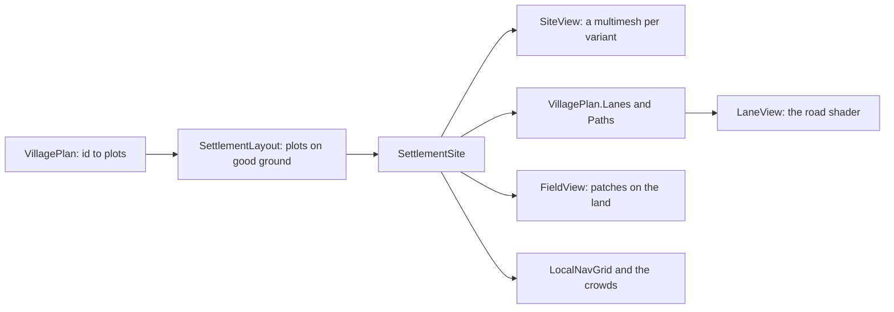
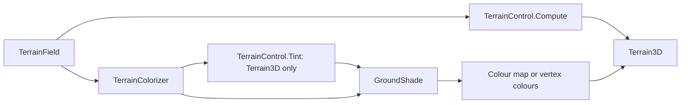

# Milestone 15, part 55 — The land's breadth, living water, and villages of lanes

## Overview

The owner asked whether Unreal would look much better; captures showed that the limit was the art,
not the engine, and they said to do the art pass. They also found a bridge in mid-air. The decisions
are in [ADR-077](../docs/ADR/ADR-077-land-water-and-villages.md), which amends ADR-008, ADR-022,
ADR-051, ADR-052 and ADR-054.

- **Ground:** the land's broad light and colour over the colour map; wandering, soft borders; second
  grounds in patches; a calmer palette.
- **Light:** a low side sun, AgX, sky light, haze and SMAA.
- **Water:** ripples, shore waves and foam; rivers that flow; banks that fade.
- **Bridges:** bank top to bank top, arched, shared by roads, walked on.
- **Villages:** a plan of lanes along the ways roads leave a region, four variants of each house
  style, each house its own colours, weathering, fields laid on the land and flower beds.

## Architecture

| Project | Changes |
| --- | --- |
| `Pantheon.Game` | • `Presentation/GroundShade`, `GroundSettings` (`Shade`, `Patches`, borders) • `TerrainControl`: warp, rings, fray • `VillagePlan`, `SettlementLayout`, `HutPlacement.Variant` • `BridgeLayout` and `BridgeSpan`, out of `Wildlife` • `HouseMesh` variants, `MeshBuilder` `Roof`, `Hip` and `Beam` • `VillageArchitecture.ColorsOf`, `FlowerBedMesh` • `RoadLayout.Strip`, `WaterSurfaceMesh.FlowAt` • `SettlementCrowd`: walkers stand on decks • `GameSettings.SmoothEdges` |
| client | • `Water/WaterTextures`, `water.gdshader`, `fresh_water.gdshader` • `Settlements/LaneView`, `FieldView`, `field.gdshader` • `Land/RoadMesh`, `RoadPresenter` (shared crossings) • `building.gdshader` weathering • `Main.tscn` light, `SettingsApplier` SMAA, the settings page's Smooth edges |
| content | • `biome_palette.json`: `Ground` palette, borders, `Patches` and `Shade` • `settlement_view.json`: the plan's sizes, `HouseMix` and `MotifShare` |

## Tasks

- [x] `GroundShade`, wandering borders, patches, palette
- [x] Light, SMAA and its setting; measure SSIL, SSAO, FXAA, TAA and MSAA
- [x] Ripples, sea, rivers with flow, fading banks
- [x] Bridges from bank to bank; shared crossings; walkers on decks
- [x] `VillagePlan`, lanes, paths and green
- [x] House variants, colours, weathering
- [x] Fields on the land; flower beds
- [x] Tests, ADR-077, docs

## Test plan

- Tests: `VillagePlanTests`, `GroundTests`, `WildlifeTests`, `ArchitectureTests`, `SettlementLayoutTests`,
  `WaterPresentationTests` and `GameSettingsTests`.
- Captures at seed 1234, tick 9000, on Terrain3D and the fallback renderer, near, wide and high, and
  villages 4, 6 and 8.
- Frame times against the previous commit, built in a separate worktree, uncapped, alternating builds.

## Results

1948 tests pass (27 new). Uncapped at 2720x1530 on the M3 Pro, before and after: near 17.2 → 19.0 ms,
wide 21.7 → 21.0 and high 17.8 → 18.6, plus 1.1 ms for SMAA. Bridges over seed 1234 stood up to 5.9 m
above the road at an end; they now meet it, and each crossing has one.
