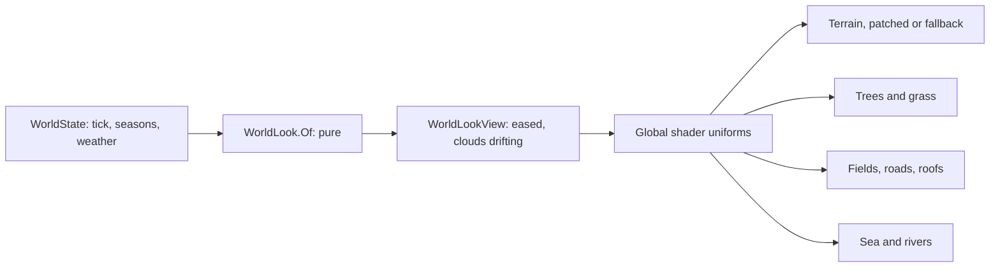

# Milestone 15, part 56 — A world that turns with the year and the weather

## Overview

The owner: "Let's raise the bar of realism and art, the entire visualization, but keep the
performance." The decisions are in
[ADR-078](../docs/ADR/ADR-078-a-world-that-turns-with-the-year.md), which amends ADR-051, ADR-052 and
ADR-077.

- **The budget:** ambient occlusion goes, for 4.5 ms of a near frame and almost no visible loss.
- **The seasons and the weather show:** one shared look reaches the ground, trees, grass, fields, roofs
  and water.
- **Clouds' shadows** drift over the land; storms cool the light and thicken the haze.
- **Details:** fire, a carved shrine, ground grain, the roads' dirt, low haze.
- **A bug found on the way:** on the Compatibility renderer no house was drawn.

## Architecture

| Project | Changes |
| --- | --- |
| `Pantheon.Game` | • `Presentation/WorldLook` • `Terrain3DShaderPatch.WithLook` • `CivicMesh.Shrine` • `GroundShade`'s grain • `Diagnostics/WeatherReadout.DescribeLook` |
| client | • `Weather/WorldLookView`, `LookTextures` • `world_look.gdshaderinc`, read by the terrain, plant, road, field, building and water shaders • `terrain_fallback.gdshader` • `ConstructionSiteView`: its own material • `FireView`, `ForestPresenter`, `Main.tscn` |
| content | • `project.godot`: the look's three global uniforms • `weather_view.json`: cloud cover and drift, storm light and haze • `biome_palette.json`: the grain |

## Tasks

- [x] Measure ambient occlusion and its quality levels, and remove it
- [x] The look: pure model, F1 line, global uniforms, include, every shader of the land
- [x] Terrain3D patch and the fallback's shader
- [x] Trees turning and bare, fields, grass, flowers, roofs
- [x] Clouds' shadows; storm light and haze
- [x] Fire, shrine, grain, road detail, low haze
- [x] Skip SMAA on the Compatibility renderer; fix its missing houses
- [x] Tests, ADR-078, docs

## Test plan

- Tests: `WorldLookTests`, `Terrain3DShaderPatchTests`, `ArchitectureTests`.
- Captures of every season and a storm, fire, forests in autumn and winter, the fallback and the
  Compatibility renderer.
- Frame times against the build before part 55, in a separate worktree, uncapped, alternating builds,
  outliers from undrawn windows set aside.

## Results

1960 tests pass (12 new). Uncapped at 2720x1530 on the M3 Pro, before part 55 and after this part:
close 15.6 → 13.4 ms, near 17.2 → 15.7, wide 21.9 → 17.5 and high 17.8 → 16.0.

Left for later: the Compatibility renderer still overflows its instance uniforms on plants (it logs
errors, as it always did), and its colours are less faithful than Forward+'s.
