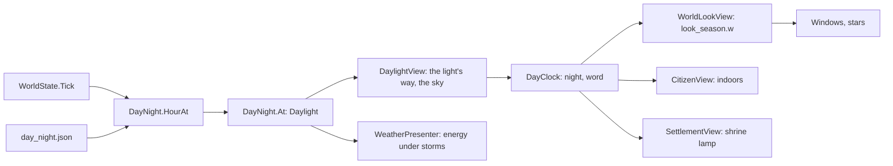

# Milestone 15, part 57 — Day and night, the sky, and figures with some life

## Overview

The owner: "continue, the rest of things; and we need to add day and night." The specification does not
mention day and night. The decisions are in [ADR-079](../docs/ADR/ADR-079-day-and-night.md), which
amends ADR-055 and ADR-077.

- **Day and night:** the hour follows from the world's clock; one light plays sun and moon.
- **The sky:** a gradient the hour sets, sun and moon, stars and high cloud.
- **Night in the villages:** lit windows, shrine lamps, people indoors.
- **Figures and miracles:** better bodies, fur, and light with threads running through it.

## Architecture

| Project | Changes |
| --- | --- |
| `Pantheon.Game` | • `Presentation/DayNight`, `DayNightSettings`, `PresentationContent` • `PersonMesh`, `AnimalPaint` • `WeatherReadout.DescribeDay`, `KeyGuide`, `LaunchOptions.Day` • `GameSettings.DayAndNight` |
| client | • `DayClock`, `Weather/DaylightView`, `sky.gdshader` • `WeatherPresenter`, `WorldLookView`, `CloudView` • `building.gdshader` windows, `SettlementView` lamp, `CitizenView` indoors • `person.gdshader`, `Creatures/FurTexture`, `miracle_glow.gdshader` • `TimeControls`, `SettingsPage`, `NatureDebug` |
| content | • `day_night.json` • `project.godot`: `debug_hours` on `\` |

## Tasks

- [x] `DayNight`, `DayNightSettings`, `day_night.json`, tests
- [x] One light for sun and moon; the weather composes over it
- [x] The sky shader
- [x] Windows, shrine lamps, people indoors, clouds dimmed
- [x] Setting, debug key, `--hour`, F1 line, the calendar's word
- [x] People, Creatures' coats, miracle light
- [x] Measure, ADR-079, docs

## Test plan

- Tests: `DayNightTests`, `GameSettingsTests`, `PeopleTests`.
- Captures at dawn, noon, dusk and night, in winter, on both terrain renderers and Compatibility.
- Frame times by day and at night, and on the stress world, against the build before part 55.

## Results

1978 tests pass (18 new). Uncapped at 2720x1530 on the M3 Pro, before part 55 and now, at noon with the
sun moving: close 15.6 → 15.6 ms, near 17.2 → 16.7, wide 21.9 → 19.4 and high 17.8 → 16.4; night costs
the same or less. The stress world (50 villages, 7000 people) went from 21.7 to 19.5 ms.

Remember that a tick is an hour now: tick 9000 is 3 in the morning, so measure and capture with `--hour`.
