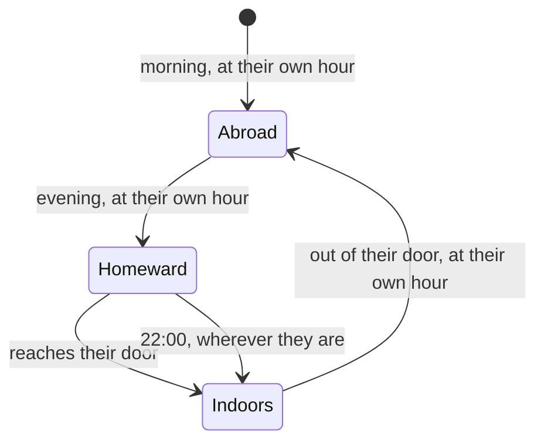

# Milestone 15, part 58 — People go home at night, and the small hours of a village

## Overview

The owner: "Let's make night more realistic, so people return home and not stay outside, and maybe other
things we can do." The decisions are in
[ADR-080](../docs/ADR/ADR-080-people-go-home-at-night.md), which amends ADR-079.

- **People go home:** each at their own hour, along the village's ways, in at their own door.
- **The small hours:** lamps go out, hearths smoke at breakfast and supper, mist at dawn, birds roost,
  fireflies on warm nights.
- **Sound:** crickets and birdsong, made in code.

## Architecture

| Project | Changes |
| --- | --- |
| `Pantheon.Game` | • `Population/CitizenEvening`, `SettlementCrowd`, `CitizenPose.Indoors`, `CrowdStatus.Indoors` • `LocalNavGrid.Route` • `DayNightSettings`: the hours, the keys' `Lamps`, `Hearths`, `Mist` and `Birds` • `HouseMesh.SmokeHeight` • `Audio`: `Crickets`, `Birdsong`, `SmallCreatures` |
| client | • `Settlements/HearthView`, `Weather/FireflyView` • `DayClock`, `WeatherPresenter`, `WorldLookView`, `WildlifePresenter`, `AudioPresenter`, `CitizenView` • `building.gdshader`: windows read `look_day` |
| content | • `day_night.json` • `project.godot`: the `look_day` global |

## Tasks

- [x] `CitizenEvening`, walking home along the ways, tests
- [x] Hurrying when the game runs fast; villages first seen at night
- [x] Lamps, hearths, mist, roosting birds, fireflies
- [x] Crickets and birdsong
- [x] F1's count of who is indoors
- [x] Measure, ADR-080, docs, website, screenshots

## Test plan

- Tests: `CitizenEveningTests`, `DayNightTests`, `AudioTests`.
- Captures of the walk home, the small hours, dawn, breakfast smoke and a summer night.
- Frame times with the clock running, at noon, evening and night, and on the stress world going home.

## Results

2000 tests pass. Uncapped at 2720x1530 on the M3 Pro, before part 55 and now, at noon, in the evening and
at night: close 15.6 → 15.6, 15.5, 15.3 ms; near 17.2 → 16.8, 17.4, 16.5; wide 21.9 → 19.4, 18.9, 17.0;
high 17.8 → 16.6, 16.3, 16.0. The stress world, 50 villages going home, ran at 18.4 ms, against 21.7.

The tuning found that a late leaver needs 3 hours of the day to reach home at a brisk walk, and that
smoke seen from above needs wind to be seen at all. Crickets and birdsong were not heard, only tested.
