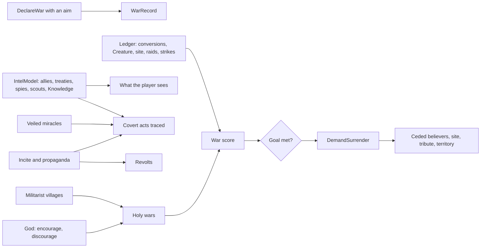

# Milestone 15, part 6 — War goals, intelligence, proxy wars and holy wars

## Overview

Part 6 completes §43–46: wars fought for something and ended on terms, gods who know only what
their spies, allies and Creatures tell them, gods who work in secret through mortals, and mortals
who go to holy war of their own will. The decisions are in
[ADR-026](../docs/ADR/ADR-026-war-goals-intelligence-proxy-wars-and-holy-wars.md).

What the player gets:

- **War goals (§44):** declare war for conquest, a holy site, tribute or to humble a rival's
  Creature.
  - Wins score: conversions, a defeated Creature and a taken site most; strikes on mortals least.
  - Win your goal and demand surrender: believers ceded, the site handed over, tribute paid or
    the loser kept out.
  - A defender that repels the attack exacts tribute.
- **Intelligence (§43):** you know a rival's following, power and plans only through allies,
  treaties, your own followers among its people, your Creature's visits and the Knowledge domain.
  Spies speed secret treaties to light and trace covert acts.
- **Proxy wars (§45):**
  - Veil a miracle (T): dearer, and nobody knows it was you. A veiled strike makes the people doubt
    their own god.
  - From the Settlements panel, incite rebels or spread propaganda against the god that leads a
    village.
  - The wronged god may trace any of these.
- **Mortal holy wars (§46):** militarist villages attack neighbours of another faith of their own
  will, killing and converting. Their god may urge them on or hold them back, which costs their
  love.

## Architecture

| Project | Changes |
| --- | --- |
| `Pantheon.Domain` | Conflict state and rules: • `Conflict/` (`WarGoal`, `WarAim`, `WarRecord`, `HolyWarState`, `HolyWarStance`, `ProxyKind`, `ProxyCommand`, `ConflictRules`) • `DiplomacyState.Wars`, `SocietyState.HolyWar` and `HolyWarEndedTick` • `DiplomacyRules.Conflict` • `CastMiracleRequest.Veiled`, `MiracleCast.Veiled` • `DiplomaticCommand.Aim`, `DemandSurrender`, `ProposalKind.Surrender` • acts `HolyWar`, `CovertAct` and `Dictated`  Events and history: • events `WarGoalAchieved`, `PeaceDictated`, `CovertActExposed`, `ProxyActed`, `HolyWarDeclared` and `HolyWarEnded` • history kinds `HolyWar`, `DictatedPeace` and `Exposure` |
| `Pantheon.Simulation` | Conflict: • `Conflict/` (`IntelModel`, `WarBook`, `WarAims`, `Covert`, `Veil`, `ConflictAuthority`, `HolyWarSystem`) • `Gods/CovertAdvisor`  Hooks: • war records, surrender and dictated peace in the diplomacy authority and `PoliticsActions` • war scores in the ledger • goals announced and wars pruned in the politics step, and leaks sped by intelligence • veiled casting in `MiracleCaster` • the AI's aims, surrender demands and answers, and veiled strikes |
| `Pantheon.Persistence` | Save version 18, `PoliticsSaveMigration.UpgradeFrom17` and `ConflictIntegrity`. |
| `Pantheon.Networking` | `CastIntent.Veiled`, `ProxyIntent`, `HolyWarIntent`; protocol version 6. |
| `Pantheon.Game` | Text, readouts and commands: • `Conflict/` (`ConflictText`, `ConflictCommands`, `SettlementConflict`) • `Alerts/ConflictAlerts` • `Diagnostics/ConflictReadout`  The panels and HUD: • the diplomacy entry's war, intelligence and war aims • the settlements panel's holy wars and actions • the HUD's blurred rivals and veil hint  Other: • `GameSession.Veiled` (the previews moved to `SessionPreviews`) • `SecretFilter` hides proxy acts and veiled casters • `--war-goal`, `--holy-war`, `--veil` |
| Godot client | T toggles veiling (`PoliticsController`); the diplomacy and settlements panels show the new lines and buttons. |
| Content | `Conflict` in `diplomacy.json`. |

## Test plan

- **Wars (`WarTests`):**
  - Declarations record their aim, and a site war without a site is a conquest.
  - Acts score: conversions most, strikes least.
  - A met goal lets the victor demand surrender, and a conquest cedes believers.
  - Each goal's terms.
  - A defender exacts tribute.
  - AI aims and surrender answers.
- **Intelligence and covert acts (`CovertTests`):**
  - Intelligence from spies, scouts, allies and learning, and how it blurs a following.
  - A veiled strike is dearer and unattributed, and plants doubt in the victims' own god.
  - A traced strike is remembered and exposed.
  - Proxy acts' effects, cost and rest.
  - Their checks.
- **Holy wars (`HolyWarTests`):**
  - A militarist village attacks a neighbour of another faith, killing and converting, and the
    attacked god remembers.
  - Encouragement is fiercer than discouragement, which costs love; only the attackers' god may
    speak.
  - A holy war ends with time, and allies are not attacked.
  - AI stances.
- **Presentation (`ConflictPresentationTests`):**
  - The diplomacy panel's war, intelligence and aims.
  - The settlements panel's holy war and actions.
  - Alerts, including the unknown caster.
  - History.
  - Secrets kept from other players.
  - Launch options.
- **Multiplayer (`ConflictMultiplayerTests`):** a player's proxy act, word to a holy war and
  veiled cast reach the host.
- **Saves (`SaveMigrationV17Tests`):**
  - A save written by part 5's build gains no war records or holy wars.
  - It keeps every other value and keeps playing the same way.
  - Broken wars and holy wars are refused.

### Verification results

- **Build and tests:** `dotnet build` has no warnings. 1040 tests pass (1011 before).
- **Ten one-hour games** (seeds 100–109, a passive player):
  - **Wars:** 31 declared for holy sites, 21 for conquest, 2 for tribute. 7 ended in dictated
    peace (6 tributes from repelled attacks, 1 conquest ceding 186 believers).
  - **Covert acts:** Kaio the Trickster spread propaganda 61 times and incited twice, and veiled
    78 strikes that went untraced; 40 covert acts were traced.
  - **Holy wars:** 5 broke out, killing 386 and converting 383; 3 turned the attacked village.
  - **Tuning:**
    - The first build let covert acts drag games out: 6 of 10 won, median 40 minutes. Without
      veiling, 8 of 10 were won; without proxy acts, 9.
    - Veiled strikes now cost twice as much and plant half the doubt; only the most treacherous
      gods veil, and only against peoples they resent.
    - Proxy acts need deeper enmity, more power to spare and four minutes' rest.
    - Raid casualties are now rounded by chance; they had always rounded down to nothing. Holy
      wars start from militarism 0.35.
- **Balance:** 40 one-hour games with a passive player (seeds 30–69).

  | Build | Games with a winner | Median time | Mean time | Winners |
  | --- | --- | --- | --- | --- |
  | Part 4 | 37 / 40 | 28.1 min | 27.5 min | Seren 22, Vael and Seren 11, Kaio 4 |
  | Part 5 | 37 / 40 | 28.6 min | 31.2 min | Seren 21, Vael and Seren 12, Kaio 4 |
  | Part 6 (this build) | 38 / 40 | 29.0 min | 31.3 min | Seren 15, Vael and Seren 16, Kaio 7 |
- **On the Mac** (seed 42, 10 minutes in, about 120 FPS):
  - **The settlements panel:** Brightwater "Wages holy war on Duskwater for Kaio (left to
    itself)", with "Incite rebels against Kaio (60)" and "Spread propaganda against Kaio (40)".
  - **The HUD:** "Vael the Tyrant: following unknown" and "Kaio the Trickster: about 700
    followers", and "Veiled (T): Lightning on Brightwater: costs 332" on the cast preview.
  - **The diplomacy panel (fallback renderer):** "Your war on Kaio for tribute: 0 to 0 (10 to
    dictate peace)", "You are partly informed of it" and "You are in the dark of it".

## Tasks

### Completed

- [x] Conflict state, rules and events; save version 18 with the migration, the integrity checks
  and the version 17 fixture.
- [x] War records, scores, goals, surrender and dictated peace.
- [x] Intelligence, veiled miracles, proxy acts and their exposure.
- [x] Mortal holy wars and their gods' word.
- [x] The AI's aims, surrender, covert acts and stances, tuned with ablations over ten games.
- [x] Protocol 6, the intents and per-player secrecy.
- [x] Panels, HUD, alerts, history, F1, T and the launch options.
- [x] Tests, probes and captures.

### Future

- Fog of war on the map and overlays, and prophets or divination as intelligence.
- Disguised missionaries beyond veiled conversion miracles.

## Relevant files

- `src/Pantheon.Domain/Conflict/`
- `src/Pantheon.Simulation/Conflict/` and `Gods/CovertAdvisor.cs`
- `src/Pantheon.Game/Conflict/`, `Alerts/ConflictAlerts.cs`, `Diagnostics/ConflictReadout.cs` and
  `SessionPreviews.cs`
- `src/Pantheon.Persistence/ConflictIntegrity.cs`
- `game/Data/diplomacy.json` (`Conflict`)
- Tests: `src/Pantheon.Tests/Conflict/`
