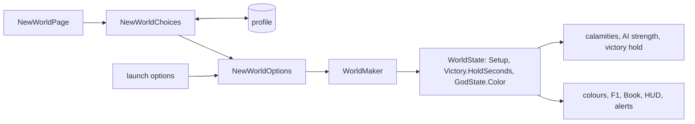

# Milestone 15, part 60 — The New World page's choices

## Overview

The owner asked: "i want the user to be able to control his god name and other settings such as how
many gods in the world". From a proposal they chose two passes, with the number of gods as a choice of
its own. The decisions are in [ADR-082](../docs/ADR/ADR-082-the-new-world-choices.md), which amends
ADR-027 (sizes and victories), ADR-060 (the New World page), ADR-065 (the born pantheon) and ADR-018
(hosting).

- **First pass:**
  - your god's name and your Creature's name;
  - the number of gods, 2 to 8, as far as the island's villages allow;
  - the time a victory is held (§53's configurable duration);
  - the same choices when hosting a shared world.
- **Second pass:**
  - your colour;
  - the rivals' temper (mixed, peaceful, warlike) and strength (weak, even, strong);
  - calamities (gentle, normal, harsh);
  - few or many villages;
  - the page remembers the last choices.

## Architecture

| Project | Changes |
| --- | --- |
| `Pantheon.Domain` | • `WorldSetup` (calamities, rivals, temper, villages) on `WorldState.Setup` • `VictorySettings.HoldSeconds`, `GodState.Color` • `WorldSizes`: `VillagesPerGod`, `PantheonShare`, `FewVillages`, `ManyVillages`, `HoldMinutes`, `Tempers`, `MoreSettlementNames`; `PantheonMaxGods` leaves the presets • `DisasterRules.Calamities` (`CalamityScales`), `GodAiRules.Strengths` (`RivalStrengths`) |
| `Pantheon.Simulation` | • `DisasterModel.CalamityScale` scales every calamity's onset (`DisasterSystem`, `Wildfires`, `HazardSystem`, `LivingHazards`, `GreatEventSystem`, `BeastSystem`) • `GodAi` scales an AI god's patience and jitter • `VictorySystem.TicksToWin(rules, world)`, `HoldSeconds` |
| `Pantheon.Persistence` | Save version 37 (`SetupSaveMigration`), `SetupIntegrity` |
| `Pantheon.Networking` | Protocol version 23 |
| `Pantheon.Game` | • `NewWorldOptions` gains the choices; `WorldChoices` holds the limits; `WorldMaker` (`AtSize` with villages, `PantheonFor` with gods, temper and names, `Settle`: hold, setup, rivals' power, colour) • `PersonaScribe` and `PantheonPrompt` draw from the temper's personalities • `Flow/NewWorldChoices`, the page's choices and the profile's memory of them; `Flow/SetupText`; `VictoryText.Span`; `Guide` counts rivals • `AlertFeed`, `HudReadout` and `WorldPage` tell the world's hold • `DivineViewSettings.GodColor(world, id)`, `GodColorNames`, `IdColor`; `LaunchOptions.Setup` |
| client | • `NewWorldPage` in four tabs, host mode; `MenuScreen` (content, colours, choices, `OpenHostPage`); `MultiplayerPage`'s "Set up a shared world…" • `GameFlow`: the profile's choices, hosting with options • every presenter's colour reads the world (`TerritoryPresenter` among them) |
| content | `world_sizes.json`, `disasters.json` (`Calamities`), `god_ai.json` (`Strengths`), `divine_view.json` (`GodColorNames`) |
| site | `scribes.js` takes the gods, names and temper; the form offers them; the fixture holds 21 such pantheons |

## Tasks

- [x] Save version 36 fixture written by part 58's build before the shape changed
- [x] Domain: setup, hold, colour, the sizes' new choices, calamity scales, rival strengths
- [x] Save version 37: migration, integrity, tests against the version 36 save
- [x] Simulation: calamity onsets, AI patience and jitter, the victory's hold
- [x] `WorldChoices` and `WorldMaker`: gods, villages, names, temper, colour, rivals' power, hold, pantheon share
- [x] Scribes and the model within a temper; the content's gods too
- [x] The hold in words everywhere; the guide counts rivals
- [x] Colours read from the world in every presenter and overlay; `IdColor` for the by-id colour
- [x] The page in four tabs, host mode, remembered choices; Play Together opens it
- [x] Launch options and `--title-page` tabs; F1 setup line; the Book's sentence
- [x] Protocol version 23
- [x] The website's port, fixture, tests and form
- [x] ADR-082, docs
- [x] Seats for seven players, and a spare connection to turn an eighth away with the reason

## Test plan

- `WorldChoiceTests`:
  - the limits by size and villages;
  - names;
  - worlds of 2 to 4 gods, each with a home, a name and an animal;
  - eight gods in order;
  - few and many villages on the shipped island, and the names they need;
  - the player's names, and a rival giving one up;
  - the scribes avoiding the player's names;
  - the colour and its swap;
  - the rivals' power;
  - the tempers, for scribes and plain worlds;
  - a mixed temper writing the old gods;
  - the kept choices;
  - determinism.
- `WorldSetupRuleTests`:
  - the shipped normal and even values;
  - quakes at gentle, normal and harsh;
  - a world made before the choices;
  - AI patience by strength, never the player's;
  - the hold.
- `NewWorldPageTests`:
  - choices to options, and the fallbacks;
  - the profile's JSON;
  - launch options and their warnings;
  - `SetupText`, `VictoryText.Span` and the guide;
  - colour names;
  - the model's question and answer within a temper.
- `SaveMigrationV36Tests`, and every older migration test through version 37. `ContentTests` cases for
  each new content rule.
- The site's 487 tests, against the game's own answers.
- On the Mac:
  - every tab and the host page (`--title-page=new`, `new-god`, `new-rivals`, `new-victory`, `host`);
  - a large world of 8 warlike, strong gods named and coloured from launch options (Terrain3D, F1);
  - a small world of 3 peaceful, weak gods in violet with many villages (the fallback renderer).

## Results

2084 tests pass (2038 before) and the site's 487.

On the M3 Pro:

- **The page:** each tab fits the title screen's panel, and the summary line follows the choices.
- **Terrain3D:**
  - seed 1234, Large, `--gods=8 --god-name=Morwen --creature-name=Pebble --color=3
    --rival-temper=warlike --rival-strength=strong --calamities=harsh --hold=20`;
  - the plaque read Morwen with an Azure bar, the Creature card Pebble, and the race line "60% for
    20:00 wins";
  - F1 listed 8 gods, Warlords and Opportunists among them, and the setup line;
  - the god that wore Azure wore Gold.
- **Fallback renderer:**
  - seed 1234, Small, 3 gods, violet, many villages: 81 FPS (12.4 ms average);
  - the first capture showed the player's border still gold under a violet wash. `TerritoryPresenter`
    passed the by-id colour as a method group. It now reads the world's colours on the main thread,
    and the by-id colour is `IdColor`, so the mistake cannot compile again.

**A shared world** (asked for after the first push), eight Godot processes on the M3 Pro, joining
over the Mac's network address 10.100.102.135 rather than loopback, each with its own scratch profile:

- **The host:** seed 1234, Large, 8 gods, Morwen in Azure, warlike, strong, harsh, a 20-minute hold.
- **Six headless players at once,** one through LAN discovery (`--join=lan`). Each replica printed the
  host's setup line word for word, and the same names, Creatures, personalities and colours
  (`SetupText.RunLines`, added to the end of unattended runs for this).
- **A windowed player** drew Morwen's chip in Azure, Vexion's in Gold, and "60% for 20:00 wins".
- **A bug found:** the host took at most three players (`MaxClients` was 3), right only for four gods.
  It is now 7 ([ADR-083](../docs/ADR/ADR-083-a-seat-for-every-rival-god.md)).
- **Seven seated at once,** then an eighth:
  - before the fix, ENet dropped the eighth silently, and it read "the host did not answer";
  - with one spare connection (`MaxConnections`), it reads "No god is free".
- **Crowding one Mac:** with seven players loading at the same moment, each blocked about 9 s
  building the large world's visuals. On one CPU those stalls ran past ENet's timeout, and the host
  dropped them. Joined one after another, all seven stayed. Separate computers would not share the
  load.
- `MultiplayerSessionTests` seats seven players in an eight-god world, refuses an eighth, and checks
  the replica's setup, hold, names and colours.

Not yet tried:

- two physical computers. No second machine was reachable from this session; every process ran on
  one Mac, over its network address;
- the Settings-like dropdowns at the smallest interface size.

Not part of this change: Godot's warning that `instance_reset_physics_interpolation()` is deprecated,
printed at start-up as before.
