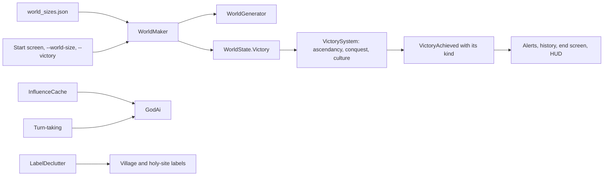

# Milestone 15, part 7 — World sizes, victories and large worlds

## Overview

Part 7 lets a world be made at a size and won in more ways (§6, §53), and keeps large worlds
playable, with a first part of world streaming (§84). The decisions are in
[ADR-027](../docs/ADR/ADR-027-world-sizes-victories-and-large-worlds.md).

What the player gets:

- **World sizes (§6):** Small (2 km, 8 villages, 4 gods), Large (4 km, 20 villages, 6 gods), Huge
  (8 km, 40 villages, 8 gods) and Vast (12 km, 48 villages, 8 gods), with four new rival gods:
  Aurel the Zealot, Maren the Nature Keeper, Thorn the Warlord and Ysolde the Isolationist.
  Larger pantheons may win together: three gods of six, four of eight.
- **Victories (§53):**
  - Divine Ascendancy, as before.
  - Conquest: every rival below 5% of all belief for ten minutes.
  - Culture: lead three villages in four for ten minutes while rivals live on.
  - Every victory, or a sandbox with none.
- **Choosing them:** the start screen offers the size and the victories beside the Creature;
  `--world-size` and `--victory` do the same.
- **Large worlds (§6, §84):**
  - The AI gods cost a seventh of what they did, and take turns.
  - Labels give way to bigger villages, and Creatures' and migrants' to villages.
  - The camera reaches over the whole island, and the fog thins.

## Architecture

| Project | Changes |
| --- | --- |
| `Pantheon.Domain` | Sizes and victories: • `World/WorldSizes` (`WorldSizes`, `WorldSizePreset` with `PantheonMaxGods`), `PantheonSetup.ExtraGods` • `World/VictorySettings` (`VictorySettings` with `PantheonMaxGods`, `VictoryKind`), `WorldState.Victory` • `GodState.ConquestSinceTick` and `CulturalSinceTick` • `DivineRules.ConquestShare` and `CulturalShare`, `VictoryAchieved.Kind` |
| `Pantheon.Simulation` | Victories: • conquest, culture and the sandbox in `VictorySystem` • the world's pantheon size in `VictorySystem.StandingOf` • the kind in the history  The AI's cost: • `Belief/InfluenceCache`, taken by `MiracleCaster.Check` • `GodAi` weighs casts only within its influence • `TreatyAdvisor` counts followers once per weighing • `GodAiSystem.IsTurn`: the AI gods take turns |
| `Pantheon.Persistence` | `world_sizes.json`; save version 19 and `VictorySaveMigration`. |
| `Pantheon.Networking` | Protocol version 7. |
| `Pantheon.Game` | Making worlds: • `WorldMaker` and `NewWorldOptions`, `GameSession.CreateNew` and `StartNewWorld` with options • `SessionCommands.NewWorld` with options, and `Describe`  Presentation: • `Flow/VictoryText`: deeds, reasons, titles, settings and choices • alerts, history, the end screen and the HUD by kind • `Presentation/LabelDeclutter` • `GodCameraModel.MaxDistance` by the island's width • F1's island and victories  Options: • `--world-size` and `--victory` |
| Godot client | The start screen's size and victory choices; `DeclutteredLabel` and `LabelDeclutterer` for village, holy-site, Creature and migrant labels; fog by the island's width; the HUD's rivals wrap. |
| Content | `world_sizes.json`; `ExtraGods` in `gods.json`; `ConquestShare` and `CulturalShare` in `divine_rules.json`. |

## Test plan

- **Victories (`VictoryKindTests`):**
  - Conquest is won when every rival stays below 5%, and shared with allies.
  - Its clock stops when a rival recovers.
  - Culture is won by leading three villages in four while a rival lives on; not without a rival,
    nor by leading too few.
  - The dead and the barely believing are not counted.
  - A sandbox has no winner, though dominance is still tracked.
  - Ascendancy and pantheon victories carry their kind, and the first victory is the only one.
  - A world's size sets how many gods may win together.
- **Sizes (`WorldSizeTests`, `ContentTests`):**
  - The shipped sizes, the first being the content's own world; what a larger size adds.
  - A scaled-down large world is made with its villages, gods, species and victories, the same
    for the same seed.
  - Sizes that cannot be made are refused, in code and in `world_sizes.json`, including a pantheon
    larger than the gods.
  - The camera's reach, the options and the status line.
- **The AI's cost (`AiCostTests`):** the influence cache gives the fields `InfluenceField` builds,
  and casts check alike with it and without; AI gods take turns, each once an interval.
- **Labels (`LabelDeclutterTests`):** labels apart are all shown; a lesser label gives way to its
  name and then altogether; priority, not order, decides.
- **Presentation (`VictoryPresentationTests`):** alerts, history, the end screen, the HUD and the
  choices for each kind.
- **Saves (`SaveMigrationV18Tests`):**
  - A save written by part 6's build is won by ascendancy alone, with no other clocks.
  - It keeps every other value and keeps playing the same way.
  - A version 18 save with victory settings is refused.
  - Settings survive a save and load.

### Verification results

- **Build and tests:** `dotnet build` has no warnings. 1084 tests pass (1040 before).
- **Cost of a tick** (seed 42, ten simulated minutes, headless):

  | Size | Before | After |
  | --- | --- | --- |
  | Small | 0.15 ms | 0.08 ms |
  | Large | 0.86 ms | 0.20 ms |
  | Huge | 4.14 ms | 0.59 ms |
  | Vast | | 0.56 ms |

  - **The AI step in a Huge world**, over 3000 ticks: 9.76 s with a worst tick of 110 ms before;
    1.98 s and 33 ms after skipping villages out of influence; 1.66 s and 31 ms with the cache;
    0.72 s and 18 ms with the followers counted once and turn-taking.
  - **Treaty weighing** for all AI gods fell from 11.6 ms to 0.4 ms.
- **Behaviour kept:** with turn-taking switched off, the 40-game probe gives exactly part 6's
  results: 38 of 40, median 29.0 minutes, the same winners. So the cache, the influence check and
  the counting change nothing a god does.
- **Balance:** 40 one-hour games with a passive player.

  | Build | Seeds | Games with a winner | Median time | Mean time | Winners |
  | --- | --- | --- | --- | --- | --- |
  | Part 6 | 30–69 | 38 / 40 | 29.0 min | 31.3 min | Seren 15, Vael and Seren 16, Kaio 7 |
  | Part 7 (this build) | 30–69 | 33 / 40 | 25.9 min | 30.8 min | Seren 15, Vael and Seren 13, Kaio 5 |
  | Part 7 without turn-taking | 70–109 | 37 / 40 | 25.5 min | 27.4 min | Seren 12, Vael and Seren 18, Kaio 7 |
  | Part 7 (this build) | 70–109 | 39 / 40 | 23.8 min | 27.6 min | Seren 15, Vael and Seren 18, Kaio 6 |

  Turn-taking reshuffles each game's draws. Fewer games were won on one set of seeds and more on
  the other, so it shifts no trend.
- **Larger worlds' games:** ten one-hour games each, seeds 30–39, a passive player.

  | World | Pantheon | Games with a winner | People after an hour |
  | --- | --- | --- | --- |
  | Large | 2 gods | 1 / 10 | 10,200–15,800 |
  | Large | 3 gods (shipped) | 4 / 10, median 28.8 min | 5,700–15,800 |
  | Huge | 2 gods | 0 / 10 | 16,300–26,500 |
  | Huge | 4 gods (shipped) | 1 / 10 | 15,600–26,500 |
  | 12 km, 24 m water | 4 gods | 1 / 10 | 8,600–14,300 |

  Six or eight gods hold each other in check: with pantheons of two the leaders stall at 30–40%.
  Letting half the pantheon win together ends more Large games and is §53's pantheon victory.
  Larger worlds remain long games.
- **A 16 km island** (2048 × 8 m) cost the same as Huge (0.50 ms a tick, made in 5.6 s); Vast
  took 12 km, with villages less far apart.
- **On the Mac:**
  - **Large** (seed 42): about 112 FPS at the start.
    - The first capture found two faults. The rivals line ran off both sides of the screen; it now
      wraps between gods. Rivers looked blocky with 16 m water cells; Large now uses 8 m.
  - **Huge** (seed 42): 106 FPS at the start. Ten minutes in, from 2.6 km up, 118–120 FPS.
    - The first capture there was buried in forty villages' labels and washed out by fog.
    - Labels now give way to bigger villages and holy sites, and draw above clouds.
    - The fog thins with the island.
  - **Large on the fallback renderer** (seed 1234, 1.5 km up): 120 FPS, with labels in full, by
    name and hidden.
  - **Small** (seed 42, 15 minutes in): as before, at 121 FPS.
  - **Vast** (seed 42): 102 FPS at the start with 24 m water cells, whose rivers zigzagged; 12 m
    cells smoothed them, at 125 FPS. From 6 km up, ten minutes in: 118 FPS.
    - The opening view showed Bramble's label over Ashcombe's, as on every size. Creature and
      migrant labels now give way to villages, and a label faded out by distance takes no place.
  - **A shared Large world** (`--host=on --world-size=large`, a headless player joining): the
    player built all 4096 regions from the snapshot and received 342 KB in its first seconds
    (40.6 KB/s), with a 30 ms round trip.
  - **The start screen:** "World size: Small, 2 km across, 8 villages and 4 gods" and "Victory:
    Divine Ascendancy, Hold 60% of all belief for ten minutes, alone or with an ally".

## Tasks

### Completed

- [x] World sizes, extra gods and names, `WorldMaker` and its validation.
- [x] Conquest, cultural and sandbox victories, their clocks, kinds and words.
- [x] Size and victory choices on the start screen and the command line.
- [x] The AI's cost measured and cut, keeping every outcome; turn-taking.
- [x] Label decluttering, the camera's reach, fog and the HUD for large worlds.
- [x] Save version 19 with the migration and the version 18 fixture; protocol 7.
- [x] Tests, probes and captures.

### Future

- Terrain streamed in pieces: a Huge or Vast world builds its whole heightfield at once, in 1.1 s.
- Worlds beyond 12 km and more than eight gods.
- A history record keeps two winners, so a pantheon of three or four is told by its first two.
- A size and victories chosen on the menu's host page (`--host` with `--world-size` works now).

## Relevant files

- `src/Pantheon.Domain/World/WorldSizes.cs` and `VictorySettings.cs`
- `src/Pantheon.Game/WorldMaker.cs`, `Flow/VictoryText.cs` and `Presentation/LabelDeclutter.cs`
- `src/Pantheon.Simulation/Belief/VictorySystem.cs` and `InfluenceCache.cs`
- `src/Pantheon.Simulation/Gods/GodAiSystem.cs`, `GodAi.cs` and `TreatyAdvisor.cs`
- `src/Pantheon.Persistence/VictorySaveMigration.cs`
- `game/Scripts/Presentation/DeclutteredLabel.cs` and `LabelDeclutterer.cs`, `UI/Flow/MenuScreen.cs`
- `game/Data/world_sizes.json`, `gods.json` (`ExtraGods`) and `divine_rules.json`
- Tests: `src/Pantheon.Tests/Worlds/` and `Persistence/SaveMigrationV18Tests.cs`
