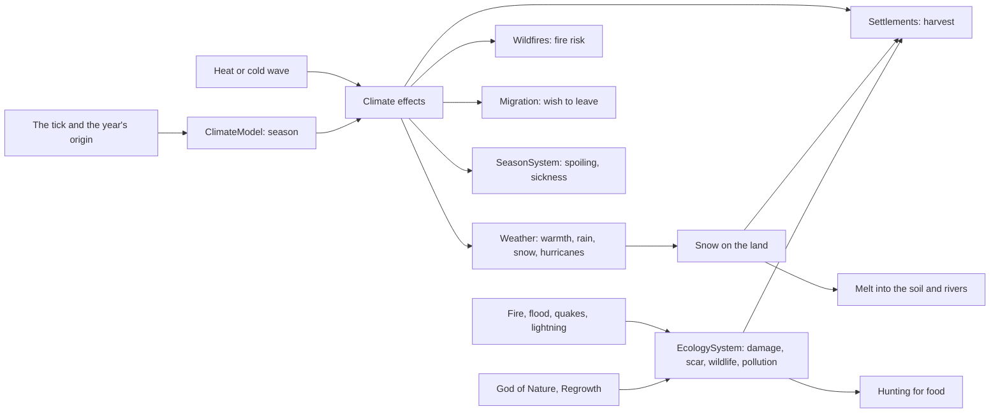

# Milestone 15, part 8 — Seasons, weather extremes and the land's life

## Overview

Part 8 gives the world a year and a living land (§16–18). The decisions are in
[ADR-028](../docs/ADR/ADR-028-seasons-extremes-and-ecology.md). The rest of §19's disasters,
disaster preparation and terrain damage (§19–21, §64) follow in part 9.

What the player gets:

- **Seasons (§17):** a ten-minute year of spring, summer, autumn and winter, chosen with the world.
  - Summer grows crops, dries the land, spoils stores and brings heat waves and fire.
  - Autumn brings the harvest, rain and hurricanes from the sea.
  - In winter the fields lie fallow under snow, stores must last, the cold sickens the homeless
    and few set out to migrate.
- **Weather extremes (§16):**
  - snow that lies on the hills and melts into the soil in spring;
  - fog;
  - hurricanes that tear houses down;
  - heat waves and cold waves.
- **The land's life (§18):**
  - Fires, floods, earthquakes and lightning harm the land, which heals; repeated harm scars it for
    good.
  - A god of Nature heals scars, and Regrowth heals both harm and scars.
  - Wild animals return as the land allows and feed the villages that hunt them.
  - Crowded villages pollute their land.
- **Where to see it:** the HUD's season, alerts, the history, F1's climate line, F3's layers, the
  O Nature overlay, snow on the land, Y and the launch options.

## Architecture

| Project | Changes |
| --- | --- |
| `Pantheon.Domain` | Seasons and extremes: • `Weather/Season`, `SeasonState`, `ClimateRules` (`ClimateEffects`, `SeasonRules`, `ExtremeRules`) • `WeatherRules.Seasons` and `Extremes`, `WorldState.Seasons` • `WeatherKind` Snow, Fog, Hurricane; `WeatherSpell` HeatWave, ColdWave  The land's life: • `Ecology/EcologyRules` • `RegionState.Snow`, `Wildlife`, `Damage`, `Scar` and `Pollution`  Events and history: • events `SeasonChanged` and `LandScarred`, `StormStruck.Hurricane`, `DisasterKind.Hurricane` • history kinds `Hurricane` and `Scar` |
| `Pantheon.Simulation` | Climate: • `Weather/ClimateModel`, `SeasonSystem`, `ClimateRulesValidator` • snow, fog, hurricanes and the season's warmth and rain in the weather step • the season's harvest, fire risk and wish to leave in the settlement, fire and migration steps • hurricanes tearing houses down in the disaster step  Ecology: • `Ecology/EcologyModel`, `EcologySystem`, `EcologyRulesValidator` • hunting in the settlement step • harmed and polluted farmland yields less • earthquakes and lightning harm the land; Regrowth heals it |
| `Pantheon.Persistence` | `ecology.json`; save version 20 and `NatureSaveMigration`. |
| `Pantheon.Networking` | Protocol version 8. |
| `Pantheon.Game` | Text, readouts and commands: • `Weather/SeasonText`, `SeasonCommands` • `Alerts/NatureAlerts` • `Presentation/NatureOverlay`, `SnowCover` • F1's climate and the land at the cursor, F3's layers • the regions section's new fields  Options: • `NewWorldOptions.Seasons` • `--seasons`, `--season`, `--weather=heatwave\|coldwave\|hurricane` |
| Godot client | The start screen's "Climate" choice; Y for the next season; snow over the land (one island-wide layer); white, slow snowfall. |
| Content | `Seasons` and `Extremes` in `weather.json`; `ecology.json`. |

## Test plan

- **Climate (`ClimateTests`):**
  - The season follows the tick from the year's origin, and can be made to begin now.
  - A season and a wave combine: shifts and losses add, factors multiply.
  - Waves follow only an ordinary spell, by the season's chances.
  - The season step tells of a new season once, spoils stores in summer and sickens in winter,
    the homeless most.
  - Winter yields less than summer, and nothing grows under snow.
  - Snow lies on cold land under rain and melts into the soil when it warms.
  - Snow, fog and hurricanes are classified only where the rules have them.
  - A hurricane is reported as it arrives and tears houses down.
  - Winter holds people back from setting out.
- **Ecology (`EcologyTests`, `SignatureMiracleTests`):**
  - Harm heals down to the scar, and harm above the threshold becomes scar.
  - A god of Nature heals faster and heals scars.
  - The land's health, capacity and biodiversity fall with harm and pollution.
  - Fire and flood harm the land; fire kills its animals, which return after.
  - Villages hunt the animals around them, in their own step.
  - Harmed and polluted land yields less.
  - Crowded villages pollute, and pollution clears.
  - Scarred land is reported once.
  - Lightning harms the land it falls on; Regrowth heals harm and scars; earthquakes harm what they
    shake.
- **Presentation (`NaturePresentationTests`, `ContentTests`):**
  - Words for the seasons, waves and new weather.
  - The HUD's season, and new worlds having seasons unless asked otherwise.
  - Alerts, the history, F1, F3, the Nature overlay and the snow cover.
  - Options and debug commands; the regions section; strict parsing of the new content.
- **Saves (`SaveMigrationV19Tests`):**
  - A save written by part 7's build has no seasons, snow or harm, and its land's animals at its
    cover.
  - It keeps every other value and keeps playing the same way.
  - A version 19 save with seasons is refused.
  - Seasons and the land's life survive a save and load.

### Verification results

- **Build and tests:** `dotnet build` has no warnings. 1123 tests pass (1084 before).
- **Six 40-minute games** (seeds 100–105, a passive player), with seasons and without:

  | | With seasons | Without |
  | --- | --- | --- |
  | Famines begun | 74 | 2 |
  | Migrations | 404 | 225 |
  | People at the end | 2,600–5,300 | 2,300–5,000 |

  - Snow lay on up to 78 regions at the end of a winter, mostly the highlands.
  - Fog formed in calm, cool, humid weather.
  - Hurricanes formed most summers and autumns, and struck a village about once in three games.
  - Scars reached 0.9 near land that quakes shook again and again.
- **Tuning:**
  - Hunting first fed villages between settlement steps, so a starving village told its famine
    every step: 3,501 times in six games. Hunting moved into the settlement step.
  - A winter harvest of 0.35 killed a quarter of a village each winter; it is now 0.5.
  - Snow rarely lay (0.3 and a slow fall); it lies below 0.35 and falls four times faster.
  - Fog never formed while it had to be dry; it now drizzles.
  - Hurricanes weakened before reaching a village; they now fill over land at a quarter of a
    storm's pace. They also first went unannounced, since their edge arrived as an ordinary storm.
  - Every storm of pressure 0.9 or more counted as a hurricane; ordinary storms now stay below.
  - The debug storm (F10) became a hurricane; it now stays below, and `--weather=hurricane` calls
    one.
- **Balance:** 40 one-hour games with a passive player (seeds 30–69).

  | Build | Games with a winner | Median time | Mean time | Winners |
  | --- | --- | --- | --- | --- |
  | Part 7 | 33 / 40 | 25.9 min | 30.8 min | Seren 15, Vael and Seren 13, Kaio 5 |
  | Part 8 (this build, seasons) | 38 / 40 | 24.9 min | 27.0 min | Seren 18, Vael and Seren 13, Kaio 6, Seren and Kaio 1 |

- **Cost of a tick** (seed 42, ten simulated minutes): Small 0.09 ms, Large 0.22, Huge 0.68, Vast
  0.64 (0.08, 0.20, 0.59, 0.56 before).
- **On the Mac:**
  - **Winter** (seed 42, `--season=winter --weather=coldwave`): snow lies white on the highlands,
    and the HUD reads "Winter of year 1 (2:30 left). A cold wave (2:00 left): frost and snow,
    poor harvests, and the cold sickens", at 116 FPS.
  - **The Nature overlay on the fallback renderer** (seed 1234, 20 minutes in): the land's life in
    reds and greens, last winter's snow white on the hills, at 120 FPS.
- **One rule changed for a test:** seed 7 no longer sees a migration in twenty minutes with
  seasons (23 without). The test that four gods migrate the same way across a save now uses seed 8.

## Tasks

### Completed

- [x] Seasons, their effects and their events; optional per world.
- [x] Snow, fog, hurricanes, and heat and cold waves.
- [x] The land's life: harm, scars, wildlife and hunting, pollution, and Nature's healing.
- [x] Save version 20 with the migration and the version 19 fixture; protocol 8.
- [x] The HUD, alerts, history, F1, F3, the Nature overlay, snow on the land, Y and the options.
- [x] Tests, probes and captures.

### Future

- The rest of §19's disasters, disaster preparation and terrain damage (part 9).
- Snow slowing travel; grass and trees changing colour with the seasons.
- Pollution that depends on a village's technology.

## Relevant files

- `src/Pantheon.Domain/Weather/` (`Season`, `SeasonState`, `ClimateRules`) and `Ecology/EcologyRules.cs`
- `src/Pantheon.Simulation/Weather/ClimateModel.cs`, `SeasonSystem.cs` and `Ecology/`
- `src/Pantheon.Game/Weather/SeasonText.cs`, `SeasonCommands.cs`, `Alerts/NatureAlerts.cs`,
  `Presentation/NatureOverlay.cs` and `SnowCover.cs`
- `src/Pantheon.Persistence/NatureSaveMigration.cs`
- `game/Scripts/Presentation/Weather/WeatherPresenter.cs` and `CloudView.cs`
- `game/Data/weather.json` (`Seasons`, `Extremes`) and `ecology.json`
- Tests: `src/Pantheon.Tests/Nature/` and `Persistence/SaveMigrationV19Tests.cs`
