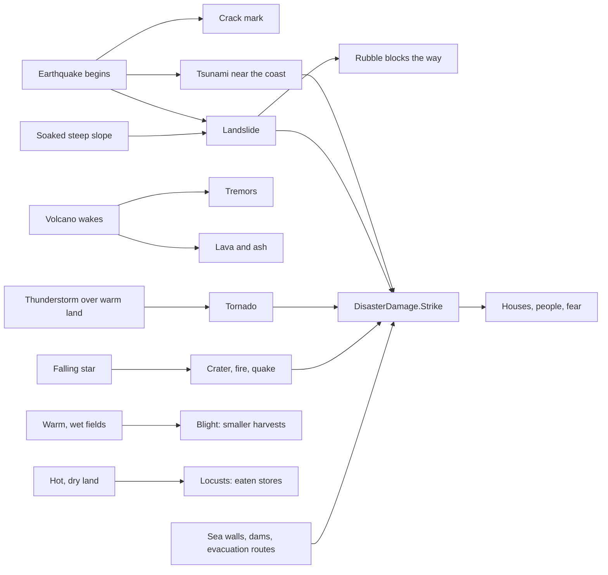

# Milestone 15, part 9 — Hazards, disaster preparation and marks on the land

## Overview

Part 9 brings the rest of nature's dangers (§19–21, §64). The decisions are in
[ADR-029](../docs/ADR/ADR-029-hazards-preparation-and-marks-on-the-land.md). The Creature's
specialisations, picking things up with the hand and Divine Acts follow in part 10.

What the player gets:

- **The rest of §19's disasters**, each a process:
  - tsunamis from earthquakes near the coast;
  - landslides on soaked or shaken slopes, whose rubble blocks the way (§20's road blockage);
  - a volcano that wakes, rumbles with tremors and erupts, with lava down its slope and ash
    around it;
  - tornadoes from thunderstorms over warm land;
  - falling stars;
  - blight in warm, wet fields;
  - locust swarms that drift with the wind.
- **Preparation (§21):** sea walls by the sea, dams and irrigation beside water, and evacuation
  routes.
- **Marks on the land (§64):** cracks, slide scars and craters that fade; the terrain is not
  remeshed.
- **Where to see it:**
  - alerts and the history;
  - the labels' "blight" and "cut off";
  - F1's hazards line, F3's blight and rubble layers and the Danger overlay;
  - blight and rubble on the land, the tornado's funnel, the swarm, the volcano's plume and the
    marks;
  - I and `--disaster`.

## Architecture

| Project | Changes |
| --- | --- |
| `Pantheon.Domain` | Hazards: • `Disasters/HazardRules` (tsunami, landslide, volcano, tornado, meteor, blight and locust rules, `MarkSeconds`) as `DisasterRules.Hazards` • `Disasters/Hazards` (`Tornado`, `LocustSwarm`, `Volcano` and `VolcanoPhase`, `TerrainMark` and `TerrainMarkKind`) • `DisasterState`'s `Tornadoes`, `Swarms`, `NextHazardId`, `Volcano`, `Marks` and `BlightedSettlementIds` • `RegionState.Blight` and `Rubble`  Preparation: • `BuildingKind` SeaWall, Dam, Irrigation, Evacuation • `Preparedness.SeaWallDamage`, `DamDamage`, `EvacuationDeaths`, `CivicEffects.IrrigationWater`  Events and history: • `Events/HazardEvents` (`TsunamiStruck`, `LandslideStruck`, `VolcanoChanged`, `TornadoTouchedDown`, `MeteorStruck`, `BlightChanged`, `SwarmArrived`) • `DisasterKind` and `HistoryKind` gain the hazards |
| `Pantheon.Simulation` | • `Disasters/HazardModel` (the volcano, lava path, nearest sea, waves, slides, impacts, spawning, marks) • `HazardSystem` (the hazard step) and `LivingHazards` (tornadoes, locusts, blight) • `HazardRulesValidator` • `DisasterDamage.Strike`, with sea walls, dams and evacuation in `Exposure` and `Deadliness` • rubble in `RegionPathfinder.IsWalkable` • blight in `SurveyFarmland`'s fertility and irrigation in `Assess` • `SocietyModel.NextProject` raising each building only where it helps • the history's hazard records |
| `Pantheon.Persistence` | Save version 21 and `HazardSaveMigration`; `DisasterIntegrity` checks the hazards; `SaveIntegrity` checks blight and rubble. |
| `Pantheon.Networking` | Protocol version 9. |
| `Pantheon.Game` | Text, readouts and commands: • `Alerts/HazardAlerts` • `Disasters/HazardCommands` (I, `--disaster`) • `DisasterText`'s hazard words, volcano names and label marks • the history's hazard titles • F1's hazards line and each village's blight and rubble • F3's layers and the Danger overlay • `Presentation/HazardCover` • the disasters and regions sections' new fields |
| Godot client | • `Presentation/Disasters/HazardPresenter` and `HazardViews`: blight and rubble draped over the land, a tornado's funnel, a locust swarm, the volcano's plume and fading marks • I for the next hazard; `--disaster=eruption` brings the camera to the volcano • labels on their own render layer, which ground decals leave alone |
| Content | `Hazards` and the new `Preparedness` values in `disasters.json`; the new buildings in `society.json`; `Civics.IrrigationWater` in `settlement_rules.json`. |

## Test plan

- **The model (`HazardModelTests`):**
  - The volcano is the highest land when it rises high enough.
  - Lava runs down the steepest slope for its length and stops at the sea.
  - A wave floods the low coast only after a strong quake near it.
  - A slide buries the land below in rubble, harms it, blocks the way and leaves its mark.
  - A meteor harms and scars the land, sets it alight, leaves a crater and shakes it.
  - Tornadoes and swarms take the next hazard id, and the volcano wakes only where there is one.
  - The falloff of a hazard's reach.
- **The step (`HazardSystemTests`):**
  - A strong quake by the coast cracks the land and raises a wave that strikes the village.
  - A sea wall spares a village most of the wave.
  - The volcano rumbles, shakes the ground, erupts and falls quiet; its lava and ash do their harm.
  - A soaked steep slope slides, burying the village below, and the rubble clears; an earthquake
    shakes steep slopes loose.
  - Meteors strike at about their rate and ruin the villages they fall near.
  - Evacuation routes save half the lives.
  - Old marks fade.
  - Hazards are the same every time, across a save and load, and leave the shared stream alone.
- **What moves and spreads (`LivingHazardTests`):**
  - Thunderstorms over warm land spin tornadoes down, but not over cold land or the sea.
  - A tornado runs its path, tears down the village it crosses and lifts.
  - Locusts drift with the wind, eat the stores of the villages they reach and are told once; a
    swarm rising on a village's fields is told at once; rain drowns them.
  - Blight grows and spreads in warm, wet fields and withers the harvest; it dies away in dry
    fields, faster under fire or blessing; it is told as it comes and goes; it never appears where
    it is off.
- **Preparation and content (`HazardPreparationTests`):**
  - Irrigation waters dry fields for a better harvest.
  - Sea walls rise only by the sea, and dams and irrigation only beside water.
  - The shipped hazards parse, and broken ones are rejected.
- **Presentation (`HazardPresentationTests`):**
  - The words and the volcano's name.
  - Alerts for every hazard that concerns the player.
  - The history.
  - The debug commands in their cycle and the launch options.
  - F1, F3, the Danger overlay, the cover and the marks' fading.
  - The disasters and regions sections.
- **Saves (`SaveMigrationV20Tests`):**
  - A save written by part 8's build has no blight, rubble or hazards and no volcano yet.
  - It keeps every other value and keeps playing the same way.
  - A version 20 save that already has tornadoes is refused.
  - The hazards survive a save and load.

### Verification results

- **Build and tests:** `dotnet build` has no warnings. 1166 tests pass (1123 before).
- **Rates:** ten one-hour games (seeds 100–109) with the shipped rules.

  | Hazard | In ten hours | Damage |
  | --- | --- | --- |
  | Tsunamis | 10 | 36 houses, 26 dead |
  | Landslides | 34 | 1 house |
  | Eruptions | 2 | |
  | Tornadoes | 5 | |
  | Falling stars | 2 | |
  | Blight told at a village | 5 (and gone 4 times) | up to 22 regions blighted at once |
  | Swarms reaching a village | 6 | |

  Every island had a volcano, 91–111 m high.
- **Tuning:**
  - **Landslides** first came 1,343 times in ten hours, burying up to 55 regions at once. Each quake
    rolled every shaken slope every second, and a 12 m drop counted two thirds of the land as
    steep. They now need a 30 m drop and a chance per second of shaking: 34.
  - **Blight** at first needed fields wetter than most are (0.6, against a median of 0.4), so it
    died before reaching any village's notice. It now needs 0.5 and is told at 0.15 of a village's
    fields.
  - **Blight's end:** it was first told gone when the mean fell through half the notice, which told
    villages it had gone when they had never been told it came (10 ends against 6 starts). The
    villages told are now kept.
  - **Locusts** found almost no land hot and dry enough; they now need 0.55 warmth and rise once an
    hour.
  - **Meteors** come at 0.3 an hour rather than 0.15.
  - A swarm that rose on a village's fields went unannounced; it is now told at once.
- **Balance:** 40 one-hour games with a passive player (seeds 30–69).

  | Build | Games with a winner | Median time | Mean time | Winners |
  | --- | --- | --- | --- | --- |
  | Part 8 | 38 / 40 | 24.9 min | 27.0 min | Seren 18, Vael and Seren 13, Kaio 6, Seren and Kaio 1 |
  | Part 9 (this build) | 39 / 40 | 24.9 min | 28.3 min | Seren 16, Vael and Seren 12, Kaio 6, Seren and Kaio 5 |

- **Cost of a tick** (seed 42, ten simulated minutes):

  | World | Before | After |
  | --- | --- | --- |
  | Small | 0.09 ms | 0.10 ms |
  | Large | 0.22 ms | 0.24 ms |
  | Huge | 0.68 ms | 0.73 ms |
  | Vast | 0.64 ms | 0.68 ms |

  - The first version cost Huge 0.83 ms. The hazard step was the third dearest system (394 ms in
    3,000 ticks), because it found every region's steepest neighbour each step. It now looks only
    at soaked or shaken regions: 120 ms. The draws are the same, so the games are too.
- **On the Mac:**
  - **The volcano** (seed 42, `--disaster=eruption --weather=dry --speed=16`): Mount Valen erupts
    with flames down its slope, its plume and the tremors' rings, and the alert "Mount Valen erupts:
    lava runs down its slope and ash falls around it", at 120 FPS.
  - **A tornado** (`--disaster=tornado`): a grey funnel over Brightwater with dust at its foot, 4
    houses in ruins and the alert, at 114 FPS.
  - **Locusts** (`--disaster=locusts`): a dark swarm over the village, at 116 FPS.
  - **Blight** (`--disaster=blight --overlay=danger`): the fields purple on the Danger overlay, the
    label marked "blight" and the warning alert, at 116 FPS.
  - **A falling star on the fallback renderer** (`--terrain=fallback --disaster=meteor`): a dark
    crater under the village and the earth shaking, at 112 FPS.
- **Found on the Mac:**
  - Ground decals (the crater, ash, the map overlays) also darkened the labels floating above.
    Labels now sit on a render layer of their own, which decals leave alone.
  - The swarm's first look was faint specks spread wide. It is now a dense dark cloud.
  - Changing its particle material after creation leaked a shader at exit, so the material is now
    built whole.

## Tasks

### Completed

- [x] Tsunamis, landslides, the volcano, tornadoes, meteors, blight and locusts as processes.
- [x] Sea walls, dams, irrigation and evacuation routes, each only where it helps.
- [x] Marks on the land and rubble that blocks the way.
- [x] Save version 21 with the migration and the version 20 fixture; protocol 9.
- [x] Alerts, history, labels, F1, F3, the Danger overlay, the client's visuals, I and the options.
- [x] Tests, probes and captures.

### Future

- Lava as its own flow.
- Landslides that change the terrain's height.
- Reservoirs beyond the cistern.
- Disease in people beyond the cold's and the ash's sickness.

## Relevant files

- `src/Pantheon.Domain/Disasters/HazardRules.cs`, `Hazards.cs` and `Events/HazardEvents.cs`
- `src/Pantheon.Simulation/Disasters/HazardModel.cs`, `HazardSystem.cs`, `LivingHazards.cs`,
  `HazardRulesValidator.cs` and `DisasterDamage.cs`
- `src/Pantheon.Game/Disasters/HazardCommands.cs`, `Alerts/HazardAlerts.cs` and
  `Presentation/HazardCover.cs`
- `src/Pantheon.Persistence/HazardSaveMigration.cs`
- `game/Scripts/Presentation/Disasters/HazardPresenter.cs` and `HazardViews.cs`
- `game/Data/disasters.json` (`Hazards`, `Preparedness`) and `society.json`
- Tests: `src/Pantheon.Tests/Disasters/Hazard*Tests.cs`, `LivingHazardTests.cs` and
  `Persistence/SaveMigrationV20Tests.cs`
