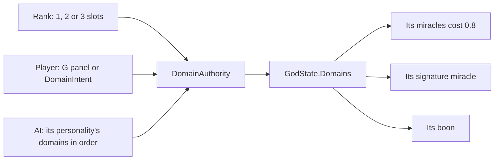
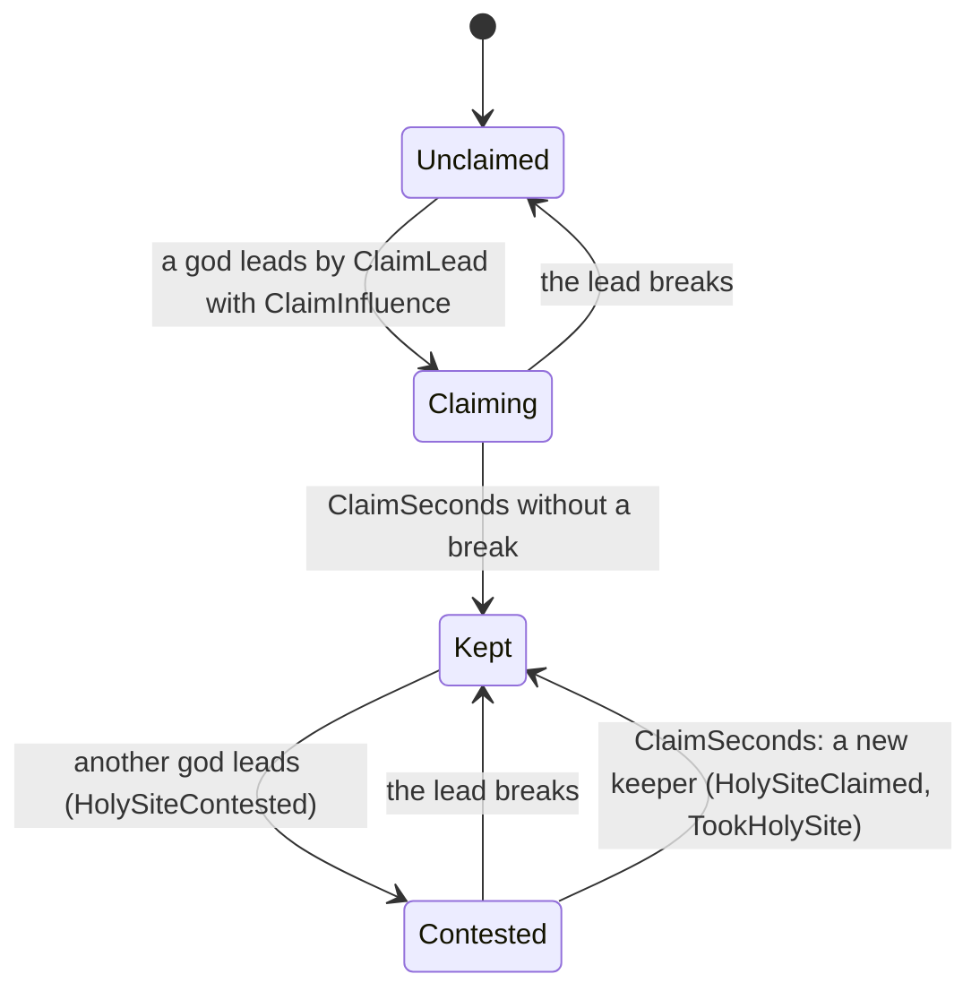

# Milestone 15 — Polish and Expansion

## Overview

Spec §130 lists Polish and Expansion "only after the vertical slice is fun":

- domains, doctrines and holy sites;
- advanced politics and schisms;
- larger worlds, more miracles and more Creatures;
- Steam networking.

This milestone builds what deepens the game the slice already is, and leaves out what it does
not yet need. The decisions are in
[ADR-021](../docs/ADR/ADR-021-domains-holy-sites-schisms-species-settings-and-audio.md).

What the player gets:

- **Domains (§12).** Eleven domains: Nature, Life, Storm, Fire, War, Death, Prosperity,
  Protection, Knowledge, Trickery and Chaos. A god takes up one as a Minor Spirit, two as a
  Lesser God and three as a God. Each domain does three things:
  - cheaper miracles in it;
  - a boon that changes a rule of the world;
  - a signature miracle only its gods can cast: eleven new miracles in all.

  The Domains panel (G) shows them, the guide asks for the first, and AI gods choose by
  personality (§47's preferred domains).
- **Holy sites (§51).** The Sacred Peak, the Ancient Grove, the Holy Spring and the Standing
  Stones, found in every world's land. The god whose influence holds one long enough keeps it,
  and gains power, influence and a gift. Creatures claim and hold them; gods remember who took
  their sites.
- **Schisms (§34).** Followers who deeply doubt their god break away to keep its Old Faith. They
  return when the god is loved again, or fade into unbelief. A god that harms people who love it
  sows that doubt itself.
- **More Creatures (§130).** Four species, each with its own strengths and look: the Mossback,
  the Stonehide, the Swiftclaw and the Lumen. The player chooses for a new world.
- **Settings (§105).** Fullscreen, vertical sync, shadows, render scale, citizens shown and
  four volumes, kept between runs.
- **Audio (§60).** Music in three moods and the sounds of miracles, storms, quakes, fire,
  Creatures and news. All are synthesized by the game, and they are heard where they happen.

Left for later, with the reasons in ADR-021:

- **Steam networking:** optional, and it needs the Steamworks SDK.
- **Larger worlds:** not measured beyond 2 km.
- **Doctrines as a system of their own:** the Old Faith's betrayal rule stands in for §33–34's
  "behaviour contradicts history".

## Architecture

| Project | Changes |
| --- | --- |
| `Pantheon.Domain` | `GodState.Domains`; `DomainRules` (slots, definitions, `DomainBoons`); `HolySites/` (`HolySite`, `HolySiteKind`, `HolySiteBoon`, `HolySiteRules`); `Belief/OldFaith`, `Belief/SchismRules` in `DivineRules` with the holy sites' influence; `SettlementState.OldFaith`, `SanctuaryGodId`, `SanctuaryUntilTick`; `Creatures/CreatureSpecies` in `CreatureRules`; `GodSlot.CreatureSpecies`; `MiracleDefinition.RequiresDomain` and eight effect kinds; events `DomainChosen`, `HolySiteContested`, `HolySiteClaimed`, `SchismStarted`, `SchismEnded`; history kinds `Domain`, `Claimed`, `Schism`, `Reunion`; `DiplomaticAct.TookHolySite`; `GodProfile.HolySites` and `Domains`. |
| `Pantheon.Simulation` | `Domains/` (`DomainModel`, `DomainAuthority`, `DomainSystem`, validator); `HolySites/` (`HolySitePlacer`, `HolySiteSystem`, `HolySiteModel`, validator); `Belief/Schisms`; `Miracles/MiracleEffects` (moved out of `MiracleCaster`, with the new effects); `Gods/MiracleValuer` (moved out of `GodAi`); species in `CreatureModel`, `CreatureFounder`, `CreatureCombat` and starvation; boons in combat, learning, disasters and casts; holy sites in `InfluenceField`; the engine's order. |
| `Pantheon.Persistence` | Save version 13 and the migration from 12; `HolySiteIntegrity`; `domains.json` and `holy_sites.json`. |
| `Pantheon.Networking` | `DomainIntent`, protocol version 2; `WorldSection.HolySites`. |
| `Pantheon.Game` | `Domains/` (`DomainText`, `DomainCommands`, `DomainReadout`); `Audio/` (`SoundBank`, `MusicComposer`, `AudioDirector`); `Settings/GameSettings`; `Alerts/FaithAlerts`; `Diagnostics/FaithReadout`; the HUD's domains line and Shift keys; the species choice in a new world; `--species`, `--rank`, `--domains`, `--domains-panel`, `--settings-page`, `--focus=siteN`; the guide's domain step; `CreatureLook` in `divine_view.json`. |
| Godot client | `Bootstrap/FaithController`, `UI/DomainPanel`, `Presentation/HolySites/`, `Presentation/Audio/AudioPresenter`, `Bootstrap/SettingsApplier`, `Bootstrap/Startup`; the settings page and the species choice in `MenuScreen`; species looks in `CreatureBody`; the G action. |
| Content | `domains.json`, `holy_sites.json`; schism and holy site numbers in `divine_rules.json`; species in `creatures.json`; the gods' species in `gods.json`; the AI's domains and holy-site weight in `god_ai.json`; eleven miracles in `miracles.json` and their looks in `divine_view.json`; `SchismPeople` in `history.json`. |

### Domains

| Domain | Boon (shipped) | Signature miracle |
| --- | --- | --- |
| Nature | farmland of its villages keeps 0.35 blessing | Regrowth: puts out fires, lifts 80% of scorch, waters and blesses (Minor Spirit) |
| Life | its villages heal 1% of the gap each second | Gift of Life: 8 newcomers sharing the village's beliefs, and healing (Lesser God) |
| Storm | a storm over its followers raises their Faith and Fear | Redirect Storm: the strongest cloud within 900 m to the target (Minor Spirit) |
| Fire | fires on its villages' land lose 15% a second | Firestorm: a wide country alight (God) |
| War | its Creature strikes 35% harder | Spear of Heaven: 0.4 health from rival Creatures beneath it (Lesser God) |
| Death | 8 Divine Power per life its miracles take | Dread: rival gods' followers lose Faith and gain Doubt (Lesser God) |
| Prosperity | 20% more power from worship | Abundance: food and blessing over 160 m (God) |
| Protection | half the houses a disaster would destroy stand | Sanctuary: its followers cannot fall away for a minute (Lesser God) |
| Knowledge | its Creature learns 60% more from each judgement | Enlighten: 80 experience to its Creature beneath it (Lesser God) |
| Trickery | its miracles plant twice the doubt about others | Sow Discord: the gods followed there remember two wrongs each, unseen (God) |
| Chaos | its earthquakes are 0.6 stronger | Upheaval: a gentler earthquake (Lesser God) |

### Holy sites and schisms

| Rule (shipped) | Value |
| --- | --- |
| Claim | influence 0.35, a lead of 0.1, 45 s |
| Keeper | 1.5 power a second; influence 0.6 fading to 0 at 250 m |
| Peak, Grove, Spring, Stones | miracles 10% cheaper; land within 350 m blessed to 0.5; villages within 450 m healed 2% a second; Creature within 400 m gains 0.5 experience a second |
| Placement | three regions from any village and five from each other, relaxed where the land is cramped |
| Schism | doubt 0.6, adherence 0.4, 20 people; 40% break away, taking half the doubt |
| Betrayal doubt | 0.5 × Love when a god harms people who love it |
| Old Faith | returns at 2% a step while Love ≥ 0.45 and Doubt ≤ 0.35; fades at 0.4% a step otherwise; a village splits again after 600 s |

### Species, settings and sound

| Species | Toughness | Strength | Speed | Learning | Temperament |
| --- | --- | --- | --- | --- | --- |
| Mossback (Ilyra) | 1 | 1 | 1 | 1 | — |
| Stonehide (Vael) | 1.5 | 1.25 | 0.75 | 0.8 | kinder |
| Swiftclaw (Kaio) | 0.8 | 1.1 | 1.4 | 1 | more aggressive |
| Lumen (Seren) | 0.85 | 0.85 | 1.1 | 1.5 | kinder, less aggressive |

Sound:

- twelve synthesized sounds and three music loops of 24 s, made at 22,050 Hz in about half a
  second on a worker thread;
- sounds of events play where they happen, with an inverse-distance falloff out to 3 km;
- the music holds a mood at least 20 s and crossfades over 3 s.

## Test Plan

| Area | Tests |
| --- | --- |
| Domains | `DomainTests`: slots by rank and every refusal; cheaper own-domain miracles; a signature needs its domain and something to act on; the HUD offers held signatures only, at their cost, on keys 10–12; Nature, Life, Storm, Fire, Prosperity, Protection, Death, Trickery, Chaos, War and Knowledge boons; the AI takes up its preferred domains as it rises; the history and the rivals' alert. |
| Signature miracles | `SignatureMiracleTests`: each of the eleven, and what Spear of Heaven and Enlighten need. |
| Holy sites | `HolySiteTests`: one site of each kind where it fits, apart from the villages and each other; claims, the former keeper's memory, no claim without enough influence or lead; keepers' power, influence, cheaper miracles and the grove's, spring's and stones' gifts; the AI's claims and defence; history and alerts. |
| Schisms | `SchismTests`: the split; none below the doubt, in a small village or under a sanctuary; the Old Faith cannot be converted; reunion and fading; the cooldown; betrayal doubt; history and alerts. |
| Content and options | `ExpansionContentTests`: the shipped domains, sites, species and schism rules; nine kinds of broken content refused with the reason; each god's species and temperament, the player's choice; an unlisted species; the new options. |
| Presentation | `DomainPresentationTests`: the Domains panel, cast hints and the debug lines. |
| Settings and sound | `GameSettingsTests`, `AudioTests`: the settings file round trip and its forgiveness; every sound deterministic, in range and audible; seamless loops; three distinct music loops; cues where events happen; the music's mood; the rain and wind under a storm. |
| Saves | `SaveMigrationV12Tests` against `save-v12.json`, written by the Milestone 14 build at commit ab9cab9 (seed 77, the small world, 4800 ticks, ten moments of history): no domains, Old Faiths or sanctuaries; every other value kept; a session finds the same sites as a new world; the same play after a save, with domains taken up; broken sites, faiths and domains refused; a version 12 save with domains refused. Versions 1–11 also migrate to version 13. |
| Shared worlds | `MultiplayerSessionTests.APlayersDomainIntent_TakesUpADomainForItsGod_AndTheSitesReachItsReplica`; the replication tests carry the holy sites. |

### Verification results

- `dotnet build Pantheon.sln`: no warnings. `dotnet test Pantheon.sln`: 853 tests pass (781 at the
  end of Milestone 14).
- Balance probes: ten games on seeds 100–109, 60 minutes each, headless.

  | Build | Games with a winner | Mean time to win |
  | --- | --- | --- |
  | Milestone 14 | 8 | 32.1 min |
  | Milestone 15 before tuning | 10 | 22.4 min (Seren every time) |
  | Milestone 15 with each new feature alone: domains / species / sites / schisms | 10 / 6 / 5 / 9 | 22.2 / 25.1 / 26.8 / 29.1 min |
  | Domains without signature miracles / without Sanctuary / without Gift of Life | 8 / 4 / 9 | 27.3 / 33.7 / 30.8 min |
  | Milestone 15 with every feature turned off | 8 | 32.1 min (identical to Milestone 14) |
  | **Milestone 15 shipped** | **8** | **32.2 min** |

  Tuning made these changes:
  - **Gift of Life:** its newcomers share the village's beliefs instead of following the giver,
    it brings 8 instead of 15, and it recovers in 120 s;
  - **Sanctuary:** lasts 60 s instead of 240 s, costs 200 and recovers in 120 s, and the AI values
    it by its people's doubt;
  - **Abundance:** smaller, dearer and rarer;
  - **Domain discount:** 0.8 instead of 0.75.
- A bot playing the player's god, same ten seeds:

  | Played as | Games with a winner | Player among the winners | Milestone 14 (20 seeds) |
  | --- | --- | --- | --- |
  | Guardian (Life, Protection, Prosperity) | 4 | 3 | 7 of 20 |
  | Tyrant (Death, Storm, Chaos) | 10 | 5 | 8 of 20 |

- Per hour of play, over the passive games:
  - about 18 schisms, nearly half of them reconciled;
  - about 6 holy sites taken;
  - 9% of all casts are signature miracles.
- Simulation:
  - 0.106 ms a tick on the shipped world 30–40 minutes in (0.076 ms in Milestone 14);
  - an AI evaluation tick takes 2.8 ms (three gods);
  - a save takes 418 KB.
- Frames:
  - Today the Mac shows periodic frames of about 140 ms in every build. Milestone 14's own build,
    run alternately in the same scenario (seed 1234, 30 minutes in, x16, 1080p, uncapped),
    averages 15–33 ms against 15–22 ms for this milestone, so the frame times are within
    Milestone 14's on the same machine and day.
  - Milestone 14's 6.7 ms could not be reproduced for either build.
  - One fix came from measuring: the HUD reapplied a theme override on every miracle button each
    frame, which relaid out the HUD (34 FPS before the fix, 55 after, in the same run).
- Audio: twelve sounds and three music loops made in 455–481 ms on a worker thread.
- Captures:
  - the Domains panel with Storm, Life and War held and the bar's Shift keys;
  - the four holy sites: the Sacred Peak (Kaio's), the Ancient Grove, the Holy Spring (Kaio's)
    and the Standing Stones (Seren's);
  - the settings page.

## Tasks

### Completed

- [x] ADR-021.
- [x] Domains: rules, authority, boons, eleven signature miracles and their effects, the AI's
  choices and values, the panel, the HUD, the intent, history and alerts.
- [x] Holy sites: placement, claims, gifts, influence, the AI's Creatures, presentation, the
  section, history and alerts.
- [x] Schisms and the Old Faith, betrayal doubt and sanctuaries.
- [x] Creature species: rules, founding, combat, learning, looks and the player's choice.
- [x] Settings and their page; synthesized sound and music.
- [x] Save version 13 and its migration; balance measured and tuned.

### Future

- Steam networking as a second transport (§69), larger worlds (§6), and Ocean and Justice with
  their own systems (water bodies, laws).
- Doctrines (§33) as a settlement's culture of its own, and heresies with gods of their own.
- Recorded or composed audio in place of the synthesized sounds.

## Relevant Files

- `src/Pantheon.Domain/Gods/DomainRules.cs`, `src/Pantheon.Domain/HolySites/`, `src/Pantheon.Domain/Belief/{OldFaith,SchismRules}.cs`, `src/Pantheon.Domain/Creatures/CreatureSpecies.cs`
- `src/Pantheon.Simulation/Domains/`, `src/Pantheon.Simulation/HolySites/`, `src/Pantheon.Simulation/Belief/Schisms.cs`, `src/Pantheon.Simulation/Miracles/MiracleEffects.cs`, `src/Pantheon.Simulation/Gods/MiracleValuer.cs`
- `src/Pantheon.Persistence/{HolySiteIntegrity,RecentSaveMigrations}.cs`
- `src/Pantheon.Game/Domains/`, `src/Pantheon.Game/Audio/`, `src/Pantheon.Game/Settings/`, `src/Pantheon.Game/Alerts/FaithAlerts.cs`, `src/Pantheon.Game/Diagnostics/FaithReadout.cs`
- `game/Scripts/Bootstrap/{FaithController,SettingsApplier,Startup}.cs`, `game/Scripts/UI/DomainPanel.cs`, `game/Scripts/Presentation/{HolySites,Audio}/`
- `game/Data/{domains,holy_sites}.json`
- `src/Pantheon.Tests/{Domains,HolySites,Belief,Settings}/`, `src/Pantheon.Tests/Persistence/{SaveMigrationV12Tests,Version13Expectations}.cs`, `src/Pantheon.Tests/Persistence/Fixtures/save-v12.json`
