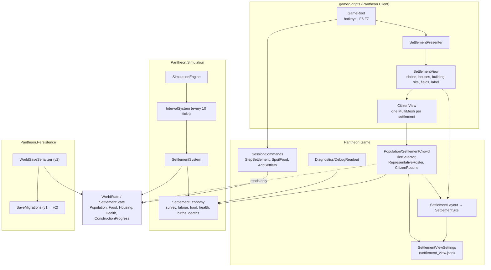
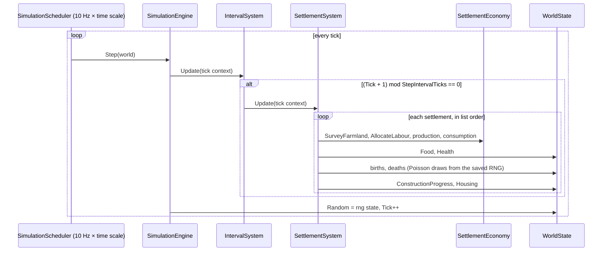
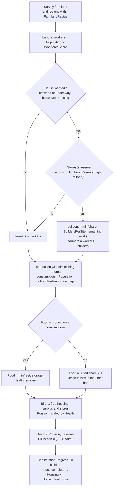
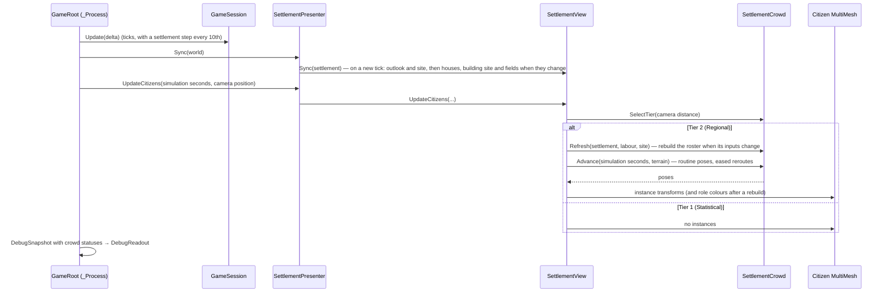
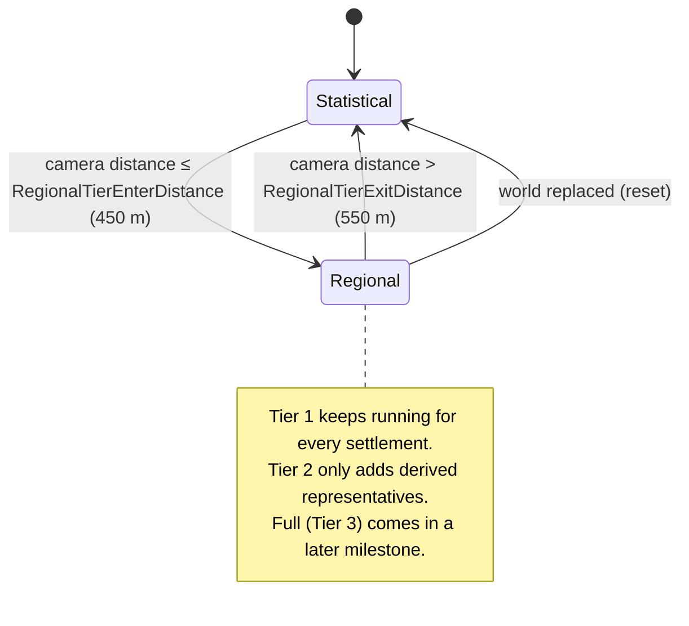
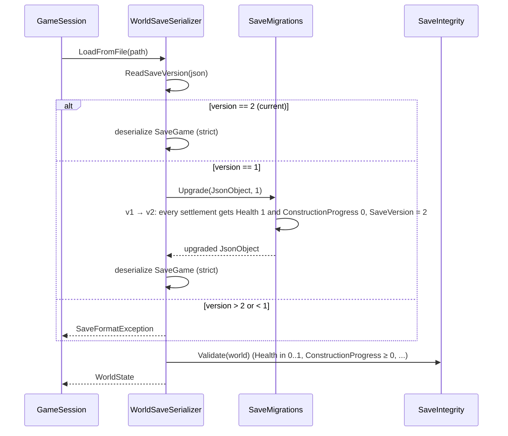

# Milestone 2 — Living Settlement Implementation

## Overview

Milestone 2 makes the starting settlement live on its own. Deliverables:

- An aggregate (statistical, Tier 1) population model for the settlement: population growth and
  decline, food production and consumption, housing capacity with autonomous house construction,
  and health. Starvation lowers health; health changes deaths and births.
- The settlement acts autonomously: the player never places houses. Villagers split into farmers
  and builders, start a house when the settlement gets crowded and stop when food runs short.
- The settlement model steps at about 1 Hz (once per simulated second), decoupled from rendering
  and from the 10 Hz tick.
- Visible representative citizens (Tier 2) near the camera: up to a few hundred figures drawn
  with one MultiMesh per settlement, each standing for several villagers. They walk, work in the
  fields and on the building site, and gather at the shrine. They are derived from the
  statistical state and are never canonical.
- New houses appear as housing grows; the house under construction and the fields are shown too.
- All state lives in `WorldState` and is saved as versioned JSON. `SaveVersion` goes from 1 to 2,
  with a migration from version 1.
- Data-driven balance (`game/Data/settlement_rules.json`) and presentation tuning
  (`game/Data/settlement_view.json`). Seeded randomness only.
- Debug overlay readouts for population, food, housing, health, jobs, construction and the
  simulation tier, plus hotkeys that drive the settlement.
- xUnit tests for the rules, the cadence, the Tier 2 derivation and the save migration.

Playable outcome: the settlement visibly lives and changes. It grows from 40 people in 12 houses
to several hundred, builds houses one at a time, and its villagers walk between homes, fields,
the building site and the shrine. A famine (driven with the debug hotkeys) lowers health, raises
deaths and the settlement recovers.

**Scope.** The earlier working roadmap in `docs/GAME_SPEC.md` also listed several settlements,
founding and the gather and worship jobs for Milestone 2. The brief for this milestone asks for
one living settlement, so those items are listed under Tasks → Future: founding and migration
need more than one settlement, worship needs belief (Milestone 3) and gathering needs ecology.
The owner's complete specification, added after this milestone as `docs/PANTHEON_SPEC.md`, lists
exactly this milestone's deliverables in §117: aggregate population, food, housing, health and
visible representative citizens. The model, the views and the saves handle a list of
settlements, so a second settlement should need no rework of them, but nothing has run with two
yet: world generation founds one and no test uses more.

**Plan pattern: Non-TDD (architecture first).** The architecture follows from ADR-004 and
ADR-006 and from this milestone's brief, so design drives implementation and the tests are
specified in the Test Plan and written with each part. The brief asks for fully autonomous
work, so the pattern could not be confirmed interactively. This is recorded as an explicit
assumption, as in Milestone 1.

**Decision record.** [ADR-008](../docs/ADR/ADR-008-settlement-step-and-representative-citizens.md)
amends ADR-004: Tier numbering, the 1 Hz settlement step, and representative citizens as the
Regional tier's derived, non-canonical presentation until a later milestone gives the regional
and full tiers effects of their own.

**Status:** implemented and verified; see Test Plan → Verification results. In review in
[#2](https://github.com/roeyazroel/pantheon/pull/2).
[docs/PROGRESS_SUMMARY.md](../docs/PROGRESS_SUMMARY.md) maps Milestones 1 and 2 against the
specification.

## Architecture

### What changes, by project

| Project | Change |
| --- | --- |
| `Pantheon.Domain` | `SettlementState` gains `Health` and `ConstructionProgress`. `SettlementRules` is rewritten for the per-step model. |
| `Pantheon.Simulation` | `SettlementEconomy` (pure rule functions), the M2 `SettlementSystem` step, `IntervalSystem` (runs a system every N ticks), the rules validator, founding with full health. |
| `Pantheon.Persistence` | `CurrentSaveVersion = 2`, `SaveMigrations` (version 1 → 2), integrity checks for the new fields. |
| `Pantheon.Game` | `Population/` (Tier 2: tier selection, representative roster, routines, crowd smoothing), `Presentation/` (house, construction and field layout, `SettlementViewSettings`), readouts, session commands, launch options. |
| Godot client | Settlement view with houses, construction site and fields; citizens in a MultiMesh; hotkeys; content loading. |
| Content | `settlement_rules.json` rewritten, new `settlement_view.json`. `worldgen.json` is unchanged, so the generation settings saved inside every world keep their shape. |

### Tier 1: the statistical settlement step

`SettlementSystem` runs once every `StepIntervalTicks` ticks (10 ticks, so once per simulated
second at ×1, four times per real second at ×4). `IntervalSystem` wraps it and runs it on the
last tick of each interval: ticks 9, 19, 29 and so on, so that after `10 × n` ticks exactly `n`
steps have run. The scheduler still ticks at 10 Hz (ADR-006 is unchanged). Every rate in
`settlement_rules.json` is per step.

Each step, for each settlement in list order (all symbols per step):

```text
land        = land regions (not sea, fertility > 0) within FarmlandRadius regions (Chebyshev) of the settlement's region
capacity    = FarmersPerRegion × land.Count
maxYield    = FoodPerFarmerPerStep × land.MeanFertility × capacity

workers     = Population × WorkforceShare
wanted      = Housing < MaxHousing and (ConstructionProgress > 0 or Population ≥ ConstructionStartCrowding × Housing)
funded      = Food ≥ ConstructionFoodReserveSteps × consumption
builders    = wanted and funded ? min(workers × MaxBuilderShare, BuildersPerSite, WorkPerHouse − ConstructionProgress) : 0
farmers     = workers − builders

production  = capacity > 0 ? maxYield × (1 − e^(−farmers / capacity)) : 0      # diminishing returns
consumption = Population × FoodPerPersonPerStep
available   = Food + production
fed         = consumption > 0 ? min(1, available / consumption) : 1
Food        = clamp(available − consumption, 0, Housing × FoodStoragePerHousing)   # surplus beyond storage spoils

Health      = fed < 1 ? max(0, Health − StarvationHealthLossPerStep × (1 − fed))
                      : min(1, Health + HealthRecoveryPerStep)

births      = production ≥ consumption and Food ≥ Population × SurplusFoodPerPerson and Housing > Population
              ? min(Housing − Population, Poisson(Population × BirthChancePerPersonPerStep × Health)) : 0
deaths      = min(Population, Poisson(Population × (DeathChancePerPersonPerStep
                                         + IllHealthDeathChancePerPersonPerStep × (1 − Health)²)))
Population += births − deaths

ConstructionProgress += builders
if ConstructionProgress ≥ WorkPerHouse: Housing = min(MaxHousing, Housing + HousingPerHouse), ConstructionProgress = 0
```

Design notes:

- `Housing` stays the canonical capacity in people; a house shelters `HousingPerHouse` people,
  so the starting 60 housing is 12 houses. `ConstructionProgress` is the only new construction
  state: one house is built at a time.
- Farmland comes from the regions around the settlement, not only its own region, because the
  fields reach about 150 m from the centre (two 64 m regions). With diminishing returns the land
  sets a soft population limit that differs between sites.
- Health does not change labour. A prototype that made sick villagers work less turned a famine
  into a trap: at low health a settlement of any size could not feed itself and died out. With
  health acting only on births and deaths, a famine shrinks the population until the land feeds
  it again, and health then recovers.
- Births need production to cover consumption, so a healthy settlement stops growing at the
  land's limit instead of overshooting into a permanent famine.
- Builders are capped per site, so even a large settlement finishes a house about every ten
  simulated seconds and each house shows a visible building phase.
- The two random draws per settlement (births, then deaths) come from the shared
  `SimulationRandom`, in list order, so runs and save/load continuations stay deterministic.

Balance (the shipped step and values, measured headless on seed 1234: 24 land regions with mean
fertility 0.46; simulated time at ×1): the settlement starts its first house after about a
minute (tick 590) and finishes it 15 seconds later, then builds a house every 10 to 15 seconds
while crowded. It reaches 95% of its limit after 18 minutes and levels off at about 540 people
in 129 houses after about 25 minutes (about 90 seconds at ×16), healthy, with spare housing and
full stores. A poor site (seed 2: 14 land regions, fertility 0.39) levels off near 210.
Emptying the stores at the limit (F6) stops births for about 11 minutes while they refill; the
population falls to about 425 by ordinary deaths and climbs back. Arriving settlers beyond what
the land feeds (F7 at the limit: 541 → 811 people) eat the stores in about 6 minutes, then
starve for about 4 minutes: health falls to about 0.7, deaths bring the population back within
the land's limit, health is full again a minute after its lowest point, and births return once
the stores refill.

### Tier 2: representative citizens (ADR-008)

- Tier numbering: Tier 1 Statistical, Tier 2 Regional, Tier 3 Full (ADR-004's tiers). The
  `SimulationTier` enum has the two tiers that exist; Full joins it with Tier 3. Readouts
  use the number and the name ("tier 2 regional").
- `TierSelector` promotes a settlement to Tier 2 when the camera comes within
  `RegionalTierEnterDistance` (450 m) of its centre and demotes it beyond
  `RegionalTierExitDistance` (550 m). The gap stops the tier from flickering at the boundary.
  Tier selection is client-local presentation state; Tier 1 always runs for every settlement.
- In Tier 2, `RepresentativeRoster` derives `N = min(Population, MaxRepresentatives)`
  representatives (300 at most). Each stands for `Population / N` people. Their roles follow the
  aggregate labour split of `SettlementEconomy.AllocateLabour`: builders, farmers and villagers
  (the inhabitants who do not work). The two role boundaries are rounded:
  `builders = round(Builders × N / Population)` and
  `builders + farmers = round(Workers × N / Population)`, so every count is within one of its
  share and the counts add up to `N`.
- Identities are stable: representative `i` keeps a hash rank, and the lowest ranks become
  builders, the next farmers and the rest villagers. Moving one person between neighbouring
  roles (builder and farmer, or farmer and villager) changes exactly one representative's role;
  one more inhabitant changes at most two existing roles (each boundary moves by at most one
  rank). Homes and fields are chosen by rendezvous hashing over house indices (houses are a
  stable prefix) and field spiral slots, so a new house or field draws a share of the
  representatives and leaves everyone else in place. Hashes mix the world seed, the settlement
  id and the representative index (no random stream is consumed).
- Spots: residents rest just outside their door (`DoorSpread`); farmers work inside their field
  (`WorkSpread` of its side), facing along its rows; builders on a ring around the house under
  construction, facing it; villagers, and builders or farmers without a site or fields, do
  chores within `WanderRadius` of home. Everyone gathers on a ring around the shrine, facing it.
  Without houses, homes lie on a ring just outside the gathering ring.
- `CitizenRoutine` gives each representative a simple schedule: rest at home, walk to work, work,
  walk to the shrine, gather, walk home. The pose (ground point, facing, a forward lean per work
  stroke, a bob per stride) is a closed-form function of simulation time
  (`(Tick + Alpha) × 0.1 s`) and the representative's phase, so citizens freeze when paused,
  speed up with the time scale and do not move in step.
- `SettlementCrowd` keeps the roster in step with the aggregates: it rebuilds the roster only
  when the role counts (whose total is `N`) or the layout change, and bumps `RosterVersion` so
  the view recolours. Rerouted citizens (a new home, a new role) walk to their new route at
  `CatchUpSpeed` instead of jumping. Representatives added while the settlement is in Tier 2
  step out of their front door; on promotion everyone appears in place on their routine.
- The client draws all of a settlement's representatives with one `MultiMeshInstance3D`: a
  two-surface figure (a body tinted per role through instance colours and a skin-coloured
  head), scaled by `FigureScale` so it reads from the god's-eye view. A few hundred figures cost
  one draw call per surface.
- Never canonical: Tier 2 reads `WorldState` and writes nothing. Its data is not saved; a load
  or new world rebuilds it. Because representatives have no effects of their own, demotion has
  nothing to fold back and totals are trivially conserved (ADR-004).

### Settlement layout (presentation data)

`SettlementLayout.ComputeSite` returns a `SettlementSite`:

- Houses: `ceil(Housing / HousingPerHouse)` complete houses on the golden-angle spiral around
  the shrine (Milestone 1's spiral, now counting houses rather than people), skipping slots on
  low ground. House `k` is always the `k`-th valid slot, so growth only appends.
- Construction: while `ConstructionProgress > 0`, the next slot shows a building site: a ring of
  scaffold poles, a timber pile, walls that rise during the first 70% of the work and a roof
  that grows during the rest. When the house completes it joins the houses in the same slot.
- Fields: plots on a second spiral, kept outside the disc of houses plus a clearance, on dry,
  gentle ground, tilted to the terrain, `ceil(houses / HousesPerField)` of them up to
  `MaxFields`. Each field shows crop rows tinted with one of the crop colours. As the village
  grows over its inner fields, the field spiral moves outward.
- Variation (house size and turn, field turn and crop) comes from `PresentationHash`, a
  SplitMix64 mix of a salt, the settlement id and the slot, so it consumes no simulation random
  stream and is the same every time the site is computed.
- Tuning (spacing, sizes, clearances, crop and role colours, Tier 2 distances and routine
  durations) is in `game/Data/settlement_view.json`, parsed strictly by
  `SettlementViewSettings`. `PresentationContent` bundles it with the biome palette, and the
  client loads both at start.
- The view lays the site out again only when `Housing` or `ConstructionProgress` changes, and
  rewrites the house and field MultiMeshes only when their placements differ from the ones
  shown.

### Saves

- `WorldSaveSerializer.CurrentSaveVersion` is 2; `MinimumSupportedSaveVersion` stays 1.
- Loading reads `SaveVersion` first. A current save deserializes directly. An older save is
  parsed into a `JsonObject`, upgraded one version at a time by `SaveMigrations`, then
  deserialized with the same strict options, so a migrated save gets exactly the checks of a
  current one.
- Version 1 → 2 adds `"Health": 1` and `"ConstructionProgress": 0` to every settlement.
  Version 1 worlds were all healthy (Milestone 1 had no health), and no house was being built.
- `SaveIntegrity` also checks `0 ≤ Health ≤ 1` and `ConstructionProgress ≥ 0`.
- A version 1 save written by the Milestone 1 build is kept as a test fixture
  (`src/Pantheon.Tests/Persistence/Fixtures/save-v1.json`).

### Debug tools

- F1 panel, per settlement:
  - population / housing, houses, health
  - food stored / storage, the net change per second, production and consumption
  - jobs (farming, building, not working) and the farmland (land regions, mean fertility)
  - expected births and deaths per second, the house under construction, time to the next step
  - the simulation tier, and in Tier 2 the number of representatives and the people each stands for
  - warnings when the settlement is starving, construction waits for food, or births are blocked
- `,`: pauses and runs ticks up to and including the next settlement step.
- F6: spoils every settlement's food stores (sets food to 0).
- F7: settlers arrive: every settlement grows by half (at least 10 people).
- Launch options: `--advance-ticks=<n>` runs n ticks before the first frame, and
  `--camera-distance=<m>` sets the starting camera distance. Together they give reproducible
  captures of a grown settlement up close.

### Coding rules (AGENTS.md)

| Rule | How Milestone 2 meets it | Checked by |
| --- | --- | --- |
| Build incrementally; every milestone leaves the game playable | Each commit builds, passes the tests and launches; the settlement grows on its own. | Windowed runs on both renderers |
| Simulation and presentation separate; core testable without rendering | The rules, Tier 2 derivation and layout are engine-agnostic C#; the client only builds nodes. | `ArchitectureRulesTests`, headless tests |
| `WorldState` authoritative | The settlement step, the session commands (including the `,` F6 F7 debug commands) and the save migration are the only writers. Tier 2 reads state and is never saved. | `SettlementCrowdTests` (world unchanged), save tests |
| Data-driven content | Balance in `settlement_rules.json`; layout, colours, Tier 2 distances and routines in `settlement_view.json`. | `ContentTests` |
| Don't optimise before profiling | Simple per-frame pose evaluation and per-instance MultiMesh writes; the frame cost is measured and recorded. | Verification results |
| No infrastructure without need | No new tools, services or packages. | Review |
| macOS, Windows and Linux | Plain .NET and Godot APIs only. | Review |
| Seeded randomness | Births and deaths draw from the saved `SimulationRandom`; Tier 2 uses seed-mixed hashes only. | `ArchitectureRulesTests`, determinism tests |
| Tests for important rules | Production, consumption, storage, health, births, deaths, construction, cadence, migration. | xUnit suite |
| Document architecture changes; never silently replace a decision | ADR-008 amends ADR-004; `docs/ARCHITECTURE.md`, the README and this plan change with the code. | Review |
| Gameplay systems over polish; emergent interactions | Growth, construction, famine and recovery come from rules interacting through food, housing and health. No scripted events. | Review |
| Debug tools early | Overlay readouts, `,` step, F6 famine, F7 settlers, launch options. | `DebugReadoutTests`, `SessionCommandsTests` |

## Mermaid Diagrams

New and changed parts (existing references unchanged):



The settlement step inside the tick loop:



One step's control flow:



Frame flow with Tier 2:



Tier selection:



Loading a save with migration:



## Code Plan

Signatures only; all public members carry XML documentation comments.

### Pantheon.Domain

```csharp
sealed class SettlementState { ...M1 members...;
    required float Health { get; set; }                  // 0 (dying) .. 1 (healthy)
    required float ConstructionProgress { get; set; } }  // work units on the next house; 0 = none under way
sealed record SettlementRules {
    int StepIntervalTicks;                // 10 → one step per simulated second
    float WorkforceShare;                 // share of inhabitants who work
    int FarmlandRadius;                   // Chebyshev radius in regions
    float FarmersPerRegion, FoodPerFarmerPerStep, FoodPerPersonPerStep, FoodStoragePerHousing, SurplusFoodPerPerson;
    float StarvationHealthLossPerStep, HealthRecoveryPerStep;
    double BirthChancePerPersonPerStep, DeathChancePerPersonPerStep, IllHealthDeathChancePerPersonPerStep;
    int HousingPerHouse; float ConstructionStartCrowding, MaxBuilderShare, BuildersPerSite, WorkPerHouse,
    ConstructionFoodReserveSteps; int MaxHousing; }
```

### Pantheon.Simulation

```csharp
sealed class IntervalSystem : ISimulationSystem {            // Systems/
    IntervalSystem(ISimulationSystem inner, int intervalTicks);
    int IntervalTicks { get; }
    static bool IsDue(long tick, int intervalTicks);           // (tick + 1) % interval == 0
    static int TicksUntilDue(long tick, int intervalTicks);    // ticks to run so the inner system runs once: interval − tick % interval
    void Update(TickContext context); }
readonly record struct FarmlandSurvey(int LandRegions, float MeanFertility);           // Settlements/
readonly record struct LabourAllocation(float Workers, float Farmers, float Builders) { float NotWorking(int population); }
enum BirthBlocker { None, NoPeople, NoFreeHousing, NoFoodSurplus }
sealed record SettlementOutlook { FarmlandSurvey Land; LabourAllocation Labour; float Production, Consumption, Storage,
    FedShare, FoodAfter, HealthAfter; bool ConstructionWanted, ConstructionFunded; BirthBlocker BirthBlocker;
    double BirthChance, DeathChance, ExpectedBirths, ExpectedDeaths;
    float NetFood; bool IsStarving; bool ConstructionWaitsForFood; }                   // the next step, before its random draws
static class SettlementEconomy {
    FarmlandSurvey SurveyFarmland(RegionGrid grid, int regionId, int radius); bool IsFarmland(RegionState region);
    float ComputeConsumption(SettlementRules rules, int population);
    float ComputeStorage(SettlementRules rules, int housing);
    int ComputeHouseCount(SettlementRules rules, int housing);                          // ceil(housing / HousingPerHouse)
    bool WantsConstruction(SettlementRules rules, SettlementState settlement);
    bool CanFundConstruction(SettlementRules rules, SettlementState settlement);
    LabourAllocation AllocateLabour(SettlementRules rules, SettlementState settlement);
    float ComputeProduction(SettlementRules rules, float farmers, FarmlandSurvey land);
    float ComputeFedShare(float available, float consumption);
    float ComputeHealth(SettlementRules rules, float health, float fedShare);
    double ComputeBirthChance(SettlementRules rules, float health);
    double ComputeDeathChance(SettlementRules rules, float health);
    BirthBlocker FindBirthBlocker(SettlementRules rules, SettlementState settlement, float production, float consumption, float foodAfter);
    SettlementOutlook Assess(SettlementRules rules, SettlementState settlement, RegionGrid regions); }
sealed class SettlementSystem : ISimulationSystem { SettlementSystem(SettlementRules rules); void Update(TickContext context); }
static class SettlementRulesValidator { void Validate(SettlementRules rules); }        // lists every error
sealed class SimulationEngine { SimulationEngine(SettlementRules rules); }             // [IntervalSystem(SettlementSystem, StepIntervalTicks)]
static class SettlementFounder { const float InitialHealth = 1f; ... }                  // new settlements are healthy, nothing under way
```

`SettlementSystem.Update` (private helpers, each small): `Step(settlement, regions, random)` →
`ApplyFood` → `ApplyHealth` → `DrawBirths` / `DrawDeaths` → `ApplyConstruction`, as in
Architecture → Tier 1.

### Pantheon.Persistence

```csharp
static class WorldSaveSerializer { const int CurrentSaveVersion = 2; const int MinimumSupportedSaveVersion = 1; ... }
internal static class SaveMigrations {
    JsonObject Upgrade(string json, int fromVersion);   // parse, then apply each step up to CurrentSaveVersion
    void UpgradeFrom1(JsonObject root); }               // settlements: Health = 1, ConstructionProgress = 0
internal static class SaveIntegrity { ... Health in 0..1, ConstructionProgress ≥ 0 ... }
```

### Pantheon.Game

```csharp
// Population/ (Tier 2, derived, never saved)
enum SimulationTier { Statistical, Regional }                           // Tier 1, 2 (ADR-004, ADR-008); Full (Tier 3) later
enum CitizenRole { Builder, Farmer, Villager }
enum CitizenActivity { AtHome, Walking, Working, Gathering }
sealed record CitizenSettings { int MaxRepresentatives; float RegionalTierEnterDistance, RegionalTierExitDistance,
    WalkSpeed, CatchUpSpeed, RestSeconds, WorkSeconds, GatherSeconds, DoorSpread, WanderRadius, WorkSpread,
    BuilderRingRadius, GatherRadiusMin, GatherRadiusMax, StrideLength, StepBounce, WorkLean, WorkStrokesPerSecond,
    FigureScale; RgbColor FarmerColor, BuilderColor, VillagerColor;
    RgbColor ColorOf(CitizenRole role); void Validate(); }                               // exhaustive switch; lists every error
readonly record struct RoleCounts(int Builders, int Farmers, int Villagers) { int Total; }
readonly record struct RepresentativeCitizen(int Index, CitizenRole Role, int House, Vector2 Home, Vector2 Work,
    float WorkYaw, Vector2 Gathering, float GatherYaw, float Phase);                  // House −1 without houses; Phase in [0, 1)
readonly record struct RoutinePose(Vector2 Ground, float Yaw, float Lean, float Bounce, CitizenActivity Activity);
readonly record struct CitizenPose(Vector3 Position, float Yaw, float Lean, CitizenActivity Activity);   // on the terrain
sealed record CrowdStatus(int SettlementId, SimulationTier Tier, int Representatives, float PeoplePerRepresentative,
    float CameraDistance, float RegionalTierEnterDistance, float RegionalTierExitDistance);
static class TierSelector { SimulationTier Select(SimulationTier current, float cameraDistance, CitizenSettings settings); }
static class RepresentativeRoster {
    int ComputeCount(int population, int maxRepresentatives);                         // clamp(population, 0, max)
    RoleCounts SplitRoles(int count, int population, LabourAllocation labour);       // both role boundaries rounded
    IReadOnlyList<RepresentativeCitizen> Build(WorldSeed seed, SettlementState settlement, LabourAllocation labour,
        SettlementSite site, SettlementViewSettings settings); }                     // ordered by index
internal static class GroundMath { Vector2 Polar(float angle, float radius); float YawAlong(Vector2 direction);
    float YawTowards(Vector2 from, Vector2 to); }                                    // yaw 0 faces +Z, as for houses
static class CitizenRoutine { float CycleSeconds(in RepresentativeCitizen c, CitizenSettings s);
    RoutinePose Evaluate(in RepresentativeCitizen c, double seconds, CitizenSettings s);
    float Bounce(float walked, CitizenSettings s); }
sealed class SettlementCrowd {                                                       // one per settlement view
    SettlementCrowd(WorldSeed seed, int settlementId, SettlementViewSettings settings);
    SimulationTier Tier; IReadOnlyList<RepresentativeCitizen> Roster; IReadOnlyList<CitizenPose> Poses; int RosterVersion;
    void SelectTier(float cameraDistance);                                           // demotion clears the roster
    void Refresh(SettlementState settlement, LabourAllocation labour, SettlementSite site);   // rebuild when role counts or layout change
    void Advance(double simulationSeconds, TerrainField terrain);                    // routine poses, catch-up, terrain heights
    CrowdStatus GetStatus(int population, float cameraDistance); }

// Presentation/
static class PresentationHash { ulong Mix(ulong a, ulong b = 0, ulong c = 0, ulong d = 0);         // chained SplitMix64
    float Unit(ulong a, ulong b = 0, ulong c = 0, ulong d = 0); }                                    // [0, 1)
sealed record SettlementLayoutSettings { float ShrineClearance, HouseSpacing, MinimumGroundHeight, DoorDistance,
    FieldSize, FieldSpacing, FieldClearance, FieldMaxSlope; int HousesPerField, MaxFields; IReadOnlyList<RgbColor> CropColors;
    void Validate(); }                                                                                // lists every error
sealed record SettlementViewSettings { SettlementLayoutSettings Layout; CitizenSettings Citizens;
    const string FileName = "settlement_view.json"; static SettlementViewSettings Parse(string json); }
sealed record PresentationContent(BiomePalette Palette, SettlementViewSettings SettlementView) {
    static PresentationContent Parse(string paletteJson, string settlementViewJson); }
readonly record struct ConstructionPlacement(HutPlacement House, float Progress);                 // progress 0..1
readonly record struct FieldPlacement(int Slot, Vector3 Position, float Yaw, Vector3 Normal, float Variant);  // Slot on the field spiral
sealed record SettlementSite(Vector3 Center, IReadOnlyList<HutPlacement> Houses, ConstructionPlacement? Construction,
    IReadOnlyList<FieldPlacement> Fields, float HouseDiscRadius) { Vector2 DoorOf(int house, float doorDistance);
    static Vector2 Facing(float yaw); }
static class SettlementLayout {
    int ComputeHouseCount(SettlementState s, SettlementRules rules);                 // SettlementEconomy.ComputeHouseCount
    int ComputeFieldCount(int houses, SettlementLayoutSettings settings);
    SettlementSite ComputeSite(SettlementState s, SettlementRules rules, TerrainField terrain, SettlementLayoutSettings settings); }

// Diagnostics/
sealed record DebugSnapshot { ...; IReadOnlyList<CrowdStatus> Crowds { get; init; } = []; }
static class DebugReadout { ... the step cadence line ...;
    const string DebugHints = "[F1] overlay  [B] regions  [F3] debug map  [.] step tick  [,] step settlement  [F6] spoil food  [F7] settlers";
    string Summarize(WorldState world, SettlementRules rules, IReadOnlyList<CrowdStatus> crowds); }   // one line for the log after a capture
internal static class SettlementReadout { void Append(List<string> lines, DebugSnapshot snapshot, SettlementState s);
                                                                                  // the settlement lines of Architecture → Debug tools
    string DescribeTier(SimulationTier tier);                                     // "tier 1 statistical", "tier 2 regional"
    CrowdStatus? FindCrowd(IReadOnlyList<CrowdStatus> crowds, int settlementId); }

// Session and launch
sealed class GameSession { double SimulationSeconds { get; }  // (Tick + Alpha) × TickDuration
    void RunTicks(int ticks); int StepToNextSettlementStep(); }
static class SessionCommands { string StepSettlement(GameSession); string AdvanceTicks(GameSession, int ticks);
    string SpoilFood(GameSession); string AddSettlers(GameSession); const float SettlerShare = 0.5f; const int MinimumSettlers = 10; }
sealed record LaunchOptions { int? AdvanceTicks; float? CameraDistance; }        // --advance-ticks, --camera-distance
```

### Godot client (`game/Scripts`)

```csharp
sealed class WorldPresenter { WorldPresenter(Node3D root, Camera3D camera, PresentationContent content, SettlementRules rules,
    TerrainBackendPreference terrainPreference); ... }
sealed class SettlementPresenter { SettlementPresenter(Node3D parent, SettlementRules rules, SettlementViewSettings settings);
    Build(world, terrain); Sync(world); UpdateCitizens(WorldState world, double seconds, Vector3 camera);
    IReadOnlyList<CrowdStatus> CrowdStatuses; }                  // WorldPresenter forwards UpdateCitizens and CrowdStatuses
sealed class SettlementView { SettlementView(Node3D parent, SettlementAssets assets, WorldSeed seed, SettlementState s,
    TerrainField terrain, SettlementRules rules, SettlementViewSettings settings);
    Sync(SettlementState s); SettlementSite Site;
    CrowdStatus UpdateCitizens(SettlementState s, double seconds, Vector3 camera); }   // shrine and label; the site through SiteView
sealed class SiteView { Show(SettlementSite site); }            // a MultiMesh per hut part, the fields (instance colours), the building site
sealed class ConstructionSiteView { Show(ConstructionPlacement? construction); }   // scaffold, timber, walls to 70%, then the roof
sealed class CitizenView { CitizenView(Node3D parent, SettlementAssets assets, CitizenSettings settings);
    Show(SettlementCrowd crowd); }                              // count and colours on a new RosterVersion, transforms every frame
sealed class SettlementAssets { ...; Mesh ScaffoldPole, TimberPile, FieldPlot, CitizenFigure;   // fields: crop-row texture
    static Transform3D PartialWall(float built); static Transform3D PartialRoof(float built); }  // citizen = body (instance colour) + head
partial class GameRoot { hotkeys ',' F6 F7; --advance-ticks, --camera-distance; crowd statuses in the snapshot }
static class GodotContentLoader { PresentationContent LoadPresentationContent(); }   // biome palette and settlement view settings
static class InputActions { SimStepSettlement (','), DebugSpoilFood (F6), DebugAddSettlers (F7) }
```

Materials: `scaffold.tres` (raw timber), `field.tres` (vertex colour as albedo, per-field crop
colour), `citizen_body.tres` (vertex colour as albedo, per-role colour), `citizen_head.tres`.

## Test Plan

Unit and integration tests in `src/Pantheon.Tests` (headless, no Godot).

| Area | Tests | Verifies |
| --- | --- | --- |
| Settlement rules | `SettlementEconomyTests` | Farmland survey counts land regions within the radius, skips sea, clips at the grid edge. Production grows with farmers but never exceeds the land's yield, is about linear for few farmers and zero without land. Starvation lowers health in proportion to the unfed share; fed villagers recover, capped at 1. Death chance rises and birth chance falls as health falls. Builders only when crowded (or under way) and funded, capped by share, site and remaining work. |
| Settlement step | `SettlementSystemTests` | A starving population loses health and dies faster than a healthy one. A fed population recovers health. A food surplus grows the population up to housing and never past it. Births need a surplus and stores. A crowded settlement starts building; an uncrowded one does not. Construction completes a house (+`HousingPerHouse`, progress reset), pauses while food is below the reserve, and stops at `MaxHousing`. Food is capped by storage. The starting settlement on a generated island grows, builds houses and stays healthy. Validator errors list every bad rule. |
| Cadence | `IntervalSystemTests` | The settlement step runs on the last tick of each interval: nothing for 9 ticks, one step on the 10th; `TicksUntilDue` matches. |
| Determinism | `DeterminismTests` (updated) | Same seed and ticks give the same state, also across a save and load, with the per-step rules. |
| Saves | `SaveLoadTests` (updated), `SaveMigrationTests` | `CurrentSaveVersion` is 2. The Milestone 1 fixture (version 1) loads with health 1, no construction and all other values intact, re-saves as version 2 and keeps simulating deterministically. A version 2 save without `Health` is rejected. Out-of-range health or negative progress is rejected. |
| Tier 2 roster | `RepresentativeRosterTests` | One representative per inhabitant up to the cap. Both role boundaries are rounded and every role stays within one of its share; a built roster gives each role its count (1, 58, 300 and 541 people). Same seed, same roster; another seed, another roster. One more inhabitant changes at most two roles and nobody's home; one more builder or farmer changes exactly one role. A new house only draws residents into itself. Everyone rests by their door and gathers around the shrine; builders work around the building site facing it; farmers work inside a field along its rows; villagers do chores near home. Without houses, fields or a building site, everyone lives around the shrine and does chores. |
| Tier 2 routine | `CitizenRoutineTests` | The cycle is the stays plus the walks. Rest, walk, work, walk, gather, walk home, repeating every cycle; never faster than walking, even where the cycle wraps; the phase shifts the routine. Leans only while working, bobs only while walking, one hop per stride. Faces the way it walks, its work and the shrine. With every spot in one place it stays put. |
| Tier selection | `TierSelectorTests` | Enters Tier 2 within 450 m, leaves beyond 550 m and keeps its tier while the camera hovers between them. |
| Tier 2 crowd | `SettlementCrowdTests` | Far from the camera nobody is shown; near it everyone appears on their routine, standing on the ground. The status tells how many people each representative stands for (540 people, 300 shown, 1 per 1.8). Leaving Tier 2 removes everyone and coming back places them afresh. A newcomer steps out of its door. Roster changes never make anyone jump; rerouted citizens hurry to their new routine no faster than the catch-up speed and stay on the ground. Paused, the crowd stands still. `RosterVersion` changes only on a rebuild or a clear. The crowd never changes the world (the save JSON before and after). |
| Layout | `SettlementLayoutTests` | House count from housing; houses are a stable prefix as housing grows; the building site uses the next slot with its progress; fields lie outside the house disc on dry, gentle land; deterministic. |
| Content | `ContentTests` (updated) | Shipped `settlement_rules.json` and `settlement_view.json` parse strictly, including the citizen settings (at most 300 representatives, the exit distance beyond the enter distance, catch-up faster than walking, three distinct role colours). Unknown members are rejected; out-of-range values list every problem of every part (layout and citizens). |
| Readouts | `DebugReadoutTests` (updated) | Population / housing, houses, health, food and storage, jobs, construction; starving and blocked-construction warnings. The tier line: tier 1 without a crowd status; the camera distance that changes the tier; in Tier 2 the citizens shown and the people each stands for. The capture summary includes the client's tier and citizens shown. |
| Commands | `SessionCommandsTests` (updated) | `,` runs to the next step boundary and pauses; F6 empties the stores; F7 adds half the population (at least 10). |
| Session and launch | `GameSessionTests`, `LaunchOptionsTests` (updated) | `SimulationSeconds`, `RunTicks`; `--advance-ticks` and `--camera-distance` parse, bad values warn. |
| Architecture | `ArchitectureRulesTests` (unchanged) | Layering, no Godot, no unseeded randomness or clock in core assemblies. |

Client verification (Godot 4.7.2 .NET on the VM, Forward+ on lavapipe):

- `dotnet build Pantheon.sln` (no warnings) and `dotnet test Pantheon.sln`.
- Headless import and headless runs; the Milestone 1 save fixture loads in the game.
- Windowed captures on Terrain3D and the fallback renderer: the starting settlement, a grown
  settlement (`--advance-ticks`), citizens up close (`--camera-distance`), a building site, and a
  famine driven with F7 and F6 showing health falling in the overlay.
- Tier switching by zooming out past 550 m and back within 450 m.
- The frame cost of the citizen update, measured and recorded here.

### Verification results

- Build: 0 warnings, 0 errors. Tests: 331 of 331 passed.
- Smoke runs, seed 1234 (the summary line each run prints after its capture):
  - Start, tick 40, camera at 90 m, on both renderers: 41 / 60 people in 12 houses, health
    100%, tier 2 regional, 41 citizens shown (one per person).
  - Houses appear as housing grows: 12 houses at tick 80, 22 houses (93 / 110 people) at tick
    2453, 85 houses (425 / 425 people, food 2020) at tick 9040.
  - Tick 9040 at 45 m, 110 m and 300 m: tier 2 regional, 300 citizens shown, 1 per 1.4
    people. At 700 m: tier 1 statistical, no citizens. The fallback renderer shows the same
    figures in the same poses at 45 m and none at 700 m.
  - Headless (`--headless --advance-ticks=9000 --camera-distance=100`): tier 2 regional,
    300 citizens shown.
  - The Milestone 1 save fixture (`--load=…/save-v1.json`) loads at tick 250 through the
    migration: seed 77, Emberfield 42 / 60 people, health 100%, 42 citizens shown.
  - The only warning is Terrain3D's known `instance_reset_physics_interpolation()` deprecation
    (README → Known issues).
- Up close with the overlay off (Terrain3D, 439 people): blue villagers by their doors and at
  chores, red farmers in the fields, amber builders, a crowd gathered around the shrine and
  figures walking between homes, fields and the shrine.
- Building site (`--advance-ticks=640`, paused before zooming in): the 13th house's scaffold
  poles, timber pile and rising walls, with amber builders on the ring around it, facing it.
  The house was complete at tick 740 (54 / 65 people, 13 houses).
- Tier switching (wheel zoom at the shrine, Terrain3D): 753 m reads tier 1 with no citizens;
  coming back in, 461 m stays tier 1 and 392 m enters tier 2; going out again, 543 m stays
  tier 2. The overlay line shows the distance that changes the tier.
- Pause (Space, tick 9000 at 60 m, overlay off): two captures 6 s apart differ only in the
  animated water (9,959 pixels changed). After resuming at ×1, two captures 3 s apart differ
  at nearly every walking or working figure (121,478 pixels changed).
- Famine at the limit (F7 then F6, ×4): from 485 people at full health, the settlers bring the
  settlement to 730 / 490 with empty stores, 86% fed and no builders. Health falls to 87% at
  712 people, then to 67% at 593 people with 1.5 deaths per second. Once the land feeds
  everyone, health is back to 100% at 492 / 490 and the stores refill.
- Frame cost (300 citizens, 129 houses and 43 fields at 544 people): `Advance` with an
  unchanged roster costs 28.2 µs per frame headless (Release); a roster rebuild costs 0.662 ms
  and happens at most once per settlement step; the site layout costs 0.024 ms. In Godot
  (Debug C#, Terrain3D on lavapipe) the client's citizen update, including the MultiMesh
  writes, averaged 0.42 ms per frame over 60 frames.

## Tasks

### Completed

- [x] Read AGENTS.md, the specification, the architecture and ADR-001…ADR-007.
- [x] Prototype the Tier 1 balance numerically (growth, equilibrium, famine and recovery, poor sites).
- [x] Write a version 1 save with the Milestone 1 build for the migration test.
- [x] Write this plan.
- [x] ADR-008 (amends ADR-004) and the ADR index.
- [x] Saves: `Health` and `ConstructionProgress` on `SettlementState`, `SaveVersion` 2, `SaveMigrations`, integrity checks, migration tests.
- [x] Tier 1: `SettlementRules`, `settlement_rules.json`, `SettlementEconomy`, `SettlementSystem`, `IntervalSystem`, validator, rule and cadence tests.
- [x] Readouts and drivers: settlement readout lines, `,` F6 F7, input map, launch options, tests.
- [x] Measure the shipped balance headless (Architecture → Tier 1).
- [x] Open the draft pull request against `cursor/milestone-1-foundation-e33e` ([#2](https://github.com/roeyazroel/pantheon/pull/2)).
- [x] Layout and views: houses from housing, building site, fields, `settlement_view.json`, client views and materials.
- [x] Tier 2: `Pantheon.Game.Population`, `CitizenView`, tier readout, tests.
- [x] Verify in Godot on both renderers; record the results here (Test Plan → Verification results).
- [x] Docs: `docs/ARCHITECTURE.md` (+ diagrams), README, AGENTS.md (current tools), `src/Pantheon.Domain/Population/README.md` and the ADR-004 status line (both with ADR-008). Every Mermaid diagram in the repository parses with Mermaid 11.
- [x] Update the pull request description with what was built and the verification results.
- [x] After the milestone: add the owner's complete specification verbatim as
  `docs/PANTHEON_SPEC.md` (3,858 lines, byte-identical to the supplied file, SHA-256
  `de61dffb…5f22f`) and link it as the source of truth from the README, AGENTS.md,
  `docs/GAME_SPEC.md` and `docs/ARCHITECTURE.md`.
- [x] After the milestone: cite milestones by the specification's numbers (§116–130). The
  earlier working roadmap stays in `docs/GAME_SPEC.md`, marked superseded and mapped to the
  specification, because the bodies of ADR-004 and ADR-008 cite it; `docs/ADR/README.md` says
  so. The README, AGENTS.md, `docs/ARCHITECTURE.md`, this plan, the reserved
  `src/Pantheon.Domain` folders, the ADR-003 status line and two code comments now use the
  specification's numbers.
- [x] After the milestone: write `docs/PROGRESS_SUMMARY.md`, which maps Milestones 1 and 2
  against the specification (implemented, partial or not started for each milestone and
  section), with the ADRs, test counts per area (169 after Milestone 1, 331 now), how to run,
  the known gaps and deviations, and the recommended next steps from Milestone 3. Link it from
  the README, AGENTS.md (including the definition of done), `docs/GAME_SPEC.md` and
  `docs/ARCHITECTURE.md`. Two sentences, in this plan's Scope and in the architecture's
  Extending section, now say that nothing has run with two settlements yet.

### In Progress

None.

### Future (later milestones)

- [ ] Several settlements and founding (outside this brief; the Complete Vertical Slice,
  Milestone 14, has eight settlements), and migration (Milestone 10).
- [ ] Worship (with belief, Milestone 3) and gather (with ecology) jobs.
- [ ] Houses that decay when empty; abandoned settlements.
- [ ] A farmland layer on the F3 region debug map.
- [ ] Tier 3 (full) agents with promotion and demotion that write back (a later milestone;
  amends ADR-008).

## Relevant Files

- `.docs/milestone-2-living-settlement.md`: this plan.
- `docs/PANTHEON_SPEC.md` (the owner's specification, verbatim), `docs/PROGRESS_SUMMARY.md`,
  `docs/GAME_SPEC.md`.
- `docs/ADR/ADR-008-settlement-step-and-representative-citizens.md`, `docs/ADR/README.md`,
  `docs/ADR/ADR-004-statistical-population-simulation-with-tiering.md` and
  `docs/ADR/ADR-003-host-authoritative-enet-networking.md` (status lines only).
- `docs/ARCHITECTURE.md`, `README.md`, `AGENTS.md`, `src/Pantheon.Domain/*/README.md` (the
  reserved folders), `src/Pantheon.Networking/Pantheon.Networking.csproj` (comment).
- `src/Pantheon.Domain/Settlements/SettlementState.cs`, `SettlementRules.cs`.
- `src/Pantheon.Simulation/Settlements/` (`SettlementEconomy`, `SettlementSystem`,
  `SettlementRulesValidator`, `FarmlandSurvey`, `LabourAllocation`, `SettlementOutlook`,
  `BirthBlocker`), `Systems/IntervalSystem.cs`, `Systems/SimulationEngine.cs`,
  `WorldGen/SettlementFounder.cs`.
- `src/Pantheon.Persistence/WorldSaveSerializer.cs`, `SaveMigrations.cs`, `SaveIntegrity.cs`.
- `src/Pantheon.Game/Population/**`, `Presentation/` (`SettlementLayout`, `SettlementSite`,
  `SettlementViewSettings`, `SettlementLayoutSettings`, `PresentationContent`,
  `PresentationHash`, placements), `Diagnostics/DebugReadout.cs`, `SettlementReadout.cs`,
  `DebugSnapshot.cs`, `SessionCommands.cs`, `GameSession.cs`, `Launch/LaunchOptions.cs`.
- `src/Pantheon.Tests/**` (new and updated tests, `Persistence/Fixtures/save-v1.json`).
- `game/Data/settlement_rules.json`, `game/Data/settlement_view.json`, `game/project.godot`,
  `game/Materials/*.tres`, `game/Scripts/Bootstrap/*`, `game/Scripts/Presentation/Settlements/*`,
  `game/Scripts/InputActions.cs`.
