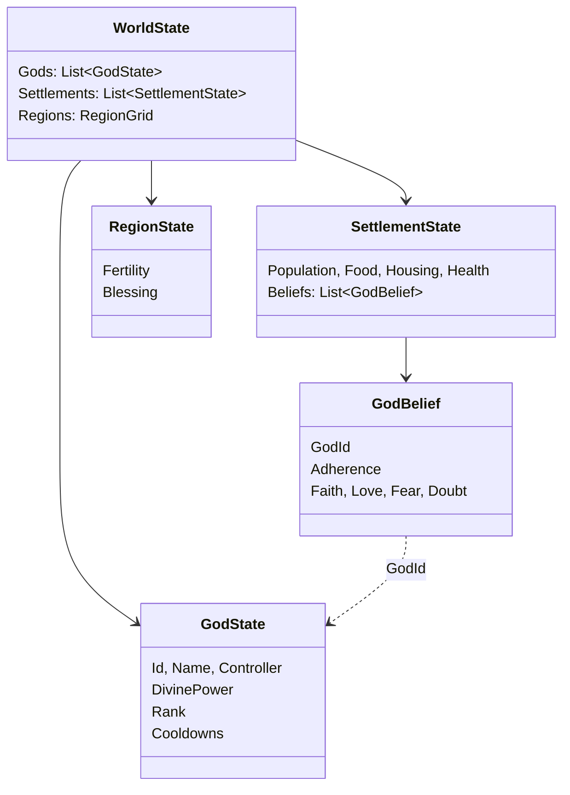
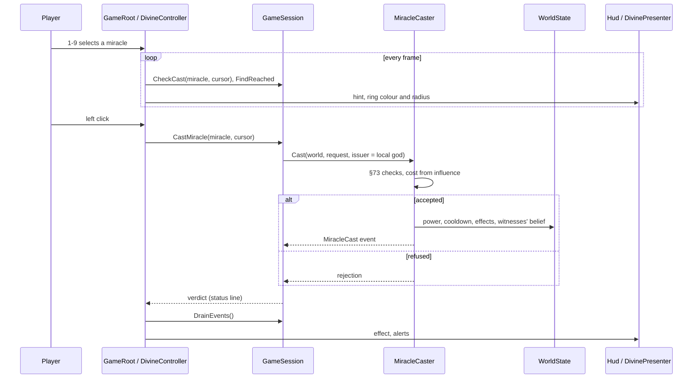
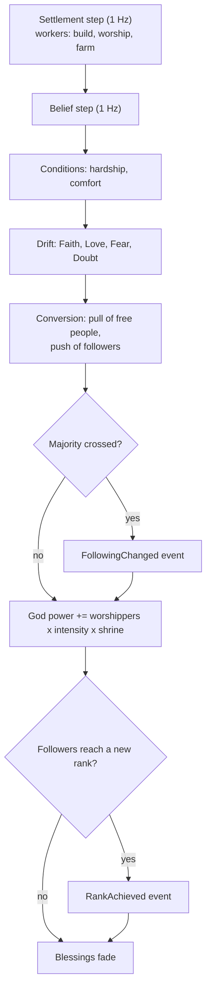

# Milestone 3 — First God

## Overview

Spec §118 asks for Divine Power, influence, belief and basic miracles, with the playable outcome
"Player can gain and spend belief". The decisions behind this milestone are in
[ADR-009](../docs/ADR/ADR-009-belief-influence-and-miracles.md).

What the player gets:

- **A god.** The player is Ilyra (`game/Data/gods.json`), a Minor Spirit followed by 60% of a home
  settlement. A HUD at the top shows Divine Power, its income per second, followers and the next
  rank.
- **Eight settlements** (§108) on the island, at least five regions apart. Only the home
  settlement knows the god at the start.
- **Belief.** Every settlement holds Faith, Love, Fear and Doubt for each god it knows, and a
  share of its people follow that god. Belief drifts every simulated second. Comfortable followers
  grow fond of their god; hunger and illness breed doubt and wear down love. Fear fades in safety.
  People convert, or fall away, through these values.
- **Worship as work.** Followers spend time worshipping at the shrine instead of farming, and
  their worship raises Divine Power: followers × Faith × intensity × the shrine (§9).
- **Influence.** Followers spread the god's influence around their settlement. The more
  followers, the further it reaches. Miracles need influence at the target and cost more where
  it is weak (§10).
- **Five miracles** (`game/Data/miracles.json`): Food, Heal, Bless Crops, Lightning and, from the
  rank of Lesser God, Mass Healing. Select one with keys 1–9 or the miracle bar. A ring on the
  ground shows its radius: green where it can be cast, red where not. The hint says which
  settlements it would reach and what it costs, or why it cannot be cast. Click to cast.
- **Consequences.** People who see a miracle change their belief. Helping people who need it
  earns love. Lightning frightens people, and frightened people convert quickly but fall away
  quickly. Strangers who see a miracle start to believe.
- **Ranks.** Ranks follow the number of followers: Lesser God at 100, God at 400, then Greater
  God, High God and Ascendant. Ranks unlock miracles and are never lost.
- **Alerts** (§59) on the right: a settlement starving, a settlement now following you or turning
  away, a new rank. Click one to look there.
- **Map overlays** (§58), cycled with O: influence, faith and food.

## Architecture

### What changes, by project

| Project | Changes |
| --- | --- |
| `Pantheon.Domain` | `Gods/` (`GodState`, `GodController`, `DivineRank`, `GodDomain`, `MiracleCooldown`, `CastMiracleRequest`, `PantheonSetup`), `Belief/` (`GodBelief`, `BeliefLevels`, `BeliefImpulse`, `DivineRules`), `Miracles/` (`MiracleDefinition`, `MiracleEffect`, `MiracleEffectKind`, `MiracleNeed`, `MiracleScale`, `MiracleCatalog`), `Events/` (`WorldEvent`, `MiracleCast`, `FollowingChanged`, `RankAchieved`, `FamineStarted`). `WorldState.Gods`, `SettlementState.Beliefs`, `RegionState.Blessing`, `SettlementRules.BlessingYieldBonus` and `WorshipWorkforceShare`, and the founding settings `Count`, `MinimumSpacing` and `PopulationVariation`. |
| `Pantheon.Simulation` | `Belief/` (`BeliefModel`, `BeliefSystem`, `InfluenceField`, `GodStanding`, `DivineRulesValidator`), `Miracles/` (`MiracleBook`, `MiracleCaster`, `CastCheck`, `CastRejection`), `Validation/RuleErrors`. `SettlementFounder.FoundAll` and `PantheonFounder`. Worship labour and blessed yields in `SettlementEconomy`, `FamineStarted` in `SettlementSystem`, events in `TickContext`, and the belief step in `SimulationEngine`. |
| `Pantheon.Persistence` | Save version 3 and the migration from version 2, integrity checks for gods, beliefs and blessings, and parsing of `divine_rules.json`, `miracles.json` and `gods.json`. |
| `Pantheon.Game` | `GameContent` with the new content, the session as the authority for casts (`CheckCast`, `CastMiracle`, `FindReached`, `DrainEvents`, `LocalGodId`), `SessionCommands.CastMiracle`, `GrantPower` and `ChangeSpeed`, `Hud/` (`HudReadout`, `HudModel`, `MiracleSlot`), `Alerts/` (`AlertFeed`, `Alert`, `AlertSeverity`), `Divine/DivineText`, `Presentation/` (`OverlayMap`, `DivineViewSettings`, `SettlementPicker`, labels with the main god), god and belief readouts, the Blessing and Influence layers of the F3 map, and new launch options. |
| Godot client | `UI/Hud`, `Bootstrap/DivineController`, `Presentation/Divine/` (`DivinePresenter`, `TargetRing`, `MapOverlay`, `MiracleEffect`, `RingTexture`), labels tinted by the main god, new input actions, and `game/Data/divine_view.json`. |

### Belief and worship

Each settlement keeps one `GodBelief` per god its people know. The belief step (`BeliefSystem`,
every 10 ticks, after the settlement step) does the following for each settlement:

1. **Conditions.** Hardship is the worse of ill health and hunger. Hunger is how far the stores
   fall short of `ComfortFoodPerPerson` per person. Comfort is health times food security.
2. **Drift**, from the values before the step:
   - Faith gains `FaithFromWorship × adherence`, loses `FaithErosionFromDoubt × Doubt` and loses
     `FaithForgettingPerStep × (1 − adherence)`.
   - Love gains `LoveFromComfort × comfort × adherence`, loses `LoveDecayPerStep` and loses
     `LoveLossFromHardship × hardship × adherence`.
   - Fear loses `FearDecayPerStep × (1 − hardship)`.
   - Doubt drifts towards `SilenceDoubt` and gains `DoubtFromHardship × hardship × adherence`.
   - Gains close that share of the gap to 1, and losses remove that share of the value.
3. **Conversion.** Each god gains `ConversionPerStep × pull × free share` of the people, where
   `pull = Faith × (BaseConversion + LoveConversion × Love + FearConversion × Fear) × (1 − Doubt)`.
   It loses `ApostasyPerStep × push × adherence`, where
   `push = Doubt × (BaseApostasy + FearFragility × Fear) × (1 − LoveLoyalty × Love)`.
   When the gods together would convert more people than are free, their gains are scaled down.
4. **Events.** A god gaining or losing half of the people raises `FollowingChanged`.
5. **Forgetting.** A belief with fewer than half a follower and Faith below `ForgottenFaith` is
   removed.

Then each god gains its worshippers' power, reaches the rank its followers earn (`RankAchieved`),
and every region's blessing fades by `BlessingDecayPerStep`.

The settlement step takes worshippers out of the fields:
`worshippers = workers × WorshipWorkforceShare × Σ(adherence × Faith)`. Blessed farmland yields
up to `1 + BlessingYieldBonus × mean blessing` times as much.

### Influence

`InfluenceField.Build(rules, world, god)` collects one source per settlement with followers.
Each source has a strength of `min(1, InfluenceStrength × adherence × Faith)` and a reach of
`InfluenceBaseRadius + InfluenceRadiusPerSqrtFollower × √followers`, and its influence fades
linearly to 0 at the reach. Sources combine as `1 − Π(1 − influenceᵢ)`. Nothing is saved.

With the shipped numbers, the home settlement reaches about 480 m at the start. Its nearest
neighbours, at about 320 m, sit at an influence of about 0.25. Settlements more than about 470 m
away need closer followers first.

### Miracles

`MiracleCaster.Check` makes §73's checks in order: unknown god, unknown miracle, not authorised,
rank too low, on cooldown, outside the world, outside influence, not enough power. The cost is
`PowerCost × (1 + WeakInfluenceCostFactor × (1 − influence))`.

`MiracleCaster.Cast` checks again. When the cast is accepted, it:

- spends the power and starts the cooldown;
- applies the effects to the settlements within `Radius + SettlementRadius` (food up to storage,
  health, smiting) and to the regions within `Radius` (blessing);
- changes the belief of every settlement within that reach plus `WitnessRadius`, weighted by
  closeness. The Love of a miracle that answers a need is scaled from `GratitudeFloor` (no need)
  to 1 (dire need).

It raises `MiracleCast` and draws no random numbers.

### Saves

Version 3 adds `World.Gods`, `Settlement.Beliefs`, `Region.Blessing` and the founding settings.
The migration from version 2 adds the Milestone 3 player god Ilyra, with 100 Divine Power,
followed by 60% of the first settlement. The other settlements know no god yet, regions have no
blessing, and the founding settings describe one settlement. It is tested against
`save-v2.json`, written by the Milestone 2 build before any of this milestone's changes.

### Debug tools

- The F1 panel, hidden at the start, shows:
  - one line per god: power and income, rank, followers and the next rank;
  - each god's influence under the cursor;
  - the settlement nearest the cursor in detail, with jobs including the worshippers, the
    blessing, its conditions and every belief: followers, values, worshippers and the power they
    raise;
  - one line for each other settlement.
- F3 adds the Blessing and Influence layers.
- F4 grants 500 Divine Power.
- The launch options `--divine-power`, `--cast`, `--select`, `--overlay`, `--focus` and
  `--debug-panel` script captures of casting, targeting and overlays. In scripted runs, the
  cursor point falls back to the screen centre.

## Mermaid Diagrams

## Code Plan

1. Domain types for gods, belief, miracles and events. Extend the world, settlement, region and
   founding state.
2. `BeliefModel`, as pure functions; then `BeliefSystem`, `InfluenceField` and `GodStanding`.
3. `MiracleBook` and `MiracleCaster`, with §73's checks.
4. Founding several settlements, and gods with home settlements.
5. Save version 3, its migration and integrity checks, and content parsing.
6. `GameContent` and the session as the authority; commands, HUD model, alerts, overlays, labels
   and readouts.
7. The Godot HUD, the divine controller, targeting, effects, the overlay decal and the input map.
8. Balance runs (headless) and captures on macOS (Metal), on both terrain renderers.

## Test Plan

| Area | Tests |
| --- | --- |
| Belief rules | `BeliefModelTests`: fear fades in safety (§102) and lingers in hardship; doubt rises among followers in hardship; love grows with comfort and wears down in hardship; worship sustains faith and unbelievers forget it; fear converts faster than love; love holds followers and fear drives them away; doubt holds back conversion; conversions never exceed the free share; conditions; §9's power formula with a worked example; worshippers leave the fields; impulse arithmetic. |
| Belief step | `BeliefSystemTests`: the step cadence; power gain; a faithful settlement converts; an unhelped famine turns followers away; ranks rise, raise an event and never fall; majority events; forgotten beliefs; fading blessings; determinism. |
| Influence | `InfluenceFieldTests`: falloff and reach, growth with followers, overlap that never passes 1, no followers and no influence. |
| Miracles | `MiracleCasterTests`: a god cannot cast without enough power (§102); each rejection; cooldowns; cost rising with weak influence; each effect; gratitude by need; witnesses and strangers. |
| Session and HUD | `DivineSessionTests`: the local god, checks that change nothing, casting and events, tick events, command wording, granting power, speed steps, the HUD's bar, hints and cooldowns, and a world without gods. |
| Presentation | `DivinePresentationTests`: alerts (relevance, repeats, capacity), overlays, labels, the picker, the debug panel's god and belief lines, the Blessing and Influence layers, and the cast wording. |
| Saves | `DivineSaveTests` (round trip, save and load continuing identically, broken beliefs and gods rejected), `SaveMigrationV2Tests` (against `save-v2.json`). Version 1 saves also migrate to version 3. |
| Content and generation | `ContentTests` (shipped divine content, out-of-range values), `WorldGenerationTests` (spaced settlements with unique names, gods and home beliefs, best site first), `LaunchOptionsTests`. |

### Verification results

- `dotnet build Pantheon.sln`: no warnings. `dotnet test Pantheon.sln`: 426 tests pass in about
  10 seconds (331 at the end of Milestone 2).
- Godot 4.7.2 .NET on macOS 26 (Apple M3 Pro, Metal 4, Forward+), Terrain3D and the fallback
  renderer:
  - The HUD, the miracle bar, the targeting ring and hint, the Food shower, the Lightning bolt
    (three people killed), and the influence and faith overlays all work.
  - 119 FPS at 1600 × 900 after 9,000 ticks: 8 settlements, 300 citizens shown, the F1 panel
    open.
- Headless balance runs with seed 1234 and the shipped content:
  - Untouched, Ilyra reaches Lesser God after about 15 simulated minutes, with 326 followers and
    about 21 Divine Power per second.
  - A bot casting Food on the nearest unconverted settlement every 15 seconds converts the first
    neighbour in about 3 minutes and the island in about 12.
  - A famine at home with no help drops adherence from 0.83 to 0.35 in 3 minutes. With Food and
    Heal every 40 seconds, it rises to 0.95.

## Tasks

### Completed

- [x] Merge Milestone 2 into `main` (pull request #2 had been merged into the Milestone 1 branch).
- [x] Install the toolchain on macOS (`dotnet-sdk@8`, `godot-mono` 4.7.2), and confirm that the
      Milestone 2 build passes its tests and renders with Metal.
- [x] Write a version 2 save fixture with the Milestone 2 build.
- [x] ADR-009.
- [x] Gods, belief, influence, Divine Power, ranks, worship labour and blessed land.
- [x] Food, Heal, Bless Crops, Lightning and Mass Healing, with §73's checks.
- [x] Eight spaced settlements; gods followed in their home settlements.
- [x] Save version 3 with its migration, and the integrity checks.
- [x] HUD, alerts, overlays, targeting, effects, labels and the input map.
- [x] Debug readouts, F3 layers, F4, and launch options for scripted captures.
- [x] Tests, balance runs, and captures on macOS.
- [x] README, ARCHITECTURE, ADR index and progress summary.

### Future (later milestones)

- Rival gods and conversion between gods (Milestone 5): the free-share rule already arbitrates
  between gods.
- Dependency and Resentment (§7); religious infrastructure beyond the shrine (temples, §10); god
  domains and traits that emerge from behaviour (§11–12).
- Rain, Water, Fire, Earthquake and Shield (§110), which need weather, water and disasters
  (Milestones 7–8).
- The Divine Hand (§55) with the Creature and Jolt (Milestone 4); casting through it sends the
  same requests.
- Audio (§60) and a miracle panel with descriptions (§57).

## Relevant Files

- `src/Pantheon.Domain/{Gods,Belief,Miracles,Events}/`
- `src/Pantheon.Simulation/{Belief,Miracles}/`, `Settlements/SettlementEconomy.cs`,
  `WorldGen/{SettlementFounder,PantheonFounder,WorldGenerator}.cs`,
  `Systems/SimulationEngine.cs`
- `src/Pantheon.Persistence/{SaveMigrations,SaveIntegrity,ContentJson,WorldSaveSerializer}.cs`
- `src/Pantheon.Game/{GameSession,GameContent,SessionCommands}.cs`,
  `src/Pantheon.Game/{Hud,Alerts,Divine}/`,
  `src/Pantheon.Game/Presentation/{OverlayMap,DivineViewSettings,SettlementLabel,SettlementPicker}.cs`
- `game/Scripts/UI/Hud.cs`, `game/Scripts/Bootstrap/{GameRoot,DivineController}.cs`,
  `game/Scripts/Presentation/Divine/`
- `game/Data/{divine_rules,miracles,gods,divine_view}.json`
- `src/Pantheon.Tests/Persistence/Fixtures/save-v2.json`
