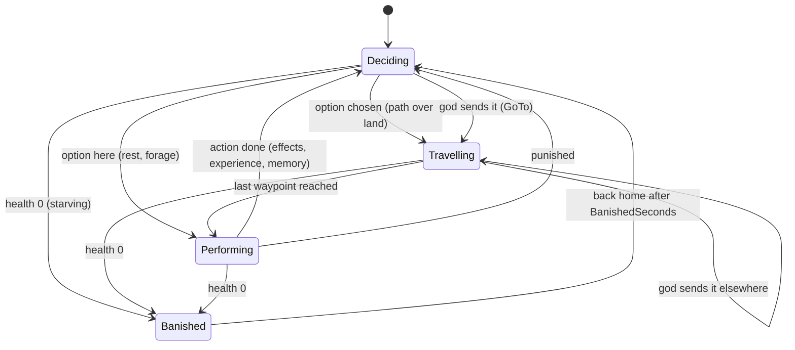

# Milestone 4 — Creature

## Overview

Spec §119 asks for the Creature, movement, interaction, needs, simple AI and reward/punishment,
with the playable outcome "Creature behaves independently". The decisions are in
[ADR-010](../docs/ADR/ADR-010-creature-simulation-and-learning.md).

What the player gets:

- **Bramble the Mossback**, the god's Creature: a mossy giant, about 12 m tall at level 1, with
  horns in the god's colour. It is born beside the home settlement.
- **A life of its own.** Its hunger, tiredness and boredom grow. It notices the settlements within
  500 m and how each is faring: in need, building or thriving. It chooses what to do from its
  needs, what it has learned to like, its personality and how far away things are:
  - forage, rest or wander;
  - eat from a village's stores;
  - feed a hungry village;
  - help a village build;
  - play with the villagers;
  - attack them;
  - walk away.
- **Consequences.** Its deeds change the world and the people's view of its god:
  - feeding fills the stores and wins love;
  - helping build raises houses;
  - eating from the stores is theft;
  - attacking kills villagers and spreads fear.

  Its morality follows its deeds, and its presence carries the god's influence.
- **Growth.** Experience from its deeds raises its level, up to 10, and with it its size, strength
  and speed.
- **Teaching** (§25). Press Z to reward and X to punish what Bramble is doing, or what it did in
  the last 15 seconds.
  - A reward makes it like that action more in that situation; a punishment makes it like it less
    and stops it.
  - Feedback also nudges its personality and changes its loyalty.
  - Rewarding feeding five times takes its preference from §25's 0.40 to about 0.86, close to the
    spec's 0.85.
- **Commands.**
  - V sends Bramble to the cursor; it waits there longer the more loyal it is.
  - C looks at it.
  - The HUD card shows its level, activity, needs, loyalty and morality, and what a reward or
    punishment would judge.
- **The Divine Hand** (visual). A glowing hand follows the cursor, presses down when you cast or
  send, pats Bramble with a golden glow when you reward it, and swats it with a red flash when you
  punish it.
- **Banishment** (§28). A Creature that starves is banished for a minute and returns home weakened.
- **Alerts** for its notable deeds (attacks, theft, feeding, building), new levels, banishment and
  its return.

## Architecture

### What changes, by project

| Project | Changes |
| --- | --- |
| `Pantheon.Domain` | `Creatures/`: `CreatureState`, `CreatureNeeds`, `CreaturePersonality`, `CreatureActivity`, `LearnedPreference`, `CreatureMemory`, the enums `CreatureAction`, `CreatureSituation`, `CreaturePhase` and `CreatureFeedback`, `CreatureCommand`, and `CreatureRules` (content). `WorldState.Creatures`, `GodState.CreatureId`, `GodSlot.CreatureName`, the `CreatureActed` and `CreatureChanged` events, the Creature influence fields of `DivineRules`, and `World/SimulationTime`. |
| `Pantheon.Simulation` | `Creatures/` (`CreatureModel`, `CreatureBrain`, `CreatureDeeds`, `CreatureSystem`, `CreatureAuthority`, `CreatureFounder`, `CreatureRulesValidator`), `Navigation/RegionPathfinder`. Creature sources in `InfluenceField`, Creatures founded with their gods, and the Creature step in the game's engine pipeline. |
| `Pantheon.Persistence` | Save version 4 and the migration from version 3, `CreatureIntegrity`, and parsing of `creatures.json`. |
| `Pantheon.Game` | `GameContent.Creatures`, the session's `LocalCreature`, `CommandCreature`, `FindJudgedAction` and `PreviewCreatureOptions`, `SessionCommands.CommandCreature`, `Creatures/CreatureText`, the HUD's `CreatureCard`, Creature alerts, the Creature debug view (`CreatureReadout`) and the launch options `--focus=creature` and `--judge`. |
| Godot client | `Presentation/Creatures/` (`CreatureBody`, `CreatureView`, `CreaturePresenter`), `Presentation/Divine/DivineHand`, the HUD's Creature card, the C, Z, X and V actions, and Jolt chosen as the physics engine. |

### The Creature's state machine and brain

When deciding, at most every `DecisionIntervalTicks` (2 ticks, 5 Hz), `CreatureBrain.ListOptions`
builds the options:

| Situation | Options | Drive |
| --- | --- | --- |
| Hungry (hunger ≥ 0.55) | Forage here; EatFromStores in each perceived settlement with food | hunger (× closeness for settlements) |
| Tired (fatigue ≥ 0.7) | Rest | fatigue |
| Bored (boredom ≥ 0.6) | Wander | boredom |
| Idle | Wander, Rest | 0.2 + 0.3 × boredom; 0.5 × fatigue |
| VillageInNeed (food or health need ≥ 0.5) | Feed, EatFromStores, Attack, Ignore | need; 0.3 + 0.7 × hunger; 0.35; 0.3 (all × closeness) |
| VillageBuilding | HelpBuild, Attack, Ignore | 0.5; 0.35; 0.3 |
| VillageThriving | Play, Attack, Ignore | 0.3 + 0.7 × boredom; 0.35; 0.3 |

Utility = preference(situation, action) × drive × (0.5 + the trait behind the action) ×
closeness. Closeness is `1 / (1 + distance / DistanceHalfUtility)`. Kind acts use kindness, cruel
acts aggression, rest laziness, and roaming curiosity. `Decide` adds up to `DecisionJitter` of
seeded noise and starts the best option it can reach over land.

### Deeds

`CreatureDeeds.Complete` applies a finished action:

| Action | Effect on the settlement | Needs |
| --- | --- | --- |
| Feed | + `Amount × strength` food, up to storage | boredom eased, tiring |
| EatFromStores | − up to `Amount × strength` food | hunger eased by the share eaten |
| HelpBuild | + `Amount × strength` builder-steps, finishing houses as the settlement step does | tiring |
| Attack | − `Amount × strength` people | boredom eased, tiring |
| Play | — | boredom eased |
| Forage, Rest, Wander, Ignore | — | hunger, fatigue or boredom eased |

The people of the settlement change their belief in the Creature's god by the action's `Witness`
impulse. Love from feeding scales with their need for food. Morality moves by `Kindness × 0.05`.
The deed adds experience (which may raise a level), a memory and a `CreatureActed` event.

### Saves

Version 4 adds `World.Creatures` and `God.CreatureId`. The migration from version 3 gives every god
the Milestone 4 newborn, Bramble, with the shipped starting preferences and an even temper (every
trait 0.5). It is born at the settlement where most of the people follow its god. The migration is
tested against `save-v3.json`, written by the Milestone 3 build at commit 5d16aba.

### Debug tools

- The F1 panel shows the Creature view (§106):
  - level and experience, health, loyalty, morality and position;
  - the activity, with its action, situation, phase, waypoints and ticks left;
  - needs and personality;
  - the four best options with their utilities;
  - the learned preferences by situation;
  - the last five memories with the god's feedback.
- `--focus=creature` starts the camera on the Creature, and `--judge=reward|punish` judges it on
  the first frame, for captures of the hand's gestures.
- Smoke runs end with a line per Creature: level, activity, position and memories.

## Test Plan

| Area | Tests |
| --- | --- |
| Learning and growth | `CreatureModelTests`: rewarding feeding reaches §25's 0.85; punishing attacks drives them to nothing; unknown preferences are added; personality nudges; levels; strength and speed; needs. |
| Navigation | `RegionPathfinderTests`: straight paths on open land, around the sea, none to an unreachable island or off the map. |
| Behaviour | `CreatureBehaviourTests`: a hungry Creature goes for food, a tired one rests; learned preferences decide between feeding and attacking a village in need; perception range; walking at its speed; feeding, attacking, eating from stores and building change the settlement and belief; experience raises the level; a starving Creature is banished and returns home; it carries influence; the same world lives the same way. |
| Commands | `CreatureAuthorityTests`: a reward judges the current action and raises preference and loyalty; a punishment stops it; feedback judges the last deed only within the window; the §73-style checks; go-to over land, refused when unreachable or outside the world. |
| Session and presentation | `CreatureSessionTests`: the god's Creature at home, acting on its own, the command wording, sending it, the HUD card, Creature alerts, the debug view, activity wording, saving and loading. |
| Saves and content | `SaveMigrationV3Tests` (against `save-v3.json`); versions 1 and 2 also migrate to 4; `ContentTests` (shipped Creature rules, bad values); `LaunchOptionsTests`. |

### Verification results

- `dotnet build Pantheon.sln`: no warnings. `dotnet test Pantheon.sln`: 471 tests pass (426 at the
  end of Milestone 3).
- A headless run with seed 1234, untouched for 15 simulated minutes: Bramble plays, wanders,
  forages, rests, eats from village stores when hungry, and helps the growing villages build
  (33 times). It never attacks with its starting preferences. With the original experience
  thresholds it reached level 5 in 12 minutes; the thresholds were doubled after this run.
- Godot on macOS (Apple M3 Pro, Metal):
  - Bramble walks and plays in Duskwater with its activity label.
  - A punishment swats it with a red flash and stops its play (loyalty 70% → 66%); a reward pats
    it with a golden glow (loyalty 70% → 72%).
  - The HUD card shows what a reward or punishment would judge.

## Tasks

### Completed

- [x] ADR-010: core Creature, our own state machine and utility AI instead of LimboAI, region
      navigation, Jolt chosen but not yet used, a visual hand.
- [x] Creature state, rules and content; founding with the gods; save version 4 and its migration.
- [x] Needs, decisions, movement, deeds, experience and levels, banishment, influence.
- [x] Reward, punishment and go-to through the authority; learning and personality nudges.
- [x] Mossback body and animation, the Divine Hand, the HUD card, keys, alerts and the debug view.
- [x] Tests, a balance run and captures.

### Future

- Rival Creatures, fights and relationships (Milestone 11).
- Picking up and throwing with the hand, with physics as presentation and outcomes checked by the
  authority (a later milestone, with its own ADR).
- Local avoidance and finer paths, once there are obstacles that matter.
- Personality traits from §26 beyond the four basic ones, and specialisations (§24).

## Relevant Files

- `src/Pantheon.Domain/Creatures/`, `src/Pantheon.Domain/Events/Creature*.cs`
- `src/Pantheon.Simulation/Creatures/`, `src/Pantheon.Simulation/Navigation/RegionPathfinder.cs`
- `src/Pantheon.Persistence/{SaveMigrations,CreatureIntegrity}.cs`
- `src/Pantheon.Game/Creatures/CreatureText.cs`, `src/Pantheon.Game/Hud/CreatureCard.cs`,
  `src/Pantheon.Game/Diagnostics/CreatureReadout.cs`
- `game/Scripts/Presentation/Creatures/`, `game/Scripts/Presentation/Divine/DivineHand.cs`
- `game/Data/creatures.json`
- `src/Pantheon.Tests/Creatures/`, `src/Pantheon.Tests/Persistence/Fixtures/save-v3.json`
