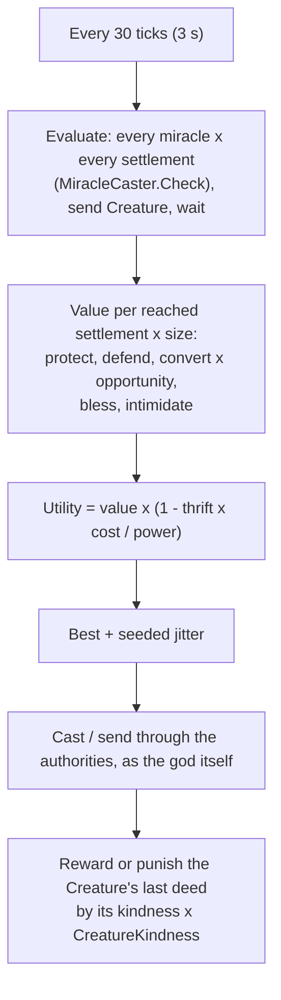
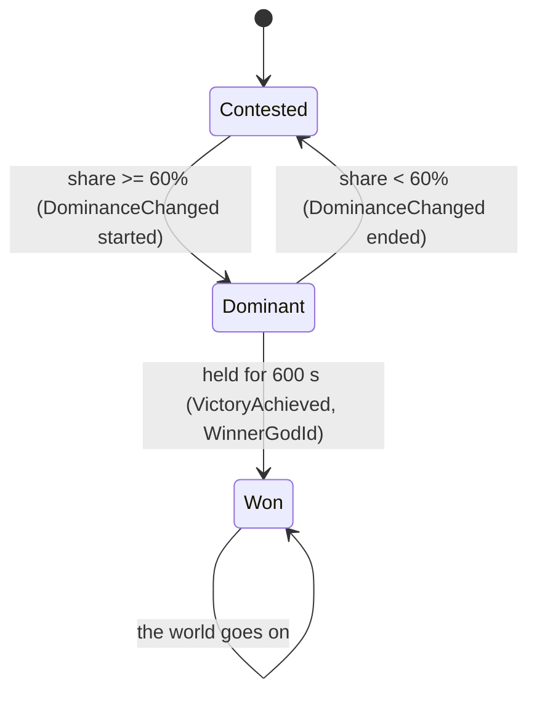

# Milestone 5 — Rival God

## Overview

Spec §120 asks for a second god, utility AI, competing belief and conversion, with the playable
outcome "Religious competition exists". The decisions are in
[ADR-011](../docs/ADR/ADR-011-rival-gods-utility-ai-and-victory.md).

What the player gets:

- **Vael the Tyrant**, an AI god with its own home at the far end of the island (Kestrel Rise for
  seed 1234) and its own Creature, Gristle.
- **Vael plays by the player's rules.** Every 3 seconds it weighs every miracle it may cast on
  every settlement, sending Gristle, and waiting, and takes the best through the same checks the
  player's casts pass. As a Tyrant it strikes its rival's followers with Lightning, heals and feeds
  its own, defends villages the player courts, and teaches Gristle cruelty.
- **Competing belief.** People who lose faith in one god go to the god that pulls them most. A
  miracle plants doubt about the other gods its witnesses follow. Working miracles where a rival is
  stronger costs more.
- **Love against fear.** Fear converts fast but fades fast. Killings breed doubt, and frightened
  followers leave easily. Loved followers stay.
- **Victory** (§115). Hold 60% of all followers for ten minutes and you win. The HUD shows the
  race ("You hold 42% of all belief; 60% for 10:00 wins", "Vael holds 68% of all belief: it wins
  in 4:10"). Alerts announce dominance and victory. The world goes on afterwards.
- **Seeing the contest.**
  - The rival on the HUD.
  - Village labels in the colour of the god most people follow.
  - The Influence overlay coloured by the strongest god.
  - A new Religion overlay.
  - Alerts when Vael works a miracle on your followers or its Creature attacks them.
  - The F1 god AI view (§106): Vael's goal now and its top candidates, with utilities and reasons.

## Architecture

| Project | Changes |
| --- | --- |
| `Pantheon.Domain` | `GodPersonality`; `GodState.Personality` and `DominantSinceTick`; `GodSlot.Personality`; `WorldState.WinnerGodId`; `GodAiRules` and `GodProfile` (content); `DivineRules.ApostateFreedom`, `RivalMiracleDoubt`, `ContestedCostFactor`, `VictoryShare` and `VictorySeconds`; the `DominanceChanged` and `VictoryAchieved` events. |
| `Pantheon.Simulation` | `Gods/` (`GodAi`, `GodAiSystem`, `AiCandidate`, `GodAiRulesValidator`); `Belief/VictorySystem`; conversion between gods in `BeliefModel.ComputeAdherenceChanges`; contested costs and rival doubt in `MiracleCaster`; spread-out homes in `PantheonFounder`; the full engine pipeline; Creatures that do not starve for a command. |
| `Pantheon.Persistence` | Save version 5 and the migration from version 4; integrity checks for personalities, dominance and the winner; parsing of `god_ai.json`. |
| `Pantheon.Game` | `GameContent.GodAi`; `GameSession.PreviewGodAi`; the HUD's rivals and contest lines; rival, dominance and victory alerts; the Influence (strongest god) and Religion overlays; `GodAiReadout`; `DivineText.Personality` and `Clock`. |
| Godot client | The HUD's rival and contest lines; rival Creatures labelled with their god; the AI view in F1. |

### The god AI

| Goal | Value in a settlement it reaches (× size factor) |
| --- | --- |
| protect | Protect × own adherence × need |
| defend | Protect × own adherence × min(1, 2 × rivals' adherence) |
| convert | Convert × (free + rivals' adherence) × (0.3 + 0.7 × need) × (1 + Opportunism × max(hardship, rivals' doubt)) |
| bless | Bless × (own + 0.5 × (1 − own)) × (0.4 + 0.6 × food need) |
| intimidate | Intimidate × (rivals' adherence + 0.3 × free) × opportunity × (1 − own adherence) |

### Conversion between gods

When god *r* loses `loss` followers in a step, every other god *g* gains
`loss × pull_g / (ApostateFreedom + Σ pull of the gods other than r)`; the rest join the people
who follow no god. Gains from the free share are scaled so the shares never pass 1, as before.

### Victory

## Test Plan

| Area | Tests |
| --- | --- |
| Competition | `RivalGodTests`: people who leave a god go to the rival that pulls them; a rival's miracle plants doubt; contested costs; a Guardian protects followers in need; a Tyrant strikes the rival's followers and says why; a poor god waits; the AI acts through the authority; victory after holding the share long enough; dominance ends when the share falls; one god alone cannot win; a contest plays out the same way each time. |
| Creatures under command | `CreatureBehaviourTests`: a desperate Creature stops waiting where it was sent; the AI does not send a hungry Creature. |
| Presentation | `RivalPresentationTests`: the HUD's rival and race lines; rival, dominance and victory alerts; the Influence and Religion overlays; the AI debug view; personalities only for AI gods; a profile for every personality. |
| Saves | `SaveMigrationV4Tests` against `save-v4.json`, written by the Milestone 4 build at commit c7d33db; versions 1–3 also migrate to version 5. |

### Verification results

- `dotnet build Pantheon.sln`: no warnings. `dotnet test Pantheon.sln`: 494 tests pass (471 at the
  end of Milestone 4).
- Headless contests, seed 1234, 25 simulated minutes each. These runs used the final rules (fear,
  Lightning and the Tyrant retuned, the defend goal added, no smiting of its own followers):
  - Passive player: Ilyra leads at first (59%). Vael takes the island from minute 9 and wins at
    19 minutes.
  - A player who casts Food on the nearest unconverted settlement every 15 s: Ilyra wins at
    13 minutes. Vael then retakes most settlements, because that player never defends.
- Before the retune, the Tyrant spammed Lightning (115 casts in 25 minutes) and won even against
  the active player. Fear lasted, and killings reduced doubt.
- Godot on macOS (Metal): the rival and race lines, red labels on Vael's settlements, the
  Influence overlay in both gods' colours, Vael's miracles alerting on Duskwater, and 119 FPS with
  the F1 AI view after 9,000 ticks.

## Tasks

### Completed

- [x] ADR-011.
- [x] Rival god, personalities, utility AI acting through the authorities, Creature teaching.
- [x] Conversion between gods, rival doubt, contested costs, retuned fear.
- [x] Victory and dominance; save version 5 and its migration.
- [x] HUD, labels, overlays, alerts and the AI debug view.
- [x] Tests, headless contests and captures.

### Future

- Diplomacy, relationships and betrayal memory (Milestone 6); four gods and the remaining
  personalities (Milestone 9).
- Long-term goals and plans for the AI (§47, §87 major planning every 15–60 s).
- A victory screen and a choice of victory conditions and duration (§53).

## Relevant Files

- `src/Pantheon.Simulation/Gods/`, `src/Pantheon.Simulation/Belief/{BeliefModel,VictorySystem}.cs`,
  `src/Pantheon.Simulation/Miracles/MiracleCaster.cs`, `src/Pantheon.Simulation/WorldGen/PantheonFounder.cs`
- `src/Pantheon.Domain/Gods/{GodPersonality,GodAiRules}.cs`, `src/Pantheon.Domain/Events/{DominanceChanged,VictoryAchieved}.cs`
- `src/Pantheon.Game/Diagnostics/GodAiReadout.cs`, `src/Pantheon.Game/Hud/HudReadout.cs`,
  `src/Pantheon.Game/Presentation/OverlayMap.cs`, `src/Pantheon.Game/Alerts/AlertFeed.cs`
- `game/Data/{god_ai,gods,divine_rules,miracles}.json`
- `src/Pantheon.Tests/Gods/`, `src/Pantheon.Tests/Persistence/Fixtures/save-v4.json`
