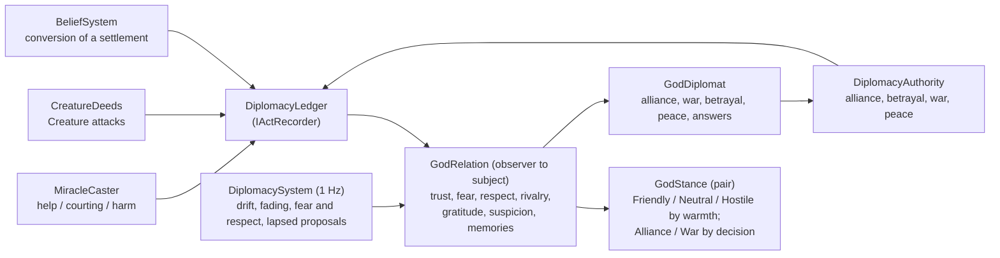

# Milestone 6 — Diplomacy

## Overview

Spec §121 asks for relationships, alliance, war and betrayal memory, with the playable outcome
"Rival can cooperate or attack". The decisions are in
[ADR-012](../docs/ADR/ADR-012-diplomacy-relations-status-and-memory.md).

What the player gets:

- **Relationships.** Every god sees every other god in its own way (trust, fear, respect,
  rivalry, gratitude, suspicion) and remembers what the other did:
  - helped its followers in need;
  - courted them with miracles they did not need;
  - struck them;
  - converted a settlement from it;
  - let its Creature attack them;
  - betrayed it;
  - declared war on it;
  - allied with it, or made peace.
- **Status.** Each pair is allied, friendly, neutral, hostile or at war. Friendly and hostile come
  by themselves as feelings warm or sour; alliance, war and peace are decisions.
- **Diplomacy panel** (P). For each rival it shows your status, how the rival feels about you and
  why ("remembers that you betrayed it; converted Elar"), what your people hold against it, what
  it has proposed, and buttons for the moves allowed now: offer alliance, break alliance,
  declare war, request peace, accept, decline.
- **Consequences.**
  - Allies do not plant doubt in each other's followers or raise each other's costs, and their AI
    and Creatures leave each other's people alone.
  - At war, peoples resist the enemy's pull where their god holds the majority, and Creatures are
    drawn to enemy villages.
  - Breaking an alliance is a betrayal: the victim's trust collapses, every god trusts the traitor
    less, and the memory lasts.
- **The rival decides for itself.** It weighs alliance, war, betrayal and peace by its view of you,
  the balance of followers, war-weariness and its personality, and it answers your proposals.
  The F1 AI view lists its diplomatic candidates with the factors behind them.
- **Alerts** for proposals, war, betrayal, alliances, peace and refusals.

## Architecture

| Project | Changes |
| --- | --- |
| `Pantheon.Domain` | `Diplomacy/`: `DiplomacyState`, `GodRelation`, `DiplomaticMemory`, `DiplomaticAct`, `GodStance`, `DiplomaticStatus`, `DiplomaticProposal`, `ProposalKind`, `DiplomaticCommand`, `DiplomaticCommandKind`, `DiplomacyRules`; `WorldState.Diplomacy`; the `DiplomacyChanged` event; the diplomacy weights in `GodProfile`. |
| `Pantheon.Simulation` | `Diplomacy/`: `IActRecorder`, `DiplomacyLedger`, `DiplomacyModel`, `DiplomacySystem`, `DiplomacyAuthority`, `DiplomacyRulesValidator`. `Gods/GodDiplomat` and `DiplomacyCandidate`. `Systems/Authorities`. Acts recorded in `MiracleCaster`, `CreatureDeeds` and `BeliefSystem`. Status effects in `MiracleCaster`, `BeliefModel`/`BeliefSystem` (war resistance), `CreatureBrain` and `GodAi`. The full engine pipeline gains the diplomacy step. |
| `Pantheon.Persistence` | Save version 6, the migration from version 5, `DiplomacyIntegrity`, and parsing of `diplomacy.json`. |
| `Pantheon.Game` | `Diplomacy/DiplomacyText` and `DiplomacyReadout`; `GameSession.CommandDiplomacy`, `CheckDiplomacy` and `PreviewGodDiplomacy`, with the session using the engine's `Authorities`; `SessionCommands.CommandDiplomacy`; diplomacy alerts; status on the HUD's rival line; diplomacy candidates in the AI view; `--diplomacy-panel`. |
| Godot client | `UI/DiplomacyPanel` and the P action. |

### Acts and relations

| Act | Recorded when | Immediate effect on the observer's view |
| --- | --- | --- |
| Helped | a miracle reaches its followers whose food or health need is ≥ 0.5 | gratitude +0.08 |
| Courted | a kind miracle reaches its followers who did not need it | rivalry +0.03, suspicion +0.015 |
| Harmed | a harmful miracle reaches its followers | trust −0.08, rivalry +0.1 |
| CreatureAttacked | the actor's Creature attacks its followers | trust −0.08, rivalry +0.1 |
| Converted | the actor wins a settlement's majority from it | rivalry +0.1, suspicion +0.05 |
| DeclaredWar | the actor declares war on it | trust −0.08, rivalry +0.2 |
| Betrayed | the actor breaks their alliance, or declares war on it while allied | trust −0.5, suspicion +0.5; every other god's trust in the actor −0.2 |
| Allied, MadePeace | an alliance or peace is accepted | trust +0.08 |

Grudge is the sum of the weights of the hostile memories, with betrayal counting double and
courting a third. Warmth is `2 × (trust − 0.5) + gratitude − rivalry − suspicion − 0.2 × grudge`.

### The AI diplomat

| Move | Utility (with the god's view of the other, advantage = its share lead between the two) |
| --- | --- |
| Offer alliance (or accept, +0.2) | Cooperation × (trust + 0.5 respect + gratitude + 0.5 goodwill) + 0.6 fear + 0.5 × max(0, −advantage) − 0.6 rivalry − suspicion − grudge × Grudge − 0.3 |
| Declare war | Aggression × (rivalry + grudge + max(0, advantage) + 0.3 if hostile) + 0.6 if the other dominates − 0.5 trust − fear − 0.3 Cooperation − 0.4 |
| Break alliance | Treachery × (max(0, advantage) + rivalry) + 0.8 if the other dominates − trust − 0.4 |
| Request peace (or accept, +0.3) | Cooperation × (war-weariness × (1 − max(0, advantage)) + max(0, −advantage)) + fear − 0.5 grudge − 0.3 |

War-weariness is the length of the war divided by 300 s. The diplomat acts on the best move above
0.25 that the authority accepts.

## Test Plan

| Area | Tests |
| --- | --- |
| Relations and status | `DiplomacyTests`: acts change views and are remembered; capacity keeps betrayal; drift and fading with betrayal remembered longest; souring to hostile and warming to friendly; alliance proposed, accepted and remembered; betrayal and reputation; war and peace with cooldowns; the authority's checks; proposals lapse and are spaced; allies plant no doubt and raise no costs; a people at war resists the enemy; miracles noted as help or courting by need; the AI answers proposals with reasons; the AI never strikes an ally's village. |
| Presentation | `DiplomacyPresentationTests`: the panel's moves, the command wording, explanations and grievances, alerts, the HUD's status, and the shipped rules. |
| Saves | `SaveMigrationV5Tests` against `save-v5.json` (two gods, written by the Milestone 5 build at commit 4a9b09d); versions 1–4 also migrate to version 6. |

### Verification results

- `dotnet build Pantheon.sln`: no warnings. `dotnet test Pantheon.sln`: 519 tests pass (494 at the
  end of Milestone 5).
- Headless runs with seed 1234 and a player who casts Food at the frontier, offers alliance and
  accepts every proposal, 25 minutes each:
  - Tyrant: declines the alliance, declares war at 3 minutes, accepts peace twice and declares
    war again each time.
  - Opportunist: declines every alliance while ahead and wins.
  - Guardian: accepts the alliance at 3 minutes and keeps it; the contest stalls near 46/54.
- Before the courting change, the player's Food on the rival's comfortable followers made the
  rival *grateful* (gratitude 1.0). The Tyrant also asked for peace every minute while it was
  winning.
- Godot on macOS (Metal), both terrain renderers, seed 1234 after 3,000 ticks with
  `--diplomacy-panel=on`. The HUD's rival line ends with "hostile". The panel shows Vael the
  Tyrant as hostile, "Has formed no view of you yet", the grievance "Vael struck your followers in
  Duskwater", and only the moves allowed (Offer alliance, Declare war).
- An earlier capture showed "hostile" next to "does not know you yet", with no reason for the
  hostility. The grievances line and the wording "has formed no view of you yet" came from it.

## Tasks

### Completed

- [x] ADR-012.
- [x] Relations, stances, proposals, the ledger, the diplomacy step and the authority.
- [x] Acts recorded from miracles, Creatures and conversions; status effects on miracles, belief,
      Creatures and the AI.
- [x] The AI diplomat with explainable candidates; personality weights.
- [x] Save version 6 and its migration; integrity.
- [x] Diplomacy panel, alerts, the HUD's status and the AI view.
- [x] Tests, headless runs and captures.

### Future

- Treaties beyond the statuses (§38), secret agreements (§39), favours and their requests (§41)
  and the Divine Council (§42).
- Pantheon victory and the alliance endgame (§53–54).
- Diplomacy among four gods (Milestone 9): third-party betrayal, shared enemies and coalitions.

## Relevant Files

- `src/Pantheon.Domain/Diplomacy/`, `src/Pantheon.Domain/Events/DiplomacyChanged.cs`
- `src/Pantheon.Simulation/Diplomacy/`, `src/Pantheon.Simulation/Gods/GodDiplomat.cs`,
  `src/Pantheon.Simulation/Systems/{Authorities,SimulationEngine}.cs`
- `src/Pantheon.Persistence/DiplomacyIntegrity.cs`
- `src/Pantheon.Game/Diplomacy/`, `game/Scripts/UI/DiplomacyPanel.cs`
- `game/Data/{diplomacy,god_ai}.json`
- `src/Pantheon.Tests/Diplomacy/`, `src/Pantheon.Tests/Persistence/Fixtures/save-v5.json`
