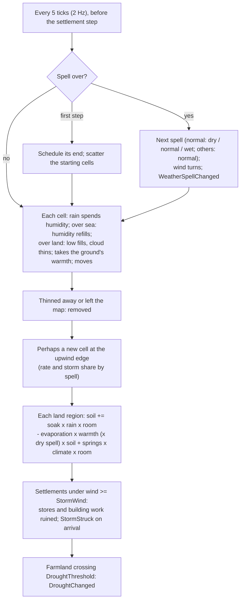
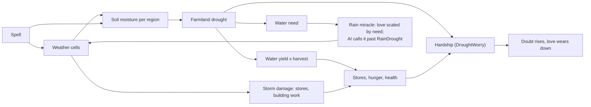

# Milestone 7 — Weather

## Overview

Spec §122 asks for weather cells, moving storms, rain and drought, with the playable outcome
"World produces environmental pressure". The decisions are in
[ADR-013](../docs/ADR/ADR-013-weather-cells-and-soil-water.md).

What the player gets:

- **Weather you can watch.** Clouds drift in from the sea on the prevailing wind, rain on the
  island and thin away. Storms are dark, windy and full of lightning. From afar the clouds show
  where the weather is; up close the rain falls and the light dims under a storm.
- **Spells.** The island is in normal weather, a dry spell or a wet spell. A dry spell brings little
  rain and dries the land; a wet one brings frequent rain and storms. The HUD shows the spell and
  how long it lasts, and alerts announce dry spells.
- **Drought.** Every region's soil holds water: rain fills it, warmth dries it, springs refill it
  slowly. Dry farmland yields less, down to a quarter of its harvest when parched. A village in
  drought:
  - goes hungry once its stores run out;
  - worries before that, so its followers doubt a silent god.

  Its label says "drought", the HUD names it and an alert warns you.
- **Storms.** Storm winds ruin part of a village's stores and building work for as long as they
  blow. An alert tells you when a storm strikes your people.
- **Rain** (key 6). Calls a rain cloud over the target that soaks the farmland as it lingers. People
  in drought love you for it. Rival gods call rain on their own parched villages, and on yours to
  win them over.
- **Tools.** The Weather overlay (O) shows soil water from brown (drought) to blue (soaked). F3 has
  a soil layer. F1 lists the spell, the wind, the strongest cells and the selected village's water.
  F8 cycles the spell, F10 calls a storm at the cursor, and `--weather=normal|dry|wet|storm` sets
  either up at the start.

## Architecture

| Project | Changes |
| --- | --- |
| `Pantheon.Domain` | `Weather/`: `WeatherState`, `WeatherCell`, `WeatherSpell`, `WeatherKind`, `WeatherRules`. `RegionState.SoilMoisture`, `WorldState.Weather`. `SettlementRules.WellWateredSoil`, `DroughtYieldFloor`, `DroughtThreshold`; `DivineRules.DroughtWorry`; `GodAiRules.RainDrought`. `MiracleEffectKind.Rain`, `MiracleNeed.Water`. The `WeatherSpellChanged`, `StormStruck` and `DroughtChanged` events. |
| `Pantheon.Simulation` | `Weather/`: `WeatherModel` (pure rules), `WeatherSystem` (the step), `PointWeather`, `WeatherRulesValidator`. Farmland soil, drought and water yield in `SettlementEconomy`; drought as hardship and need in `BeliefModel`; the Rain effect in `MiracleCaster`; Rain valued by drought in `GodAi`; the starting weather in `WorldGenerator`; `SeedMixer.Derive(seed, purpose, counter)`. The full engine pipeline starts with the weather step. |
| `Pantheon.Persistence` | Save version 7 and the migration from version 6; `WeatherIntegrity` and soil checks; parsing of `weather.json`. |
| `Pantheon.Game` | `Weather/WeatherText` and `WeatherCommands`; `Diagnostics/WeatherReadout`; the soil layer of the F3 map; the Weather overlay; weather alerts; the HUD weather line; drought on labels; `Presentation/CloudLayout` and `WeatherViewSettings` (`weather_view.json`); `--weather`. |
| Godot client | `Presentation/Weather/` (`WeatherPresenter`, `CloudView`, `SoftDiscTexture`); the HUD's weather line; F8 and F10; bolts from cloud height in `MiracleEffect`. |

### The weather step

### From weather to belief

| Quantity | Rule (shipped values) |
| --- | --- |
| Rain of a cell | `clamp((humidity - 0.35) / 0.65) x (0.5 + 0.6 x pressure)` |
| Wind; lightning | `pressure`; `3 x pressure x rain x temperature` |
| Kinds | thunderstorm from lightning 0.5, windstorm from wind 0.65, rain from 0.1 |
| Humidity per second | `- 0.006 x rain`; over sea `+ 0.01 x (1 - humidity)`; over land `- 0.0015` |
| Pressure over land | `- 0.0015` per second |
| Soil per second | `+ 0.03 x rain x (1 - soil) - 0.0025 x (0.5 + temperature) x soil` (x 1.6 in a dry spell) `+ 0.0009 x moisture x (1 - soil)` |
| Drought; water yield | `1 - min(1, soil / 0.35)`; `1 - 0.75 x drought`; in drought from 0.35 |
| Hardship | `max(health need, food need, 0.5 x drought)` |
| Storm damage per second | stores `x (1 - 0.012 x severity)`, building work `x (1 - 0.02 x severity)`, severity `(wind - 0.65) / 0.35` |
| New cells | 0.012 per second in a normal spell, x 0.1 dry, x 2 wet; 12% storms (35% wet) |
| Spells | normal 6–12 min (then dry 50%, normal 20%, wet 30%), dry 5–10 min, wet 3–6 min |

## Test Plan

| Area | Tests |
| --- | --- |
| Weather rules | `WeatherModelTests`: rain needs water and grows with it and the low; kinds; coverage; the weather at a point; soil wetting, drying, heat and dry spells; the springs' resting level; spells' factors; a summoned rain cell. |
| Weather step | `WeatherSystemTests`: the first step schedules the spell and scatters clouds; cells move and spend water; the sea refills, land fills and thins; spent and departed cells vanish; rain wets the soil beneath; a dry spell brings far fewer cells; spells change, the wind turns and it is reported; the next-spell table; storms ruin stores and building work and are reported on arrival; showers do no harm; droughts start and end; the same every time and across a save and load; its own random stream. |
| Water's effects | `WaterTests`: dry farmland yields less; a drought starves a village the land fed; drought is a hardship and a need; Rain calls a cloud and is loved more on parched land; Rain without weather calls none; Rain on a rival's parched followers is help; a Guardian calls rain on its followers in drought. |
| Presentation | `WeatherPresentationTests`: the Weather overlay; cloud layout, look, rain and gloom; lightning; wind and spell wording; the F1 lines; alerts; the HUD line; drought labels; the debug commands; `--weather`; content parsing. |
| Saves | `SaveMigrationV6Tests` against `save-v6.json` (two gods with a relation, written by the Milestone 6 build at commit e449825); versions 1–5 also migrate to version 7. |

### Verification results

- `dotnet build Pantheon.sln`: no warnings. `dotnet test Pantheon.sln`: 574 tests pass (519 at the
  end of Milestone 6).
- Headless runs with a passive player, 40 simulated minutes each, seeds 1234, 42 and 7:
  - Droughts: 11, 13 and 12. Storm strikes on villages: 7, 4 and 4. Vael's Rain casts: 9, 7 and 4.
  - In normal weather the farmland soil stays between about 0.3 and 0.7. Seed 1234's dry spell
    (minutes 23.5 to 33) takes several villages to about 0.2, where harvests fall short of
    consumption, and Vael calls up to seven rain clouds over its own villages.
- Tuning found along the way:
  - At first the normal soil sat at the drought line, and a dry spell barely showed while clouds
    already over the island kept raining. Raising groundwater and soak, drying faster in a dry
    spell and starting with scattered clouds fixed both.
  - Once Rain had a value, the AI cast it like any kind miracle, 22 times in 25 minutes even with
    the weather switched off, and no drought ever formed. Scaling Rain's value by the drought past
    `RainDrought` brought that to 4–9 casts, all against droughts.
- Contest, seed 1234, 25 minutes:
  - a passive player loses to Vael at 18.8 minutes;
  - a player who casts Food at the frontier every 15 s loses at 22.0 minutes, or at 24.3 with the
    weather switched off;
  - one who also casts Rain on parched villages loses at 23.0.

  Weather moves the contest by about a minute. That Food-only bot won at 13 minutes in
  Milestone 5, before the Tyrant could go to war (Milestone 6); the war, not the weather, turned
  that result.
- Godot on macOS (Metal), seed 1234:
  - a storm over Duskwater shows as dark clouds from 1100 m and as rain and dimmed light from
    380 m;
  - Rain calls a cloud over the target;
  - after ten minutes of a dry spell the Weather overlay shows the island's dry soil, on the
    fallback renderer;
  - the HUD shows the wet spell, F1 lists the cells and the water;
  - 116 FPS at 1100 m with nine cells after 9,000 ticks.
- Cloud looks went through three attempts. Lit spheres looked like bubbles, and fog washed storms
  out at a distance. Shadow decals under each cloud drew hard edges and showed no edge up close.
  Soft unfogged billboards, distance-faded rain and storm gloom replaced them.

## Tasks

### Completed

- [x] ADR-013.
- [x] Weather cells, spells, prevailing wind, the weather step and its own random stream.
- [x] Soil water, drought, water yield, drought hardship and need; storm damage.
- [x] The Rain miracle and its value to AI gods; Rain as help in diplomacy.
- [x] Save version 7 and its migration; integrity.
- [x] Clouds, rain, lightning and storm gloom; the Weather overlay, the soil layer, the F1 lines,
      alerts, the HUD line, drought labels, F8, F10 and `--weather`.
- [x] Tests, headless runs and captures.

### Future

- Disasters (Milestone 8): lightning-lit wildfires, floods, earthquakes and destruction, and
  settlements' response.
- More states (§16): snow, heat and cold waves, fog, hurricanes; seasons (§17) if a map wants them.
- Ecology (§18): vegetation and wildlife that follow the water.
- Weather at the Creature's scale: shelter, tiredness in storms.

## Relevant Files

- `src/Pantheon.Domain/Weather/`, `src/Pantheon.Domain/Events/{WeatherSpellChanged,StormStruck,DroughtChanged}.cs`
- `src/Pantheon.Simulation/Weather/`, `src/Pantheon.Simulation/Settlements/SettlementEconomy.cs`,
  `src/Pantheon.Simulation/Belief/BeliefModel.cs`, `src/Pantheon.Simulation/Miracles/MiracleCaster.cs`,
  `src/Pantheon.Simulation/Gods/GodAi.cs`
- `src/Pantheon.Persistence/{WeatherIntegrity,SaveMigrations}.cs`
- `src/Pantheon.Game/Weather/`, `src/Pantheon.Game/Diagnostics/WeatherReadout.cs`,
  `src/Pantheon.Game/Presentation/{CloudLayout,WeatherViewSettings,OverlayMap}.cs`
- `game/Scripts/Presentation/Weather/`
- `game/Data/{weather,weather_view,settlement_rules,divine_rules,miracles,god_ai}.json`
- `src/Pantheon.Tests/Weather/`, `src/Pantheon.Tests/Persistence/Fixtures/save-v6.json`
