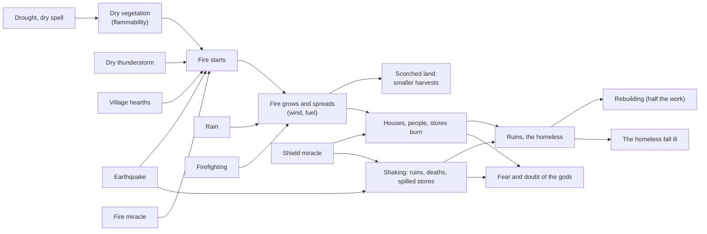

# Milestone 8 — Disaster Simulation

## Overview

Spec §123 asks for earthquake, wildfire, destruction and settlement response, with the playable
outcome "Disasters produce emergent consequences". The decisions are in
[ADR-014](../docs/ADR/ADR-014-disasters-as-processes.md).

What the player gets:

- **Wildfires.** Dry land burns. A spark from a village's hearths, a dry thunderstorm, an
  earthquake or a god sets the fields alight, and the fire spreads, faster downwind and across
  the driest, greenest land. It leaves the land scorched, and scorched land yields less until it
  regrows. Rain and the villagers' firefighting put fires out. A fire in a village burns its
  houses, people and stores.
- **Earthquakes.** Now and then the ground shakes. For a few seconds houses collapse into ruins,
  people die, stores spill and fires break out, worst near the epicentre. The camera shakes with
  the ground.
- **Destruction and recovery.**
  - Destroyed houses stay as rubble.
  - The homeless fall ill until the village rebuilds, and rebuilding a ruin takes half the work of
    a new house.
  - Survivors fear their gods and doubt that the gods care.
- **New miracles** (keys 7–9):
  - Fire (Lesser God) sets the target alight.
  - Shield (Lesser God) protects the villages it covers from fire and earthquakes for three
    minutes.
  - Earthquake (God) shakes the ground at the target.

  The rival uses all three: it shakes and burns your villages and shields its own.
- **Seeing it.** Flames, smoke and glow over burning land; ash on scorched land; domes over
  shielded villages; rubble where houses fell. Labels mark "burning", "fire nearby", ruins and
  shields. The HUD names your villages under threat, and alerts announce earthquakes, fires near
  your people and the damage done. A Danger overlay (O) shows fires, ash and shields.
- **Tools.** F1 lists earthquakes, the fiercest fires and the selected village's dangers. F3 adds
  fire and scorch layers. F11 starts an earthquake and F12 a fire at the cursor, and
  `--disaster=quake|fire` starts one at the focused village.

## Architecture

| Project | Changes |
| --- | --- |
| `Pantheon.Domain` | `Disasters/`: `DisasterState`, `Earthquake`, `DisasterRules`, `DisasterKind`, `FireCause`. `RegionState.Fire` and `Scorch`; `SettlementState.Ruins` and `ShieldedUntilTick`; `WorldState.Disasters`. `SettlementRules.ScorchYieldLoss`, `HomelessHealthLossPerStep`, `RuinWorkShare`; `DivineRules.DangerWorry`, `DisasterFear`, `DisasterDoubt`. `MiracleEffectKind.Ignite`, `Quake`, `Shield`; `MiracleNeed.Danger`. The `EarthquakeStruck`, `WildfireStarted` and `SettlementDamaged` events. |
| `Pantheon.Simulation` | `Disasters/`: `DisasterModel` (pure rules), `DisasterSystem` (the step), `Wildfires` (lightning, hearths, burning, spreading, regrowth), `DisasterRulesValidator`. `Belief/Hazards` (drought and danger for the conditions). Scorch, ruins and the homeless in `SettlementEconomy` and `SettlementSystem`. Fire, Earthquake and Shield in `MiracleCaster`; their value in `GodAi`. The full pipeline runs the disaster step after the weather step. |
| `Pantheon.Persistence` | Save version 8 and the migration from version 7; `DisasterIntegrity`, fire and scorch, ruins and shield checks; parsing of `disasters.json`. |
| `Pantheon.Game` | `Disasters/DisasterText` and `DisasterCommands`; `Diagnostics/DisasterReadout`; the fire and scorch layers; the Danger overlay; disaster alerts; dangers on the HUD line; marks on labels; ruins in `SettlementLayout`; `--disaster`. |
| Godot client | `Presentation/Disasters/` (`DisasterPresenter`, `FireView`); rubble in `SiteView`; camera shake; `Bootstrap/NatureDebug` (F8, F10, F11, F12 and the weather and disaster launch options, moved out of `GameRoot`). |

### A disaster's chain

| Quantity | Rule (shipped values) |
| --- | --- |
| Flammability | `vegetation x (1 - scorch) x dryness²`, dryness `1 - min(1, soil / 0.6)`; no fire below 0.04 |
| Fire per second | `+ 0.08 x (min(1, 2 x flammability) - fire) - 0.03 x rain - 0.01 x people / 100` (firefighting in the village's own region); out below 0.02 |
| Scorch per second | `+ 0.06 x fire` while burning; `- 0.004 x scorch` once out |
| Spread per neighbour per second | `0.12 x fire x flammability(neighbour) x (1 + 2 x wind x downwind alignment)`, 0.7 on diagonals |
| Ignition per second | storms `0.004 x lightning x coverage x flammability`; hearths `0.001 x people / 100 x flammability` of a field next to the village |
| Fire damage per second | houses `0.02 x fire x 0.5` (resistance), deaths `0.004 x fire`, stores `0.03 x fire` |
| Earthquakes | 2 per hour, magnitude 4.5–7.5 (skewed small); intensity `(m - 4.5) / 3`; radius `250 m x (m - 4.5)`; 12 s |
| Quake damage over the quake | houses `0.6 x shaking x 0.7` (resistance), deaths `0.06 x shaking`, stores `0.3 x shaking`; fire with chance `0.5 x shaking` |
| Shield | damage x 0.1 for 180 s |
| Response | ruins rebuilt with 0.5 of the work; health `- 0.02 x homeless share` per step; scorched farmland yields `x (1 - 0.7 x scorch)` |
| Belief | fear `+ 0.4 x severity`, doubt `+ 0.3 x severity` (a full earthquake is 1; a second of full fire is 0.03); danger counts `0.6 x danger` as hardship |

## Test Plan

| Area | Tests |
| --- | --- |
| Disaster rules | `DisasterModelTests`: quakes by magnitude; shaking by distance; flammability; ignition; fire threat and danger; shields. |
| Disaster step | `DisasterSystemTests`: a quake's ruins, deaths, spilled stores, fear and reports; shields; the natural quake rate; fires growing, scorching and burning out; rain and firefighting; spreading downwind and not onto wet land; fire in a village; regrowth; hearth and lightning fires; determinism, save and load, and the shared stream left alone. |
| Response | `ResponseTests`: scorched harvests; the homeless; rebuilding ruins; danger as hardship and need; the Fire, Earthquake and Shield miracles; fire on a rival's followers as harm; a Guardian shielding against fire; a Tyrant never shaking its own village. |
| Presentation | `DisasterPresentationTests`: the Danger overlay; label marks; alerts; the HUD; the F1 lines and F3 layers; the debug commands; `--disaster`; content. `SettlementLayoutTests`: ruins beyond the houses and the building site. |
| Saves | `SaveMigrationV7Tests` against `save-v7.json` (two gods, weather with a rain cloud the player called, written by the Milestone 7 build at commit 521fe42); versions 1–6 also migrate to version 8. |

### Verification results

- `dotnet build Pantheon.sln`: no warnings. `dotnet test Pantheon.sln`: 615 tests pass (574 at the
  end of Milestone 7).
- Headless runs with a passive player, 40 simulated minutes each, seeds 1234, 42 and 7:
  - Seed 1234: a dry spell's hearth fire grew to 33 burning regions and scorched 86, burning 10
    houses and killing 11. The Tyrant shook the player's home twice (44 houses and 36 lives lost
    to earthquakes in all), and its four Shields covered its own villages.
  - Seed 42: one wildfire reached 26 regions.
  - Seed 7: only small fires.
  - Ruins were rebuilt within about five minutes.
- Tuning went through three regimes before settling:
  - Fires lit by lightning died at once in their own storm's rain, and hearth fires in a village's
    own region were put out by its firefighting: at most three regions ever burned.
  - With hearths lighting the fields around villages and faster spread, every fire took the
    island: 100–260 regions burning for half the game.
  - Squaring the dryness in flammability, burning out faster and spreading at 0.12 gave fires that
    stay small in normal weather and run large in dry spells.
- Contest, seed 1234, 25 minutes: a passive player loses at 18.8 minutes (as in Milestone 7), and a
  player who casts Food at the frontier loses at 21.8 (22.0 in Milestone 7). The Tyrant cast 2–4
  Earthquakes, up to 3 Fires and 1–2 Shields.
- Godot on macOS (Metal), seed 1234:
  - `--disaster=quake` shows the HUD's "The earth shakes at Duskwater", the damage alert, a ruin
    on the label and rubble;
  - after 16,200 ticks the Danger overlay shows a wildfire around Duskwater with flames, and labels
    marked "fire nearby · 6 in ruins".

## Tasks

### Completed

- [x] ADR-014.
- [x] Wildfires: flammability, ignition by storms, hearths, quakes and miracles; growth, scorch,
      spread, rain, firefighting and regrowth.
- [x] Earthquakes as processes: natural ones, shaking, damage and fire.
- [x] Destruction with house resistance; ruins; rebuilding; the homeless; scorched harvests; fear
      and doubt; danger as hardship and need.
- [x] Fire, Shield and Earthquake miracles and the AI's use of them.
- [x] Save version 8 and its migration; integrity.
- [x] Fire, smoke, ash, domes, rubble, shock waves and camera shake; the Danger overlay, F3
      layers, F1 lines, alerts, the HUD, labels, F11, F12 and `--disaster`.
- [x] Tests, headless runs and captures.

### Future

- Migration after disasters (Milestone 10), roads and their blockage (§20).
- Disaster preparation (§21): granaries, firebreaks, shelters, and settlements choosing them.
- More disasters (§19): floods, volcanoes, landslides, disease, locusts.
- Smoke and fire visuals (Milestone 15).

## Relevant Files

- `src/Pantheon.Domain/Disasters/`, `src/Pantheon.Domain/Events/{EarthquakeStruck,WildfireStarted,SettlementDamaged}.cs`
- `src/Pantheon.Simulation/Disasters/`, `src/Pantheon.Simulation/Belief/Hazards.cs`,
  `src/Pantheon.Simulation/Settlements/{SettlementEconomy,SettlementSystem}.cs`,
  `src/Pantheon.Simulation/Miracles/MiracleCaster.cs`, `src/Pantheon.Simulation/Gods/GodAi.cs`
- `src/Pantheon.Persistence/{DisasterIntegrity,SaveMigrations}.cs`
- `src/Pantheon.Game/Disasters/`, `src/Pantheon.Game/Diagnostics/DisasterReadout.cs`
- `game/Scripts/Presentation/Disasters/`, `game/Scripts/Bootstrap/NatureDebug.cs`
- `game/Data/{disasters,miracles,settlement_rules,divine_rules,divine_view}.json`
- `src/Pantheon.Tests/Disasters/`, `src/Pantheon.Tests/Persistence/Fixtures/save-v7.json`
