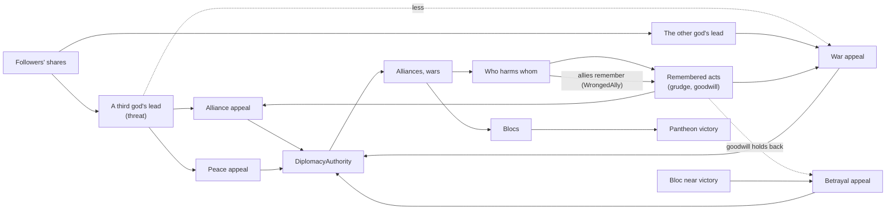

# Milestone 9 — Four Gods

## Overview

Spec §124 asks for one player, three AI gods, diplomacy between all gods and multiple strategic
personalities, with the playable outcome "Basic politics emerges". The decisions are in
[ADR-015](../docs/ADR/ADR-015-four-gods-coalitions-and-pantheon-victory.md).

What the player gets:

- **Three rivals.** Vael the Tyrant, Seren the Guardian and Kaio the Trickster each have a home, a
  Creature and a mind of their own. They compete for the same people as the player and as each
  other.
- **Politics among them.**
  - The gods ally, fight, make peace and betray, among themselves as well as with the player.
  - A god that pulls ahead draws wars, and draws the others into coalitions against it.
  - Two lesser gods make peace rather than fight while a third runs away with the world.
  - A fresh peace or a new alliance holds for a while.
  - A god whose ally is harmed remembers who did it.
- **Pantheon victory.**
  - Allies count their followers together: a bloc that holds 60% of all belief for ten minutes wins
    together, and every member wins.
  - Near such a victory a treacherous god that outweighs its ally may break away to try alone; a
    loyal one stays.
- **Three more personalities** in `god_ai.json`: Trickster, Isolationist and Warlord. All eight of
  §47 are now playable.
- **Seeing it.**
  - The HUD lists every rival.
  - The contest line names a bloc ("Vael and Seren hold 76% of all belief together: they win
    together in 8:26").
  - The diplomacy panel (P) shows each god's alliances and wars with the others.
  - Alerts announce alliances between other gods and a bloc's dominance or victory.
  - The F1 view shows each AI god's reasons, including "against Seren" and "they lead".
- **Labels.** Creature labels keep their screen size whatever the Creature's size, and fade out at
  strategic zoom, where four gods' Creatures would crowd the view.

## Architecture

| Project | Changes |
| --- | --- |
| `Pantheon.Domain` | `GodPersonality.Trickster`, `Isolationist`, `Warlord`. `DiplomaticAct.WrongedAlly`. `WorldState.WinnerGodIds` (was `WinnerGodId`). `DivineRules.PantheonVictory`. `DominanceChanged.Allies`; `VictoryAchieved.GodIds`. |
| `Pantheon.Simulation` | `DiplomacyModel.AlliesOf` and `BlocOf`. `DiplomacyLedger` tells the victim's allies (`WrongedAlly`). `VictorySystem.StandingOf`; dominance and victory by standing. `GodDiplomat`: coalition, balance of power, the leader, goodwill and the endgame. |
| `Pantheon.Persistence` | Save version 9 and the migration from version 8; integrity of the winners. |
| `Pantheon.Game` | `DivineText.Names` and the new personalities' names; the HUD's joint contest; joint dominance, joint victory and third-party alliance alerts; `DiplomacyText.Ties` and `DiplomacyEntry.Ties`; "wronged its ally" and "wronged your ally". The Creature's go-to wording now reads right for every god's Creature. |
| Godot client | The diplomacy panel shows ties. Creature labels are counter-scaled and fade out around 900 m. |
| Content | `gods.json`: four gods. `god_ai.json`: Trickster, Isolationist and Warlord profiles, and the Guardian's `Convert` lowered from 0.6 to 0.35. `divine_rules.json`: `PantheonVictory`. |

### How politics emerges

| Term | Rule |
| --- | --- |
| Threat of a third god | `clamp((share − 0.3) / (0.6 − 0.3))`, 1 if it dominates; only gods allied with neither count |
| The other god's lead | the same scale for the other god's share, when it holds more than this god |
| Alliance | ADR-012's appeal `+ Cooperation × 0.8 × threat` |
| Peace | ADR-012's appeal `+ Cooperation × threat` |
| War | ADR-012's appeal `+ Aggression × lead − goodwill − 0.8 × threat` |
| Betrayal | ADR-012's appeal `− goodwill + endgame`; an ally's dominance counts only if it dominates alone |
| Endgame | when the bloc holds at least `0.6 − 0.15`: `Treachery × 3 × max(0, own − ally) − (1 − Treachery) × 0.5` |
| Allies' memory | each ally of the victim: trust `− 0.04`, rivalry `+ 0.05`, `WrongedAlly` (weight 0.25) |
| Standing | own share, or the bloc's when allied and the bloc holds more |

| Personality | Protect | Convert | Intimidate | Bless | Opportunism | Thrift | Creature | Kindness | Cooperation | Aggression | Treachery | Grudge |
| --- | --- | --- | --- | --- | --- | --- | --- | --- | --- | --- | --- | --- |
| Trickster | 0.4 | 0.9 | 0.3 | 0.2 | 1.0 | 0.5 | 0.6 | 0.0 | 0.8 | 0.4 | 1.0 | 0.3 |
| Isolationist | 1.0 | 0.2 | 0.1 | 0.8 | 0.1 | 0.7 | 0.1 | 0.5 | 0.2 | 0.1 | 0.1 | 0.8 |
| Warlord | 0.4 | 0.4 | 1.0 | 0.1 | 0.6 | 0.3 | 0.9 | −0.6 | 0.4 | 1.0 | 0.4 | 0.8 |

## Test Plan

| Area | Tests |
| --- | --- |
| Pantheon victory | `PantheonTests`: allies counting together and winning together; every god alone without pantheon victory; a god dominant alone winning alone; a broken alliance ending dominance; blocs reaching allies of allies; allies remembering a wrong, and not their own acts; four gods playing out the same way across a save. |
| Politics | `PoliticsTests`: a third god's lead drawing two gods together and away from war; the leader drawing war; an ally of either being no common threat; a fresh peace holding war back; the treacherous breaking away near a joint victory and the loyal staying; an ally dominating together being no reason to betray; every personality's profile and name; the Isolationist tending its own and keeping out of wars; the Warlord striking rivals' followers; the Trickster courting a rival's people in hardship. |
| Presentation | `PantheonPresentationTests`: names with "You" first; joint dominance alerted once, joint victory; alliances between other gods alerted, their peace not; the HUD's bloc, its dominance and its victory; each god's ties in the panel; "wronged its ally" and "wronged your ally". `RivalPresentationTests` and `DiplomacyPresentationTests` cover every rival. |
| Saves | `SaveMigrationV8Tests` against `save-v8.json`, written by the Milestone 8 build at commit ef4db96 (seed 77, two gods, an earthquake under way, three ruins and a fire): no winners; a version 8 winner kept; a missing winner field refused; every other value kept; the same play after a save; repeated winners refused. Versions 1–7 also migrate to version 9. |

### Verification results

- `dotnet build Pantheon.sln`: no warnings. `dotnet test Pantheon.sln`: 646 tests pass (615 at the
  end of Milestone 8).
- Headless runs of 40 simulated minutes on seeds 1234, 42 and 7, with three kinds of run: a
  passive player; a player who casts Food at the nearest village it does not hold; and a passive
  player with the personalities moved (Vael the Trickster, Seren the Tyrant, Kaio the Guardian).
  The final tuning gave:

  | Run | Alliances | Wars declared | Peace made | Outcome |
  | --- | --- | --- | --- | --- |
  | 1234 passive | 0 | 6 | 4 | open: Seren 51%, Kaio 28% |
  | 42 passive | Vael and Seren at 10.0 min | 5 | 3 | Vael and Seren win together at 25.8 min |
  | 7 passive | Seren and Kaio at 34.3 min | 5 | 3 | Seren wins alone at 30.8 min |
  | 1234 Food | 0 | 6 | 5 | open: Seren 47%, Kaio 30% |
  | 42 Food | Seren and Kaio at 3.0 min | 8 | 6 | Seren and Kaio win together at 25.3 min |
  | 7 Food | 0 | 8 | 5 | open: Seren 46%, Kaio 31% |
  | 1234 moved | Seren and Kaio at 10.0 min | 4 | 1 | Seren and Kaio win together at 26.0 min |
  | 42 moved | Seren and Kaio at 12.5 min | 4 | 3 | open: Vael 51% against the bloc's 49% |
  | 7 moved | Seren and Kaio at 13.3 min | 5 | 3 | open: Kaio 54%, Vael 45% |

- Tuning went through three stages:
  - **First run:** the Guardian won alone in every run. Vael made war and peace with Kaio every one
    to three minutes while Seren ran away with the world, and only one alliance formed in three
    runs.
  - **Then:** the balance of power (peace and war weighed against the third god's threat) and the
    goodwill of fresh peace stopped the cycle of war and peace. Moving the personalities showed the
    Guardian leads from any seat, so its `Convert` weight was lowered from 0.6 to 0.35.
  - **Finally:** a Trickster broke its alliance at the moment the bloc began to dominate. An ally
    dominating *with* a god now counts as no threat, and the goodwill of a new alliance holds
    betrayal back.
- The player who casts Food holds 5–13% after 36 minutes: three rivals crowd the island.
- Godot on macOS (Metal):
  - **Seed 1234 at 5 minutes (Terrain3D):** the HUD lists three rivals, and the panel shows three
    cards.
  - **Seed 42 at 17.5 minutes (fallback renderer):** the HUD reads "Vael and Seren hold 76% of all
    belief together: they win together in 8:26". The panel shows "Allied with Seren; at war with
    Kaio" under Vael, and Creature labels are hidden at 1800 m.
  - **Up close at 260 m:** Creature labels are the size of settlement labels.

## Tasks

### Completed

- [x] ADR-015.
- [x] Four gods in `gods.json`; Trickster, Isolationist and Warlord profiles.
- [x] Blocs, pantheon victory, `WinnerGodIds` and the events' allies.
- [x] Allies' memory of wrongs (`WrongedAlly`).
- [x] The AI diplomat's coalition, balance of power, the leader, goodwill and endgame terms.
- [x] Save version 9 and its migration; integrity.
- [x] HUD, alerts, the panel's ties, names, Creature labels.
- [x] Tests, headless runs and captures.

### Future

- Population movement between gods' lands (Milestone 10).
- Rival Creatures' friendships and fights (Milestone 11).
- Trade, tribute, vassals and shared enemies as treaty terms (§39), and a pantheon of more than
  four gods with a setup screen.
- The Guardian's lead: a broader look at love against fear in the belief rules.

## Relevant Files

- `src/Pantheon.Domain/{Gods/GodPersonality,Diplomacy/DiplomaticAct,World/WorldState,Belief/DivineRules}.cs`,
  `src/Pantheon.Domain/Events/{DominanceChanged,VictoryAchieved}.cs`
- `src/Pantheon.Simulation/{Diplomacy/DiplomacyModel,Diplomacy/DiplomacyLedger,Belief/VictorySystem,Gods/GodDiplomat}.cs`
- `src/Pantheon.Persistence/{SaveMigrations,SaveIntegrity,WorldSaveSerializer}.cs`
- `src/Pantheon.Game/{Divine/DivineText,Hud/HudReadout,Alerts/AlertFeed,Diplomacy/DiplomacyText,Diplomacy/DiplomacyReadout,Creatures/CreatureText}.cs`
- `game/Scripts/UI/DiplomacyPanel.cs`, `game/Scripts/Presentation/Creatures/CreatureView.cs`
- `game/Data/{gods,god_ai,divine_rules}.json`
- `src/Pantheon.Tests/Gods/{PantheonTests,PoliticsTests}.cs`,
  `src/Pantheon.Tests/Game/PantheonPresentationTests.cs`,
  `src/Pantheon.Tests/Persistence/{SaveMigrationV8Tests,Version9Expectations}.cs`,
  `src/Pantheon.Tests/Persistence/Fixtures/save-v8.json`
