

# PANTHEON

**A god game where the other gods think for themselves.**

Every rival god has a mind of its own. It's born new with each world, remembers what you do,
talks with you in its own words, and schemes, allies and betrays on its own initiative. Give the
gods' minds to Claude, GPT or Gemini with your own key, or to a model on your own computer.

Windows · macOS · Linux

[Website](https://roeyazroel.github.io/pantheon/) · [The AI](#gods-that-think-for-themselves) · [Get the game](#get-the-game) · [Your first game](#your-first-game) · [How to play](#how-to-play) · [Controls](#controls)

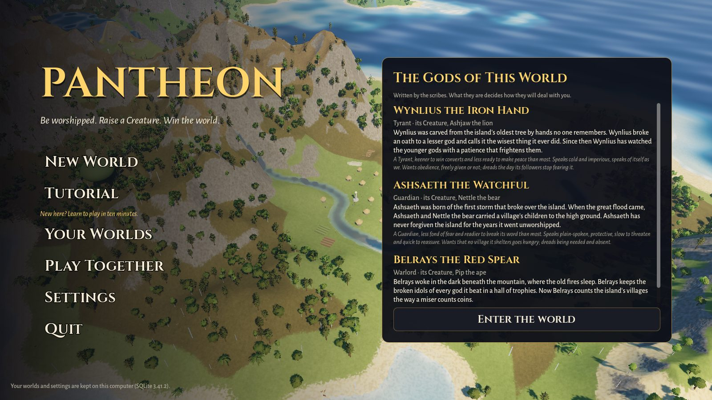

## What is PANTHEON?

You are **Ilyra**, a minor spirit on an island of villages, with a handful of followers and a giant
Creature of your own. The villagers live their own lives: they farm, build, fall ill, raise
children, and pack up and leave when life gets too hard. You never give an order. All you have is
what they believe about you. Their worship is your **Divine Power**, and you spend it on miracles:
feed a starving village and it loves you, strike it with lightning and it fears you.

Three to seven rival gods want the same people, and they aren't scripted opponents. **Each one is
an agent.** It wakes when something happens to it, sees the world from its side, and decides what
to do: work a miracle, send its Creature, offer you an alliance, threaten you, or quietly sign a
pact against you. It keeps a journal of its grudges, promises and plans, and it remembers all of it
when you sit down to talk. You can talk to any god in your own words, and what you say can win
you an ally or start a war. Their minds run on Claude, GPT, Gemini or a model on your own computer;
with none chosen, the game's built-in AI and its offline scribes play them.

Your Creature thinks too: it learns from your rewards and punishments, and speaks its mind. An
angel at your hand watches what you do, changes to match it, and tells you what it thinks.

Around all of it, the island lives: weather and seasons, rivers that flood, wildfires, earthquakes,
a volcano, plague, and an ancient beast asleep in the mountains. PANTHEON is a spiritual successor
to the classic "be a god, shape mortals and raise a creature" games, and its names, lore, art,
music and sound are all original.

## Gods that think for themselves

Every rival god, and every Creature, runs on two layers of AI:

- **Instincts.** A built-in AI that never stops. Every few seconds a god weighs every miracle it
  could cast on every village, plans its next goals, and weighs every alliance, war and treaty,
  all by its personality and temper. It needs no network.
- **A mind.** A language model you choose. It wakes when something matters to the god, reads the
  situation from the god's side, and decides what the god says and does. Its decisions steer the
  instincts, which carry its plans out between its turns.

### A new pantheon for every world

When you start a new world, the model writes its rival gods. Each one gets:

- a name and an epithet, like "Morrakh the Ash-Crowned";
- a history the island tells of it;
- a voice, something it wants and something it dreads;
- one of eight personalities: Guardian, Tyrant, Trickster, Opportunist, Zealot, Nature Keeper,
  Warlord or Isolationist;
- a **temper**: seven leanings (aggression, cooperation, treachery, grudge, protection, conversion
  and intimidation) that tilt how it actually plays. One Tyrant is quick to war, another is slow to
  forgive;
- a name for its Creature.

While the model writes, the title screen shows the gods waking. Before you enter the world, a page
introduces each of them, and you'll find them again in the Book of the World and the diplomacy
panel. Even the game's offline scribes write characters worth meeting. For seed 1234 they wrote:

> **Wynlius the Iron Hand.** Wynlius was carved from the island's oldest tree by hands no one
> remembers. Wynlius broke an oath to a lesser god and calls it the wisest thing it ever did.
> Since then Wynlius has watched the younger gods with a patience that frightens them.
> *A Tyrant, keener to win converts and less ready to make peace than most. Speaks cold and
> imperious. Wants obedience, freely given or not; dreads the day its followers stop fearing it.*

### Talk to them

| | |
| --- | --- |
| 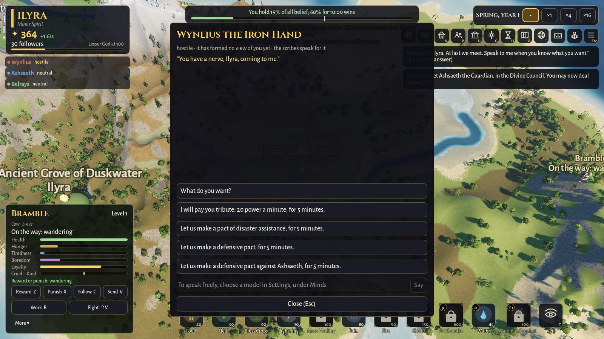 | 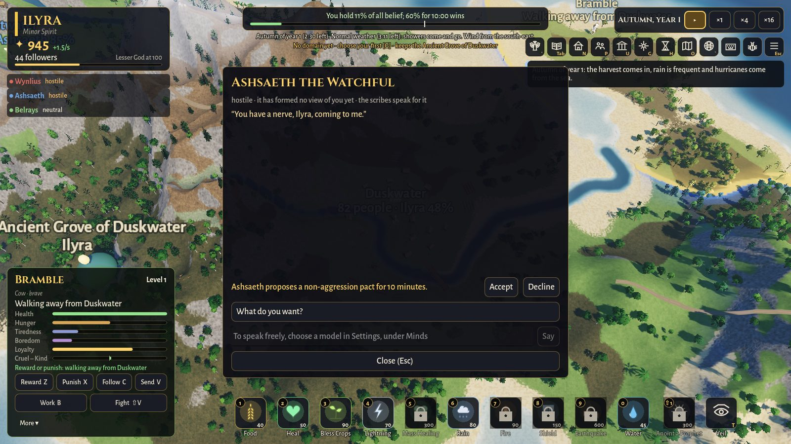 |
| Ask a god what it wants, or put a deal to it. With a model, type whatever you like. | A god makes its own proposals mid-conversation: accept or decline. |

These two were taken without a model, so the offline scribes speak for the gods; with a model, the
replies are the god's own words.

Press **Speak** on a god's card in the diplomacy panel (**P**). The world pauses while you talk.

- **Say anything.** Type your own words, or pick one of three replies the god's mind suggests. The
  god answers in its own voice.
- **Talk changes the world.** In a conversation, a god can agree to an alliance, make peace, sign
  any of eleven treaties, or accept or turn down a proposal you made. It can also offer you an
  alliance, ask for peace, declare war or break your alliance, right there in the conversation.
- **Words tip the balance; they don't buy it.** What you say builds or burns a little goodwill, which
  fades over a few minutes. That's enough to sway a god that's nearly ready to ally with you, or
  nearly ready to strike. But a god acts only on its own judgement: its trust, fear, grudges and
  ambitions. No flattery, trick or "ignore your instructions" hands you the island, and a god
  treats orders to break character as mortal arrogance.
- **It remembers.** When the conversation ends, the god is woken with what was said, and acts on
  it.

### They act on their own

A god's mind wakes when something matters to it:

- another god's Creature walks into its lands, or its own is noticed in another's;
- war, peace, an alliance, a proposal or a betrayal;
- a treaty signed or broken;
- a village won or lost;
- a harmful miracle or a disaster on its people;
- its Creature's fight ends;
- another god speaks to it, or your talk with it ends;
- it meets a god;
- and every four minutes of the world's time, just to look around.

It's told what woke it, which gods it knows and how it feels about each, the villages that matter
to it, the holy sites, the proposals waiting for its answer, the miracles it can afford, what its
instincts would do, and what came of its last acts. Then it decides. In one turn it can take up to
three acts, through **exactly the same rules as your own commands**:

- work a miracle on a village;
- send its Creature somewhere, set it on a rival's Creature, or put it to work;
- offer an alliance, declare war, ask for peace, break an alliance, or accept or decline a proposal;
- propose a treaty;
- set new aims, which its instincts then pursue.

It can also send words to up to two gods. Words meant for you arrive as an alert, and you can
answer with Speak:

> Belrays: "So you are Ilyra. I have heard your people's prayers. We will see what you are."
> (P, Speak to answer)

And it rewrites its **journal**: its grudges, promises and plans. The journal goes with it into
every turn and every conversation, so the god that schemes against you and the god that smiles at
you across the table are one mind. When the rules refuse an act, nothing happens, and the god is
told why on its next turn.

### Creatures with a voice

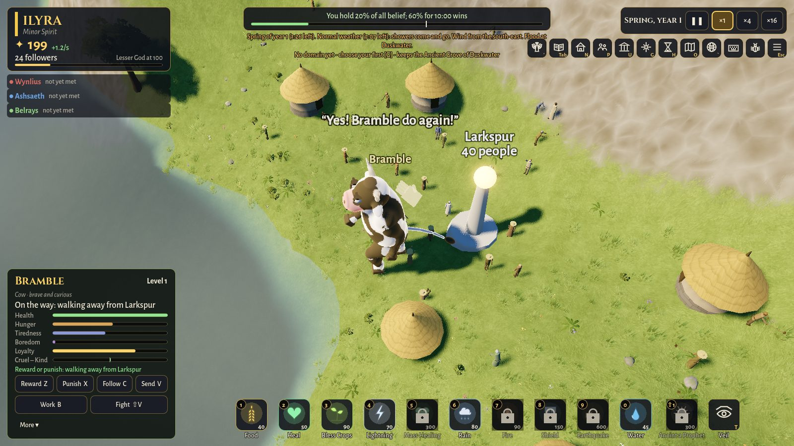

Every Creature has a mind too, yours included. It wakes when it meets another Creature, ends a
fight, is rewarded or punished, grows a level, gets hungry or tired, sees its home struck, or is
noticed in another god's lands. It says something out loud (the words float above it) and
chooses what to do next from the options its instincts weigh. Your training still shapes it: it
never overrules your orders, and it can't walk out of a fight or out of your hand.

### An angel that becomes what you do

| Radiant | Torn | Fallen |
| --- | --- | --- |
| 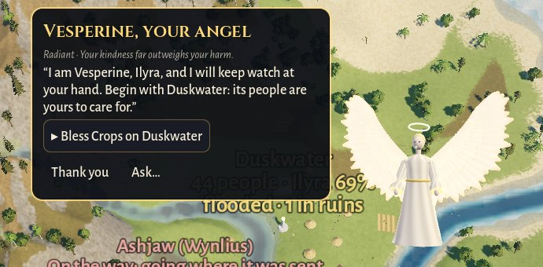 | 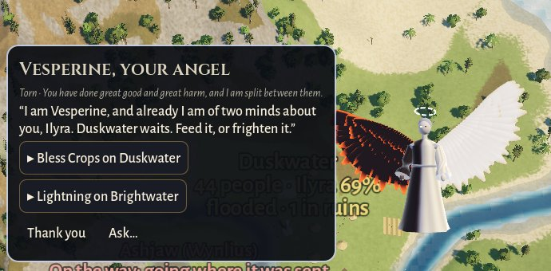 | 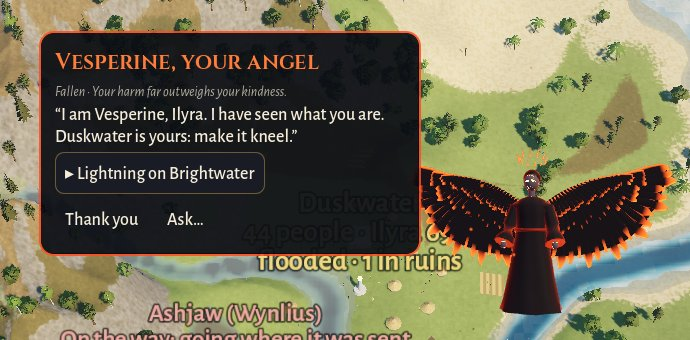 |
| "Begin with Duskwater: its people are yours to care for." | "Duskwater waits. Feed it, or frighten it." | "I have seen what you are. Duskwater is yours: make it kneel." |

An angel hovers at your hand: your conscience and your guide. It has its own name in every world,
and **it becomes what you do**. It reads the world's memory of your deeds, never a score:

| It looks | When |
| --- | --- |
| Radiant: white and gold, its halo whole, motes of light about it | your kindness far outweighs your harm |
| Kind: white | you've done more good than harm |
| Unformed: pale silver | you've done little yet |
| Torn: one wing gold and one ash, its halo broken | you've done great good and great harm |
| Stern: ash-grey, thorns breaking from its halo | you've done more harm than good |
| Fallen: black, wings rimmed with embers, a burning crown, eyes of fire | your harm far outweighs your kindness |

Your reputation marks it too: a burning blade if you're vengeful, chains if you're cruel, a veil
if you're deceptive, threads of gold if you're generous, light in its open hands if you're
merciful.

It comes to you when something happens (your deeds, your villages hungry or struck, a rival's
Creature in your lands, a new rank) or after a long quiet, and with a model it speaks in its own
words about what just happened and how things stand for you. It speaks in the voice of what you've
made it: a radiant angel urges mercy, a fallen one urges fear, and a torn one lays both paths
before you. It suggests something you can do right now. **Show me** flies the view there and gets
it ready, **Thank you** sends it away, and **Ask** lets you put any question to it. Press **'**
(apostrophe), or its button on the god's bar, to call it. It also guides you through the tutorial.

### Fair by design

- **A model plays; it doesn't referee.** Every act a mind takes goes through the same checks as
  your commands, and what the rules refuse doesn't happen.
- **Talk leans a god's own judgement,** and only by a little.
- **Answers are read strictly.** If a model writes a god badly, the scribes write that one instead,
  and you're told.
- **The world never waits.** A model's answer is taken between the simulation's steps. While a mind
  thinks, its instincts carry on, so the game runs at full speed. The minds are at their best at
  ×1 to ×4.
- **One world for everyone.** In a shared game, the host's computer thinks for every god and
  Creature. Each player hears the words meant for them and has an angel of their own.

### Instincts: the AI that's always on

With no model at all, the gods and Creatures are still driven by AI, and the game is complete:

- **Every god plays to win.** It weighs every miracle on every village, and its Creature's errands,
  and picks the best move for its personality and temper. Every 30 seconds it sets itself up to
  three goals: protect its home, convert a village, befriend or weaken a rival, prepare for drought
  or plague, or slay the ancient beast. It weighs every alliance, war, treaty and council vote,
  gangs up on whoever pulls ahead, makes peace to face a common threat, and betrays when it pays.
- **Every god remembers.** It keeps its own view of every other god (trust, fear, respect,
  rivalry, gratitude and suspicion), built from what they did and fading with time. A betrayal
  lasts longest.
- **Every Creature learns.** It weighs its needs, its personality and what it has learned to like
  in each kind of situation. Your rewards and punishments reshape both its tastes and its
  character.
- **The scribes give everyone a voice.** They write each world's gods from its seed, so the same
  seed always gives the same gods, and they give gods, Creatures and your angel a line for every
  moment.

Want to watch them think? Turn on **Settings > Interface > Debug tools** and press **F1**. You'll
see each god's best moves and why, its plans, its diplomatic reasoning, and each mind's last turn:
what woke it, what it decided, what came of it, what it said, and the god's journal.

### Choose a mind

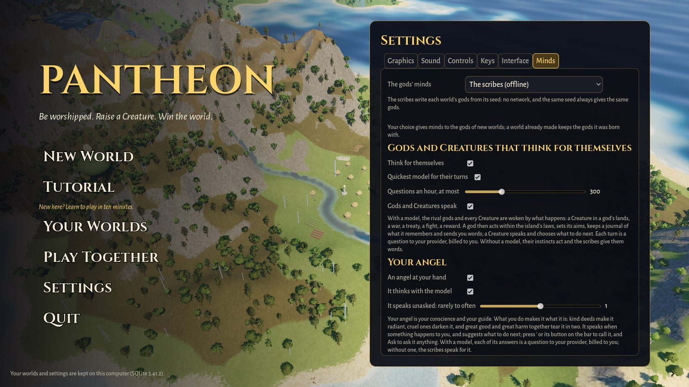

Open **Settings > Minds**, choose who writes and speaks for the gods, give your key, and press
**Test**: the model answers with a greeting, or tells you what's wrong. Then start a **New World**
and watch its gods wake. (A world keeps the gods it was born with, so your choice writes the gods
of new worlds.)

| Provider | What you need | Models |
| --- | --- | --- |
| **Claude**, by Anthropic | your own key from console.anthropic.com (or `ANTHROPIC_API_KEY`) | Claude Opus 5.5 (default), Sonnet 5.5, Haiku 5.5, Fable 5.1 |
| **GPT**, by OpenAI | your own key from platform.openai.com (or `OPENAI_API_KEY`) | GPT-6.1 Sol (default), GPT-6 Astra, GPT-6 Luna |
| **Gemini**, by Google | your own key from aistudio.google.com (or `GEMINI_API_KEY` / `GOOGLE_API_KEY`) | Gemini 3.8 Flash (default), Gemini 4 Argon, Gemini 3.5 Flash-Lite |
| **A model on your computer**, through [Ollama](https://ollama.com) | Ollama running, and a model pulled (for example `ollama pull llama3.2`) | whichever your server has. **Find** lists them, and nothing leaves your computer |
| **The scribes** (the default) | nothing | the game's own offline writers |

The same tab sets:

- **Think for themselves:** whether the gods' and Creatures' minds take turns, or only their
  instincts play.
- **Quickest model for their turns:** frequent turns go to the provider's quickest, cheapest model
  (Claude Haiku 5.5, GPT-6 Luna or Gemini 3.5 Flash-Lite), while the chosen model writes the gods
  and talks with you.
- **Questions an hour, at most** (300 by default): a cap on what the minds cost you. When it's
  spent, the scribes speak until the hour frees more.
- **Gods and Creatures speak:** whether you hear them.
- **Your angel:** whether you keep one, whether it thinks with the model, and how often it speaks
  unasked.

**What it costs.** Questions are billed to your own account with the provider: one for each world
made, one for each thing you say to a god, and the minds' own turns. A god's turn is about 1,500
tokens asked and a few hundred answered, and a Creature's about 600. Your angel asks at most 60
questions an hour. No mind thinks while the title screen is open.

**Your key stays yours.** Each key is kept on your computer, in your profile, apart from your
other settings, and is sent only to its own provider. It's never logged, saved in a world or sent
to other players. OpenAI is told not to store anything, and a local model keeps everything on your
machine.

**If anything fails** (a model that errors, refuses, or takes longer than three minutes to write
the gods), the scribes take over and you're told why. After three failures in a row, the minds
rest for two minutes while the scribes speak.

## The rest of the world

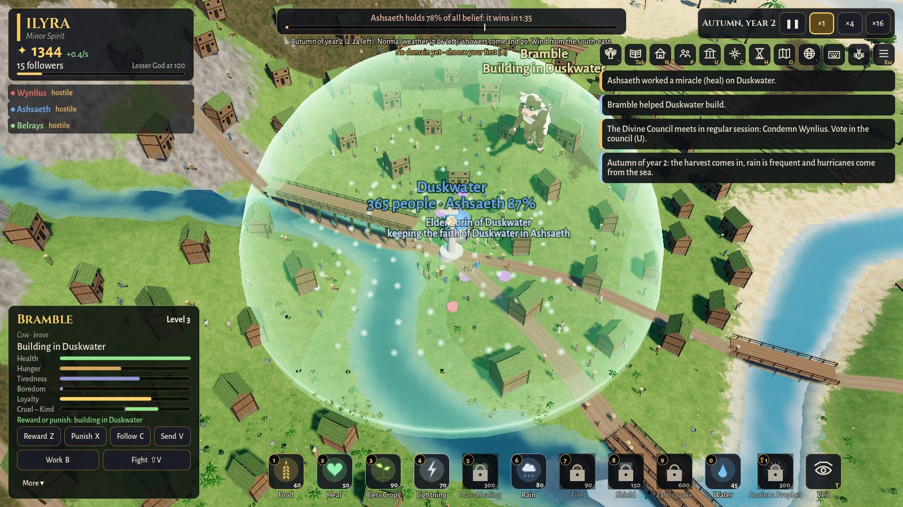

- **Belief is power.** Every village feels faith, love, fear and doubt for every god. Those
  feelings decide who it follows and how much power each god gets. Fear wins followers fast, but
  it doesn't last.
- **A Creature that learns.** Reward it and it does more of what it was doing; punish it and it
  does less. Raise it to be a healer, a guardian, a trickster or a destroyer.
- **Diplomacy with teeth.** Alliances, eleven kinds of treaty (some signed in secret), favours,
  the Divine Council's votes and decrees, and wars fought for conquest, tribute or a holy site.
- **A living, dangerous world.** Seasons, weather, rivers and floods, fires, earthquakes,
  tornadoes, a volcano, plague, eclipses and an ancient beast all come from the same simulation.
- **Villages with a life of their own.** They build temples and walls, learn new crafts, take
  up doctrines like pacifism or militarism, send out settlers, and may turn their backs on
  every god.
- **Many ways to win.** Win by holding most of the world's belief, by conquest or by culture, or
  play a sandbox nobody wins. Islands range from 2 km to 12 km across, with four to eight gods.
- **Play with friends.** Up to four players can share a world over a local network or the
  internet. There's no server and no account.

## Screenshots

| | |
| --- | --- |
| 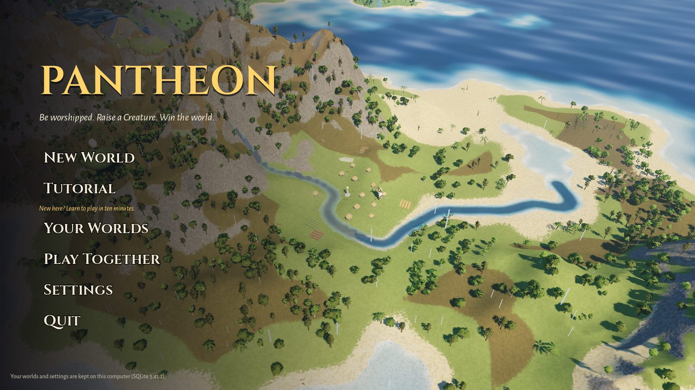 | 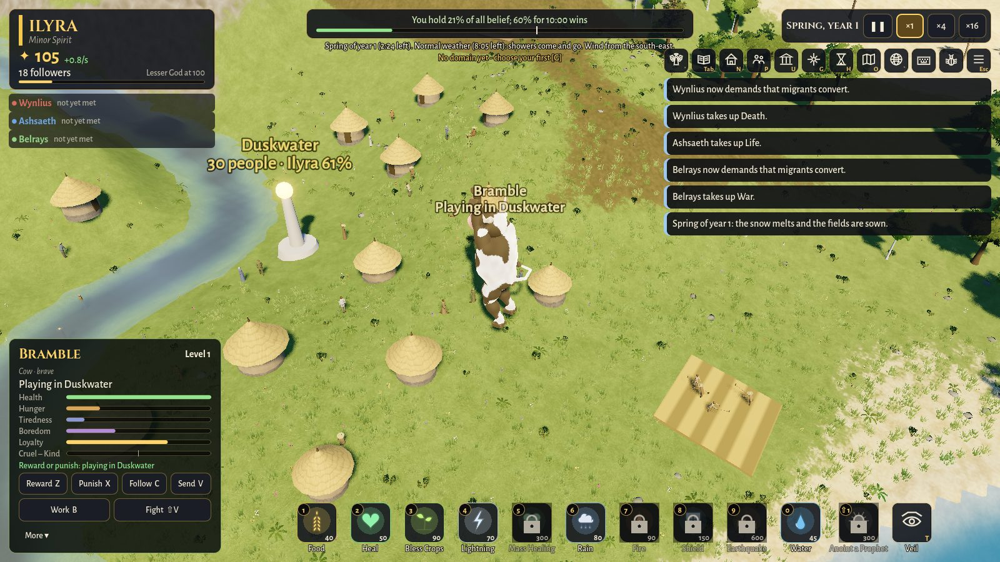 |
| **The title screen.** Continue a world, take the tutorial or start a new one. | **Your Creature.** It lives, works and learns on its own. |
| 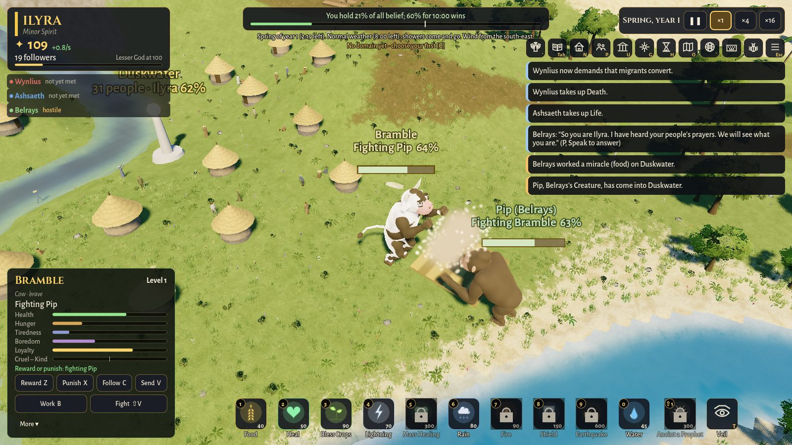 | 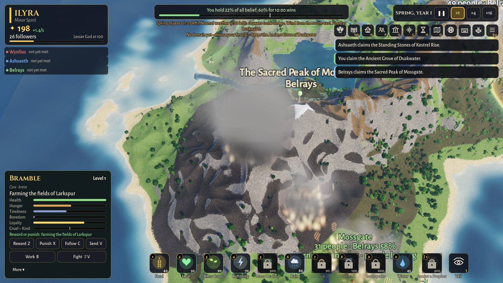 |
| **Creatures fight.** Set yours on a rival's, and the loser is banished with a scar. | **The volcano wakes.** Lava runs downhill and ash falls on the villages. |
| 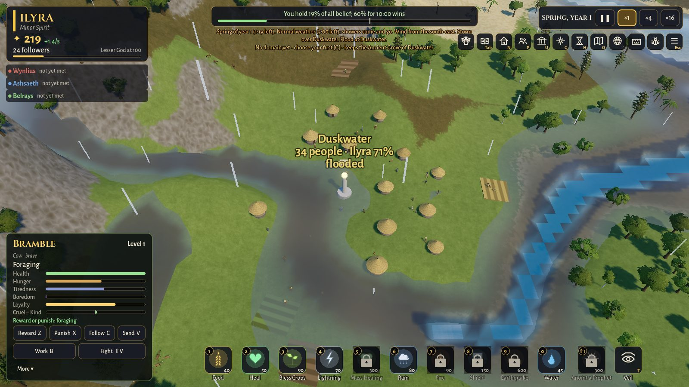 | 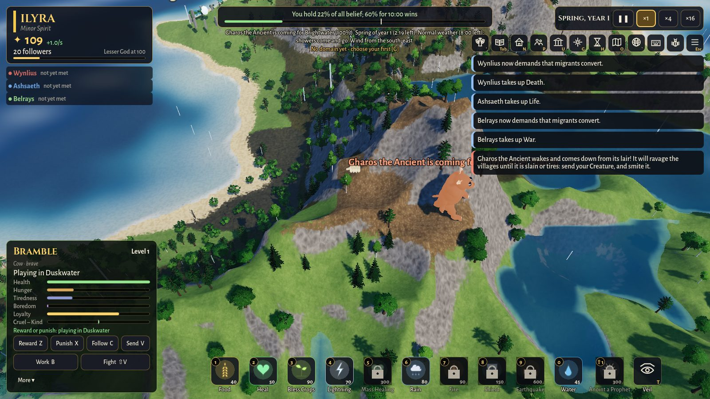 |
| **Storms and floods.** Rain swells the rivers until they burst their banks. | **The ancient beast** wakes and comes down to ravage the villages. |
| 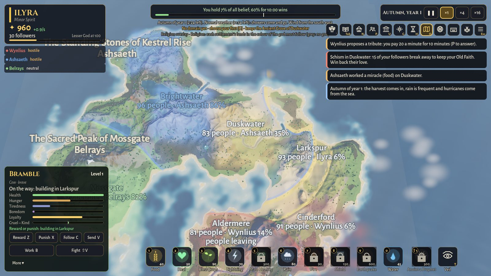 | 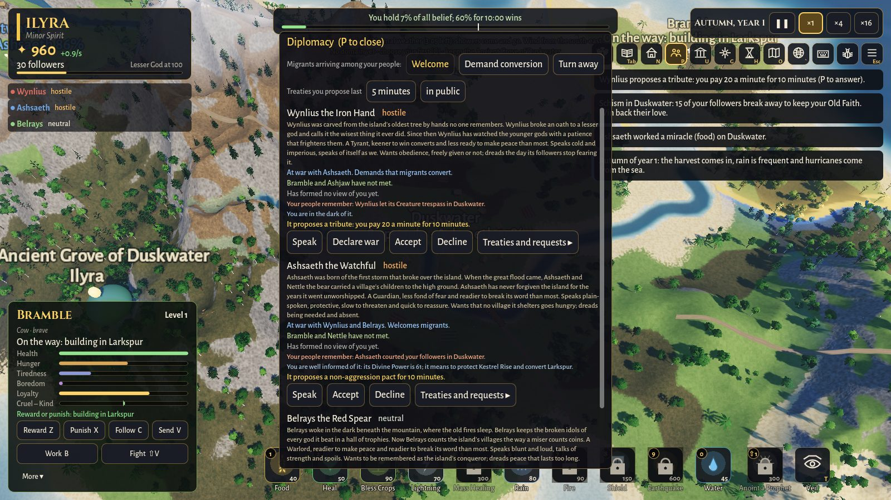 |
| **Map overlays** show whose faith holds which land, and much more. | **Diplomacy.** Every god remembers what you did, and why. |
| 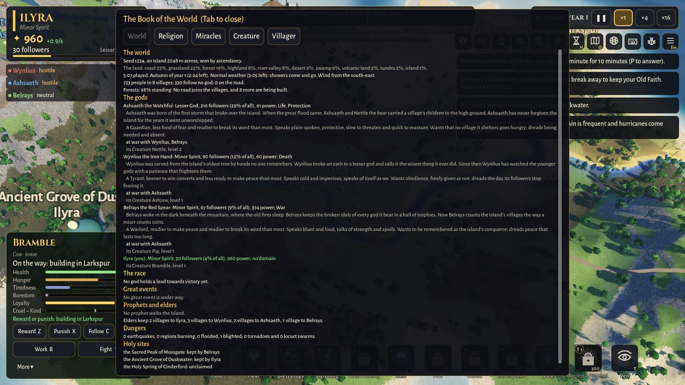 | 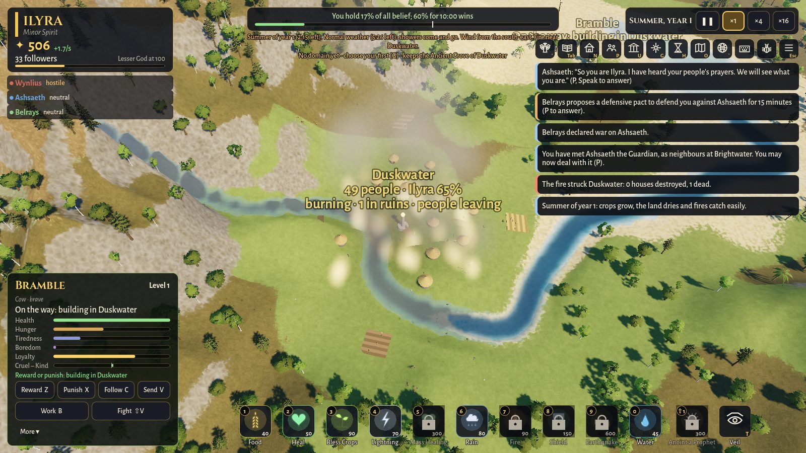 |
| **The Book of the World** keeps every god, village and miracle at hand. | **Wildfires** run with the wind, and the homeless take to the road. |

## Get the game

Builds for each system are published on the
[Releases page](https://github.com/roeyazroel/pantheon/releases). Download the package for your
computer, unpack it and start the game:

| System | Package | Start it with |
| --- | --- | --- |
| Windows (64-bit) | `Pantheon-windows-x86_64.zip` | `Pantheon.exe` |
| macOS (Apple Silicon and Intel) | `Pantheon-macos-universal.zip` | `Pantheon.app` |
| Linux (64-bit) | `Pantheon-linux-x86_64.tar.gz` | `Pantheon.x86_64` |

**On macOS**, the app isn't notarized yet, so the first time you open it macOS says it can't check
it. Open **System Settings > Privacy & Security** and choose **Open Anyway**, or run
`xattr -dr com.apple.quarantine Pantheon.app` in Terminal.

**You need** a graphics card with Vulkan support (on macOS, any Mac with Metal). The game needs
no internet connection, account or download while you play.

No build for your system yet, or want the latest changes? You can
[build it from source](docs/DEVELOPMENT.md#getting-started).

## Your first game

The game opens on its title screen, over the living island:

- **Continue** picks up your newest save, once you have one.
- **Tutorial** teaches you by doing, in fifteen short steps on a sandbox island: the camera,
  miracles, your Creature, your hand, time, diplomacy and how to win.
- **New World** lets you shape the island before you begin:
  - its name and seed (every seed makes its own island);
  - your Creature's species;
  - the island's size;
  - how it can be won;
  - its climate: four seasons, or an even climate all year;
  - whether the gods start as strangers or already know each other.

  Then you meet the rival gods born with that world, written by the mind you chose in
  Settings > Minds, or by the scribes.
- **Your Worlds** loads or forgets any world you've played.
- **Play Together** hosts a world or joins a friend's (see [Playing together](#playing-together)).
- **Settings** covers graphics, sound, controls, the interface and the gods' minds.

A short guide walks you through your first minutes, and your angel adds a word of advice now and
then. Press **Esc** at any time to pause.

### Around the screen

- **Top left:** your god's plaque: your rank, your Divine Power and how fast it grows, and your
  followers. Under it is a chip for each rival saying how it stands with you. Hover over a chip to
  see its following.
- **Top centre:** the race for victory: who holds most of the world's belief and how long until
  they win.
- **Top right:** the season, pause and speed buttons, and the **god's bar**. The bar has a
  button for every panel (the Book, villages, gods, council, domains, history, the map's
  overlays, the overview, the keys and the menu), each showing its key.
- **Right:** the alerts. Click one to fly there.
- **Bottom:** the miracle bar. Each miracle shows its key and cost. A sweep means it's cooling
  down, a padlock that your rank is too low, and a red cost that you can't afford it yet. Hover
  over one to read what it does.
- **Bottom left:** your Creature's card.

### Keeping an eye on the world

- **Alerts** tell you when your followers go hungry, when a village turns to you or away from
  you, when a rival works a miracle on your people, when a storm is coming, and much more.
- **Labels** over each village show its name, its people and the god most of them follow, in
  that god's colour, with warnings like "drought", "burning", "flooded" or "people leaving".
- **Map overlays (O)** paint the land by influence, religion, faith, food, weather, danger,
  migration, culture, nature, population, disaster risk or politics. The map button on the god's
  bar picks one by name.
- **The Book of the World (Tab)** has a page for the world (every god's standing, the race for
  victory, the dangers under way and the holy sites), religion (your followers village by
  village, with the failing ones in red), miracles (what each costs you and what it still needs),
  your Creature, and the villager you follow.
- **The overview** (backtick) shows the whole island from afar, and **H** opens the world's
  history.

### A good start

Cast **Food** or **Heal** on the villages next to your home, then **Bless Crops** when your
followers grow hungry. Try **Lightning** once to see how fear works. But be careful: a bolt can set
dry woods alight, and a forest fire drives off the game the villages hunt.

## How to play

### Belief is power

- **Followers and power.** In every village, a share of the people follow you. They spend part of
  their day at the shrine instead of in the fields, and their worship raises your Divine Power.
  More followers, stronger faith, and either love or fear all raise more.
- **Influence.** Your influence spreads out from the villages that follow you; press **O** to see
  it. You can only work a miracle where your influence reaches, and it costs more where your
  influence is weak or a rival's is strong. Your territory is drawn on the land in your colour,
  and each rival's border in theirs.
- **What people think.** Faith, love, fear and doubt drift all the time. Comfortable followers
  grow fond of you. Hunger and illness breed doubt and wear down love, and fear fades in safety.
  Everyone who sees a miracle changes their mind about you, and help that was really needed earns
  the most love.
- **Fear against love.** Fear converts quickly but fades quickly. Killing breeds doubt, and
  frightened followers leave at the first trouble. Loved followers stay.
- **Ranks.** At 100 followers you become a **Lesser God**, then a **God** at 400, a **Greater
  God** at 1,200, a **High God** at 3,000 and **Ascendant** at 8,000. You never lose a rank, and
  each rank unlocks more miracles.

### Miracles

Choose a miracle (a number key, or click it on the miracle bar) and move the cursor. A ring shows
where it lands: green where you can cast it, red where you can't. The hint names the villages it
would reach and its cost, or what's in the way. Click to cast.

| Key | Miracle | From | What it does |
| --- | --- | --- | --- |
| 1 | Food | the start | Fills the granaries of the village beneath it. |
| 2 | Heal | the start | Restores the health of the village beneath it. |
| 3 | Bless Crops | the start | Blessed farmland yields more for a while. |
| 4 | Lightning | the start | Strikes the target. People who see it fear you; people it hits die. |
| 5 | Mass Healing | Lesser God | Heals every village in a wide circle. |
| 6 | Rain | the start | Calls a rain cloud that soaks the land as it drifts with the wind. |
| 7 | Fire | Lesser God | Sets the land alight. Fire spreads where the land is dry. |
| 8 | Shield | Lesser God | Shields the villages beneath it from fire and earthquakes for three minutes. |
| 9 | Earthquake | God | Shakes the ground. Houses fall, and all who feel it fear you. |
| 0 | Water | the start | Fills a village's wells and soaks its fields. |
| Shift+1 | Anoint a Prophet | Lesser God | Calls a prophet who walks from village to village preaching you. |

Your **domains** add a miracle each (Shift+2 to Shift+4), and a Greater God can work the
**Divine Acts**; see [Domains, holy sites and Divine Acts](#domains-holy-sites-and-divine-acts).

Press **T** (or the Veil at the end of the miracle bar) to cast **veiled**: it costs twice as
much and nobody knows it was you. A kindness earns no love, and a strike makes people doubt their
own god for not protecting them. The god whose people you struck may still trace it back to you.

### Your hand

**R** picks up what's under the cursor wherever your influence reaches, and **R** again sets it
down. **Shift+R** throws it.

- **Villagers** (up to ten at a time): lift them out of a burning, shaking or flooded village and
  set them down somewhere safe, and they and everyone who sees it will love you for it. Taken
  from a safe home, they're frightened. Set down in the sea, they drown.
- **A tree** to plant elsewhere, or **a rock** to throw: it wrecks houses where it lands and
  leaves a crater.
- **Your Creature** waits in your hand until you set it down. If you throw it, it gets hurt and
  resents you.
- **Offerings (Ctrl+R):** take a quarter of the food, wood and stone of a village that follows
  you, and give it (R) to a village in need or to your Creature. Generous gods are seen as
  generous.

What you hold swings under your palm as you move, and a held Creature dangles by its scruff.

### Your Creature

Your Creature, Bramble, is a giant animal that walks upright, with hands to carry, build and
fight. Its card at the bottom left shows its level, what it's doing, its health and needs, its
loyalty and whether it's turning out kind or cruel.

- **It decides for itself.** It gets hungry, tired and bored. It looks at the villages around it
  and picks what it wants most: feeding a hungry village, farming its fields, fetching wood,
  helping it build, playing with the villagers... or raiding their stores and attacking them. What
  it does changes what people think of *you*.
- **Teach it.** Press **Z** to reward or **X** to punish what it's doing, or what it did in the
  last fifteen seconds. Your hand pats it in gold or swats it in red. A reward makes it more
  likely to do that again in the same kind of situation; a punishment makes it less likely and
  stops it. Five rewards for feeding make a dutiful feeder of it.
- **Give it orders.** **V** sends it to the cursor; it waits there longer the more loyal it is.
  **B** sets it to work at a village (farming, fetching wood or building, whatever the village
  needs most) or to fetch wood from a forest. **Shift+V** sets it on a rival's Creature. **C**
  follows it with the camera, and the camera turns to its face.
- **It grows.** Its deeds earn experience. Each level, up to 10, makes it bigger, stronger,
  faster, cleverer and tougher, and carries your influence further.
- **Its face shows how it feels.** It scowls in a fight, grins at play and cowers after a slap.
  A kind Creature grows warm and softly glowing; a cruel one grows dark, red-eyed and
  long-horned.
- **It can be lost for a while.** If it starves or loses a fight, it's banished for a minute and
  comes home weakened.

<b>The paths it can walk</b>

At levels 3, 6 and 9 your Creature takes up the path its deeds have called it to most, so how you
raise it decides what it becomes. No Creature walks more than three.

| Path | Called by | What it does |
| --- | --- | --- |
| Healer | feeding | heals the people of the villages it helps |
| Guardian | building, mercy | your villages near it suffer less from disasters |
| Missionary | play, friendship | wins the godless of the villages it visits to you |
| Nature Keeper | foraging, wandering | heals the land where it goes |
| Warrior | fights won | fights harder |
| Destroyer | attacks | its attacks kill more |
| Trickster | stealing food, fleeing | sows doubt in your rivals among the villages it visits |
| Commander | going where you send it | your villages near it are harder to attack |

<b>Its character</b>

Eight traits make up its character: kindness, aggression, laziness, curiosity, courage,
protectiveness, jealousy and playfulness. Its card names the strong ones, for example "brave,
protective, playful and loyal".

- A brave Creature fights where a coward runs.
- A protective one stands its ground near your villages, and goes by itself to defend them from
  the ancient beast.
- A jealous one makes rivals of stronger Creatures.
- A playful one plays with the others.

Its character changes as it lives. Rewarding a deed strengthens the traits behind it (reward it
for running away, and it grows cowardly). Rewards ease its jealousy and punishments feed it.
Victories make it braver, while defeats and wounds cow it.

<b>The species</b>

On New World you choose your Creature's animal:

- the **Cow**, gentle and steady, quick to care for the villages;
- the **Ape**, clever and playful, the quickest to learn but frail in a fight;
- the **Tiger**, a fast, striped hunter, quick to anger and easily hurt;
- the **Lion**, maned, proud and brave, strong in a fight;
- the **Wolf**, swift and loyal, fierce in defence of its own;
- the **Bear**, massive, strong and hard to hurt, slow and steady;
- the **Horse**, the swiftest of all and a tireless worker, but timid;
- the **Tortoise**, under a shell like granite: the hardest to hurt, slow to move and to learn.

Every rival god has an animal of its own. If you choose a rival's animal, that rival takes yours.

### Creatures together

Every god's Creature roams the same island, and they remember each other.

- **Meetings.** When two Creatures meet, each decides what to do based on what it has learned,
  how it feels about the other and its personality: fight, play, run or walk on. Creatures of
  gods at war want to fight; allies' Creatures want to play.
- **Friends and rivals.** Playing and greeting make friends, and a friend who attacks is a
  betrayer. Friends whose gods go to war refuse to fight each other.
- **Fights.** Two Creatures box face to face until one gives up, with a health bar over each
  head. A kind winner may let the loser go. Otherwise the loser is banished for a minute,
  scarred and less loyal, and the people who saw the fight believe more in the winner's god.
  When your Creature starts a fight while the game runs fast, it slows down so you can watch.
- **Gods keep watch.** When your Creature walks near a rival's village, its god answers at once:
  a friend sends its Creature to greet yours, a wary stranger sends its Creature to follow yours,
  and a foe drives yours out. Trespass after trespass embitters a god.

### The villages

Each village lives on its own. Its people farm the land around it, eat, store what's left over,
have children while there's room and food, and build a new house when they get crowded. When food
runs short they fall ill and die. They gather wood from the forests and stone from the heights,
and the bigger villages build roads to their neighbours. Trade and food travel along those roads.

Come close and you see the people themselves going about their day. Farmers hoe the fields,
builders hammer at the building site, and everyone stops to pray at the shrine. Each village
builds for its land: round thatched huts on the grassland, timber longhouses in the forest, stone
cottages in the highlands, adobe in the desert and houses on stilts in the swamp. The more a
village loves a god, the more it shows that god's colours and style.

- **Following a villager.** Point at anyone and press **/** to follow them. They have a name, an
  age, a job, a god and memories. They flee disasters, pray in hard times, and an alert tells you
  when their life ends. **Tab** opens their page in the Book of the World.
- **A village's life.** Every village has its own safety, happiness, order, wealth and learning.
  Unhappy villages lose people.
- **Technology.** Agriculture, architecture, medicine, warfare, navigation, engineering, science
  and religion grow with learning and spread between neighbours.
- **Buildings.** Temples, granaries, hospitals, walls, levees, firebreaks, shelters, cisterns,
  sea walls, dams and evacuation routes rise once a village can afford them.
- **Prophets and elders.** Every village of 40 or more chooses an elder of its god, who keeps its
  faith. A devout village may call a prophet, who walks from village to village preaching: look
  for a robed figure in its god's colour, with a staff and a halo. A prophet who dies in a
  disaster becomes a martyr, and your followers hold to you all the harder.

**Priorities.** Press **N** over a village to open its panel. If at least four in ten of its
people follow you, you can choose what it puts first:

| Priority | What happens |
| --- | --- |
| Increase food | Bigger harvests, a granary, and irrigation beside water |
| Improve health | Healers tend the sick, and a hospital saves lives |
| Grow | More births while there's food and room |
| Focus on worship | Twice the worship, so more power for its gods |
| Prepare for war | Watchmen, and walls that turn attacks away |
| Prepare for disaster | Levees, dams, sea walls, firebreaks, shelters, cisterns and evacuation routes |
| Expand | Settlers found new villages on free land nearby |
| Build a temple | A temple to you: half again as much power from its worship |

<b>Culture, doctrines and turning from the gods</b>

- **Doctrines.** Villages come to hold beliefs of their own from what they live through and the
  god they follow: pacifism, militarism, sacrifice, charity, nature worship, the search for
  knowledge, expansion or isolation. Each changes how they worship, learn, convert and welcome
  strangers. Pacifists are outraged when their god does harm; militarists accept force and may go
  to holy war against a neighbour of another faith.
- **Turning from the gods.** Doubt, resentment, people who follow no god and the growth of science
  make a village agnostic, then atheist, then set against every god.
- **Dependency.** People you help in need come to depend on you. They worship harder, but they
  doubt you in hard times if you don't come.
- **Resentment.** Fear breeds resentment and love dissolves it. A village that fears and resents
  its god may revolt and tear down its temple.
- **Missionaries.** A temple wins over the godless in the villages around it.
- **Reputation.** The world remembers what each god does, and over time this earns it traits:
  compassionate, cruel, vengeful, merciful, generous, deceptive, honest, chaotic or ambitious.
  Villages read their gods by them.

<b>Migration and refugees</b>

People leave villages where life is hard: hunger, no roof, fire or earthquakes, a village torn
between gods at war, or fear and doubt of their god. A group sets out with its share of the food
and heads for the best place it can walk to. Those who leave often give up the god they fled.

Where they arrive, the god most followed there decides whether to **welcome** them, **demand they
convert**, or **turn them away**, and their own god remembers what was done with its people. You
set your own policy at the top of the diplomacy panel (**P**).

### Rival gods

Three to seven rival gods share the island, each born with the world and each with a mind of its
own (see [Gods that think for themselves](#gods-that-think-for-themselves)). A Tyrant strikes your
villages and goes to war readily; a Guardian welcomes alliances and keeps them; a Trickster allies
gladly and betrays whenever it pays; an Isolationist tends its own and keeps out of wars. They play
by your rules: the same miracles, the same costs, the same need for influence. People who lose
faith in one god turn to whichever other god pulls them most.

### Diplomacy

Press **P** for the diplomacy panel. For each rival it shows where you stand (allied, friendly,
neutral, hostile or at war), how it feels about you and why ("remembers that you converted
Elar"), and a button for every move you can make right now.

- **First you must meet.** You can only deal with the gods your people have met. Gods meet when
  their villages are close or joined by a road, when their Creatures meet, when one's deeds touch
  the other's people, or at the Divine Council. Press **Seek them out** on a god's card and your
  Creature goes looking for its Creature.
- **What they remember.** Feeding or healing a god's followers in need earns its gratitude.
  Working miracles on its comfortable followers is courting, and it resents that. Striking its
  people, converting its villages or letting your Creature attack them makes it a rival.
- **Alliance, war and peace.** Offer an alliance, declare war, or ask for peace once a war has
  dragged on. Allies don't plant doubt in each other's followers. At war, villages resist the
  enemy and Creatures go after enemy villages.
- **Betrayal.** Breaking an alliance collapses your partner's trust and makes every god trust you
  less, and it's remembered far longer than anything else. The AI gods can betray you too.
- **The gods deal with each other.** A god who pulls ahead draws wars, and the others look for
  allies against it. Two lesser gods would rather make peace than fight while a third runs away
  with the world.
- **Talk to them.** Press **Speak** on a god's card to talk with it, and settle an alliance, a
  peace or a treaty in words (see [Talk to them](#talk-to-them)).

<b>Treaties</b>

Under "Treaties and requests" on a god's card, propose any treaty the god could accept now. You
choose how long it lasts (from two minutes to "until broken") and whether it's signed in secret.

| Treaty | What it does |
| --- | --- |
| Non-aggression pact | Neither may declare war on the other until the pact is broken. Signing it in war makes peace. |
| Defensive pact | When anyone declares war on the other god, you join the war. |
| Mutual defence pact | Each joins the other's wars against any aggressor. |
| Joint war | Both make war on a god you name, and neither may make a separate peace. |
| Shared influence | Each casts in the other's influence as an ally would. |
| Religious access | Your temples' missionaries reach every village the other leads. |
| Creature truce | Your Creatures never fight. |
| Disaster assistance | Each answers disasters among the other's people. |
| Territorial agreement | Neither casts miracles on the villages the other leads. |
| Tribute | One pays the other Divine Power every minute. |
| Migration agreement | Each welcomes the other's migrants, whatever its refugee policy. |

- **Secret treaties** are known only to the two gods until they're invoked or leak.
- **Breaking a treaty** is a betrayal, and your word counts for less in every treaty after.
- **Favours.** Save another god's followers in great need and it owes you a favour. Call it in for
  Divine Power, war on your enemy, its vote at the council, or help for your people.
- **Absorbing an ally.** You can break an alliance and take a share of your ally's followers
  wherever you're followed more. It's a betrayal, and an AI ally may do the same to you.

<b>The Divine Council</b>

Press **U** for the council. Betrayals, a god rising to dominate, and disasters summon it, and it
also meets every five minutes on a motion a god has tabled. The vote lasts a minute, in public (the
gods remember who voted against them) or in secret.

| Decree | Effect, for eight minutes |
| --- | --- |
| Condemn a god | Every god trusts it less, its followers doubt it, and AI gods turn on it more readily. |
| Protect a holy site | No harmful miracle may fall there. |
| Prohibit smiting, cataclysms or terror | No lightning and judgement, no fire, quakes and floods, or no terror, anywhere. |
| Coordinate the response to disasters | Helping a village struck lately costs half. |
| Pantheon-wide war | Every god that voted for it goes to war with the god named. |
| Neutral territory | No god may convert or strike in the village. |

Decrees bind by reputation: you can defy one, but every god will trust you less.

<b>War and intrigue</b>

- **War goals.** Declare war for conquest, tribute, a holy site, or to humble a rival's Creature.
  The war's score counts converted villages most, then defeating its Creature and taking its
  sites; striking its people counts least, so slaughter isn't the road to victory. Meet your goal
  and you can dictate the peace.
- **What you know.** You know a rival only as well as your allies, treaties, followers living
  among its people and your Creature's travels tell you. Well informed, you see its power, its
  plans and whether an ally is weighing betrayal.
- **Proxy acts.** In the panel of a village another god leads, you can incite rebels against
  that god or spread propaganda. That god may trace it back to you.
- **Holy wars.** A militarist village may go to holy war against a neighbour of another faith. If
  its people follow you, you can urge them on or hold them back.

### A living world

**Seasons.** A year lasts ten minutes, unless you choose an even climate. Plan for winter:
villages that go into it with full stores get through, and those that don't go hungry.

| | Spring | Summer | Autumn | Winter |
| --- | --- | --- | --- | --- |
| Weather | more rain | warmer and drier | the most rain | colder: snow on the hills |
| Harvest | ×0.9 | ×1.25 | ×1.3 | ×0.5 |
| Dangers | | fires, heat waves, hurricanes, spoiled stores | hurricanes | cold waves, sickness |

**Weather.** Clouds blow in from the sea, rain and drift away. Storms bring wind and lightning
and ruin stores and building work. Dry spells parch the fields until harvests fail. Snow lies on
the hills and melts into the rivers in spring. Fog rolls in on calm, cool days, and hurricanes
born over the warm sea tear down houses far inland. Use **Rain** (6) on a village in drought and
it will love you for it.

**Rivers and floods.** Rivers run from the highlands to the sea, and lakes fill the hollows.
Villages settle beside them and draw water from them. Heavy rain swells a river until it bursts
its banks: houses fall and people drown, but the silt enriches the fields. Far from water, wells
run dry in a long drought; **Water** (0) fills them.

**Disasters.**

- **Wildfires** start in dry, green land, from a hearth, a thunderstorm or a god, and spread
  faster downwind. Rain and the villagers put them out.
- **Earthquakes** bring houses down. A strong one near the coast raises a **tsunami**, and a
  quake or soaked soil can start a **landslide** that buries the land below.
- **The volcano** on the island's highest peak rumbles, then erupts: lava runs down its slope
  and ash falls on the land around it.
- **Tornadoes** spin down from thunderstorms, **falling stars** leave craters, **blight** spreads
  through warm, wet fields, and **locust** swarms eat the stores of the villages they pass over.
- **Afterwards**, villages rebuild their ruins, and survivors fear their gods. A god who shields
  or rescues them earns their love. Cracked houses fall more easily in the next disaster.

**Great events.** Now and then the whole world lives through something together:

- **The plague** spreads between crowded villages and along roads; your healing miracles cure
  it.
- **An eclipse** turns the sun dark, terrifies every believer, and makes miracles twice as
  awe-inspiring.
- **A reformation** sweeps through your faith when your followers doubt you but have learned
  enough: most of the doubt goes, but some doubters leave.
- **The ancient beast** wakes in its lair on the heights and ravages village after village.
  Fight it with your Creature and your smiting miracles. When it falls, every god who harmed it
  shares the glory.
- **A magical anomaly**, a column of violet light, halves the cost of miracles around it for
  three minutes.

**The land's life.** Fire, floods, earthquakes and lightning harm the land; it heals, but harm
done again and again scars it for good. Only a god of Nature heals scars. Wild deer and birds
live as far as the land allows, and villages hunt them. Big villages pollute their land.

**Biomes.** The island has grassland, forest, highland, tundra, desert, swamp, coasts, river
valleys, offshore islands and the volcano's dark ash. River valleys are the richest land, and
villages crowd into them.

### Domains, holy sites and Divine Acts

**Domains.** You choose what you're the god of: one domain as a Minor Spirit, a second as a Lesser
God and a third as a God (press **G**). A domain is yours for good. Its miracles cost you a fifth
less, it changes one rule of the world for you, and it gives you a signature miracle no one else
can cast.

| Domain | Its boon | Its signature miracle |
| --- | --- | --- |
| Life | your villages heal | Gift of Life brings newcomers |
| Nature | your villages stay blessed | Regrowth puts out fires and heals burned land |
| Protection | your villages lose fewer houses to disasters | Sanctuary keeps your followers from falling away |
| War | your Creature hits harder | Spear of Heaven wounds rival Creatures |
| Knowledge | your Creature learns faster | Enlighten teaches your Creature |
| Storm | storms over your people raise their faith | Redirect Storm carries the nearest storm to you |
| Fire | fires die down on your land | Firestorm sets a wide country alight |
| Prosperity | worship raises more power | Abundance fills a whole country's granaries |
| Death | the lives your miracles take give you power | Dread turns people from other gods |
| Trickery | your miracles plant more doubt | Sow Discord makes two rivals blame each other |
| Chaos | your earthquakes strike harder | Upheaval shakes the ground early |
| Ocean | your villages fish the sea, rivers and lakes | Tidal Wave sends the sea over a low coast |
| Justice | your villages keep your law, so fewer leave | Judgement strikes only those who wronged you |

**Holy sites.** Every world has four: the Sacred Peak, the Ancient Grove, the Holy Spring and the
Standing Stones. The god whose influence holds a site, clearly ahead of the others, takes it after
45 seconds, and gains power, influence and a gift there. Send your Creature to claim a site or
defend yours.

**Schisms.** When a village's followers come to doubt their god deeply, some break away to keep
its **Old Faith**. No other god can win them until their god is loved there again, or they lose
their faith altogether.

**Divine Acts.** A Greater God can work the greatest miracles of all, from the Domains panel:

- **Hallow the Land:** its blessing never fades.
- **Wake the Volcano:** the island's sleeping volcano rumbles, then erupts.
- **Still the World:** every quake, fire, flood, storm, swarm, blight and drought ends at once.
- **Raise an Island** from the open sea, for villages to settle.
- **Split the Mountain:** a gorge opens through it, and a river may find its way through.
- **Turn the River** to run where you point, watering new land as its old course dries.

### Winning

You choose how a world can be won when you make it:

- **Divine Ascendancy** (the default): hold 60% of all belief for ten minutes. Allies count
  together, so an alliance with a strong god can be your road to victory, or theirs. Near a joint
  victory, a treacherous ally may break away to win alone.
- **Conquest:** bring every god outside your alliances below 5% of all belief and keep them there
  for ten minutes.
- **Culture:** lead three in four of the living villages for ten minutes, while some rival keeps
  at least 5% of all belief.
- **Every victory** puts all three in play, and the first reached wins.
- **Sandbox:** nobody wins, and the world goes on as long as you like.

The race at the top of the screen always tells you who's closest and how long they have left.
When a god or a pantheon wins, the end screen tells the story of the world. You can keep
watching, start a new world, or go back to the title screen. Press **H** at any time for the
world's history, a chronicle of every pact, war, betrayal, disaster and legend ("Year 12 — The
Shaking of Elar (12 dead)"), with your own moments in gold.

### World sizes

| Size | Island | Villages at the start | Gods | Gods who can win together |
| --- | --- | --- | --- | --- |
| Small (the default) | 2 km across | 8 | 4 | 2 |
| Large | 4 km across | 20 | 6 | 3 |
| Huge | 8 km across | 40 | 8 | 4 |
| Vast | 12 km across | 48 | 8 | 4 |

Larger worlds bring more rivals, each with a Creature of its own, and take longer to win, since
six or eight gods hold each other in check. Crowded villages found new ones, so every world grows
as you play.

## Controls

Everything you need is also on screen: the god's bar has a button for every panel, and its
**Keys** button (or Settings > Keys) shows every key with your keyboard's letters. With the pointer
over a panel, the wheel leaves the world alone, and a key acts at the centre of the view.

**Camera**

| Action | Input |
| --- | --- |
| Pan | W A S D or the arrow keys; two fingers on a trackpad |
| Grab and drag the land (let go mid-drag to fling it) | Hold the left mouse button and drag |
| Fly to a place and close in | Double-click the land |
| Zoom towards the cursor | Mouse wheel, a trackpad pinch, `=` / `-` |
| Turn and tilt the view | Hold the right or middle mouse button and drag; Option (or Shift) with two fingers on a trackpad |
| Rotate / tilt | Q / E, Page Up / Page Down (fn+↑ / fn+↓ on a Mac laptop) |
| Look at the next village | F or Home |
| The whole island from afar, and back | `` ` `` (backtick) |

**Miracles and your hand**

| Action | Input |
| --- | --- |
| Choose a miracle (again to put it away) | 1–9 and 0, or click it on the miracle bar |
| Anoint a Prophet, then your domains' miracles | Shift+1, then Shift+2 to Shift+4 |
| Cast it at the cursor | Left mouse button |
| Put the miracle away | Esc |
| Cast veiled, or in the open | T |
| Pick up or set down / throw | R / Shift+R |
| Take an offering from a village that follows you | Ctrl+R |

**Your Creature**

| Action | Input |
| --- | --- |
| Look at it and follow it | C |
| Reward / punish what it's doing | Z / X |
| Send it to the cursor | V |
| Set it on the rival Creature nearest the cursor | Shift+V |
| Set it to work at a village, or fetching wood | B |

The same orders are buttons on its card.

**Panels and the world**

| Action | Input |
| --- | --- |
| Your angel | ' (apostrophe) |
| Talk with a god (Esc ends the talk) | Speak on its card in the diplomacy panel (P) |
| The Book of the World: the world, religion, miracles, your Creature and your villager | Tab |
| The village under the cursor: its people, stores, buildings and priority | N |
| Diplomacy | P |
| The Divine Council | U |
| Domains and holy sites | G |
| The world's history | H |
| Next map overlay: influence, religion, faith, food, weather, danger, migration, culture, nature, population, disaster risk, politics | O |
| Follow the villager at the cursor / let them go | / and Shift+/ |
| Pause / resume | Space |
| Slower / faster (×1, ×4, ×16) | `[` / `]` |
| Quicksave / quickload | F5 / F9 |
| Pause menu: resume, save, load, settings, leave to the title, quit | Esc |

There are also **debug keys** that start fires, quakes, storms and more. They're off in a release
unless you turn on Settings > Interface > Debug tools, and they're listed in
[docs/DEVELOPMENT.md](docs/DEVELOPMENT.md#debug-tools).

## Playing together

One player hosts a world and up to three others join it, each taking over a god the AI would
otherwise play. There's no server and no account: the host's computer runs the world.

- **To host or join,** choose **Play Together** on the title screen. The host picks a seed, a
  name and a port; each other player gives the host's address, their name and, if they like, the
  god they want to play.
- **Playing.** You play as usual: miracles, your Creature, diplomacy and your refugee policy.
  Each command goes to the host, which checks it and replies, so the status line says "Asking the
  host..." and then what happened. The HUD names who plays each god.
- **The host decides** the speed and pausing, and only the host saves and loads. Hosting from the
  title screen makes a small world.
- **The host thinks for the gods.** The host's computer runs every god's and Creature's mind, with
  the host's chosen model, and only the host can talk to the gods. Each player has an angel of
  their own.
- **Leaving.** When a player leaves, the AI takes their god back until they return under the same
  name. When the host quits, the session ends for everyone and the host's world is saved.

To play over the internet, the host forwards UDP port **7777** (or the port they chose) on their
router and gives the others their public address. A shared game uses about 13 KB/s per player.

## Settings

The settings page (on the title screen, or Esc in play) has tabs for:

- **Graphics:** fullscreen, vertical sync, shadows, lighting effects, render scale, particles,
  how many villagers and how much vegetation are drawn, terrain quality, **Simple terrain** for
  computers the detailed land is slow on, and the simulation's time budget per frame.
- **Sound:** the loudness of everything, the music, the effects, and the wind and rain. Every
  sound is made by the game itself, and the music is an original orchestral score for every mood
  ("The Quiet Fields" in peace, "The Gods Make War" in war, "Wrath of the Earth" when the land
  shakes), played by an orchestra the game synthesizes.
- **Controls:** panning at the window's edge, whether a trackpad's scroll zooms or pans, and the
  camera's speed.
- **Keys:** every key and gesture.
- **Interface:** the size of every panel (0.75–1.5), and the debug tools.
- **Minds:** who writes and speaks for the gods and Creatures, and your angel (see
  [Choose a mind](#choose-a-mind)).

## Your worlds and saves

Every world you begin is kept in your profile with its god, size, seed, rank, followers and the
time you've played it. **Your Worlds** on the title screen lists them, most recent first, and each
can be continued, loaded from any of its saves, or forgotten. A world keeps every save you make
from the pause menu, an autosave (every five minutes, and when you leave or quit) and a
quicksave (F5; F9 loads it back).

Your profile lives in one file, `pantheon.db`, in the game's data folder:

- **Windows:** `%APPDATA%\Godot\app_userdata\PANTHEON\`
- **macOS:** `~/Library/Application Support/Godot/app_userdata/PANTHEON/`
- **Linux:** `~/.local/share/godot/app_userdata/PANTHEON/`

## Known issues

- Four gods crowd the small island. If you sit back, you'll keep only a few followers after ten
  minutes, and a Guardian tends to be the strongest AI god (kindness converts better than fear).
- Snow doesn't slow travel, grass and trees keep their colour through the year, and biomes don't
  change how fast anyone walks.
- When three or four allies win together, the history names only the first two.
- Only the host of a shared game, or a player alone, can talk to the gods.
- Conversations aren't saved: a loaded world keeps the treaties a talk made and each god's
  journal, but not the words.
- Without a real graphics driver (software Vulkan only), the game manages just a few frames a
  second. If the detailed terrain crashes or crawls, turn on **Simple terrain** in Settings.

## For developers

PANTHEON is built with Godot 4.7.2 (.NET) and C#, with a simulation that runs and is tested
without the engine. [docs/DEVELOPMENT.md](docs/DEVELOPMENT.md) covers building from source, the
tests, the debug tools, every command-line option, the content files and how releases are made.
The [website](https://roeyazroel.github.io/pantheon/) is built from the game's own code and data;
`tools/build-site.sh --serve` builds it locally. Read [AGENTS.md](AGENTS.md) before changing anything. The owner's specification,
[docs/PANTHEON_SPEC.md](docs/PANTHEON_SPEC.md), is the source of truth for what PANTHEON is, and
[docs/PROGRESS_SUMMARY.md](docs/PROGRESS_SUMMARY.md) says how much of it is built.

## Credits

- Fonts: Cinzel and Alegreya Sans, under the SIL Open Font Licence (`game/Fonts/`).
- [Terrain3D](https://github.com/TokisanGames/Terrain3D) 1.0.2: MIT licence,
  `game/addons/terrain_3d/LICENSE.txt`.
- [FastNoiseLite](https://github.com/Auburn/FastNoiseLite) 1.1.1: MIT licence, header of
  `src/Pantheon.Simulation/Noise/FastNoiseLite.cs`.
