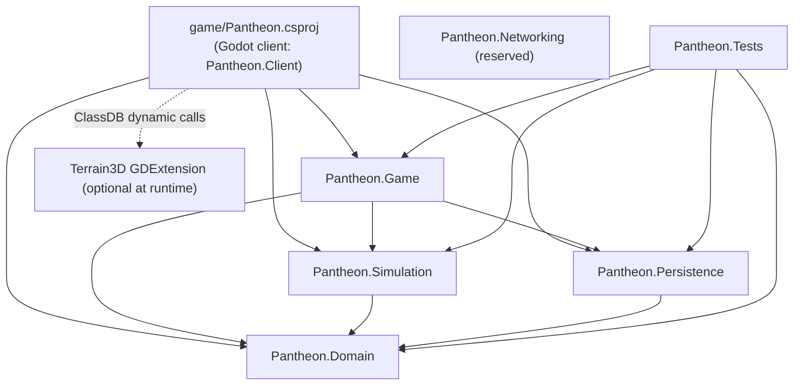
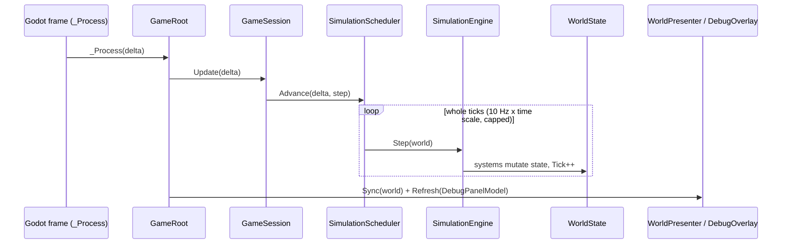
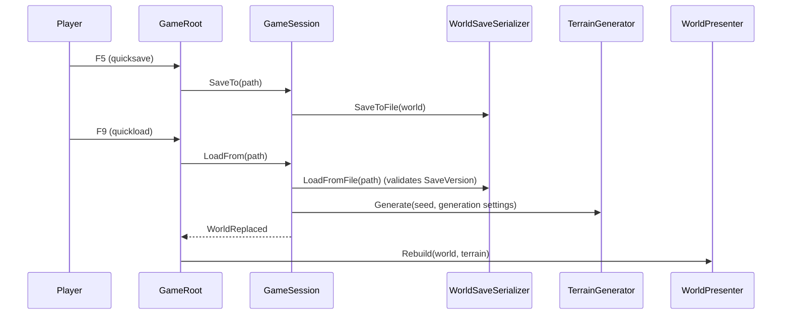
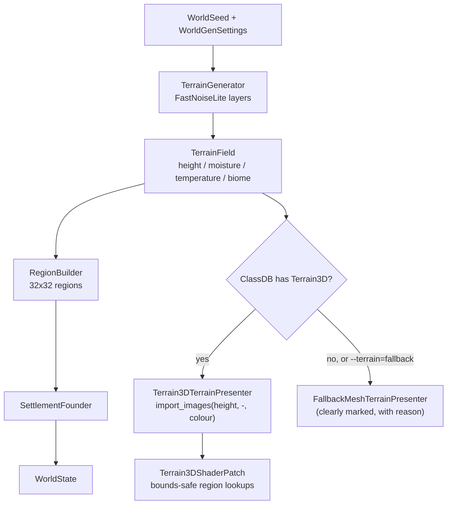

# PANTHEON — Architecture

This document describes how the code is organised and the rules that keep the simulation
independent of the engine. Decisions are recorded in [ADR/](ADR/README.md).

## Guiding rules

1. **`WorldState` is the source of truth** (ADR-006). It is plain C# data in `Pantheon.Domain`.
2. **Godot nodes are presentation only.** Presentation adapters build and update nodes from
   `WorldState` and derived data. Nodes never hold authoritative state.
3. **Never serialize the SceneTree.** Saves are versioned JSON of `WorldState`. Loading rebuilds
   visuals.
4. **Core code has no Godot dependency** and is tested headless (`dotnet test`).
5. **Seeded randomness only.** Core systems use `SimulationRandom` (xoshiro256\*\*) derived from
   the `WorldSeed`. RNG state lives in `WorldState.Random`, so saves resume the same sequence.
   No global or ambient randomness in core systems.
6. **Data-driven content** where practical (`game/Data/*.json`), parsed strictly (unknown or
   missing members are errors).
7. **No speculative infrastructure or optimisation.** Reserved areas (gods, belief, creatures,
   diplomacy, weather, events, networking) contain only a README until their milestone.

## Repository layout

```text
Pantheon.sln                  Root solution (Godot editor uses it via dotnet/project/solution_directory)
Directory.Build.props         Shared C# settings (nullable, warnings as errors)
game/                         Godot 4.7.2 project (res://)
  project.godot               Project settings, input map, .NET settings
  Pantheon.csproj             Godot.NET.Sdk/4.7.2 project: assembly "Pantheon", namespace Pantheon.Client
  Scenes/                     Main.tscn, Camera/GodCamera.tscn, UI/DebugOverlay.tscn
  Scripts/                    Bootstrap, Camera, Presentation (adapters), UI
  Data/                       worldgen.json, settlement_rules.json, biome_palette.json
  Materials/ Shaders/         Presentation resources (.tres, .gdshader)
  Assets/ Audio/              Original art and audio (empty in M1)
  addons/terrain_3d/          Vendored Terrain3D 1.0.2 runtime subset (ADR-005)
src/
  Pantheon.Domain/            State and content contracts: World, Ecology, Settlements (+ reserved folders)
  Pantheon.Simulation/        Randomness, Noise (FastNoiseLite), Terrain, WorldGen, Systems, SimulationEngine
  Pantheon.Persistence/       Versioned JSON saves, content parsing
  Pantheon.Game/              Engine-agnostic application layer: GameSession, scheduler, camera model, diagnostics
  Pantheon.Networking/        Reserved for host-authoritative ENet (ADR-003)
  Pantheon.Tests/             xUnit tests (headless)
tools/                        Maintenance scripts (vendor-terrain3d.sh)
docs/                         GAME_SPEC.md, ARCHITECTURE.md, ADR/
.docs/                        Milestone task files (plan / progress contracts)
```

### Why the Godot code is in `game/Scripts` rather than `src/Pantheon.Game`

Godot requires the C# project file next to `project.godot`, and node scripts must be inside
`res://`. The Godot-facing code (bootstrap, input, presentation adapters, UI) therefore lives in
`game/Scripts` and compiles into the `Pantheon` assembly. `src/Pantheon.Game` keeps the
engine-agnostic application logic: the session lifecycle, the fixed-step scheduler, camera math
and debug readouts. That logic stays testable, and the separation between simulation and
presentation is preserved.

## Dependency graph



Allowed references point down the graph only. `Pantheon.Domain` references nothing.
Only `game/Pantheon.csproj` references Godot.

## Layers

### Domain (`Pantheon.Domain`)

- `WorldState`: `Seed`, `Generation` (a copy of the `WorldGenSettings` used), `Tick`, `Random`
  (RNG state), `Regions` (`RegionGrid`) and `Settlements`.
- `RegionGrid`: `Columns × Rows` cells of `RegionState`, each `RegionSize` metres square, with a
  row-major `Id = row * Columns + column`.
- `RegionState`: `Id`, `Biome`, `Elevation` (mean metres, sea level = 0), `Temperature`,
  `Moisture`, `Fertility`, `Vegetation` (0..1).
- `SettlementState`: `Id`, `Name`, `RegionId`, `Position`, `Population`, `Food`, `Housing`.
- Content contracts: `WorldGenSettings` (and its nested settings records) and `SettlementRules`.

### Simulation (`Pantheon.Simulation`)

- `Randomness/SimulationRandom`: xoshiro256\*\* PRNG with explicit, serializable state.
  `SeedMixer` derives independent streams (`"terrain.elevation"`, `"simulation"`,
  `"settlement.names"`) from one seed.
- `Noise/FastNoiseLite`: vendored C# FastNoiseLite 1.1.1 (MIT), kept unmodified apart from a
  namespace and `internal` visibility. As third-party code it is exempt from the project's
  class-size rule.
- `Terrain/TerrainGenerator` produces a `TerrainField` (derived data, never saved):
  1. Continent fBm plus ridged mountain noise, shaped by a radial island falloff.
  2. Normalised elevation is remapped to metres (land exponent for flatter lowlands).
  3. Moisture (noise plus coastal bonus) and temperature (noise minus elevation lapse rate).
  4. Each sample is classified by data-driven `BiomeRule`s (first match wins).
- `WorldGen/RegionBuilder` aggregates samples per region (means plus majority biome) and derives
  fertility and vegetation. `SettlementFounder` places the starting settlement on the best
  fertile land region near the island centre.
- `Systems/SettlementSystem`: the statistical-tier settlement model (food, births, deaths).
- `SimulationEngine.Step(WorldState)` runs the systems in order with a `SimulationRandom`
  restored from `WorldState.Random`, writes the RNG state back, and increments `Tick`.
- `Terrain/TerrainRaycaster`: ray against the heightfield (used for cursor picking).

### Persistence (`Pantheon.Persistence`)

- Save envelope: `{ "SaveVersion": 1, "World": { ... } }`, indented, enums as strings,
  property names exactly as in C#, strict members.
- Loading reads `SaveVersion` first. A missing, older (no migration yet) or newer version raises
  `SaveFormatException` with a clear message.
- Saves are written atomically (temporary file, then rename).
- `ContentJson` parses the content files with the same strict options (comments and trailing
  commas allowed).

### Application (`Pantheon.Game`)

- `GameSession`: creates or loads worlds, owns `WorldState` + `TerrainField`, runs the
  scheduler, saves and loads, and raises `WorldReplaced` so presentation rebuilds.
- `SimulationScheduler`: fixed-step accumulator (10 ticks/s × time scale, pause, a cap on
  ticks per frame so a long frame cannot cause a spiral of death).
- `Camera/GodCameraModel`: engine-agnostic god-camera math: focus, yaw and distance targets
  with exponential smoothing, pitch from zoom, bounds, terrain clearance, and the zoom bands
  Close (≤ 120 m), Regional (≤ 700 m) and Strategic (≤ 2600 m).
- `Diagnostics/DebugReadout`: formats the debug overlay model from state (pure).
- `Launch/LaunchOptions`: parses user arguments `--seed=`, `--load=`,
  `--terrain=auto|terrain3d|fallback`, `--quit-after-frames=` and `--screenshot=`. Bad input
  becomes a warning, never an error.
- `Presentation/*`: engine-agnostic presentation data shared by both terrain renderers (colour
  map, fallback mesh chunks, water depth map, region lines, hut layout, labels) and
  `Terrain3DShaderPatch`.

### Godot client (`game/Scripts`, namespace `Pantheon.Client`)

- `Bootstrap/GameRoot`: composition root. Loads content, creates the session, wires
  presenters, camera and overlay, routes hotkeys and picks the region under the cursor.
  `Bootstrap/SmokeTestDriver` implements `--quit-after-frames` and `--screenshot`.
- `Camera/GodCameraController`: maps input (WASD, edge scroll, right-drag grab, wheel, Q/E,
  middle-drag) to `GodCameraModel` and applies the pose to `Camera3D`.
- `Presentation/WorldPresenter`: rebuilds and syncs all world visuals:
  - `Terrain/ITerrainPresenter` with `Terrain3DTerrainPresenter` (primary) and
    `FallbackMeshTerrainPresenter` (fallback, logged and labelled), chosen by
    `TerrainPresenterFactory`. The Terrain3D adapter switches Terrain3D to a copy of its
    generated shader with bounds-safe region lookups (ADR-005).
  - `Water/WaterPresenter`: sea-level plane (`Materials/water.tres`, `Shaders/water.gdshader`)
    tinted by a baked depth map, so it does not read the depth buffer. Waves flatten and the
    surface gets rougher with camera distance, which avoids flickering sun glints.
  - `Settlements/SettlementPresenter`: procedural huts (MultiMesh), shrine and name/population label.
  - `Regions/RegionBoundaryOverlay`: region grid lines draped on the terrain, plus a hover highlight.
- `UI/DebugOverlay`: FPS, tick, seed, terrain backend, camera band, region under cursor,
  settlement stats, boundary toggle and status messages.

## Frame and tick flow



The render frame rate never changes simulation results. Only the number of real seconds
elapsed (× time scale) determines how many ticks run.

## Save and load flow



## World generation and terrain backends



Default world: 1024 × 1024 height samples at 2 m spacing (a 2048 m island), 32 × 32 regions of
64 m, sea level at 0 m. The biome set is Sea plus three land biomes: Grassland, Forest and Highland.

## Determinism

- World generation is a pure function of `(WorldSeed, WorldGenSettings)`.
- Tick results are a pure function of `WorldState` (including RNG state) and `SettlementRules`.
- Guaranteed per platform and runtime. Bit-exact cross-platform determinism is not required,
  because networking will be host-authoritative (ADR-003).

## Testing

- `src/Pantheon.Tests` (xUnit) covers determinism, save/load round trips, save versioning, RNG,
  the scheduler, the raycaster, the camera model and edge scrolling, session commands, content
  parsing, launch options, presentation helpers and the Terrain3D shader patch. The tests load
  the shipped `game/Data/*.json`.
- The Godot client is verified by building the solution and running the main scene, headless
  and windowed. `--quit-after-frames=<n> --screenshot=<file>` gives a scripted smoke run that
  saves a frame capture.

## Extending (later milestones)

- New simulation features add state to `Pantheon.Domain`, systems to `Pantheon.Simulation`
  (registered in `SimulationEngine`), and presenters to `game/Scripts/Presentation`.
- Breaking changes to the save shape bump `WorldSaveSerializer.CurrentSaveVersion` and add a
  migration step from the previous version.
