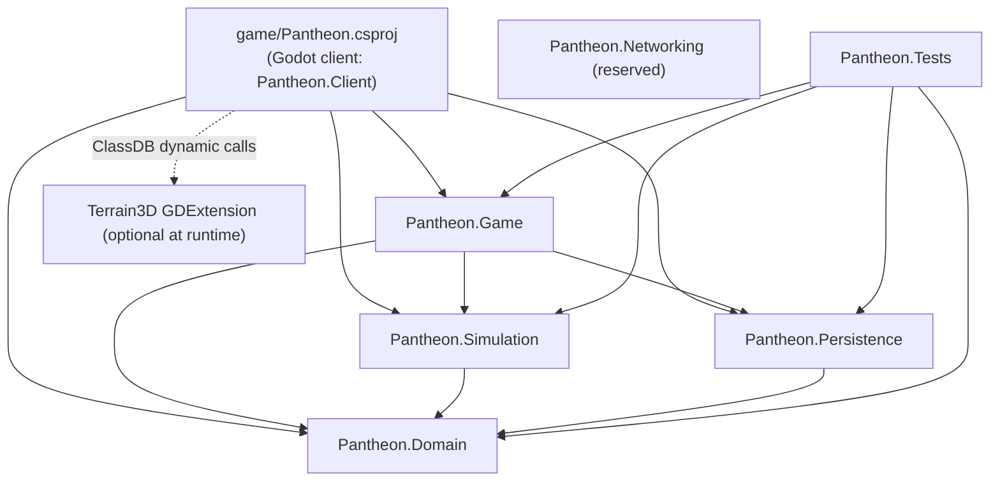
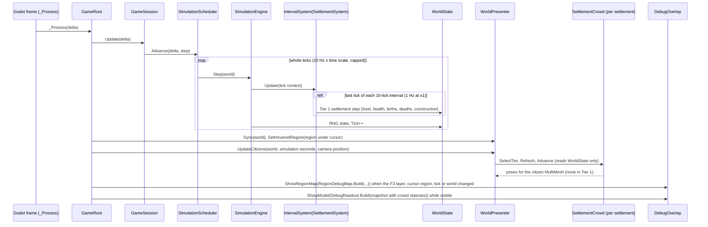
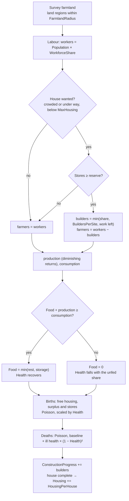
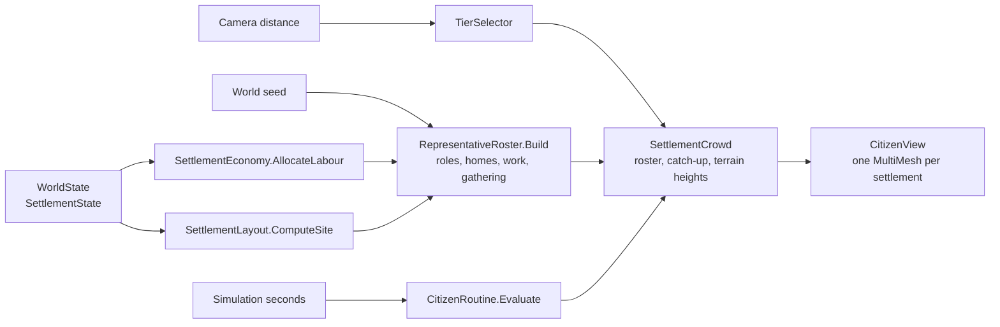
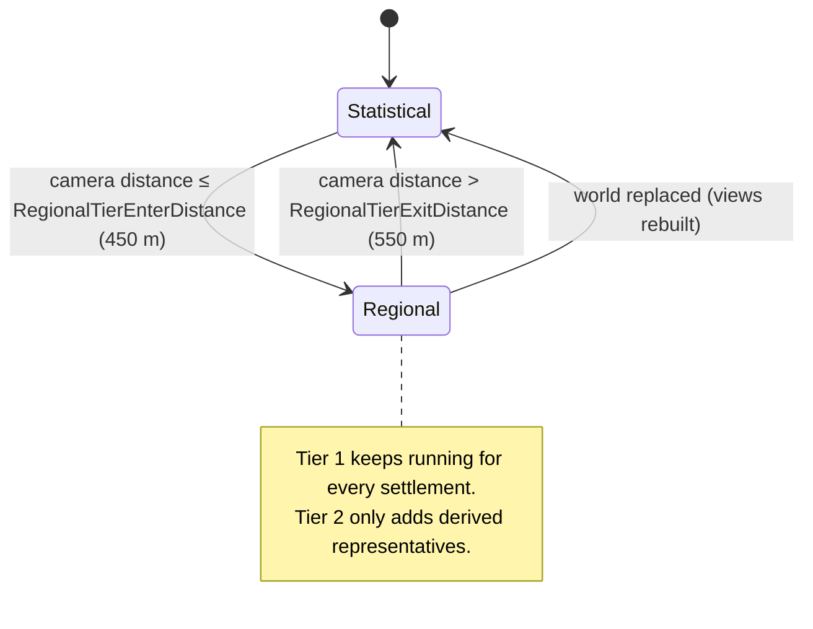
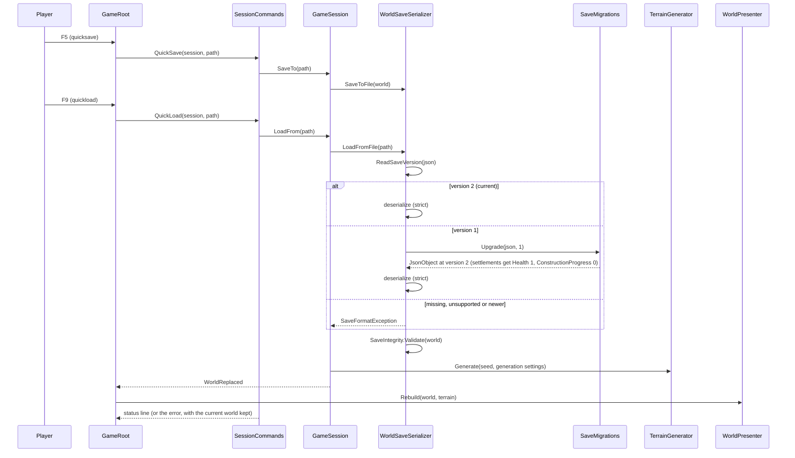
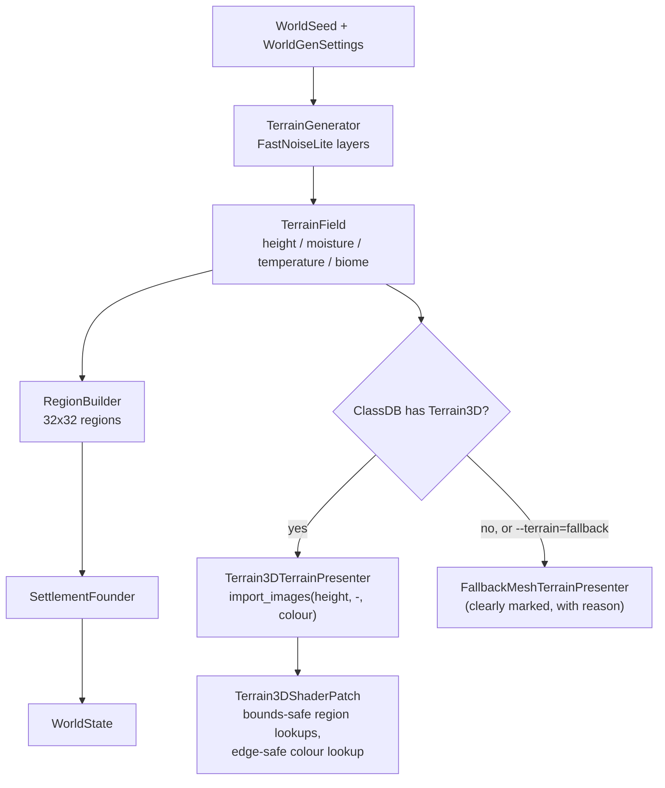

# PANTHEON — Architecture

This document describes how the code is organised and the rules that keep the simulation
independent of the engine. The owner's complete specification,
[PANTHEON_SPEC.md](PANTHEON_SPEC.md), is the source of truth for the architecture it describes,
and [PROGRESS_SUMMARY.md](PROGRESS_SUMMARY.md) maps what is built so far against it. Decisions
are recorded in [ADR/](ADR/README.md), and the coding rules every change follows are in
[AGENTS.md](../AGENTS.md).

## Guiding rules

1. **`WorldState` is the source of truth** (ADR-006). It is plain C# data in `Pantheon.Domain`.
2. **Godot nodes are presentation only.** Presentation adapters build and update nodes from
   `WorldState` and derived data. Nodes never hold authoritative state.
3. **Never serialize the SceneTree.** Saves are versioned JSON of `WorldState`. Loading rebuilds
   visuals.
4. **Core code has no Godot dependency** and is tested headless (`dotnet test`).
5. **Seeded randomness only.** Core systems use `SimulationRandom` (xoshiro256\*\*) derived from
   the `WorldSeed`. RNG state lives in `WorldState.Random`, so saves resume the same sequence.
   No global or ambient randomness in core systems: `ArchitectureRulesTests` scans the core
   assemblies for `System.Random`, clock and tick-count reads and GUIDs.
6. **Data-driven content** where practical (`game/Data/*.json`), parsed strictly (unknown or
   missing members are errors).
7. **No speculative infrastructure or optimisation.** Reserved areas (gods, belief, creatures,
   diplomacy, weather, events, networking) contain only a README until their milestone.

## Repository layout

```text
Pantheon.sln                  Root solution (Godot editor uses it via dotnet/project/solution_directory)
Directory.Build.props         Shared C# settings (nullable, warnings as errors)
AGENTS.md                     The owner's coding rules and the conventions that meet them
game/                         Godot 4.7.2 project (res://)
  project.godot               Project settings, input map, .NET settings
  Pantheon.csproj             Godot.NET.Sdk/4.7.2 project: assembly "Pantheon", namespace Pantheon.Client
  Scenes/                     Main.tscn, Camera/GodCamera.tscn, UI/DebugOverlay.tscn
  Scripts/                    Bootstrap, Camera, Presentation (adapters), UI
  Data/                       worldgen.json, settlement_rules.json, settlement_view.json, biome_palette.json
  Materials/ Shaders/         Presentation resources (.tres, .gdshader)
  Assets/ Audio/              Original art and audio (none yet; created with the first asset)
  addons/terrain_3d/          Vendored Terrain3D 1.0.2 runtime subset (ADR-005)
src/
  Pantheon.Domain/            State and content contracts: World, Ecology, Settlements (+ reserved folders)
  Pantheon.Simulation/        Randomness, Noise (FastNoiseLite), Terrain, WorldGen, Settlements, Systems, SimulationEngine
  Pantheon.Persistence/       Versioned JSON saves with migrations, content parsing
  Pantheon.Game/              Engine-agnostic application layer: GameSession, scheduler, camera model,
                              diagnostics, settlement layout, Tier 2 representative citizens (Population)
  Pantheon.Networking/        Reserved for host-authoritative ENet (ADR-003)
  Pantheon.Tests/             xUnit tests (headless)
tools/                        Maintenance scripts (vendor-terrain3d.sh)
docs/                         PANTHEON_SPEC.md (the owner's specification), PROGRESS_SUMMARY.md,
                              GAME_SPEC.md, ARCHITECTURE.md, ADR/
.docs/                        Milestone task files (plan / progress contracts)
```

### Why the Godot code is in `game/Scripts` rather than `src/Pantheon.Game`

Godot requires the C# project file next to `project.godot`, and node scripts must be inside
`res://`. The Godot-facing code (bootstrap, input, presentation adapters, UI) therefore lives in
`game/Scripts` and compiles into the `Pantheon` assembly. `src/Pantheon.Game` keeps the
engine-agnostic application logic: the session lifecycle, the fixed-step scheduler, camera math
and debug readouts. That logic stays testable, and the separation between simulation and
presentation is preserved.

## Dependency graph



Allowed references point down the graph only. `Pantheon.Domain` references nothing.
Only `game/Pantheon.csproj` references Godot. `ArchitectureRulesTests` reads the core project
files and compiled assemblies and fails when either rule is broken.

## Layers

### Domain (`Pantheon.Domain`)

- `WorldState`: `Seed`, `Generation` (a copy of the `WorldGenSettings` used), `Tick`, `Random`
  (RNG state), `Regions` (`RegionGrid`) and `Settlements`.
- `RegionGrid`: `Columns × Rows` cells of `RegionState`, each `RegionSize` metres square, with a
  row-major `Id = row * Columns + column`.
- `RegionState`: `Id`, `Biome`, `Elevation` (mean metres, sea level = 0), `Temperature`,
  `Moisture`, `Fertility`, `Vegetation` (0..1).
- `SettlementState`: `Id`, `Name`, `RegionId`, `Position`, `Population`, `Food`, `Housing`
  (capacity in people), `Health` (0..1) and `ConstructionProgress` (work done on the one house
  being built; 0 when none is under way). These aggregates are the canonical population
  (Tier 1, ADR-004 and ADR-008).
- Content contracts: `WorldGenSettings` (and its nested settings records) and `SettlementRules`
  (the per-step balance of the settlement model, `game/Data/settlement_rules.json`).

### Simulation (`Pantheon.Simulation`)

- `Randomness/SimulationRandom`: xoshiro256\*\* PRNG with explicit, serializable state.
  `SeedMixer` derives independent streams (`"terrain.elevation"`, `"simulation"`,
  `"settlement.names"`) from one seed.
- `Noise/FastNoiseLite`: vendored C# FastNoiseLite 1.1.1 (MIT), kept unmodified apart from a
  namespace and `internal` visibility. As third-party code it is exempt from the project's
  class-size rule.
- `Terrain/TerrainGenerator` produces a `TerrainField` (derived data, never saved):
  1. Continent fBm plus ridged mountain noise, shaped by a radial island falloff.
  2. Normalised elevation is remapped to metres (land exponent for flatter lowlands).
  3. Moisture (noise plus coastal bonus) and temperature (noise minus elevation lapse rate).
  4. Each sample is classified by data-driven `BiomeRule`s (first match wins).
- `WorldGen/RegionBuilder` aggregates samples per region (means plus majority biome) and derives
  fertility and vegetation. `SettlementFounder` places the starting settlement on the best
  fertile land region near the island centre, healthy and with nothing under construction.
- `Settlements/SettlementEconomy`: the settlement rules as pure functions: the farmland survey,
  the labour split into farmers and builders, production with diminishing returns,
  consumption, storage, health, birth and death chances, and `Assess`, which previews the next
  step for the debug panel. `Settlements/SettlementSystem` applies one Tier 1 step to every
  settlement (see [Settlement simulation and population tiers](#settlement-simulation-and-population-tiers)).
  `SettlementRulesValidator` lists every invalid rule.
- `Systems/IntervalSystem` runs a wrapped system on the last tick of every interval of N ticks.
- `SimulationEngine.Step(WorldState)` runs the systems in order (today the settlement system,
  wrapped in an `IntervalSystem` of `StepIntervalTicks`) with a `SimulationRandom` restored
  from `WorldState.Random`, writes the RNG state back, and increments `Tick`.
- `Terrain/TerrainRaycaster`: ray against the heightfield (used for cursor picking).

### Persistence (`Pantheon.Persistence`)

- Save envelope: `{ "SaveVersion": 2, "World": { ... } }`, indented, enums as strings,
  property names exactly as in C#, strict members.
- Loading reads `SaveVersion` first. A current save deserializes directly. An older save, back
  to `MinimumSupportedSaveVersion` (1), is parsed into a `JsonObject`, upgraded one version at
  a time by `SaveMigrations`, then deserialized with the same strict options, so a migrated
  save gets exactly the checks of a current one. Version 1 → 2 gives every settlement
  `"Health": 1` and `"ConstructionProgress": 0`. A missing, unsupported or newer version raises
  `SaveFormatException` with a clear message.
- `SaveIntegrity` then checks the world's structure and lists every inconsistency: the grid
  against the generation settings, settlement ids and regions, non-negative quantities, health
  in 0..1.
- Saves are written atomically (temporary file, then rename).
- `ContentJson` parses the content files with the same strict options (comments and trailing
  commas allowed).

### Application (`Pantheon.Game`)

- `GameSession`: creates or loads worlds, owns `WorldState` + `TerrainField`, runs the
  scheduler, saves and loads, and raises `WorldReplaced` so presentation rebuilds.
  `StepOneTick` runs one tick through the same engine call as the scheduler; `RunTicks` and
  `StepToNextSettlementStep` run several. `SimulationSeconds` is the simulation time including
  the scheduler's progress towards the next tick, which drives the citizens' routines.
- `SessionCommands`: the player commands behind the world and simulation hotkeys (quicksave,
  quickload, new world, pause, speed presets, single-tick step, settlement step) and the debug
  drivers (spoil the food stores, add settlers, advance ticks at launch). Each returns the
  status line shown in the overlay.
- `SimulationScheduler`: fixed-step accumulator (10 ticks/s × time scale, pause, a cap on
  ticks per frame so a long frame cannot cause a spiral of death).
- `Camera/GodCameraModel`: engine-agnostic god-camera math: focus, yaw and distance targets
  with exponential smoothing, pitch from zoom, bounds, terrain clearance, and the zoom bands
  Close (≤ 120 m), Regional (≤ 700 m) and Strategic (≤ 2600 m).
- `Diagnostics/DebugReadout`: formats the debug overlay model from state (pure), with
  `SettlementReadout` for the settlement lines. `Diagnostics/RegionDebugMap` builds the F3
  region debug map image (pure).
- `Launch/LaunchOptions`: parses user arguments `--seed=`, `--load=`,
  `--terrain=auto|terrain3d|fallback`, `--advance-ticks=`, `--camera-distance=`,
  `--quit-after-frames=` and `--screenshot=`. Bad input becomes a warning, never an error.
- `Presentation/*`: engine-agnostic presentation data shared by both terrain renderers (colour
  map, fallback mesh chunks, water depth map, region lines, labels) and `Terrain3DShaderPatch`.
  `SettlementLayout.ComputeSite` lays out a settlement's houses, building site and fields as a
  `SettlementSite`, tuned by `SettlementViewSettings` (`game/Data/settlement_view.json`).
  `PresentationHash` (SplitMix64) gives presentation variation without consuming a simulation
  random stream. `PresentationContent` bundles the biome palette and the settlement view
  settings.
- `Population/*`: Tier 2 representative citizens, derived from `WorldState` and never saved:
  `TierSelector`, `RepresentativeRoster`, `CitizenRoutine` and `SettlementCrowd` (see
  [Settlement simulation and population tiers](#settlement-simulation-and-population-tiers)).

### Godot client (`game/Scripts`, namespace `Pantheon.Client`)

- `Bootstrap/GameRoot`: composition root. Loads content (`GodotContentLoader`: the game
  content and the presentation content), creates the session, wires presenters, camera and
  overlay, routes hotkeys and picks the region under the cursor.
  `Bootstrap/SmokeTestDriver` implements `--quit-after-frames` and `--screenshot`.
- `Camera/GodCameraController`: maps input (WASD, edge scroll, right-drag grab, wheel, Q/E,
  middle-drag) to `GodCameraModel` and applies the pose to `Camera3D`.
- `Presentation/WorldPresenter`: rebuilds and syncs all world visuals:
  - `Terrain/ITerrainPresenter` with `Terrain3DTerrainPresenter` (primary) and
    `FallbackMeshTerrainPresenter` (fallback, logged and labelled with its reason), chosen by
    `TerrainPresenterFactory` (ADR-005). The Terrain3D adapter switches Terrain3D to a copy of
    its generated shader with bounds-safe region lookups and a colour lookup that also covers the
    world's east and south edges (ADR-007, which amends ADR-005).
  - `Water/WaterPresenter`: sea-level plane (`Materials/water.tres`, `Shaders/water.gdshader`)
    tinted by a baked depth map, so it does not read the depth buffer. Waves flatten and the
    surface gets rougher with camera distance, which avoids flickering sun glints.
  - `Settlements/SettlementPresenter`: one `SettlementView` per settlement with the shrine and
    the name/population label, plus:
    - `SiteView`: the houses (one MultiMesh per hut part) and the fields (crop rows tinted
      through instance colours), rewritten only when their placements change;
    - `ConstructionSiteView`: the house being built, as scaffold poles, a timber pile, walls
      that rise during the first 70% of the work and a roof during the rest;
    - `CitizenView`: the settlement's Tier 2 representatives in one MultiMesh of a two-surface
      figure (a body tinted per role, a head), recoloured when the roster changes.
  - `Regions/RegionBoundaryOverlay`: region grid lines draped on the terrain, plus a hover highlight.
- `UI/DebugOverlay`: FPS, tick, seed, terrain backend, camera band, region under cursor,
  settlement readouts, boundary toggle and status messages, plus the F3 region debug map.

## Frame and tick flow



The render frame rate never changes simulation results. Only the number of real seconds
elapsed (× time scale) determines how many ticks run, and the settlement model steps on every
tenth tick, so its cadence follows simulated time, not frames. The citizens move every frame,
but their poses are functions of simulation time, so they freeze while paused and speed up
with the time scale.

## Settlement simulation and population tiers

Population is simulated statistically everywhere and shown in more detail near the camera
(ADR-004, amended by ADR-008). Tier 1 is canonical; Tier 2 is derived from it and never saved.
Tier 3 (full agents with promotion and demotion that write back) comes in a later milestone.

### Tier 1: the statistical settlement step

`SettlementSystem` runs once every `StepIntervalTicks` ticks (10, so once per simulated second
at ×1). `IntervalSystem` runs it on the last tick of each interval, so `10 × n` ticks run
exactly `n` steps. Every rate in `settlement_rules.json` is per step. Each step, for each
settlement in list order:

1. **Farmland:** the land regions (not sea, fertility above 0) within `FarmlandRadius` regions
   of the settlement's region. They set the farming capacity and the yield.
2. **Labour:** `WorkforceShare` of the inhabitants work. When the settlement is crowded
   (`Population ≥ ConstructionStartCrowding × Housing`) or a house is under way, below
   `MaxHousing`, and the stores hold `ConstructionFoodReserveSteps` of consumption, some
   workers build (capped by share, by `BuildersPerSite` and by the work left); the rest farm.
3. **Food:** production grows with farmers with diminishing returns
   (`maxYield × (1 − e^(−farmers / capacity))`); consumption is `FoodPerPersonPerStep` per
   person. Stores keep what is left, up to `FoodStoragePerHousing` per unit of housing, and the
   rest spoils.
4. **Health:** falls in proportion to the unfed share while food runs short and recovers by
   `HealthRecoveryPerStep` when everyone is fed.
5. **Births and deaths:** Poisson draws from the saved `SimulationRandom`. Births need free
   housing, production covering consumption and stores of `SurplusFoodPerPerson` per person,
   and scale with health. Deaths have a baseline plus an ill-health term in `(1 − Health)²`.
6. **Construction:** builders add their work to `ConstructionProgress`. At `WorkPerHouse` the
   house is finished: `Housing` grows by `HousingPerHouse` and the progress resets.

The settlement acts on its own: the player never places houses. Health does not change the
workforce share; during a famine construction stops for want of food, so the builders go back
to farming, and deaths shrink the population until the land feeds it again. The formulas and
the measured balance are in the Milestone 2 plan
([.docs/milestone-2-living-settlement.md](../.docs/milestone-2-living-settlement.md)).



### Tier 2: representative citizens

When the camera comes within `RegionalTierEnterDistance` (450 m) of a settlement, the
settlement enters Tier 2 and shows `N = min(Population, MaxRepresentatives)` representatives
(300 at most), each standing for `Population / N` people. It returns to Tier 1 beyond
`RegionalTierExitDistance` (550 m); the gap keeps the tier from flickering. Tier 1 keeps
running for every settlement either way.

- `TierSelector` picks the tier from the camera distance. The tier is client-local
  presentation state, not `WorldState`.
- `RepresentativeRoster` derives the representatives from the aggregates, the layout and the
  world seed. Roles (builder, farmer, villager) follow `SettlementEconomy.AllocateLabour`, with
  both role boundaries rounded so every count is within one of its share. Each representative
  keeps a hash rank, so one more inhabitant changes at most two roles. Homes and fields come
  from rendezvous hashing over house indices and field slots, so a new house or field draws a
  share of the representatives and leaves everyone else in place. The hashes mix the seed, the
  settlement id and the representative index; no random stream is consumed.
- `CitizenRoutine` gives each representative a closed-form schedule in simulation time: rest
  by the door, walk to work (the fields, a ring around the building site, or chores near
  home), work with a forward lean per stroke, walk to the shrine, gather facing it, walk home.
  Walks bob once per stride.
- `SettlementCrowd` keeps the roster in step with the aggregates. It rebuilds the roster only
  when the role counts or the layout change, and bumps `RosterVersion` so the view recolours.
  Rerouted figures walk to their new routine at `CatchUpSpeed` instead of jumping; newcomers
  step out of their door; on promotion everyone appears in place.
- Representatives have no effects of their own: they show the work the aggregates already
  account for. Demotion has nothing to fold back, and saves, loads and new worlds rebuild them.

The tuning (distances, durations, speeds, colours, figure scale) is in the `Citizens` section
of `game/Data/settlement_view.json`.





## Debug tools

Every system gets tools to see and drive it from the start (see [AGENTS.md](../AGENTS.md)).
The readouts are built by pure functions in `Pantheon.Game.Diagnostics` and only displayed by
the client.

- F1: the debug panel, built by `DebugReadout` from a `DebugSnapshot`. `SettlementReadout`
  adds, per settlement: population / housing, houses and health; food stored / storage with
  the net change per second, production and consumption; the jobs (farming, building, not
  working) and the farmland; expected births and deaths per second; the house under
  construction and the time to the next settlement step; the simulation tier, with the
  camera distance that changes it and, in Tier 2, the citizens shown and the people each
  stands for; and warnings when the settlement starves, construction waits for food or births
  are blocked. `SettlementEconomy.Assess` previews the next step without its random draws, so
  the panel shows rates rather than samples.
- B: the region grid and the hover outline (`RegionBoundaryOverlay`).
- F3: the region debug map. `RegionDebugMap.Build` turns one `RegionDebugLayer` (biome,
  elevation, temperature, moisture, fertility or vegetation) into a `RegionDebugMapImage` with
  one RGBA8 pixel per region and a legend. Numeric layers use a dark-to-bright ramp from the
  lowest to the highest value; the region under the cursor is white and settlement regions are
  red. `GameRoot` rebuilds it only when the layer, the cursor region, the tick or the world
  changes, and `DebugOverlay.ShowRegionMap` displays it.
- `.`: `SessionCommands.StepTick` pauses the scheduler and calls `GameSession.StepOneTick`, the
  same engine call a scheduled tick makes. Stepping N times therefore equals N scheduled ticks,
  which `SessionCommandsTests` checks.
- `,`: `SessionCommands.StepSettlement` pauses and runs the ticks up to and including the next
  settlement step, so the panel shows what one step changed.
- F6 (`SpoilFood`) empties every settlement's food stores, and F7 (`AddSettlers`) grows every
  settlement by half (at least 10 people). Together they drive a famine: the stores run out,
  health falls, deaths rise and the settlement recovers once the land feeds it again.
- Launch options and `SmokeTestDriver` for reproducible and scripted runs. `--advance-ticks=<n>`
  runs n ticks before the first frame and `--camera-distance=<m>` sets the starting camera
  distance, so a grown settlement can be captured up close. Unattended runs end with a
  one-line summary per settlement (`DebugReadout.Summarize`), including its tier and the
  citizens shown.

## Save and load flow



## World generation and terrain backends



Default world: 1024 × 1024 height samples at 2 m spacing (a 2048 m island), 32 × 32 regions of
64 m, sea level at 0 m. The biome set is Sea plus three land biomes: Grassland, Forest and Highland.

## Determinism

- World generation is a pure function of `(WorldSeed, WorldGenSettings)`.
- Tick results are a pure function of `WorldState` (including RNG state) and `SettlementRules`.
  The settlement step's births and deaths draw from the saved `SimulationRandom` in settlement
  list order, so a run continues identically across a save and load.
- Presentation never consumes a simulation random stream. The settlement layout and the Tier 2
  roster use `PresentationHash` of the seed, the settlement id and a slot or index, and the
  routines are functions of simulation time. The same world, tick and camera therefore show the
  same houses, fields and citizens on both renderers.
- Guaranteed per platform and runtime. Bit-exact cross-platform determinism is not required,
  because networking will be host-authoritative (ADR-003).

## Testing

- `src/Pantheon.Tests` (xUnit) covers determinism, save/load round trips, save versioning and
  the version 1 → 2 migration (against a save written by the Milestone 1 build, kept in
  `Persistence/Fixtures/save-v1.json`), RNG, the scheduler and the settlement step cadence,
  the settlement rules and step (starvation, recovery, growth up to housing, construction when
  crowded, storage), the raycaster, the camera model and edge scrolling, session commands
  (including the single-tick and settlement steps, F6 and F7), content parsing, launch options,
  presentation helpers and the settlement layout, the Tier 2 roster, routines, tier selection
  and crowd (including that it never changes the world), the debug readouts and region debug
  map, and the Terrain3D shader patch. The tests load the shipped `game/Data/*.json`.
- `ArchitectureRulesTests` checks the rules that can be checked mechanically: the layering
  above, no Godot reference in core projects, no unseeded randomness or clock in core
  assemblies, and Windows, macOS and Linux libraries (debug and release) in every vendored
  GDExtension.
- The Godot client is verified by building the solution and running the main scene, headless
  and windowed. `--quit-after-frames=<n> --screenshot=<file>` gives a scripted smoke run that
  saves a frame capture.

## Extending (later milestones)

- New simulation features add state to `Pantheon.Domain`, systems to `Pantheon.Simulation`
  (registered in `SimulationEngine`, wrapped in an `IntervalSystem` when they step less often
  than every tick), and presenters to `game/Scripts/Presentation`.
- Breaking changes to the save shape bump `WorldSaveSerializer.CurrentSaveVersion` and add a
  `SaveMigrations` step from the previous version, tested against a save written by the
  previous build.
- The step, the layout, the tiers and the views iterate over every settlement, so more
  settlements should need no rework there. Nothing has run with two yet: world generation
  founds one, no test uses more, and the focus key goes to the first.
- Tier 3 adds agents with effects and promotion and demotion that write back to the
  aggregates; the milestone that adds it amends or supersedes ADR-008.
