# PANTHEON — Architecture

This document describes how the code is organised and the rules that keep the simulation
independent of the engine. The owner's complete specification,
[PANTHEON_SPEC.md](PANTHEON_SPEC.md), is the source of truth for the architecture it describes,
and [PROGRESS_SUMMARY.md](PROGRESS_SUMMARY.md) maps what is built so far against it. Decisions
are recorded in [ADR/](ADR/README.md), and the coding rules every change follows are in
[AGENTS.md](../AGENTS.md).

## Guiding rules

1. **`WorldState` is the source of truth** (ADR-006). It is plain C# data in `Pantheon.Domain`.
2. **Godot nodes are presentation only.** Presentation adapters build and update nodes from
   `WorldState` and derived data. Nodes never hold authoritative state.
3. **Never serialize the SceneTree.** Saves are versioned JSON of `WorldState`. Loading rebuilds
   visuals.
4. **Core code has no Godot dependency** and is tested headless (`dotnet test`).
5. **Seeded randomness only.** Core systems use `SimulationRandom` (xoshiro256\*\*) derived from
   the `WorldSeed`. RNG state lives in `WorldState.Random`, so saves resume the same sequence. The
   weather and disaster steps draw a fresh stream each step from the seed and the tick instead,
   so they never shift the shared stream (ADR-013, ADR-014).
   No global or ambient randomness in core systems: `ArchitectureRulesTests` scans the core
   assemblies for `System.Random`, clock and tick-count reads and GUIDs.
6. **Data-driven content** where practical (`game/Data/*.json`), parsed strictly (unknown or
   missing members are errors).
7. **No speculative infrastructure or optimisation.** Reserved areas (the networking project and
   the domain's population folder) hold no code until their milestone.
8. **Commands go through an authority.** A player's intent (casting a miracle, rewarding,
   punishing or sending the Creature, a diplomatic move, a refugee policy) is a request that
   `MiracleCaster`, `CreatureAuthority`, `DiplomacyAuthority` or `MigrationAuthority` checks
   against the world before anything changes (spec §73, ADR-009, ADR-010, ADR-012, ADR-016). The engine owns them as one `Authorities` bundle.
   `GameSession` is the local authority; a multiplayer host will run the same checks. AI gods
   send the same requests through the same authorities (ADR-011).

## Repository layout

```text
Pantheon.sln                  Root solution (Godot editor uses it via dotnet/project/solution_directory)
Directory.Build.props         Shared C# settings (nullable, warnings as errors)
AGENTS.md                     The owner's coding rules and the conventions that meet them
game/                         Godot 4.7.2 project (res://)
  project.godot               Project settings, input map, .NET settings
  Pantheon.csproj             Godot.NET.Sdk/4.7.2 project: assembly "Pantheon", namespace Pantheon.Client
  Scenes/                     Main.tscn, Camera/GodCamera.tscn, UI/DebugOverlay.tscn
  Scripts/                    Bootstrap, Camera, Network (ENet adapter), Presentation (adapters), UI
  Data/                       worldgen.json, settlement_rules.json, divine_rules.json, miracles.json, gods.json,
                              creatures.json, god_ai.json, diplomacy.json, weather.json, disasters.json,
                              migration.json (simulation);
                              settlement_view.json, biome_palette.json, divine_view.json, weather_view.json
                              (presentation)
  Materials/ Shaders/         Presentation resources (.tres, .gdshader)
  Assets/ Audio/              Original art and audio (none yet; created with the first asset)
  addons/terrain_3d/          Vendored Terrain3D 1.0.2 runtime subset (ADR-005)
src/
  Pantheon.Domain/            State and content contracts: World, Ecology, Settlements, Gods, Belief, Miracles,
                              Creatures, Diplomacy, Weather, Disasters, Events (+ reserved folders)
  Pantheon.Simulation/        Randomness, Noise (FastNoiseLite), Terrain, WorldGen, Settlements, Belief, Miracles,
                              Creatures, Navigation, Gods (AI), Diplomacy, Weather, Disasters, Systems,
                              SimulationEngine
  Pantheon.Persistence/       Versioned JSON saves with migrations, content parsing
  Pantheon.Game/              Engine-agnostic application layer: GameSession, scheduler, camera model,
                              diagnostics, HUD model, alerts, overlays, settlement layout,
                              Tier 2 representative citizens (Population), Multiplayer (host and player)
  Pantheon.Networking/        Host-authoritative protocol (ADR-003, ADR-018): messages, codecs, transport
                              contract, in-memory loopback
  Pantheon.Tests/             xUnit tests (headless)
tools/                        Maintenance scripts (vendor-terrain3d.sh)
docs/                         PANTHEON_SPEC.md (the owner's specification), PROGRESS_SUMMARY.md,
                              GAME_SPEC.md, ARCHITECTURE.md, ADR/
.docs/                        Milestone task files (plan / progress contracts)
```

### Why the Godot code is in `game/Scripts` rather than `src/Pantheon.Game`

Godot requires the C# project file next to `project.godot`, and node scripts must be inside
`res://`. The Godot-facing code (bootstrap, input, presentation adapters, UI) therefore lives in
`game/Scripts` and compiles into the `Pantheon` assembly. `src/Pantheon.Game` keeps the
engine-agnostic application logic: the session lifecycle, the fixed-step scheduler, camera math
and debug readouts. That logic stays testable, and the separation between simulation and
presentation is preserved.

## Dependency graph

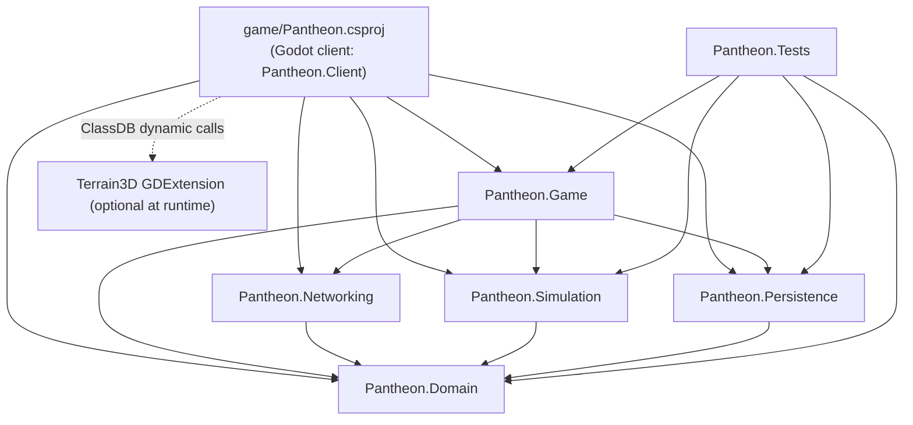

Allowed references point down the graph only. `Pantheon.Domain` references nothing.
Only `game/Pantheon.csproj` references Godot. `ArchitectureRulesTests` reads the core project
files and compiled assemblies and fails when either rule is broken.

## Layers

### Domain (`Pantheon.Domain`)

- `WorldState`: `Seed`, `Generation` (a copy of the `WorldGenSettings` used), `Tick`, `Random`
  (RNG state), `Regions` (`RegionGrid`), `Settlements`, `Gods`, `Creatures`, `Diplomacy`,
  `Weather`, `Disasters`, `Migration` (groups on the road, ADR-016) and `WinnerGodIds` (the god
  or allied gods that have won, spec §53 and §115; ADR-015). Settlements carry their people's
  wish to leave (`Emigration`) and gods their `RefugeePolicy`. Creatures carry their combat
  skill, scars and views of each other (`CreatureRelation`, ADR-017). `History` holds the moments
  the world remembers (`HistoryRecord`, ADR-020). `HolySites` holds the world's sacred places
  (`HolySite`: kind, name, region, keeper, claimant and the claim so far; ADR-021). `Water` holds
  the rivers (`River`: name, regions from source to mouth, level) and the lakes (`Lake`: name,
  regions, surface) (ADR-022).
- `RegionGrid`: `Columns × Rows` cells of `RegionState`, each `RegionSize` metres square, with a
  row-major `Id = row * Columns + column`.
- `RegionState`: `Id`, `Biome`, `Elevation` (mean metres, sea level = 0), `Temperature`,
  `Moisture` (the climate), `Fertility`, `Vegetation` (0..1), `Blessing` (0..1, from miracles; it
  fades), `SoilMoisture` (0..1, the water in the soil now; ADR-013), `Fire` (how fiercely it burns
  now), `Scorch` (how much of its fuel fire has eaten; ADR-014), `FreshWater` (0..1, how much of it a
  river or lake waters, fixed at generation) and `Flood` (0..1, how deep it lies under a flood now;
  ADR-022).
- `SettlementState`: `Id`, `Name`, `RegionId`, `Position`, `Population`, `Food`, `Water` (in its
  wells and cisterns; ADR-022), `Society` (`SocietyState`: safety, happiness, stability,
  wealth, education, `TechnologyLevels` in §36's eight fields, buildings, priority and the
  building under way; ADR-023), `Culture` (`CultureState`: how firmly it holds each of §33's
  eight doctrines and how far it has turned from the gods, its secularism; ADR-024), `Housing`
  (capacity in people), `Health` (0..1), `ConstructionProgress` (work done on the one house
  being built; 0 when none is under way), `Ruins` (houses destroyed and not yet rebuilt),
  `ShieldedUntilTick` (while a Shield miracle protects it), `OldFaith` (the share of its people
  who broke away from their god in a schism, with how many have returned or fallen away; ADR-021),
  `SanctuaryGodId` and `SanctuaryUntilTick` (whose followers cannot fall away for now) and
  `Beliefs`. These aggregates are the canonical
  population (Tier 1, ADR-004 and ADR-008).
- `GodBelief` (one per god a settlement knows): `GodId`, `Adherence` (the share of the people who
  follow the god; the shares add up to at most 1) and `Faith`, `Love`, `Fear`, `Doubt`,
  `Dependency` and `Resentment` (0..1; the last two §7–8's deeper feelings, ADR-024).
  Followers are `Population × Adherence` and are never stored (ADR-009).
- `GodState`: `Id`, `Name`, `Controller` (Human, Ai or Remote), `Personality` (`None` for players;
  one of §47's eight for AI gods), `DivinePower`, `Rank` (never falls), `DominantSinceTick`
  (while it holds the victory share), `CreatureId`, `RefugeePolicy`, `Cooldowns` and `Domains`
  (the domains it has taken up, ADR-021), `Conduct` (`GodConduct`: what the world remembers of its
  acts, fading) and `Traits` (what the world calls it, from that conduct; ADR-024). Followers and
  influence are derived from the beliefs.
- `CreatureState` (ADR-010): a Tier 3 entity saved whole: position and heading, level, experience,
  health, loyalty, morality, `Needs` (hunger, fatigue, boredom), `Personality` (kindness,
  aggression, laziness, curiosity), `Activity` (action, situation, phase, target, path, ticks
  left), `Preferences` (learned weight per situation and action) and `Memories` (recent deeds with
  the god's feedback). `CreatureCommand` (reward, punish, go to) is the intent the authority
  checks. `World/SimulationTime` fixes 10 ticks per simulated second.
- `CastMiracleRequest` (god, miracle id, target): the intent that the authority checks (§73).
- `DiplomacyState` (ADR-012): `Relations` (one `GodRelation` per observer and subject: trust,
  fear, respect, rivalry, gratitude, suspicion and the `DiplomaticMemory` of acts), `Stances`
  (one `GodStance` per pair: `DiplomaticStatus` Alliance, Friendly, Neutral, Hostile or War, since
  when, and the last proposal), `Proposals` (alliance, peace, a treaty with its `TreatyTerms` or
  a request with its `RequestAsk`, waiting for an answer), and since ADR-025 `Treaties` (`Treaty`:
  kind, parties, target, payer and amount, secrecy, term), `Favours`, `Obligations` (promises of
  assistance or backing) and the `Council` (`CouncilState`: the session in progress with its
  `CouncilMotion` and votes, tabled motions, decrees in force). `DiplomaticCommand` (offer alliance,
  break alliance, declare war, request peace, accept, decline, propose or break a treaty, ask,
  absorb) is the intent the diplomacy authority checks; `DiplomacyRules.Politics` tunes treaties,
  favours and the council.
- `DisasterState` (ADR-014): the `Earthquakes` under way (epicentre, magnitude, peak intensity,
  radius, end and the god who caused it) and `NextEarthquakeId`.
- `WeatherState` (ADR-013): `Cells` (`WeatherCell`: position, velocity, radius, pressure,
  temperature, humidity, precipitation, wind, electrical activity and the god who called it),
  `NextCellId`, `Spell` (normal, dry or wet), `SpellEndsTick` and `WindDirection`.
- `Events/`: transient `WorldEvent` records (`MiracleCast`, `FollowingChanged`, `RankAchieved`,
  `FamineStarted`, `DiplomacyChanged`, `WeatherSpellChanged`, `StormStruck`, `DroughtChanged`,
  `EarthquakeStruck`, `WildfireStarted`, `SettlementDamaged`, `MigrationStarted`, `MigrationEnded`,
  `MigrantsTurnedAway`, `CreaturesMet`, `CreatureFightEnded`, `DomainChosen`, `HolySiteContested`,
  `HolySiteClaimed`, `SchismStarted`, `SchismEnded`, `FloodStarted`, `ThirstStarted`,
  `PriorityChanged`, `BuildingCompleted`, `TechnologyAdvanced`, `SettlementFounded` and others)
  raised during a tick or a command
  and never saved.
- Content contracts: `WorldGenSettings` (and its nested settings records), `SettlementRules`
  (the per-step balance of the settlement model, `game/Data/settlement_rules.json`),
  `DivineRules` (belief, worship, power, influence and ranks, `divine_rules.json`),
  `MiracleCatalog` and `MiracleDefinition` (`miracles.json`), `PantheonSetup` (the gods of a
  new world, their personalities and their Creatures' names, `gods.json`), `CreatureRules`
  with its `CreatureBondRules` and `CreatureCombatRules` (`creatures.json`), `GodAiRules` with one `GodProfile` per personality, including its
  diplomacy weights (`god_ai.json`), `DiplomacyRules` (`diplomacy.json`), `WeatherRules`
  (`weather.json`), `DisasterRules` (`disasters.json`), `MigrationRules` (`migration.json`),
  `HistoryRules` (`history.json`), `DomainRules` with its slots, definitions and `DomainBoons`
  (`domains.json`), `HolySiteRules` (`holy_sites.json`), `WaterRules` (`water.json`, ADR-022) and
  `SocietyRules` (`society.json`, ADR-023). What technology and buildings do lives with the rules
  of the system it changes: `SettlementRules.Civics`, `DisasterRules.Preparedness`, the temple and
  religion factors in `DivineRules`, and unhappiness, unrest and navigation in `MigrationRules`.
  `DivineRules.Culture` (`CultureRules`) holds the culture's numbers (ADR-024).
  `WorldGenSettings.Hydrology` (optional) shapes the rivers and lakes. `DivineRules` carries the
  `SchismRules` and the holy sites' influence, and `CreatureRules` the `CreatureSpecies`
  (ADR-021).

### Simulation (`Pantheon.Simulation`)

- `Randomness/SimulationRandom`: xoshiro256\*\* PRNG with explicit, serializable state.
  `SeedMixer` derives independent streams (`"terrain.elevation"`, `"simulation"`,
  `"settlement.names"`) from one seed.
- `Noise/FastNoiseLite`: vendored C# FastNoiseLite 1.1.1 (MIT), kept unmodified apart from a
  namespace and `internal` visibility. As third-party code it is exempt from the project's
  class-size rule.
- `Terrain/TerrainGenerator` produces a `TerrainField` (derived data, never saved):
  1. Continent fBm plus ridged mountain noise, shaped by a radial island falloff.
  2. Normalised elevation is remapped to metres (land exponent for flatter lowlands).
  3. Moisture (noise plus coastal bonus) and temperature (noise minus elevation lapse rate).
  4. With `Hydrology` set, rivers and lakes are found and cut into the land (ADR-022):
     `WorldGen/FlowGrid` routes water by a priority flood, `HydrologyGenerator` finds the lakes and
     rivers and `ChannelCarver` cuts the channels; the result is the field's `HydrologyMap`.
  5. Each sample is classified by data-driven `BiomeRule`s (first match wins).
- `WorldGen/RegionBuilder` aggregates samples per region (means plus majority biome) and derives
  fertility and vegetation. `SettlementFounder.FoundAll` places up to `Count` settlements (8) on
  the best habitable regions, at least `MinimumSpacing` regions apart so their farmland never
  overlaps, with names and populations drawn from seeded streams. `PantheonFounder` creates the
  gods of `gods.json`, each followed in its own home settlement, best site first.
- `Settlements/SettlementEconomy`: the settlement rules as pure functions: the farmland survey,
  the labour split into farmers and builders, production with diminishing returns,
  consumption, storage, health, birth and death chances, and `Assess`, which previews the next
  step for the debug panel. `Settlements/SettlementSystem` applies one Tier 1 step to every
  settlement (see [Settlement simulation and population tiers](#settlement-simulation-and-population-tiers)).
  `SettlementRulesValidator` lists every invalid rule.
- `Belief/BeliefModel`: the belief rules as pure functions (conditions, drift, pull and push,
  conversion within the free share, worshippers, worship intensity, Divine Power, impulses).
  `BeliefSystem` applies one belief step (see [Gods, belief and miracles](#gods-belief-and-miracles)).
  `InfluenceField` derives a god's influence from its followers. `GodStanding` counts followers,
  sums power and picks ranks.
- `Miracles/MiracleBook` validates and indexes the miracles; `MiracleCaster` checks requests
  (§73: authorisation, a signature miracle's domain, rank, cooldown, place, influence, a target
  to act on, power), computes costs (less for the god's own domains and its holy sites) and
  applies accepted casts through `MiracleEffects` (settlements, land, weather, ground, Creatures
  and the gods' views).
- `Creatures/`: `CreatureModel` (growth, needs and learning as pure functions), `CreatureBrain`
  (options and utilities, decisions, planned routes), `CreatureDeeds` (what a finished action does
  to the world), `CreatureSystem` (the per-tick state machine), `CreatureAuthority` (rewards,
  punishments and go-to, checked) and `CreatureFounder` (see [The Creature](#the-creature)).
  `CreatureBonds` (views and urges), `CreatureMeetings` and `CreatureCombat` are the Creatures'
  dealings with each other (see [Creature relationships](#creature-relationships)).
  `Navigation/RegionPathfinder` runs A* over land regions and smooths the path.
- `Gods/GodAi` is the strategic utility AI of AI gods (see [Rival gods](#rival-gods)), run by
  `GodAiSystem`; `Gods/MiracleValuer` weighs what each miracle is worth to it, and
  `Gods/GodDiplomat` adds its diplomatic moves. It takes up its personality's domains and sends
  its Creature to claim holy sites (ADR-021). `Belief/VictorySystem` tracks
  each god's standing (alone or with its bloc), dominance and victory.
- `Diplomacy/`: `DiplomacyModel` (finding and creating relations and stances, grudge, warmth),
  `DiplomacyLedger` (the `IActRecorder` that miracles, Creature deeds and conversions report
  acts to), `DiplomacySystem` (the diplomacy step) and `DiplomacyAuthority` (diplomatic commands,
  checked). See [Diplomacy](#diplomacy).
- `Politics/`: `TreatyModel` and `CouncilModel` (what treaties and decrees allow and forbid, asked
  by each system they change), `PoliticsChecks`, `TreatyBook` (signing, ending, breaking and
  revealing treaties), `FavourBook`, `PoliticsActions` (treaties, requests and absorption for the
  authority), `CouncilChamber` (sessions, votes and decrees), `CouncilAuthority` (tabling and
  voting, checked), `Defiance` and `PoliticsSystem` (the politics step: terms, tributes, leaks,
  promises, the council). `Gods/TreatyAdvisor` and `Gods/CouncilAdvisor` are the AI's side
  (ADR-025). See [Treaties and the Divine Council](#treaties-and-the-divine-council).
- `Weather/`: `WeatherModel` (cells' rain, wind and lightning, coverage, the weather at a point,
  soil water, summoned rain) and `WeatherSystem` (the weather step). See [Weather](#weather).
- `Disasters/`: `DisasterModel` (quakes, shaking, flammability, ignition, fire threat, danger,
  shields), `Wildfires` (lighting, burning, spreading, regrowth), `DisasterDamage` (what a quake,
  fire or flood does to a settlement) and `DisasterSystem` (the disaster step). `Belief/Hazards`
  carries a settlement's drought, danger and thirst into its conditions. See
  [Disasters](#disasters).
- `Society/`: `SocietyModel` (targets of safety, happiness and stability, wealth, learning,
  focus, the next building), `SocietySystem` (the society step), `Expansion` (settlers founding
  villages), `SocietyAuthority` (priorities, checked) and `PriorityAdvisor` (AI gods' priorities).
  `Settlements/CivicModel` turns technology, buildings and priorities into the settlement model's
  factors (ADR-023). See [Settlements' society](#settlements-society).
- `Culture/`: `CultureModel` (secular stages, dependency and resentment, doctrine and secular
  targets, the factors culture puts on worship, conversion, miracles, learning, founding and
  welcome), `ConductModel` (acts noted, fading and traits), `WitnessCulture` (what witnessing a
  miracle adds, and what the world notes of a cast) and `CultureSystem` (the culture step:
  doctrines, secularism, missionaries, charity, revolts and traits; ADR-024). See
  [Culture](#culture).
- `Water/`: `WaterModel` (a river's level, overflow, spreading floods, waves) and `WaterSystem`
  (the water step: levels, floods, silt, irrigation, drowning). `WorldGen/WaterFounder` records
  the rivers and lakes in the state. See [Rivers, lakes and floods](#rivers-lakes-and-floods).
- `Migration/`: `MigrationModel` (pressure, abandonment, appeal, conversion, merging),
  `MigrationSystem` (the migration step), `MigrationAuthority` (refugee policies) and
  `RefugeeAdvisor` (AI gods' policies). See [Migration](#migration).
- `History/HistoryRecorder` weighs the events of each tick, and of commands through
  `SimulationEngine.Chronicle`, and keeps the significant ones as the world's history (ADR-020).
- `Domains/`: `DomainModel` (slots by rank, who holds what, cost factors), `DomainAuthority`
  (taking up a domain, checked) and `DomainSystem` (the lasting boons). `HolySites/`:
  `HolySitePlacer` (finding the sites in the land), `HolySiteSystem` (claims and keepers' gains)
  and `HolySiteModel`. `Belief/Schisms` splits off and evolves Old Faiths within the belief step.
  See [Domains, holy sites and schisms](#domains-holy-sites-and-schisms).
- `Systems/IntervalSystem` runs a wrapped system on the last tick of every interval of N ticks.
  `Systems/Authorities` bundles the miracle, Creature, diplomacy, migration, domain, society and
  council authorities; the first three, the migration step and the holy sites share one ledger.
- `SimulationEngine.Step(WorldState, events)` runs the systems in order (the weather step, the
  water step, the disaster step, the settlement step, the belief step, the society step, the culture step, the domains' boons, the holy sites, the
  victory check, the diplomacy step, the politics step and the migration step, each in an
  `IntervalSystem`, then the Creature system every tick, then the AI gods every
  `EvaluationIntervalTicks`) with a
  `SimulationRandom` restored from `WorldState.Random`, collects the events they raise, writes
  the RNG state back and increments `Tick`.
- `Terrain/TerrainRaycaster`: ray against the heightfield (used for cursor picking).

### Networking (`Pantheon.Networking`)

- `NetworkProtocol`: the protocol version, the default port (7777), the host's peer id and the
  most players.
- `Protocol/NetMessage` and its records: `Hello`, `Welcome`, `Refused`, `Snapshot`,
  `SectionUpdate` (one `WorldSection` of the world, ADR-019), `EventBatch`, `PlayerList`,
  `ViewFocus`, the intents (`CastIntent`, `CreatureIntent`, `DiplomacyIntent` with a treaty's
  terms, a treaty or an ask, `RefugeeIntent`, `DomainIntent`, `PriorityIntent`, `CouncilIntent`),
  `Verdict` and `Goodbye`. `MessageCodec` writes them as JSON tagged with their type, gzipped from
  512 bytes; `EventCodec` carries any `WorldEvent` by its type name.
- `Transport/INetworkTransport`: connect, receive, send reliably or not, disconnect, round trip.
  `LoopbackNetwork` is an in-memory host and players for headless tests; the client's
  `Network/EnetTransport` is Godot's ENet. See [Multiplayer](#multiplayer).

### Persistence (`Pantheon.Persistence`)

- Save envelope: `{ "SaveVersion": 15, "World": { ... } }`, indented, enums as strings,
  property names exactly as in C#, strict members.
- Loading reads `SaveVersion` first. A current save deserializes directly. An older save, back
  to `MinimumSupportedSaveVersion` (1), is parsed into a `JsonObject`, upgraded one version at
  a time by `SaveMigrations` (versions 1–5) and `RecentSaveMigrations` (from version 6), then
  deserialized with the same strict options, so a migrated
  save gets exactly the checks of a current one. Version 1 → 2 gives every settlement
  `"Health": 1` and `"ConstructionProgress": 0`. Version 2 → 3 adds the Milestone 3 player god
  (Ilyra, 100 Divine Power) followed by 60% of the first settlement, empty beliefs elsewhere, no
  blessing on any region and founding settings for one settlement. Version 3 → 4 gives every god
  the Milestone 4 newborn Creature, Bramble, at the settlement where most of the people follow
  it. Version 4 → 5 gives every god no personality and no dominance, and the world no winner.
  Version 5 → 6 adds empty diplomacy: no relations, no stances (every pair neutral) and no
  proposals. Version 6 → 7 adds clear skies (no cells, a normal spell not yet scheduled, a west
  wind) and gives each region its climate's moisture as soil water. Version 7 → 8 adds no
  earthquakes, no fire or scorch, and no ruins or shields. Version 8 → 9 turns the one winner
  into the list of winners (that god, or none). Version 9 → 10 adds no migration groups, no wish
  to leave and a welcoming refugee policy for every god. Version 10 → 11 gives every Creature no
  combat skill, scars or views of the others, and marks nothing it did as concerning another
  Creature. Version 11 → 12 gives the world an empty history. Version 12 → 13 gives every god no
  domains, every settlement no Old Faith or sanctuary and the world no holy sites; a session finds
  the sites as a new world would. Version 13 → 14 gives the world no rivers or lakes, every region
  no fresh water or flood and every settlement full wells (six per unit of housing); its
  generation settings have no hydrology, so its land regenerates unchanged. Version 14 → 15
  (`SocietySaveMigration`) gives every settlement a newly founded society. Version 15 → 16 gives
every settlement a culture with no doctrine and no secularism, every belief (a settlement's or a
migration group's) no dependency or resentment, and every god no conduct or traits. Version 16 → 17
(`PoliticsSaveMigration`) gives the world no treaties, favours or promises and a council that has
not met. A missing,
  unsupported or newer version
  raises `SaveFormatException` with a clear message.
- `SaveIntegrity` then checks the world's structure and lists every inconsistency: the grid
  against the generation settings, settlement ids and regions, non-negative quantities, health
  and blessing in 0..1, god ids and Divine Power, and beliefs (known gods, one each, values in
  0..1, shares adding up to at most 1), Creatures (`CreatureIntegrity`: owners, home and
  target settlements, levels, values in range, combat skill and scars, one view per other known
  Creature, references to Creatures that exist), diplomacy (`DiplomacyIntegrity`: known gods,
  one relation per observer and subject and one stance per pair, values in range), soil moisture
  in 0..1, and weather (`WeatherIntegrity`: unique cell ids below the next id, finite positions,
  values in range, known gods), fire and scorch in 0..1, ruins and shields not negative, and
  disasters (`DisasterIntegrity`: unique quake ids below the next id, valid values, known gods),
  rivers and lakes (`WaterIntegrity`: unique ids, names, regions that exist, valid levels), fresh
  water and flood in 0..1, water not negative, societies (`SocietyIntegrity`: values in range,
  each building once, temples to known gods, known priorities), culture (`CultureIntegrity`:
  doctrines, secularism, dependency and resentment in 0..1, conduct not negative, each trait once),
  politics (`PoliticsIntegrity`: unique treaty ids below the next, known gods as parties, payers
  and targets, terms that fit the kind, favours and promises between known gods, valid motions,
  decrees and votes),
  and migration (`MigrationIntegrity`: unique group ids below the next id, known settlements, valid
  sizes, food, health and positions, and beliefs as a settlement's), and holy sites and faiths
  (`HolySiteIntegrity`: unique sites in known regions with known gods, Old Faiths of known gods
  that leave room for the followers, sanctuaries of known gods), and gods' domains (known, once each).
- Saves are written atomically (temporary file, then rename).
- `ContentJson` parses the content files with the same strict options (comments and trailing
  commas allowed).

### Application (`Pantheon.Game`)

- `GameSession`: creates or loads worlds, owns `WorldState` + `TerrainField`, runs the
  scheduler, saves and loads, and raises `WorldReplaced` so presentation rebuilds. It is the local
  authority: `LocalGodId` is the first human god, `CheckCast` and `FindReached` preview a cast,
  `CastMiracle` sends the request through `MiracleCaster` with the local god as issuer, and
  `DrainEvents` hands the tick and command events to the client. `CommandCreature` sends the
  local Creature's commands through `CreatureAuthority`; `FindJudgedAction` and
  `PreviewCreatureOptions` feed the HUD card and the debug view, and `PreviewGodAi` the god AI
  view. `CommandDiplomacy` and `CheckDiplomacy` send and preview the local god's diplomatic moves
  through `DiplomacyAuthority`, and `PreviewGodDiplomacy` lists an AI god's diplomatic
  candidates.
  `StepOneTick` runs one tick through the same engine call as the scheduler; `RunTicks` and
  `StepToNextSettlementStep` run several. `SimulationSeconds` is the simulation time including
  the scheduler's progress towards the next tick, which drives the citizens' routines.
- `SessionCommands`: the player commands behind the world and simulation hotkeys (quicksave,
  quickload, new world, pause, speed presets, single-tick step, settlement step) and the debug
  drivers (spoil the food stores, add settlers, advance ticks at launch), plus casting a miracle,
  stepping the speed presets and the F4 grant of Divine Power. Each returns the status line shown
  in the overlay.
- `SimulationScheduler`: fixed-step accumulator (10 ticks/s × time scale, pause, a cap on
  ticks per frame so a long frame cannot cause a spiral of death).
- `Camera/GodCameraModel`: engine-agnostic god-camera math: focus, yaw and distance targets
  with exponential smoothing, pitch from zoom, bounds, terrain clearance, and the zoom bands
  Close (≤ 120 m), Regional (≤ 700 m) and Strategic (≤ 2600 m).
- `Diagnostics/DebugReadout`: formats the debug overlay model from state (pure), with
  `SettlementReadout` for the settlement lines. `Diagnostics/RegionDebugMap` builds the F3
  region debug map image (pure).
- `Launch/LaunchOptions`: parses user arguments `--seed=`, `--load=`,
  `--terrain=auto|terrain3d|fallback`, `--advance-ticks=`, `--camera-distance=`,
  `--quit-after-frames=` and `--screenshot=`. Bad input becomes a warning, never an error.
- `Presentation/*`: engine-agnostic presentation data shared by both terrain renderers (colour
  map, fallback mesh chunks, water depth map, region lines, labels) and `Terrain3DShaderPatch`.
  `SettlementLayout.ComputeSite` lays out a settlement's houses, building site and fields as a
  `SettlementSite`, tuned by `SettlementViewSettings` (`game/Data/settlement_view.json`).
  `PresentationHash` (SplitMix64) gives presentation variation without consuming a simulation
  random stream. `PresentationContent` bundles the biome palette and the settlement view
  settings.
- `Hud/HudReadout` builds the player HUD model (spec §57): god and rank, Divine Power and income,
  followers and the next rank, the miracle bar (hotkey, cost, cooldown, locked, affordable), the
  target hint and the Creature card (level, activity, needs, loyalty, morality, combat skill,
  scars, its bonds with the Creatures it has met, what feedback would judge), the rival gods with their status towards the player, the race for victory (a bloc's
  shared share when allied, ADR-015), and the
  weather and dangers when they matter (a dry or wet spell; droughts, storms, fires and earthquakes
  among the player's people).
  `Divine/DivineText` words ranks, personalities, clocks and cast verdicts;
  `Creatures/CreatureText` words Creature activities and command outcomes;
  `Creatures/CreatureBondText` words how Creatures regard each other, and
  `Creatures/CreatureCommands` brings another Creature to the player's (K).
- `Disasters/DisasterText` words fire causes, disasters and the marks on labels;
  `Disasters/DisasterCommands` starts an earthquake (F11) or a fire (F12) at a point for debugging.
- `Weather/WeatherText` words spells, kinds, the wind's direction and droughts;
  `Weather/WeatherCommands` drives the weather for debugging (F8 next spell, F10 a storm at the
  cursor).
- `Diplomacy/DiplomacyReadout` builds the diplomacy panel's entries (status, the rival's ties
  with the other gods, how the two gods' Creatures regard each other, its attitude and why, the
  player's grievances, the proposal waiting and the moves allowed now), and
  `DiplomacyText` words statuses, commands, memories and rejections.
- `Alerts/AlertFeed` turns events into alerts for the local player (§59): only those about the
  player's god or followers, plus wars, betrayals and alliances between other gods and every
  god's or bloc's dominance and victory; never the same alert twice within 30 simulated seconds,
  the most urgent kept when full.
- `Presentation/OverlayMap` builds the map overlays (§58): influence (each region in the colour of
  the strongest god, opacity by its influence), religion (each settlement's lands in its main god's
  colour), faith and food (each settlement's lands on a red-to-green ramp), weather (each land
  region's soil water, brown to yellow to blue), danger (fires, ash and shielded settlements) and
  migration (each settlement's lands by the pressure to leave, and every group's way in its god's
  colour) and culture (each settlement's lands in the colour of its strongest doctrine, grey where
  it has turned from the gods). `Presentation/CloudLayout` lays out each weather
  cell's puffs, colour, opacity, rain and lightning from `PresentationHash` and
  `WeatherViewSettings` (`weather_view.json`), and how much a storm dims the light.
  `DivineViewSettings` (`divine_view.json`) holds the god colours, overlay opacity and miracle
  looks. `SettlementLabel` adds the main god's share; `SettlementPicker` finds the settlement
  nearest a point.
- `Multiplayer/MultiplayerHost` and `Multiplayer/MultiplayerClient` share a world (ADR-018); see
  [Multiplayer](#multiplayer). `GameSession` holds either the host's world or a player's replica,
  and every player command can name its issuing god (`CastMiracleAs` and the like), which the host
  uses for its players' intents. `SessionEvents` keeps events for the local player and, on a
  host, for the players.
- `History/HistoryText` and `HistoryReadout` word the chronicle ("Year 12 — The Shaking of Elar");
  `Flow/EndSummary` builds the end screen, `Flow/Guide` the first-minutes guide (ADR-020).
  `Persistence/SaveCatalog` lists the saves for the load page.
- `Culture/CultureText`, `CultureReadout` and `CultureCommands` word doctrines, secular stages and
  traits, build the Settlements panel's and F1's culture lines, and shape a village's culture for
  `--doctrine`; `Alerts/CultureAlerts` adds revolts, godless villages, doctrines and traits, and
  `Presentation/CultureOverlay` paints the Culture overlay (ADR-024). The HUD's god line and the
  diplomacy panel say how the world sees each god.
- `Domains/DomainText`, `DomainCommands` and `DomainReadout` word domains, sites and Old Faiths,
  take up a domain for the player (asking the host in a shared world) and build the Domains
  panel; `Alerts/FaithAlerts` and `Diagnostics/FaithReadout` add their alerts and debug lines
  (ADR-021). The HUD shows the god's domains and kept sites, and only the miracles it can cast:
  the signature miracles of its domains follow the ninth, on Shift+1–3.
- `Settings/GameSettings` is the player's settings file, forgiving where content is strict.
  `Audio/SoundBank` and `Audio/MusicComposer` synthesize the sounds and music; `Audio/AudioDirector`
  decides what the world sounds like. See [Sound and settings](#sound-and-settings).
- `Population/*`: Tier 2 representative citizens, derived from `WorldState` and never saved:
  `TierSelector`, `RepresentativeRoster`, `CitizenRoutine` and `SettlementCrowd` (see
  [Settlement simulation and population tiers](#settlement-simulation-and-population-tiers)).

### Godot client (`game/Scripts`, namespace `Pantheon.Client`)

- `Bootstrap/GameRoot`: composition root. Loads content (`GodotContentLoader`: the game
  content and the presentation content), creates the session, wires presenters, camera and
  overlay, routes hotkeys and picks the region under the cursor.
  `Bootstrap/SmokeTestDriver` implements `--quit-after-frames` and `--screenshot`.
- `Camera/GodCameraController`: maps input (WASD, edge scroll, right-drag grab, wheel, Q/E,
  middle-drag) to `GodCameraModel` and applies the pose to `Camera3D`.
- `Presentation/WorldPresenter`: rebuilds and syncs all world visuals:
  - `Terrain/ITerrainPresenter` with `Terrain3DTerrainPresenter` (primary) and
    `FallbackMeshTerrainPresenter` (fallback, logged and labelled with its reason), chosen by
    `TerrainPresenterFactory` (ADR-005). The Terrain3D adapter switches Terrain3D to a copy of
    its generated shader with bounds-safe region lookups and a colour lookup that also covers the
    world's east and south edges (ADR-007, which amends ADR-005).
  - `Water/WaterPresenter`: sea-level plane (`Materials/water.tres`, `Shaders/water.gdshader`)
    tinted by a baked depth map, so it does not read the depth buffer. Waves flatten and the
    surface gets rougher with camera distance, which avoids flickering sun glints.
  - `Water/FreshWaterPresenter` (ADR-022): the rivers and lakes from the `HydrologyMap`
    (`WaterSurfaceMesh`) and the floodwater (`FloodSurface`), with `Shaders/fresh_water.gdshader`
    (depth in the vertex colour; floods are muddy).
  - `Settlements/SettlementPresenter`: one `SettlementView` per settlement with the shrine and
    the name/population label, plus:
    - `SiteView`: the houses (one MultiMesh per hut part) and the fields (crop rows tinted
      through instance colours), rewritten only when their placements change;
    - `ConstructionSiteView`: the house being built, as scaffold poles, a timber pile, walls
      that rise during the first 70% of the work and a roof during the rest;
    - `CitizenView`: the settlement's Tier 2 representatives in one MultiMesh of a two-surface
      figure (a body tinted per role, a head), recoloured when the roster changes.
  - `Regions/RegionBoundaryOverlay`: region grid lines draped on the terrain, plus a hover highlight.
- `UI/DebugOverlay`: FPS, tick, seed, terrain backend, camera band, region under cursor,
  settlement readouts, boundary toggle and status messages, plus the F3 region debug map. Hidden
  at the start; F1 shows it.
- `UI/Hud`: the player HUD, built in code: the top bar, the miracle bar with the target hint and
  the clickable alerts. It shows `HudModel`s and reports clicks.
- `Presentation/Weather/`: `WeatherPresenter` keeps one `CloudView` per weather cell (soft
  camera-facing puffs that fade near the camera, rain streaks seen nearby) and plays lightning
  bolts; it dims the sun under storms over the camera's focus.
- `Presentation/Disasters/`: `DisasterPresenter` keeps a `FireView` (flames, smoke, glow) per
  burning region, ash decals on scorched land and a dome over each shielded settlement, plays a
  shock wave when an earthquake begins and shakes the camera while the ground under its focus
  shakes. `SiteView` draws ruins as rubble.
- `Presentation/Migration/`: `MigrationPresenter` keeps a `MigrationView` per group on the road:
  walkers in the migrants' god's colour (about one per three people), strung out two abreast
  along the way, and a label that fades out at strategic zoom.
- `Bootstrap/NatureDebug` wires the weather, disaster, migration and Creature debug hotkeys (F8,
  F10, F11, F12, M, K) and the `--weather`, `--disaster`, `--migrate`, `--refugees` and `--meet`
  launch options.
- `Presentation/Creatures/CreatureView` poses fights (blows traded face to face), games and
  flight, shows a fighter's health on its label, and `CreatureBody` draws scars on the flanks.
- `Bootstrap/GameFlow` is the game's flow (ADR-020): the start screen, the pause menu (Esc), named
  saves and the autosave, hosting and joining from the menu (joining reloads the main scene, whose
  next start reads the host's address from `PendingLaunch`), the end screen, the guide and the history panel (H), drawn by `UI/Flow/`
  (`MenuScreen`, `HistoryPanel`, `GuidePanel`, `UiKit`).
- `Network/EnetTransport` puts Godot's `ENetMultiplayerPeer` behind `INetworkTransport` (reliable and
  unreliable channels, round trips). `Network/NetworkDriver` joins a host before the world is shown
  (`--join`), hosts the local world (`--host`, `--upnp`), polls the network each frame and, at the
  end, says goodbye and saves a host's world.
- `UI/DiplomacyPanel`: the diplomacy panel (P), built in code from `DiplomacyReadout` entries. Its
  buttons send the moves through `SessionCommands.CommandDiplomacy`, and its refugee row sets the
  player's policy through `MigrationCommands.SetPolicy`. Each card lists the player's treaties with
  that god (with Break), its other treaties, favours and its proposal; "Treaties and requests"
  opens the treaties and requests the authority would accept, on the term and secrecy the panel
  row chooses. `UI/CouncilPanel` (U) shows `CouncilReadout`. `Bootstrap/PoliticsController` runs
  both panels' actions through `PoliticsCommands`, J and the politics launch options (ADR-025).
- `Bootstrap/DivineController`: the player's divine interface. It selects miracles (keys 1–9 or
  the bar), casts at the cursor on a left click, rewards, punishes and sends the Creature (Z, X, V
  or the card), drives the hand's gestures, drains the session's events into effects and alerts,
  and refreshes the HUD, the targeting ring and the overlay.
- `Presentation/Creatures/`: `CreatureBody` (the Mossback from primitive meshes, tinted by its
  god), `CreatureView` (follows the simulated position smoothly, grows with level, walks and poses
  per action, flashes on feedback, labels its activity) and `CreaturePresenter`.
  `Presentation/Divine/DivineHand`: the god's hand as a visual: it follows the cursor, presses
  when casting or sending, and pats or swats the Creature.
- `Presentation/Divine/DivinePresenter`: the targeting ring (a decal with a procedural ring
  texture), the map overlay (one decal over the world with one pixel per region) and miracle
  effects (`MiracleEffect`: falling or rising motes, a spreading ring or a lightning bolt with a
  glow, freed when done).
- Settlement labels show the main god's share and take its colour once it holds the majority.
- `Bootstrap/FaithController` (ADR-021) owns the Domains panel (`UI/DomainPanel`, G) and the holy
  sites in the world (`Presentation/HolySites/`: an obelisk, a great tree, a pool or a ring of
  stones round a crystal in the keeper's colour that flickers while the site is being taken), and
  applies `--rank`, `--domains`, `--domains-panel` and `--focus=siteN`. `CreatureBody` draws each
  species by its look in `divine_view.json`.
- `Presentation/Audio/AudioPresenter` plays the sound (ADR-021), and `Bootstrap/SettingsApplier`
  and `Bootstrap/Startup` load, apply and keep the settings; the menus have a settings page and
  the new-world page a choice of Creature species.

## Frame and tick flow

```mermaid
sequenceDiagram
    participant Godot as Godot frame (_Process)
    participant Root as GameRoot
    participant Session as GameSession
    participant Sched as SimulationScheduler
    participant Engine as SimulationEngine
    participant Settle as IntervalSystem(SettlementSystem)
    participant State as WorldState
    participant View as WorldPresenter
    participant Crowd as SettlementCrowd (per settlement)
    participant Overlay as DebugOverlay

    Godot->>Root: _Process(delta)
    Root->>Session: Update(delta)
    Note over Root: NetworkDriver.Update first: a host handles intents and sends events and snapshots; a player takes them
    Session->>Sched: Advance(delta, step)
    loop whole ticks (10 Hz x time scale, capped)
        Sched->>Engine: Step(world)
        Engine->>Settle: Update(tick context)
        opt last tick of each 5-tick interval (2 Hz at x1)
            Engine->>State: weather step (spell, cells, soil water, storms, droughts)
        end
        opt last tick of each 10-tick interval
            Engine->>State: disaster step (earthquakes, wildfires, destruction, fear)
        end
        opt last tick of each 10-tick interval (1 Hz at x1)
            Settle->>State: Tier 1 settlement step (food, health, births, deaths, construction)
            Engine->>State: belief step (drift, conversion, power, ranks, blessings)
            Engine->>State: victory check, diplomacy step (drift, fading, status, lapsed proposals)
            Engine->>State: politics step (treaty terms, tributes, leaks, promises, the council)
            Engine->>State: migration step (wish to leave, departures, the road, arrivals)
        end
        Engine->>State: Creature system (needs, decide at 5 Hz, walk, deeds, meetings at 5 Hz, fights, views fade at 1 Hz)
        opt every 30 ticks
            Engine->>State: AI gods (miracles, Creature, diplomacy, refugee policy) through the authorities
        end
        Engine->>State: RNG state, Tick++
    end
    Root->>Session: DrainEvents() (via DivineController)
    Root->>View: effects and alerts for the events, HUD, targeting ring, overlay
    Root->>View: Sync(world), Creatures.Sync (smoothed pose), Weather.Sync (clouds, rain, lightning), SetHoveredRegion(region under cursor)
    Root->>View: UpdateCitizens(world, simulation seconds, camera position)
    View->>Crowd: SelectTier, Refresh, Advance (reads WorldState only)
    Crowd-->>View: poses for the citizen MultiMesh (none in Tier 1)
    Root->>Overlay: ShowRegionMap(RegionDebugMap.Build(...)) when the F3 layer, cursor region, tick or world changed
    Root->>Overlay: ShowModel(DebugReadout.Build(snapshot with crowd statuses)) while visible
```

The render frame rate never changes simulation results. Only the number of real seconds
elapsed (× time scale) determines how many ticks run, and the settlement model steps on every
tenth tick, so its cadence follows simulated time, not frames. The citizens move every frame,
but their poses are functions of simulation time, so they freeze while paused and speed up
with the time scale.

## World history and the game's flow

ADR-020 records the decisions, and the Milestone 14 plan
([.docs/milestone-14-vertical-slice.md](../.docs/milestone-14-vertical-slice.md)) has the rules
with their shipped values and the measurements.

- **History** is world state. `HistoryRecorder` runs after every tick on the events the tick raised,
  and after commands through `SimulationEngine.Chronicle`. It keeps only what `history.json` calls
  significant, does not repeat the same kind for the same place or pair within a while, and notes
  settlements that fall and are settled again. It is saved, replicated as a section, worded by
  `HistoryText` and shown in the History panel and on the end screen.
- **Victory** (amending ADR-015): a god counts with its strongest direct allies only, up to
  `PantheonMaxGods`.
- **Flow**: `GameFlow` puts menus over the running world. The start screen shows when the game starts
  without options; the pause menu pauses a world the player owns (a joined player's keeps running);
  the end screen opens once per world when it has winners. The guide's steps advance on the events
  the divine controller hands it.

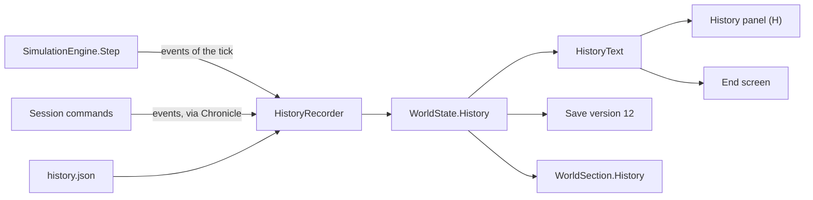

## Domains, holy sites and schisms

ADR-021 records the decisions, and the Milestone 15 plan
([.docs/milestone-15-polish-and-expansion.md](../.docs/milestone-15-polish-and-expansion.md)) the
numbers.

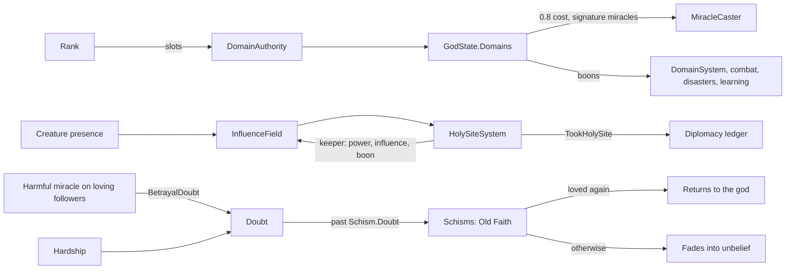

- A domain is taken up through its authority, as a player's intent or by the AI (its
  personality's preferred domains in order), and held for good.
- Holy sites are found in the land from the regions and settlements when a world is made.
  Influence decides who takes them: a Creature at a site adds its own, which is why AI gods send
  theirs to claim sites and to hold their own.
- An Old Faith sits outside the beliefs: `ComputeAdherenceChanges` leaves its share out of the
  people who can be converted, and a Sanctuary leaves its god's followers out of those who can
  fall away.

## Rivers, lakes and floods

ADR-022 records the decisions, and the plan
([.docs/milestone-15-part-2-water-and-law.md](../.docs/milestone-15-part-2-water-and-law.md)) the
numbers.

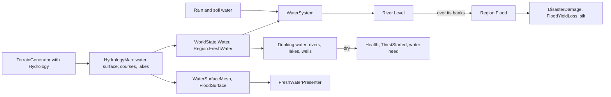

- The hydrology is derived from the seed and the settings like the heightfield, so a world saved
  before version 14 (no `Hydrology`) regenerates without rivers.
- Floods go through the same damage as quakes and fires, so Shields and Protection lessen them.
- Ocean feeds villages from the water regions around them; Justice calms their wish to leave
  and lets doubt fade; Tidal Wave and Judgement are their signature miracles.
- The client draws the rivers and lakes once from the `HydrologyMap`, and floodwater as the
  nearest water risen by the regions' floods, rebuilt when a flood changes visibly.

## Settlements' society

ADR-023 records the decisions, and the plan
([.docs/milestone-15-part-3-society.md](../.docs/milestone-15-part-3-society.md)) the numbers.

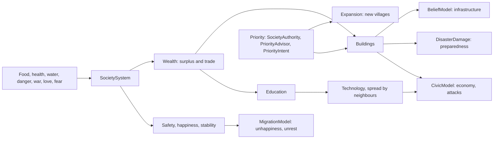

- The player sets a village's priority from the Settlements panel (N), through `SocietyCommands`
  (an intent for a joined player); AI gods through `PriorityAdvisor` at their evaluation interval.
- New villages join `WorldState.Settlements` with the next id and an unused name, and the
  settlement presenter adds their views on its next sync.

## Culture

ADR-024 records the decisions, and the plan
([.docs/milestone-15-part-4-culture.md](../.docs/milestone-15-part-4-culture.md)) the numbers.

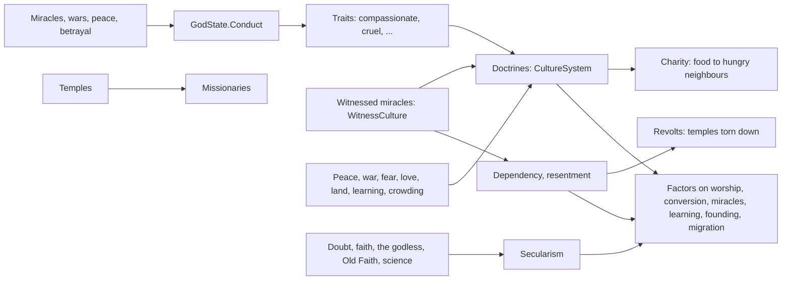

- The culture step runs after the society step, at the belief step's rate. Each factor is
  applied where the system it changes already computes: `BeliefModel.ComputePower`,
  `BeliefSystem`'s pull, `MiracleCaster.Witness`, `SocietySystem`'s learning, `Expansion` and
  `MigrationSystem`'s appeal.
- `MiracleCaster` and `DiplomacyAuthority` note acts in `GodState.Conduct`; traits are derived from
  it each step, and doctrines read a god only through its traits and domains.

## Treaties and the Divine Council

ADR-025 records the decisions, and the plan
([.docs/milestone-15-part-5-politics.md](../.docs/milestone-15-part-5-politics.md)) the numbers.

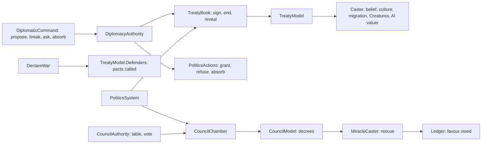

- Every treaty's effect is a query on `TreatyModel`, and every decree's on `CouncilModel`, made
  by the system it changes, so the systems stay independent of each other.
- Wars declared by treaties (joint wars, invoked pacts, war support, pantheon wars) go through
  the authority's one declaration of war, so betrayal of an ally, the victim's memory and broken
  treaties follow the same rules. Only a player's or AI's own declaration calls the victim's
  pacts.
- AI gods act through the same authorities as players: `TreatyAdvisor` and `CouncilAdvisor` run
  with the refugee and priority advisors at each AI evaluation.

## Sound and settings

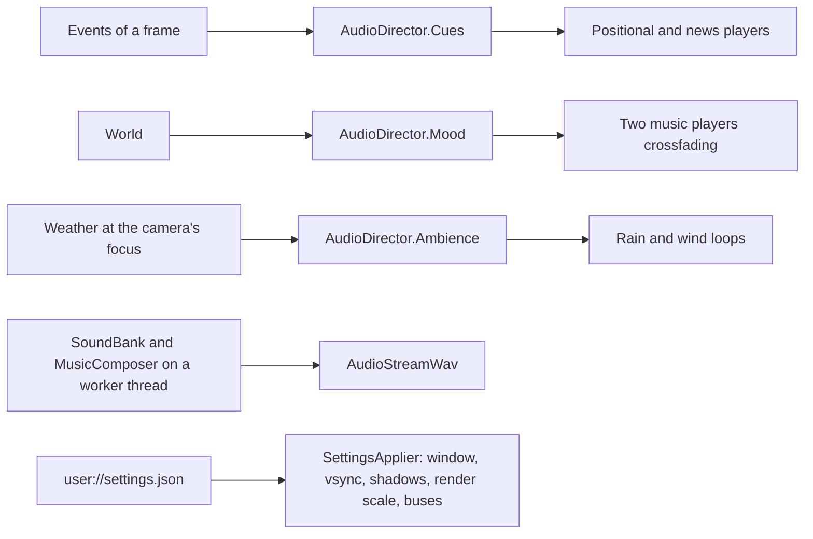

- Sounds of events play where they happen (`AudioStreamPlayer3D`, heard from far off at a
  low volume); the player's news plays everywhere. The same kind of sound starts at most every
  0.4 s.
- The music holds a mood at least 20 s and crossfades over 3 s.
- Settings apply at once from the menus' settings page; fewer citizens apply when the game next
  starts, since the settlement presenters are built with the count.

## Multiplayer

ADR-018 records the decisions, and the Milestone 12 plan
([.docs/milestone-12-multiplayer-foundation.md](../.docs/milestone-12-multiplayer-foundation.md))
has the measured run.

- **One canonical world.** The host's `GameSession` runs the simulation, as alone. A joining player
  takes over a god the AI played (controller `Remote`), and the AI leaves it alone.
- **Intents** (§73): a player's commands travel to the host as intents without a god. The host
  carries each out as the player's god through the same authorities as its own commands, and
  answers with a `Verdict`. Saving, loading, the clock and the debug tools are the host's alone.
- **Replication** (§95–96, ADR-019): the whole world when a player joins, for a new host world
  and as a correction every 20 s. In between, `Replicator` sends each `WorldSection` at its own
  rate when it changed:
  - Creature motion at 5 Hz near the player's view (`ViewFocus`) and 1 Hz elsewhere;
  - gods at 4 Hz;
  - migration at 2 Hz;
  - weather, disasters and the rivers (ADR-022) at 1 Hz;
  - settlements (with their society and culture, ADR-023 and ADR-024), whole Creatures, changed
    regions, the history and the holy sites every 2 s;
  - diplomacy when a status, proposal or memory changes.

  Secret treaties reach only their parties: while one exists the host strips the others' from the
  snapshot, the diplomacy section and the events it sends each player (`SecretFilter`, ADR-025).

  Every event goes out as it is raised, and the list of players when it changes. After an intent
  the sections it can change go out with the verdict. `WorldSections` writes a section in compact
  save JSON and applies it to a replica in place.
- **Replicas**: a player's session runs the same simulation between snapshots, only to predict.
  It discards its own events and takes each snapshot as its world.
- **Leaving** (§71): a departed player's god goes back to the AI; a host that quits tells its
  players and saves its world. A saved world loads with the AI playing every `Remote` god.

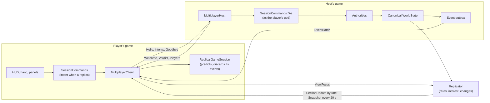

## Settlement simulation and population tiers

Population is simulated statistically everywhere and shown in more detail near the camera
(ADR-004, amended by ADR-008). Tier 1 is canonical; Tier 2 is derived from it and never saved.
Tier 3 (full agents with promotion and demotion that write back) comes in a later milestone.

### Tier 1: the statistical settlement step

`SettlementSystem` runs once every `StepIntervalTicks` ticks (10, so once per simulated second
at ×1). `IntervalSystem` runs it on the last tick of each interval, so `10 × n` ticks run
exactly `n` steps. Every rate in `settlement_rules.json` is per step. Each step, for each
settlement in list order:

1. **Farmland:** the land regions (not sea, fertility above 0) within `FarmlandRadius` regions
   of the settlement's region. They set the farming capacity and the yield.
2. **Labour:** `WorkforceShare` of the inhabitants work. When the settlement is crowded
   (`Population ≥ ConstructionStartCrowding × Housing`) or a house is under way, below
   `MaxHousing`, and the stores hold `ConstructionFoodReserveSteps` of consumption, some
   workers build (capped by share, by `BuildersPerSite` and by the work left); the rest farm.
3. **Food:** production grows with farmers with diminishing returns
   (`maxYield × (1 − e^(−farmers / capacity))`), times the blessing bonus and the water yield of
   the farmland's soil (ADR-013); consumption is `FoodPerPersonPerStep` per person. Stores keep what is left, up to `FoodStoragePerHousing` per unit of housing, and the
   rest spoils.
4. **Health:** falls in proportion to the unfed share while food runs short and recovers by
   `HealthRecoveryPerStep` when everyone is fed.
5. **Births and deaths:** Poisson draws from the saved `SimulationRandom`. Births need free
   housing, production covering consumption and stores of `SurplusFoodPerPerson` per person,
   and scale with health. Deaths have a baseline plus an ill-health term in `(1 − Health)²`.
6. **Construction:** builders add their work to `ConstructionProgress`. At `WorkPerHouse` the
   house is finished: `Housing` grows by `HousingPerHouse` and the progress resets.

The settlement acts on its own: the player never places houses. Health does not change the
workforce share; during a famine construction stops for want of food, so the builders go back
to farming, and deaths shrink the population until the land feeds it again. The formulas and
the measured balance are in the Milestone 2 plan
([.docs/milestone-2-living-settlement.md](../.docs/milestone-2-living-settlement.md)).

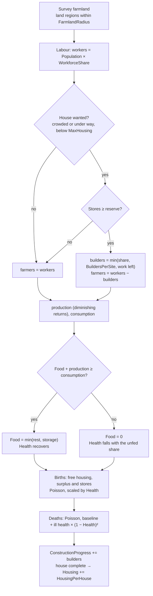

### Tier 2: representative citizens

When the camera comes within `RegionalTierEnterDistance` (450 m) of a settlement, the
settlement enters Tier 2 and shows `N = min(Population, MaxRepresentatives)` representatives
(300 at most), each standing for `Population / N` people. It returns to Tier 1 beyond
`RegionalTierExitDistance` (550 m); the gap keeps the tier from flickering. Tier 1 keeps
running for every settlement either way.

- `TierSelector` picks the tier from the camera distance. The tier is client-local
  presentation state, not `WorldState`.
- `RepresentativeRoster` derives the representatives from the aggregates, the layout and the
  world seed. Roles (builder, farmer, villager) follow `SettlementEconomy.AllocateLabour`, with
  both role boundaries rounded so every count is within one of its share. Each representative
  keeps a hash rank, so one more inhabitant changes at most two roles. Homes and fields come
  from rendezvous hashing over house indices and field slots, so a new house or field draws a
  share of the representatives and leaves everyone else in place. The hashes mix the seed, the
  settlement id and the representative index; no random stream is consumed.
- `CitizenRoutine` gives each representative a closed-form schedule in simulation time: rest
  by the door, walk to work (the fields, a ring around the building site, or chores near
  home), work with a forward lean per stroke, walk to the shrine, gather facing it, walk home.
  Walks bob once per stride.
- `SettlementCrowd` keeps the roster in step with the aggregates. It rebuilds the roster only
  when the role counts or the layout change, and bumps `RosterVersion` so the view recolours.
  Rerouted figures walk to their new routine at `CatchUpSpeed` instead of jumping; newcomers
  step out of their door; on promotion everyone appears in place.
- Representatives have no effects of their own: they show the work the aggregates already
  account for. Demotion has nothing to fold back, and saves, loads and new worlds rebuild them.

The tuning (distances, durations, speeds, colours, figure scale) is in the `Citizens` section
of `game/Data/settlement_view.json`.

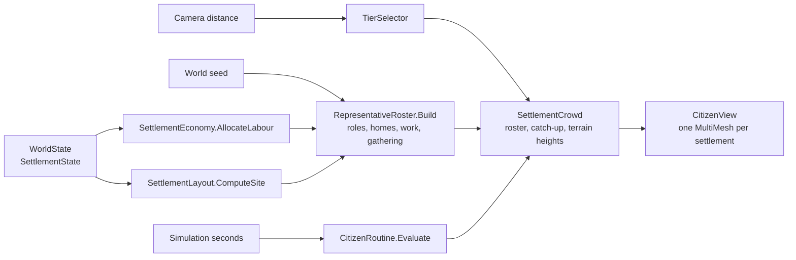

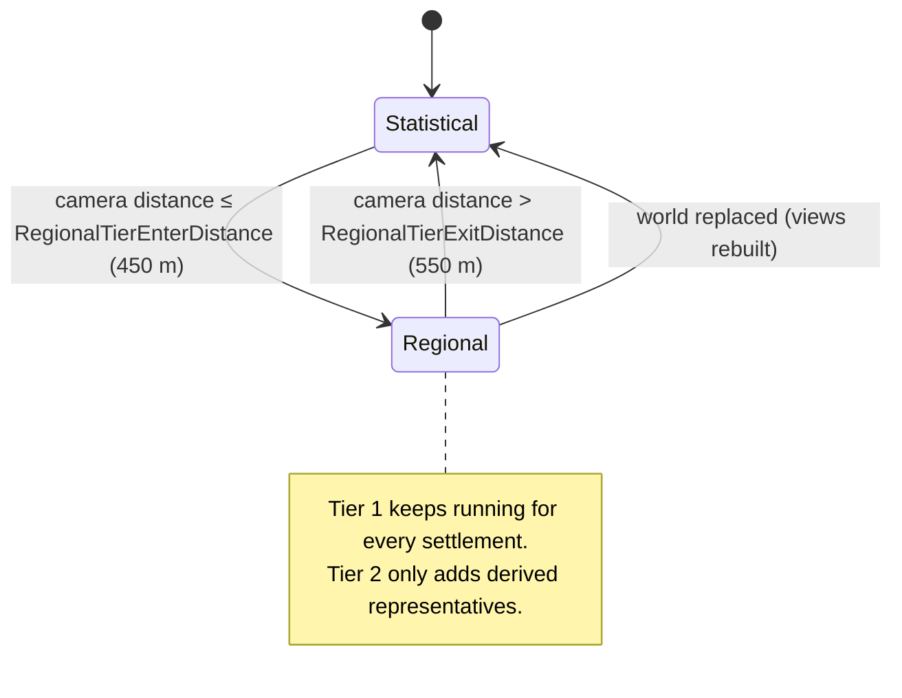

## Gods, belief and miracles

ADR-009 records the decisions; the Milestone 3 plan
([.docs/milestone-3-first-god.md](../.docs/milestone-3-first-god.md)) has the formulas and the
measured balance.

- **Belief step** (`BeliefSystem`, every `DivineRules.StepIntervalTicks` ticks, after the
  settlement step). For each settlement:
  - the conditions: hardship is the worse of ill health and hunger, and comfort is health × food
    security;
  - every belief drifts from its values before the step: Faith grows with worship, erodes with
    Doubt and is forgotten by non-followers; Love grows with comfort among followers, fades and
    wears down in hardship; Fear fades in safety; Doubt drifts towards a "silence" level and rises
    among followers in hardship;
  - each god converts part of the free share with a pull of `Faith × (base + Love + Fear) ×
    (1 − Doubt)` and loses followers with a push of `Doubt × (base + Fear) × (1 − Love)`; gains
    are scaled so the shares never pass 1;
  - crossing half of the people raises `FollowingChanged`.

  Then every god gains its worshippers' Divine Power and the rank its followers earn
  (`RankAchieved`), and blessings fade.
- **Worship** takes `WorshipWorkforceShare × devotion` of the workers out of the fields. Power per
  step is worshippers × intensity (rising with Love and more with Fear) × shrine ×
  `PowerPerWorshipperPerStep`.
- **Influence** is derived, never saved. Each settlement with followers is a source with strength
  `min(1, k × adherence × Faith)`, fading linearly to a reach that grows with √followers. Sources
  combine as `1 − Π(1 − i)`.
- **Miracles** (`miracles.json`): Food, Heal, Bless Crops, Lightning and Mass Healing.
  `MiracleCaster` checks the request:
  - in §73's order: god, miracle, issuer, rank, cooldown, world, influence, power;
  - the cost is `cost × (1 + factor × (1 − influence))`.

  When it accepts, it applies the effects to the settlements within `Radius + SettlementRadius`
  and to the regions within `Radius`. It changes the belief of everyone within that distance plus
  `WitnessRadius`: closer people feel more, Love scales with need, and strangers start to believe.
  It raises `MiracleCast`.

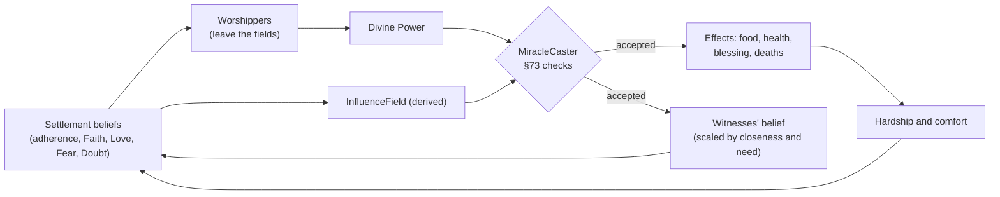

## The Creature

ADR-010 records the decisions, and the Milestone 4 plan
([.docs/milestone-4-creature.md](../.docs/milestone-4-creature.md)) has the tables of options and
deeds.

- **State machine** (`CreatureSystem`, every tick). Needs grow and health follows hunger and rest.
  Deciding picks an option at most every `DecisionIntervalTicks` (5 Hz). Travelling walks the
  path at the level's speed. Performing counts down and then applies the deed. Banished counts
  down to the Creature's return home.
- **Brain** (`CreatureBrain`). Options come from the Creature's needs and from each settlement
  within `PerceptionRadius`, classified as in need, building or thriving. Utility is learned
  preference × drive × personality × closeness, plus seeded jitter; the best reachable option
  wins.
- **Learning** (`CreatureAuthority`). A reward or punishment judges the current action, or the
  last one within `FeedbackWindowSeconds`. It moves the preference for that situation and action,
  the trait behind it and loyalty; a punishment also stops the action.
- **Deeds** (`CreatureDeeds`) change food, houses and population. They change the people's belief
  in the Creature's god and the Creature's morality, and they add experience and a memory. The
  Creature's presence carries its god's influence.

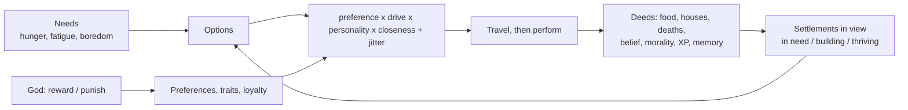

## Creature relationships

ADR-017 records the decisions, and the Milestone 11 plan
([.docs/milestone-11-creature-relationships.md](../.docs/milestone-11-creature-relationships.md))
has the rules with their shipped values and the measured runs.

- **Views** (`CreatureRelation`, one per Creature met, each side its own): friendship, fear,
  rivalry, respect and trust, the last meeting and the latest encounters. `CreatureBonds` holds the
  pure rules: the urges to fight, play and flee, what each encounter does to both views, and how
  views fade.
- **Meetings** (`CreatureMeetings`, on decision ticks): two free Creatures within `MeetRadius`
  meet once a cooldown. Each answers through `CreatureBrain.Respond`: preference × drive ×
  personality in the `MeetsCreature` or `MeetsEnemyCreature` situation (gods at war). The answers
  make a fight, a game, a greeting, a flight or nothing. Creatures in sight are also options in the
  brain's ordinary decisions, to seek or flee.
- **Combat** (`CreatureCombat`, every tick): blows by strength × combat skill with jitter from a
  stream derived from the seed and the tick. It ends in a banishment (scar, loyalty, experience,
  witnesses' belief, the god's `CreatureDefeated` memory), mercy, a draw or a broken-off fight.
- **Gods**: `GodAi` rewards fights with enemies' Creatures and play with allies', and at war may
  send its Creature against an enemy's Creature that threatens its people.

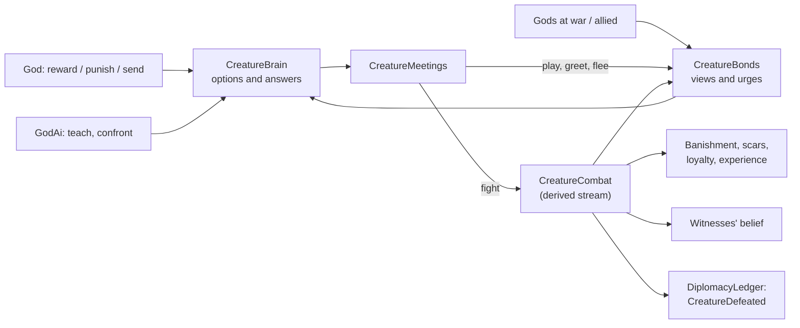

## Rival gods

ADR-011 records the decisions, and the Milestone 5 plan
([.docs/milestone-5-rival-god.md](../.docs/milestone-5-rival-god.md)) has the goal formulas and
the measured contests.

- **Homes** are spread out: the first god takes the best site, and each later god takes the free
  settlement furthest from the homes already taken.
- **The god AI** (`GodAi`, every 3 s) scores every allowed miracle on every settlement, sending its
  Creature, and waiting. A cast's value is the sum over the settlements it reaches of the
  personality's goals:
  - protect followers in need;
  - defend followers being courted;
  - convert others, more in hardship or doubt;
  - bless land;
  - intimidate rivals' followers.

  Utility is value × (1 − thrift × cost / power). The best candidate (plus jitter) goes through
  the authorities as the god itself, and the god then rewards or punishes its Creature's latest
  deed by its personality. Candidates keep their reasons for the debug view.
- **Competition.** People leaving a god follow the others by their pull, or no god by
  `ApostateFreedom`. A miracle plants doubt about the other gods its witnesses follow. Casting
  under a stronger rival's influence costs more.
- **Victory** (`VictorySystem`): 60% of all followers held for 600 s wins (`WinnerGodIds`,
  `VictoryAchieved`), and the world goes on. Allied gods count together (see
  [Four gods and pantheon victory](#four-gods-and-pantheon-victory)).

## Diplomacy

ADR-012 records the decisions, and the Milestone 6 plan
([.docs/milestone-6-diplomacy.md](../.docs/milestone-6-diplomacy.md)) has the tables of acts and
the AI diplomat's utilities.

- **Relations are directional**: what one god thinks of another (trust, fear, respect, rivalry,
  gratitude, suspicion) and the acts it remembers of it. **Status is shared** by the pair.
- **Acts are recorded where they happen.** `MiracleCaster` (help, courting, harm), `CreatureDeeds`
  (attacks), `BeliefSystem` (conversions) and `DiplomacyAuthority` (alliance, peace, war,
  betrayal) report to one `DiplomacyLedger`, which updates the observer's view at once and
  remembers the act.
- **The diplomacy step** (1 Hz) lets relations drift back to rest and memories fade (betrayal
  slowest), sets fear and respect from the balance of followers and ranks, lets proposals lapse,
  and turns pairs that are neither allied nor at war Friendly or Hostile by their warmth.
- **Decisions go through the authority**: alliance, betrayal, war and peace are commands, checked
  against status, waiting proposals and cooldowns. Breaking an alliance costs the betrayer every
  god's trust.
- **Status matters**: allies plant no doubt in each other's followers and do not raise each
  other's costs, and their AI and Creatures spare each other's people. At war, peoples resist the
  enemy where their own god leads, and AI gods and Creatures target the enemy more.
- **The AI diplomat** (`GodDiplomat`) answers proposals and weighs alliance, war, betrayal and
  peace by its view, the balance of followers, war-weariness and its personality.

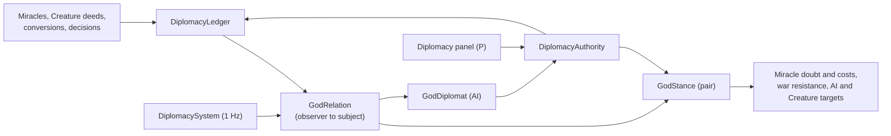

## Four gods and pantheon victory

ADR-015 records the decisions, and the Milestone 9 plan
([.docs/milestone-9-four-gods.md](../.docs/milestone-9-four-gods.md)) has the terms and the
measured politics.

- **Four gods**: the player and three AI gods (Tyrant, Guardian and Trickster in `gods.json`), each
  with a home and a Creature. Eight personalities have profiles in `god_ai.json`.
- **Blocs**: a god and every god allied with it, directly or through allies
  (`DiplomacyModel.BlocOf`). With `PantheonVictory`, a god's standing is its bloc's share when that
  is more than its own, so a bloc dominates and wins together; a god holding the share alone wins
  alone.
- **Allies remember**: a wrong done to a god is noted, at half strength, by each of its allies
  (`WrongedAlly`).
- **The AI diplomat weighs third gods**: a third god's lead draws two gods into alliance and away
  from war with each other; a leader draws war; the goodwill of a fresh peace or alliance holds war
  and betrayal back; near a joint victory a treacherous god that outweighs its ally may break away.

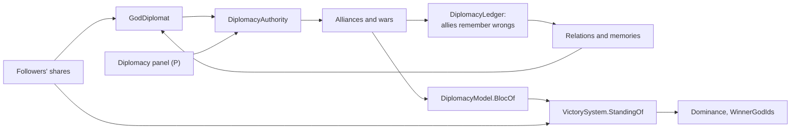

## Migration

ADR-016 records the decisions, and the Milestone 10 plan
([.docs/milestone-10-population-movement.md](../.docs/milestone-10-population-movement.md)) has the
rules with their shipped values and the measured runs.

- **Pressure and the wish to leave**: hunger, homelessness, danger, war, and followers' fear and
  doubt push a settlement's people out; love keeps them. Above a threshold the wish to leave
  (`SettlementState.Emigration`) builds, and once enough want to go a group sets out.
- **Groups** (`MigrationGroup`, §82) carry their people, beliefs, food and health along a route
  from the region pathfinder to the most appealing settlement they can reach. On leaving they
  give up gods they fear or doubt, in proportion.
- **Arrival**: the god followed most at the destination welcomes them, demands that they convert
  or turns them away, by its `RefugeePolicy`. The migrants' god remembers it (`Sheltered`,
  `Converted`, `TurnedAway`), and joining mixes beliefs by population, so the host's gods convert
  them over time.
- **Policies** are commands checked by `MigrationAuthority`: the player sets theirs in the
  diplomacy panel, and `RefugeeAdvisor` sets the AI gods' from their profiles, refusing migrants
  while their own followers lack room.

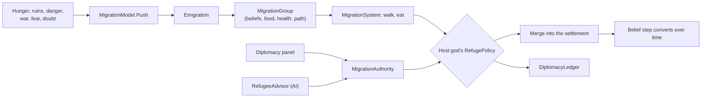

## Weather

ADR-013 records the decisions, and the Milestone 7 plan
([.docs/milestone-7-weather.md](../.docs/milestone-7-weather.md)) has the rules with their
numbers and the measured droughts and storms.

- **Cells** drift on the prevailing wind. Over the sea they take up water; over land they rain it
  out, their lows fill and they thin away. Rain, wind and lightning follow humidity, the depth of
  the low and warmth, and name the weather: clear, rain, thunderstorm or windstorm.
- **Spells** (normal, dry, wet) of seeded length set how often cells blow in and how stormy they
  are; the prevailing wind turns between them.
- **Soil water** per land region rises with rain, falls with warmth (faster in a dry spell) and is
  refilled slowly by springs. A settlement's drought follows its farmland's soil. It lowers the
  harvest and counts as hardship, so people worry before their stores run out.
- **Storms** ruin a share of the stores and building work of the settlements they cover.
- **Rain** (a miracle) calls a cloud over its target; AI gods call it where drought is deep.

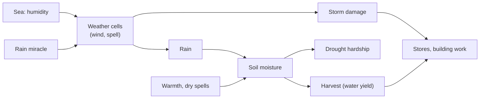

## Disasters

ADR-014 records the decisions, and the Milestone 8 plan
([.docs/milestone-8-disasters.md](../.docs/milestone-8-disasters.md)) has the rules with their
numbers and the measured fires and earthquakes.

- **Wildfires** live in the regions they burn. Flammability is vegetation × unscorched share ×
  dryness², so fire follows drought. Dry storms, villages' hearths, earthquakes and the Fire
  miracle light it. It grows on its fuel, scorches the land, spreads (more downwind), and dies in
  the rain, under a village's firefighting or for want of fuel. Scorched land yields less and
  regrows.
- **Earthquakes** are processes: a few seconds of shaking, fading with distance from the
  epicentre, that collapse houses into ruins, kill, spill stores and start fires.
- **Settlements respond**: they fight fires in their region and rebuild ruins at half the work;
  the homeless fall ill. Survivors fear their gods and doubt that the gods care, and danger counts
  as hardship.
- **Gods intervene** with Fire, Earthquake and Shield (protection from disasters for three
  minutes) and Rain (which quenches fire).

```mermaid
flowchart LR
    Dry["Dry land (ADR-013)"] --> Fire["Wildfire"]
    Sparks["Storms, hearths,<br/>quakes, miracles"] --> Fire
    Fire --> Scorch["Scorch: smaller harvests"]
    Fire --> Damage["Houses, people, stores"]
    Quake["Earthquake"] --> Damage
    Damage --> Ruins["Ruins, the homeless"]
    Ruins --> Rebuild["Rebuilding"]
    Damage --> Belief["Fear and doubt"]
    Shield["Shield"] --> Damage
    Rain["Rain, firefighting"] --> Fire
```

## Debug tools

Every system gets tools to see and drive it from the start (see [AGENTS.md](../AGENTS.md)).
The readouts are built by pure functions in `Pantheon.Game.Diagnostics` and only displayed by
the client.

- F1: the debug panel (hidden at the start), built by `DebugReadout` from a `DebugSnapshot`.
  `BeliefReadout` adds a line per god (power and income, rank, followers, next rank) and every
  god's influence under the cursor. The settlement nearest the cursor is shown in detail, with its
  belief conditions and each belief (followers, values, worshippers and the power they raise); the
  others get one line each. `SettlementReadout` adds, for the detailed settlement: population / housing, houses and health; food stored / storage with
  the net change per second, production and consumption; the jobs (farming, building, not
  working) and the farmland; expected births and deaths per second; the house under
  construction and the time to the next settlement step; the simulation tier, with the
  camera distance that changes it and, in Tier 2, the citizens shown and the people each
  stands for; and warnings when the settlement starves, construction waits for food or births
  are blocked. `SettlementEconomy.Assess` previews the next step without its random draws, so
  the panel shows rates rather than samples.
- B: the region grid and the hover outline (`RegionBoundaryOverlay`).
- F3: the region debug map. `RegionDebugMap.Build` turns one `RegionDebugLayer` (biome,
  elevation, temperature, moisture, fertility, vegetation, blessing or the local god's
  influence) into a `RegionDebugMapImage` with
  one RGBA8 pixel per region and a legend. Numeric layers use a dark-to-bright ramp from the
  lowest to the highest value; the region under the cursor is white and settlement regions are
  red. `GameRoot` rebuilds it only when the layer, the cursor region, the tick or the world
  changes, and `DebugOverlay.ShowRegionMap` displays it. The soil moisture layer follows the
  weather.
- `.`: `SessionCommands.StepTick` pauses the scheduler and calls `GameSession.StepOneTick`, the
  same engine call a scheduled tick makes. Stepping N times therefore equals N scheduled ticks,
  which `SessionCommandsTests` checks.
- `,`: `SessionCommands.StepSettlement` pauses and runs the ticks up to and including the next
  settlement step, so the panel shows what one step changed.
- F6 (`SpoilFood`) empties every settlement's food stores, and F7 (`AddSettlers`) grows every
  settlement by half (at least 10 people). Together they drive a famine: the stores run out,
  health falls, deaths rise and the settlement recovers once the land feeds it again.
- The F1 panel's Creature view (`CreatureReadout`, §106) shows its level, health, loyalty,
  morality and position, its activity, needs and personality, its best options with their
  utilities, its learned preferences and its latest memories. Since Milestone 11 it also shows
  each Creature's combat skill, scars and power, its view of every Creature it has met (friendship,
  fear, rivalry, respect, trust and the latest encounters), and how the player's Creature would
  answer the nearest one if they met now. K brings the nearest Creature beside the player's, and
  `--meet=on|<name>` does so at the start.
- The F1 panel's god AI view (`GodAiReadout`, §106) shows each AI god's personality, its goal now
  (its best candidate) and its top three candidates with utilities and reasons, followed by its
  diplomatic candidates and the factors behind them.
- P: the diplomacy panel shows each rival's status, its alliances and wars with the other gods,
  its attitude and memories, and drives every diplomatic move. `--diplomacy-panel=on` opens it in scripted runs.
- The F1 panel's weather lines (`WeatherReadout`, §106) show the spell and its time left, the wind,
  the strongest cells with their state, the soil and weather under the cursor and the selected
  settlement's water and yield. F8 starts the next spell (normal, dry, wet), F10 calls a storm at
  the cursor, and `--weather=normal|dry|wet|storm` sets either up at the start.
- The F1 panel's disaster lines (`DisasterReadout`) list the earthquakes under way, the fiercest
  fires and the selected settlement's dangers (fire threat, shaking, ruins, homeless, scorched
  land, shield). F3 has fire and scorch layers, the Danger overlay shows fires, ash and shields,
  F11 starts an earthquake and F12 a fire at the cursor, and `--disaster=quake|fire` starts one at
  the focused settlement.
- The F1 panel's migration lines (`MigrationReadout`, §106 "migration routes") list the groups on
  the road (size, way, cause, food, health, the god they follow), every god's refugee policy with
  the AI's reason, and the selected settlement's pressure, cause and people wanting to leave. The
  Migration overlay shows the routes, M sends 20 people out of the village under the cursor,
  `--migrate=<n>` sends n out of the focused village and `--refugees=welcome|convert|turnaway`
  sets the player's policy.
- F4 (`GrantPower`) gives the player's god 500 Divine Power.
- O cycles the player map overlays (influence, religion, faith, food, weather, danger, migration),
  which double as debug views.
- Launch options and `SmokeTestDriver` for reproducible and scripted runs. `--advance-ticks=<n>`
  runs n ticks before the first frame and `--camera-distance=<m>` sets the starting camera
  distance, so a grown settlement can be captured up close. `--divine-power`, `--cast`,
  `--select`, `--overlay`, `--focus` (a settlement or `creature`), `--judge` and `--debug-panel`
  script captures of casting, targeting, overlays and the Creature; in scripted runs the cursor falls back to the screen centre. Unattended runs end with a
  one-line summary per settlement (`DebugReadout.Summarize`), including its tier and the
  citizens shown.

## Save and load flow

```mermaid
sequenceDiagram
    participant Player
    participant Root as GameRoot
    participant Cmd as SessionCommands
    participant Session as GameSession
    participant Save as WorldSaveSerializer
    participant Mig as SaveMigrations
    participant Gen as TerrainGenerator
    participant View as WorldPresenter

    Player->>Root: F5 (quicksave)
    Root->>Cmd: QuickSave(session, path)
    Cmd->>Session: SaveTo(path)
    Session->>Save: SaveToFile(world)
    Player->>Root: F9 (quickload)
    Root->>Cmd: QuickLoad(session, path)
    Cmd->>Session: LoadFrom(path)
    Session->>Save: LoadFromFile(path)
    Save->>Save: ReadSaveVersion(json)
    alt version 12 (current)
        Save->>Save: deserialize (strict)
    else versions 1 to 11
        Save->>Mig: Upgrade(json, version)
        Mig-->>Save: JsonObject at version 12, one step at a time (1→2: health, construction; 2→3: player god, beliefs, blessings; 3→4: Creatures; 4→5: personalities, dominance, winner; 5→6: diplomacy; 6→7: weather, soil water; 7→8: disasters, fire, scorch, ruins, shields; 8→9: winners; 9→10: migration, refugee policies; 10→11: Creatures' skill, scars and views; 11→12: history)
        Save->>Save: deserialize (strict)
    else missing, unsupported or newer
        Save-->>Session: SaveFormatException
    end
    Save->>Save: SaveIntegrity.Validate(world)
    Session->>Session: gods a connected player played (Remote) go back to the AI
    Session->>Gen: Generate(seed, generation settings)
    Session-->>Root: WorldReplaced
    Root->>View: Rebuild(world, terrain)
    Cmd-->>Root: status line (or the error, with the current world kept)
```

## World generation and terrain backends

```mermaid
flowchart TD
    Seed["WorldSeed + WorldGenSettings"] --> TG["TerrainGenerator<br/>FastNoiseLite layers"]
    TG --> TF["TerrainField<br/>height / moisture / temperature / biome"]
    TF --> RB["RegionBuilder<br/>32x32 regions"]
    RB --> SF["SettlementFounder"]
    SF --> WS["WorldState"]
    TF --> TPF{"ClassDB has Terrain3D?"}
    TPF -- yes --> T3["Terrain3DTerrainPresenter<br/>import_images(height, -, colour)"]
    T3 --> SP["Terrain3DShaderPatch<br/>bounds-safe region lookups,<br/>edge-safe colour lookup"]
    TPF -- "no, or --terrain=fallback" --> FB["FallbackMeshTerrainPresenter<br/>(clearly marked, with reason)"]
```

Default world: 1024 × 1024 height samples at 2 m spacing (a 2048 m island), 32 × 32 regions of
64 m, sea level at 0 m. The biome set is Sea plus three land biomes: Grassland, Forest and Highland.

## Determinism

- World generation is a pure function of `(WorldSeed, WorldGenSettings)`.
- Tick results are a pure function of `WorldState` (including RNG state) and the content, and a
  cast is a pure function of the world, the request and the content; the belief step and the
  caster draw no random numbers. The weather and disaster steps draw from streams seeded by the
  world seed and the tick, so they need no saved state and never shift the shared stream
  (ADR-013, ADR-014).
  The settlement step's births and deaths draw from the saved `SimulationRandom` in settlement
  list order, so a run continues identically across a save and load.
- Presentation never consumes a simulation random stream. The settlement layout and the Tier 2
  roster use `PresentationHash` of the seed, the settlement id and a slot or index, and the
  routines are functions of simulation time. The same world, tick and camera therefore show the
  same houses, fields and citizens on both renderers.
- Guaranteed per platform and runtime. Bit-exact cross-platform determinism is not required,
  because networking will be host-authoritative (ADR-003).

## Testing

- `src/Pantheon.Tests` (xUnit) covers determinism, save/load round trips, save versioning and
  the version 1 → 2 migration (against a save written by the Milestone 1 build, kept in
  `Persistence/Fixtures/save-v1.json`), RNG, the scheduler and the settlement step cadence,
  the settlement rules and step (starvation, recovery, growth up to housing, construction when
  crowded, storage), the raycaster, the camera model and edge scrolling, session commands
  (including the single-tick and settlement steps, F6 and F7), content parsing, launch options,
  presentation helpers and the settlement layout, the Tier 2 roster, routines, tier selection
  and crowd (including that it never changes the world), the debug readouts and region debug
  map, and the Terrain3D shader patch. Since Milestone 3 it also covers the belief rules and
  step, influence, every miracle check and effect, the session as the authority, the HUD model,
  alerts, overlays, the version 2 → 3 migration (against `save-v2.json`, written by the
  Milestone 2 build) and several settlements. Since Milestone 4 it covers the Creature's
  learning, brain, deeds, banishment, commands and navigation, and the version 3 → 4 migration
  (against `save-v3.json`, written by the Milestone 3 build). Since Milestone 5 it covers conversion
  between gods, contested costs, rival doubt, the god AI's choices for each personality, dominance
  and victory, and the version 4 → 5 migration (against `save-v4.json`). Since Milestone 6 it
  covers relations, acts and memory, status changes, betrayal, war and peace through the
  authority, the effects of status, the AI diplomat, the diplomacy panel and the version 5 → 6
  migration (against `save-v5.json`). Since Milestone 7 it covers the weather rules and step,
  spells, soil water, droughts and storms, the Rain miracle and the AI's use of it, the weather's
  presentation and tools, and the version 6 → 7 migration (against `save-v6.json`). Since
  Milestone 8 it covers earthquakes, wildfires, destruction, ruins, the settlements' response, the
  Fire, Earthquake and Shield miracles and the AI's use of them, the disasters' presentation and
  tools, and the version 7 → 8 migration (against `save-v7.json`). Since Milestone 9 it covers
  blocs and pantheon victory, allies' memory, the AI diplomat's coalition, balance, goodwill and
  endgame terms, the new personalities, the four-god presentation, and the version 8 → 9 migration
  (against `save-v8.json`). Since Milestone 10 it covers migration's pressure, abandonment, appeal,
  conversion and merging, the migration step from leaving to arriving, refugee policies for the
  player and the AI, migration's presentation and tools, and the version 9 → 10 migration
  (against `save-v9.json`). Since Milestone 11 it covers the Creatures' views and urges,
  meetings, play, flight, betrayal, fights and their outcomes, the AI's teaching and confronting,
  their presentation and tools, and the version 10 → 11 migration (against `save-v10.json`). Since
  Milestone 12 it covers the protocol and its codecs, the loopback transport, a host and its players
  over the loopback (joining, refusals, intents and verdicts, snapshots, events, leaving), and the
  multiplayer launch options and readouts. Since Milestone 13 it covers every world section's trip
  into a replica, the sections' rates, change detection, interest, intents reaching players with
  their verdicts, replicas staying with the host, four players, and players coming back to their
  gods. Since Milestone 14 it covers the world's history, the end screen, the guide, the save
  list, eligible pantheons and the version 11 → 12 migration (against `save-v11.json`). The tests
  load the shipped `game/Data/*.json`; rule tests
  pin their own rules (`SettlementWorlds.Rules`, `DivineWorlds.Rules`, `DiplomacyWorlds.Rules`,
  `WeatherWorlds.Rules`, `DisasterWorlds.Rules`, `MigrationWorlds.Rules`)
  so retuning the data does not change their meaning.
- `ArchitectureRulesTests` checks the rules that can be checked mechanically: the layering
  above, no Godot reference in core projects, no unseeded randomness or clock in core
  assemblies, and Windows, macOS and Linux libraries (debug and release) in every vendored
  GDExtension.
- The Godot client is verified by building the solution and running the main scene, headless
  and windowed. `--quit-after-frames=<n> --screenshot=<file>` gives a scripted smoke run that
  saves a frame capture.

## Extending (later milestones)

- New simulation features add state to `Pantheon.Domain`, systems to `Pantheon.Simulation`
  (registered in `SimulationEngine`, wrapped in an `IntervalSystem` when they step less often
  than every tick), and presenters to `game/Scripts/Presentation`.
- Breaking changes to the save shape bump `WorldSaveSerializer.CurrentSaveVersion` and add a
  `SaveMigrations` step from the previous version, tested against a save written by the
  previous build.
- The step, the layout, the tiers and the views iterate over every settlement, and world
  generation founds eight. Four gods share them since Milestone 9; more gods are more entries in
  `gods.json` (and god colours in `divine_view.json`), as the AI, belief, diplomacy and victory
  rules handle any number.
- Tier 3 adds agents with effects and promotion and demotion that write back to the
  aggregates; the milestone that adds it amends or supersedes ADR-008.
